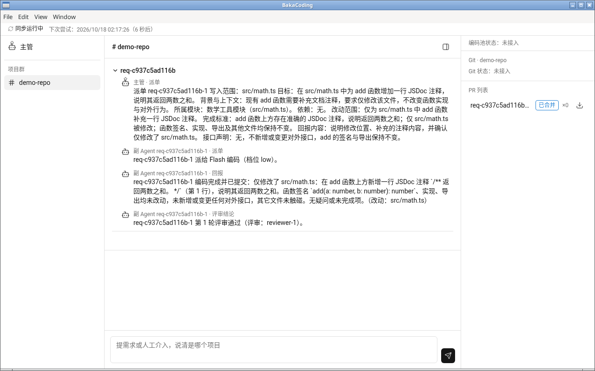
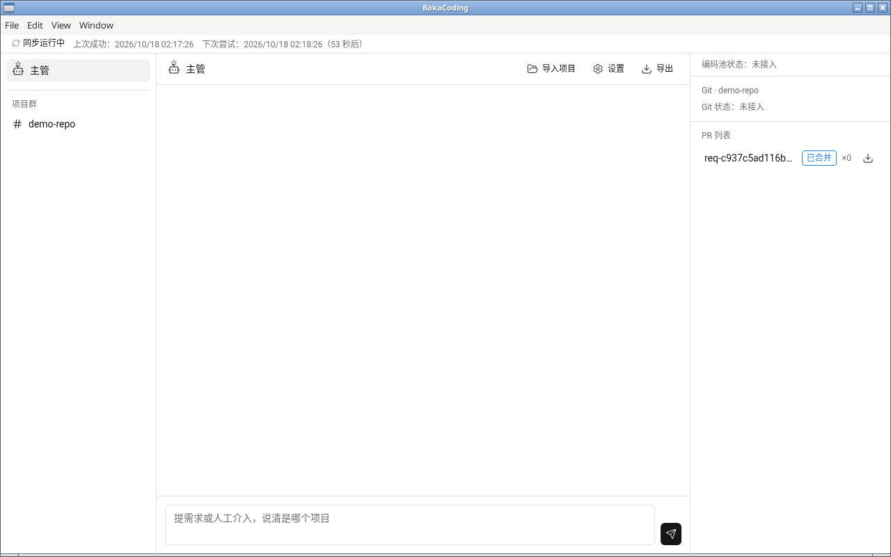
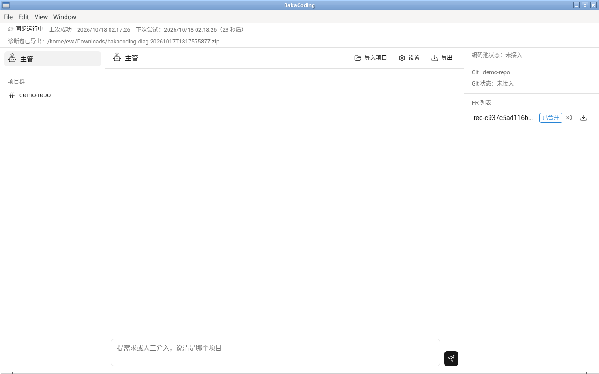

<div align="center">


# BakaCoding

### 笨蛋编程助手

**用并发的 Flash 编码池，帮个人开发者推进大型软件工程。**

评审把关和受控合并，测试与 CI 交给用户现有工具。

[整体设计](docs/product-design.md) · [功能模块](docs/modules.md) · [开发进度](docs/progress.md) · [参与讨论](https://github.com/Akarin7784/BakaCoding/issues)

[](LICENSE)

</div>

> **1.0.0-preview 是预览版**（GitHub 上标为 pre-release）。整条流水线的效果还没有在真实项目上实测，文中提到的默认值都是初始值，待实测。

## 项目是什么

BakaCoding 帮个人开发者推进大型软件工程。核心是 **Flash 编码池**：多个高速 Flash 模型以低思考档位并发编码。多个旗舰模型组成**评审组**，其中必填的**主管模型**负责拆单和最终裁决，其余成员组成评审池，只做 PR 评审。每张需求单配一个**副 Agent**，负责开 PR、评审和复投。通过评审的 PR 经**合并队列**有序合并。

用户只对接主管 Agent。BakaCoding 不跑编译、lint 或测试，也不管 CI runner；测试和 CI 交给你仓库里已有的工具。



*三栏主界面：左栏对话列表，中间是项目群，右侧边栏显示编码池状态、Git 区和 PR 列表（图里有一张已合并的单）。*

## 核心设计

```
用户 ⇄ 主管 Agent（评审组，主管固定最高思考档）
   │ 拆成写入范围互不重叠的需求单
   ▼
每张需求单 → 一个副 Agent
   ├─ 按单设计 Flash 权限 → 临时 Flash 代理（写完即销毁）→ 补丁
   ├─ 推到工作分支并开 PR（或建本地 PR 记录）→ 一次评审
   └─ 不通过 → 带评审意见原地复投（评审不过最多 3 次）
                 │ 通过
                 ▼
     合并队列：排队 → 按依赖顺序 → 合并前检测冲突 → 合入集成分支
                 │
                 ▼
     合入 main 前：主管审集成分支整体 diff；配了 CI 的须读到集成分支为绿
```

### Flash 编码池

- 每张需求单临时开一个 Flash 代理，写完即销毁，不共享会话状态。
- 默认思考档 `low`，可按项目或单次运行配置；档位取值 `off` / `low` / `high` / `max`。默认模型是 DeepSeek V4.1-Flash（`deepseek-flash`）。
- Flash 只拿到五个基础文件工具：`read`、`write`、`edit`、`glob`、`grep`。不给 shell、网络和 git，不执行代码；密钥和 `.env` 类文件不放行。
- 每单一个 Git worktree，路径为 `.bakacoding/worktrees/<ticket_id>-r<n>`（`n` 为轮次）。
- 编码并发默认上限 8，硬上限 64（初始值，待实测）。

### 副 Agent

- 一张需求单配一个副 Agent：写编码提示词，按单设计 Flash 的权限（读写 / 只读 / 拒绝三级，默认全部拒绝，写权限只能在本单写入范围内）。
- 负责开 PR，并发起**一次评审**。评审输入固定为「diff + 需求单 + 精简摘要」。
- 你的仓库配了 GitHub CI 时，可以读取 check 结果，失败算不通过。
- 不通过就带着评审意见原地复投：评审不过最多 3 次，超限上报主管重拆；同一需求重拆最多 2 次，仍不过就交给你。复投默认自动升档：第 1 次仍用 `low`，第 2、3 次用 `high`。
- 依赖类需求单（改依赖清单、锁文件）标为高风险，需要你在界面上放行或拒绝。

### 统一合并队列

- 只做三件事：排队、按依赖顺序合并、合并前检测冲突。接口变更先合，消费方在新基线上开工。
- 有冲突就基于最新集成分支复投，最多 2 次；副 Agent 不自己解冲突。
- **反压**：评审积压超过评审容量 2 倍时编码并发减半，超过 4 倍时暂停派新单；主管待办积压、待合并 PR 过多、预算触顶也会暂停或降并发（阈值均为初始值，待实测）。
- 默认合入集成分支。合入 main 由 `pipeline.main_merge` 决定：`user`（默认，主管通知你自己合）或 `supervisor`（检查通过后由主管合入）。
- **v1 不跑 CI**。CI 和远程 git 由你自己配置；BakaCoding 只读取 GitHub check 结果。

### 评审组和主管

- 不设单一主 Agent，由多个模型组成评审组。正式使用建议用旗舰模型，配置里可以换。
- **必须指定一个主管模型**：缺失时配置校验报错、不启动。主管固定用最高思考档（`max`）；模型没有 `max` 档时用它能用的最高档，启动时提示一次。
- 主管负责拆单和最终裁决（上报的单、高风险 PR、合入 main 前的集成分支审查），不写代码。
- 评审池默认 2 个成员，按负载分配，复投的单仍交给原来的模型，被限流的模型自动跳过；成员数为 0 时由主管兼任评审。
- 开发阶段所有角色都用 DeepSeek Flash，用思考档位、角色提示词和权限区分角色。目前只接入了 DeepSeek，其他服务商以后通过适配层接入。

## 模块地图

四层共 13 个模块，下层不依赖上层，模块之间通过进程内事件总线解耦。另有共享类型包 `@bakacoding/types` 和组合根 `@bakacoding/app`，二者都不算功能模块。详见 [docs/modules.md](docs/modules.md)。

| 层 | 模块 | 包 | 一句话 |
| --- | --- | --- | --- |
| 底层 | 0 事件总线 | `event-bus` | 进程内发布和订阅，只传递事件，不落库。 |
| 底层 | 1 模型接入层 | `model-gateway` | 适配 Anthropic 兼容和 OpenAI 兼容接口（DeepSeek 默认走 Anthropic 兼容），负责限流、计费和思考档位映射。 |
| 底层 | 2 存储与事件日志 | `storage` | SQLite（WAL），单一写入者加租约；订阅全部事件落库，保存 PR 记录、合并结果和决策记忆。 |
| 底层 | 3 配置与预算 | `config-budget` | 配置严格校验、读密钥、预算台账、脱敏函数、项目导入和提示词模板。 |
| 底层 | 4 工作区与受限工具层 | `workspace` | 每单建 Git worktree，提供五个受限文件工具和三级权限清单。 |
| 执行层 | 5 Flash 编码池 | `coder-pool` | 临时 Flash 代理的生命周期，提示词公共前缀逐字节固定以命中缓存。 |
| 执行层 | 6 PR 抽象 | `pr` | 一套接口两种实现：有 GitHub 时开真 PR，否则只建本地 PR 记录；读 CI check。 |
| 执行层 | 7 评审池 | `review-pool` | 按负载分配评审，对照需求单审 diff，给出评审结论。 |
| 编排层 | 8 副 Agent | `sub-agent` | 一单一个：写编码提示词、设计 Flash 权限、发起评审、驱动复投。 |
| 编排层 | 9 调度器与合并队列 | `scheduler` | 写入范围锁和独占区域、依赖排序、合并前冲突检测、反压、定时同步 GitHub。 |
| 编排层 | 10 主管 | `supervisor` | 用户的唯一对接方：对话、拆单、处理上报、裁决高风险 PR、审查集成分支和合入 main。 |
| 外围 | 11 诊断包导出 | `diagnostics` | 按单、需求或时间段导出 zip（JSONL + 原始文件），导出前完整脱敏，可转 SWE-bench 风格 JSONL。 |
| 外围 | 12 桌面界面 | `desktop` | Electron + React 三栏对话界面（electron-vite-react、shadcn/ui、lucide）。 |

## Windows 下载与运行

1. 到 [GitHub Releases](https://github.com/Akarin7784/BakaCoding/releases) 找到 `v1.0.0-preview`（pre-release），下载 Windows x64 免安装包 `BakaCoding-1.0.0-preview-win-x64.zip`。
2. 解压到任意目录，运行其中的 `BakaCoding.exe`。不需要安装。安装包没有做代码签名。

   > **待真机验证**：exe 没有签名，首次运行时 Windows SmartScreen 可能会拦截，一般点「更多信息」→「仍要运行」即可放行。这一步还没在真实 Windows 上确认过，真机冒烟后会更新这里。
3. 运行前需要：
   - 本机装好 Git，并能在命令行里直接运行 `git`（BakaCoding 用 git 命令建 worktree、读 diff）。
   - 设好下一节的环境变量。
   - 在要处理的仓库里准备两份配置（见下文「配置文件」）。

安装包基于 Electron 43.8.0。`BakaCoding.exe` 带机器人图标，文件属性里的产品版本（ProductVersion）是 `1.0.0-preview`。

启动时缺少 `DEEPSEEK_API_KEY`、配置校验失败，或者数据库被别的进程占用，界面会退到**只读模式**，并在顶部显示原因（只显示变量名或错误名，不显示值）。只读模式下可以查看项目群、PR 和同步状态，但不能和主管对话、不能裁决高风险 PR、不能导出诊断包。修好原因后可以重启程序，或者用「导入项目」换到一个能正常启动的仓库。



*顶部同步状态行（正常状态）：显示「同步运行中」、上次成功时间和下次尝试时间。*

## 使用桌面端

主管对话页顶部有三个按钮：「导入项目」「设置」「导出」。

### 和主管对话

主管对话页底部的输入框（提示文字「提需求或人工介入，说清是哪个项目」）会把消息发给主管。按 Enter 发送，Shift+Enter 换行。一次只能发一条，等主管回复时显示「主管思考中…」，发送按钮暂时不能点。单条消息最多 20000 字。选中某个项目时，项目群下方也有一个主管对话框，消息会带上这个项目。

### 导入项目

点「导入项目」，选择要处理的仓库目录。BakaCoding 会按顺序检查：

1. 目录必须是 git 仓库（有 `.git`）。
2. 配置文件存在且能通过校验：`config/models.json`（或下面说的 `--config` / `BAKACODING_CONFIG` 指定的文件）和 `config/pricing.json`。
3. 当前仓库里没有进行中的需求单，也没有等你裁决的高风险 PR。否则会提示「还有 N 张单在进行中，完成后再切换项目」，等它们完成后再切换。

检查通过后，BakaCoding 停掉当前仓库的后端，在新仓库上重新启动，界面重新加载。新仓库没能启动时，会先尝试回到原来的仓库；原仓库也起不来，就进入只读模式，并提示你重启程序。

**配置从哪里来**：启动参数 `--config <路径>` 优先于环境变量 `BAKACODING_CONFIG`（设成空字符串等于没设）。指定了其中一个时，导入只校验它指向的那个文件，不看所选仓库里的 `config/models.json`；`config/pricing.json` 仍然要在所选仓库里。导入结果会写明配置来源，例如「当前使用 --config 指定的配置：<路径>」。

**仓库路径从哪里来**（启动时）：`--repo <路径>` > `BAKACODING_REPO` > 上次在界面里导入的路径 > 当前工作目录。上次导入的路径记在 Electron 的用户数据目录里（Windows 上是 `%APPDATA%\BakaCoding\desktop-state.json`）。

**什么时候不能在界面里导入**：用 `--repo` 或 `BAKACODING_REPO` 指定了仓库，或者 `--db` / `BAKACODING_DB_PATH` 是绝对路径（所有仓库会共用一个库）时，点「导入项目」会直接提示「仓库已被启动参数 / 环境变量锁定（--repo、BAKACODING_REPO，或绝对路径的 --db、BAKACODING_DB_PATH），不能在界面里切换项目」，不会弹出目录选择框。库路径是相对路径时不锁，它在每个仓库里各自解析。`--db` 优先于 `BAKACODING_DB_PATH`。

### 导出诊断包

点「导出」，导出**当前仓库最近 24 小时**的诊断包（zip），导出前完整脱敏。

- 保存框默认打开「下载」文件夹，默认文件名是 `bakacoding-diag-<UTC 时间>.zip`，例如 `bakacoding-diag-20261018T000000000Z.zip`。
- 保存位置不能在仓库目录里。选到仓库里面时直接拒绝，不会重新弹出保存框，也不写任何文件，界面顶部提示「导出失败：不能把诊断包保存到仓库目录里，请换个位置」。要换位置，重新点「导出」。
- 选中的文件是符号链接时，同样拒绝，提示「导出失败：保存位置是符号链接，请换个位置」。
- 只读模式下不能导出：点「导出」不会弹出保存框，直接提示「导出失败：只读模式：」加原因（例如「导出失败：只读模式：配置校验失败（ConfigError）」），不写文件。

### 设置

「设置」打开只读的设置页，显示：

- 当前仓库路径。
- PR 模式：「GitHub 模式」（开真 PR）、「本地模式」（只建本地 PR 记录）或「只读」（后端处于只读模式）。
- 环境变量 `DEEPSEEK_API_KEY`、`GITHUB_TOKEN`、`BAKACODING_REPO`、`BAKACODING_CONFIG`、`BAKACODING_DB_PATH` 是「已设」还是「未设」。只显示是否已设，不显示值。

设置页不能改配置；改环境变量后要完全关掉程序再打开才生效。

## 环境变量

| 变量 | 是否必需 | 说明 |
| --- | --- | --- |
| `DEEPSEEK_API_KEY` | 必需 | DeepSeek 的 API key。只从环境变量读，安装包和配置文件里都不带。缺了就退到只读模式。 |
| `GITHUB_TOKEN` | 可选 | GitHub token。设了且仓库的 `origin` 在 github.com 上，才推分支、开真 PR；没设时只建本地 PR 记录，不连 GitHub。 |
| `BAKACODING_REPO` | 可选 | 要处理的仓库路径。优先级：`--repo <路径>` > `BAKACODING_REPO` > 上次在界面里导入的路径 > 当前工作目录。设了它（或 `--repo`）就不能在界面里导入别的项目。 |
| `BAKACODING_CONFIG` | 可选 | 模型配置文件路径。`--config <路径>` 优先于它；空字符串按未设；都没设时用 `<仓库>/config/models.json`。相对路径相对仓库目录。 |
| `BAKACODING_DB_PATH` | 可选 | 数据库路径。`--db <路径>` 优先于它；默认 `<仓库>/.bakacoding/bakacoding.db`。相对路径相对仓库目录；绝对路径会锁定界面导入。 |

注意：

- Windows 上设好或改了环境变量后，要把 BakaCoding **完全退出再重新打开**才会生效。
- 设了 `GITHUB_TOKEN` 但 token 无效或没有权限（GitHub 返回 401 / 403）时，顶部同步状态会显示「同步已停止」，并提示「鉴权失败，同步已停止，请检查 GITHUB_TOKEN」。
- 不要把任何 key 或 token 写进仓库。BakaCoding 不读 `config/secrets.local.json`，key 只从环境变量读。

### 配置文件

在要处理的仓库里准备：

- `config/models.json`（也可以用 `--config` / `BAKACODING_CONFIG` 放到别处）：从本仓库的 [`config/models.example.json`](config/models.example.json) 复制后修改。配置严格校验，未知字段直接报错。两项必填，缺了不启动：
  - `roles.supervisor`：主管模型，`effort` 固定为 `max`。
  - `budget.daily_micro_usd`：每日预算，单位是整数微美元（1 美元 = 1,000,000 微美元）。示例里的值只供参考，请按自己的情况填写。
- `config/pricing.json`：单价表和优惠时段，可以直接复制本仓库的 [`config/pricing.json`](config/pricing.json)。

## v1 已知限制

完整清单见 [docs/progress.md](docs/progress.md) 的「已知缺口」。主要几条：

- **Windows 包还没在真实 Windows 上跑过**：目前只在 Linux 上做过打包和冒烟（**待真机验证**：在真实 Windows 上冒烟后会更新或删去这一条）。
- **只支持默认分支叫 `main` 的仓库**：v1 的基线分支固定为 `main`，配置文件、环境变量和启动参数都不能改。默认分支叫 `master` 或其他名字的仓库，第一张单合入时会失败。以后会改成自动识别仓库的默认分支。
- **右侧 PR 列表里每条 PR 后面的导出按钮还没接通**：现在只能用主管对话页顶部的「导出」，导出当前仓库最近 24 小时的诊断包，界面上还不能按单张需求单或单个需求导出。
- **设置页只读**：只能查看，不能在界面里改配置或环境变量。
- **切换项目会丢进程内状态**：切换前必须没有进行中的单和待裁决的高风险 PR；暂存的对话上下文等内存状态在切换后丢失。
- **不跑 CI，不执行代码**：Flash 和副 Agent 都不执行代码，BakaCoding 不跑编译、lint 和测试。质量全靠一次模型评审，集成分支仍可能出现只有构建才能发现的问题。
- **不做验收**：诊断包用于排查问题和离线分析，不是验收。
- **数值都待实测**：评审判不过的门槛、并发上限、反压阈值、复投升档等都是初始值；集成审查的 diff 截断上限 `INTEGRATION_DIFF_MAX_CODEPOINTS` = 200000 码点，没有实测依据，待实测。
- **只接入 DeepSeek**：其他服务商以后通过适配层接入。
- **一次只处理一个仓库**：一次组装对应一个仓库。
- **部分状态只在内存里**：1:1 对话历史、高风险 PR 的放行、接口变更说明、关 PR 的重试等只在进程内，重启后会丢或要重新处理（例如重启后高风险 PR 会重新扣住，要再放行一次）。
- **独占区域偏严**：任意子目录里的 `package.json` 和锁文件都算独占区域，monorepo 里各子包改依赖的单只能排队。
- **复制检测没有用**：diff 只用 `git diff -M`，复制出来的文件按新增文件处理。
- **架构约束为空**：组合根里的 `architectureConstraints` 目前固定返回空列表，评审时不带项目架构约束。
- **定时同步**：状态失败只在界面顶部显示，不推通知；大写入范围的单等锁时没有防饿死。



*导出诊断包：点主管对话页顶部的「导出」，导出当前仓库最近 24 小时的诊断包，导出前完整脱敏。*

## 开发者指南

需要 Node.js 20 及以上、pnpm 和 Git。

```bash
pnpm install          # 安装依赖（better-sqlite3 需要编译原生模块）
pnpm build            # tsc -b，构建所有包
pnpm typecheck        # tsc -b，类型检查（会写出 dist；根目录对 project references 不能加 --noEmit）
pnpm test             # vitest run，跑全部测试
pnpm lint             # eslint
pnpm format:check     # prettier 检查格式
```

桌面端（`packages/desktop`）：

```bash
pnpm --filter @bakacoding/desktop rebuild:electron   # 按 Electron 的 ABI 重新编译 better-sqlite3
pnpm --filter @bakacoding/desktop dev                # 开发模式启动
pnpm --filter @bakacoding/desktop build:app          # vite build
pnpm --filter @bakacoding/desktop package:win        # 先在根目录 pnpm -r build、再 build:app；产出 release/win32/BakaCoding-<版本>-win-x64.zip
pnpm --filter @bakacoding/desktop package:linux      # Linux 免安装目录，冒烟测试用
```

不按 Electron 的 ABI 重新编译 `better-sqlite3`，启动会报 `NODE_MODULE_VERSION` 不匹配。

贡献流程：每张需求单一个分支、一个 PR，PR 描述写清单号和改动，并在 [docs/progress.md](docs/progress.md) 里更新对应一行。

## 第三方声明

- **lucide 图标**：应用图标基于 [lucide](https://lucide.dev) 的 Bot 图标，界面图标来自 [`lucide-react`](https://github.com/lucide-icons/lucide)，都是 [ISC 协议](https://github.com/lucide-icons/lucide/blob/main/LICENSE)：Copyright (c) 2026 Lucide Icons and Contributors。其中部分图标（如 `alert-circle`、`arrow-left`、`chevron-down`、`chevron-right`、`download`、`hash`）源自 [Feather](https://github.com/feathericons/feather)，按 MIT 协议使用：Copyright (c) 2013-present Cole Bemis。
- **Inter 字体**：界面西文字体 [Inter](https://github.com/rsms/inter)（经 [`@fontsource-variable/inter`](https://fontsource.org/fonts/inter) 随包分发 latin / latin-ext 子集），[SIL Open Font License 1.1](https://github.com/rsms/inter/blob/master/LICENSE.txt)：Copyright 2016 The Inter Project Authors；许可全文随应用放在 `dist-renderer/licenses/Inter-OFL-1.1.txt`（源文件 `packages/desktop/public/licenses/`）。

## 许可证

[MIT](LICENSE) © 2026 Akarin7784
