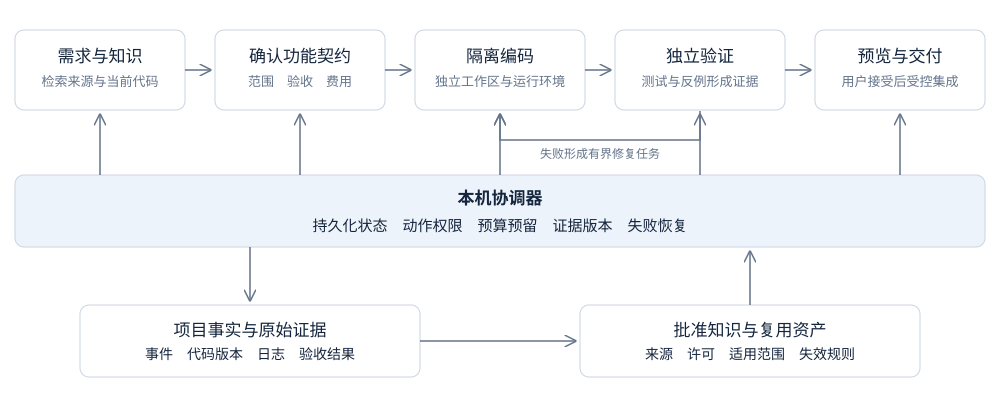

# BakaCoding

### 笨蛋编程助手

**把功能需求，变成能运行、能检查、能继续维护的代码。**

面向个人开发者与小团队的 AI 软件交付工作台。

本地优先 · 知识复用 · 预算可控 · 逐项验收 · 随时接管

[产品设计文档](docs/product-design.md) · [排版阅读版](docs/product-design.html) · [路线图](#路线图) · [参与讨论](https://github.com/Akarin7784/BakaCoding/issues)

## 让交付软件变得简单一点

“Baka”取“笨蛋”之意。BakaCoding 希望把复杂的任务拆分、上下文整理、代理协作和验证流程交给工作台，让开发者更轻松地把想法做出来。

你提出功能，确认范围和费用上限；工作台推进设计、实现、测试和预览，并把修改内容、验收证据和费用放在同一个地方。遇到问题时，可以暂停、修改要求、打开 IDE 接管，或者保留已有成果稍后继续。

**项目当前处于产品设计阶段。** 本仓库已提供完整产品方案与架构分析，尚未提供可安装的客户端或可运行的编码代理。以下产品能力和路线图均为规划，不代表已经实现。

## 为什么做 BakaCoding

AI 已经能写很多代码，但完成一个可用功能仍然需要开发者来回协调：

- 换一个会话，就要重新解释项目结构和开发规范。
- 代理说完成了，却没有可运行的预览和完整的验证结果。
- 一个小改动在反复修复中消耗了难以预估的费用。
- 多个任务同时修改代码，最后的集成和验收比编码更费时间。
- 今天没做完，明天还要重新整理上下文才能继续。

BakaCoding 围绕**功能交付**组织工作，把需求、代码、证据和项目知识连起来。

## 你将如何使用

1. **打开仓库**：检查运行环境、启动命令、现有测试和未提交修改。
2. **描述功能**：写下要解决的问题，也可以补充截图、原型和说明。
3. **确认范围**：检查验收清单、改动边界、风险和费用上限。
4. **交给工作台**：在隔离工作区实现功能，查看进度，随时暂停或接管。
5. **预览并验收**：逐项查看结果、代码差异、测试证据和已知问题。
6. **接受交付**：集成到指定分支或导出变更，把有用经验保存为项目知识。

例如：“给文章列表增加标题搜索，保留现有排序和分页行为。”交付结果应包含可交互预览、实现差异、清空搜索和空结果等验收证据，以及真实费用记录。

## 核心产品能力

| 能力 | 对开发者的价值 | 设计方式 |
| --- | --- | --- |
| 功能契约 | 开始前就知道完成标准 | 明确目标、范围、验收、版本和预算 |
| 项目知识 | 减少重复说明和重复踩坑 | 引用有来源、版本和适用范围的工程知识 |
| 受控代理协作 | 复杂任务有分工、有交接 | 规划、设计、编码和验证职责分开 |
| 隔离执行 | 保留原工作目录里的修改 | 每个实现任务使用独立工作区和分支 |
| 独立验证 | 更容易判断功能是否可用 | 冻结验收标准，测试结果绑定具体代码版本 |
| 预算管理 | 费用随任务推进保持可见 | 已花费与在途预留共同参与额度检查 |
| 失败恢复 | 中断后能从检查点继续 | 持久化任务状态、步骤和产物 |
| 人工接管 | 始终保留控制权 | 暂停代理写入后，在 IDE 中继续修改 |
| 交付报告 | 方便检查、协作和后续维护 | 导出验收、提交、风险、费用和撤销说明 |

硬预算的支持范围取决于运行框架和供应商是否提供可执行限制。只支持事后统计的适配器，应明确标记为费用估算模式。

## 架构

BakaCoding 基于 KFPA 的知识优先和按功能滚动交付思路，补充确定性的任务状态、权限、费用与证据校验。

主规划器提出方案；程序负责调度和执行边界。下一项功能可以检查上一项功能的接口衔接，但最终质量门禁由独立验证负责。并行程度按依赖、代码冲突、预算和设备资源控制，首版默认同时运行一个编码任务。

### 首版技术方向

| 模块 | 建议方案 |
| --- | --- |
| 本地工作台 | Electron、React、TypeScript |
| 协调服务 | Node.js、显式状态机、结构化事件 |
| 本地状态 | SQLite、步骤日志、内容寻址产物 |
| 代码工作区 | Git worktree 与受限执行环境 |
| 编码执行 | 优先验证 Codex SDK，保留适配器接口 |
| 功能验证 | 项目现有测试、独立检查、浏览器交互验证 |
| 项目知识 | 仓库搜索、决策记录、经审核的技能与组件 |

这些是设计建议，实际依赖版本和兼容范围会在技术验证阶段固定。Git worktree 用于隔离代码目录，执行权限由独立的安全边界约束。

本地优先指任务状态、文件和知识优先保存在设备上。调用云模型时，选定的代码和上下文仍可能发送给供应商，产品需要明确展示这部分数据流。

## 首版范围

首先服务熟悉基础 Git 和项目运行方式的独立开发者，以及 2 至 10 人小团队。

| 首版优先支持 | 后续根据试用验证扩展 |
| --- | --- |
| 已有单仓库 TypeScript Web 项目 | 更多语言与多仓库关联 |
| 一种正式支持的编码运行框架 | 多供应商与更多运行框架 |
| 单编码任务与有限阶段重叠 | 无冲突双任务编码 |
| 自带密钥与任务预算 | 团队额度与托管执行 |
| 本地预览、验收和交付报告 | 发布后观察与更多连接器 |
| 项目知识和候选经验审核 | 跨项目知识与团队共享 |

## 路线图

详细计划按 3 名研发人员、兼职产品设计和测试估算，目标是用约 10 周完成邀请试用版；实际周期需要通过技术验证校准。

- [x] 原始 KFPA 架构分析与产品定位。
- [x] 产品设计文档、功能规格、数据模型和接口草案。
- [x] 近期技术调研、质量与预算方案、商业化假设。
- [ ] **技术验证**：接通一种编码运行框架，验证隔离、费用、取消与恢复。
- [ ] **交付闭环**：从仓库接入到需求确认、编码、验证、预览和导出。
- [ ] **可靠性**：预算预留、异常恢复、证据版本校验与人工接管。
- [ ] **产品体验**：功能看板、知识审核、安装诊断与错误引导。
- [ ] **邀请试用**：真实任务对照评估、体验改进与付费意愿验证。

## 阅读产品方案

完整方案包含 22 个章节、22 项功能需求及验收标准，覆盖用户旅程、页面结构、代理协作、状态机、知识管理、质量门禁、数据与接口、费用、安全、评估、商业化和实施计划。

- [产品设计文档 Markdown](docs/product-design.md)：适合直接在 GitHub 阅读、讨论和修改。
- [产品设计文档 HTML](docs/product-design.html)：自包含阅读版，含章节导航、原架构图和改造架构图；下载后使用浏览器打开，也支持打印。
- [原始 KFPA 架构图](docs/assets/kfpa-original.png)：用于理解方案起点。

技术调研核验于 **2026 年 10 月 17 日**，近期部分采用 **2026 年 9 月 17 日至 10 月 17 日**窗口内的 12 条官方资料，基础能力文档单独列出。已发布能力、设计推论与待验证假设在文档中分别说明，实施前仍需复核供应商最新能力。

## 产品原则

- **以可验收的功能衡量进度**：交付结果应有证据，能被用户检查。
- **知识采用前看来源，采用后看效果**：经验经审核后复用，过期后失效。
- **重要边界由程序执行**：状态、权限、费用和门禁可追踪、可解释。
- **合理步骤自动推进**：范围和授权内持续执行，必要决定集中交给用户。
- **成果可以带走**：代码、项目知识和交付报告支持导出。

## 参与共建

欢迎通过 [Issues](https://github.com/Akarin7784/BakaCoding/issues) 提交真实开发场景、产品建议、架构问题和文档修订。介绍场景时，请说明项目类型、想完成的功能、当前流程的困难，以及你希望如何验收结果。

涉及新能力的提案，建议同时补充用户价值、范围、验收标准和成本影响。请勿在公开讨论或示例中附带密钥、个人隐私或未经授权的私有代码。

技术选型和定价仍在验证中。欢迎围绕具体任务，讨论 BakaCoding 如何减少从需求到交付之间的协调和返工。
