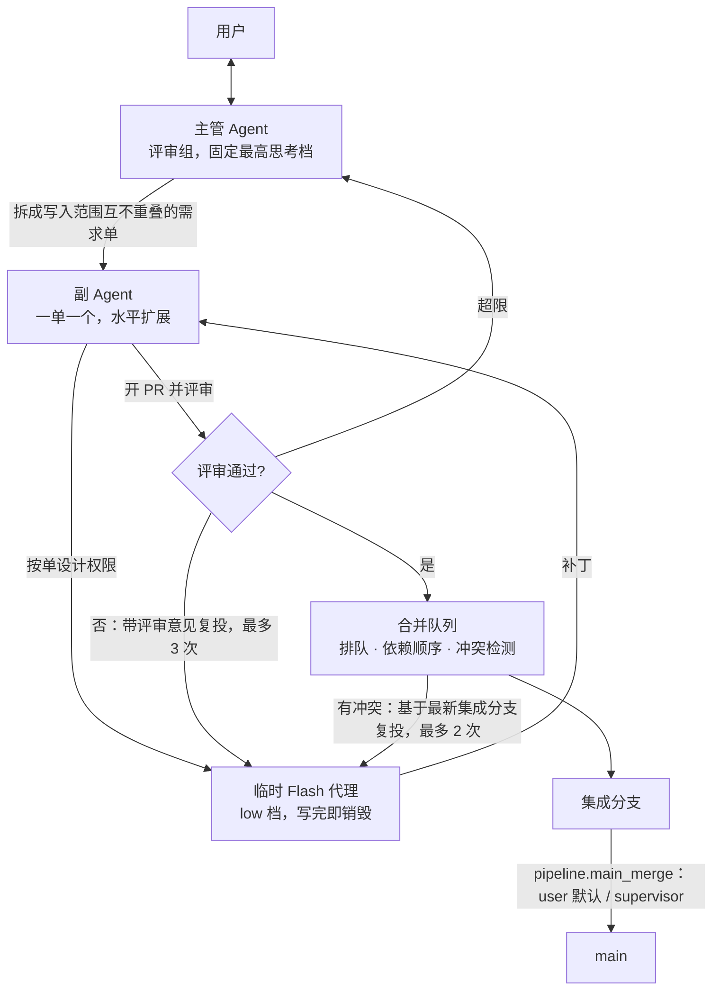

# BakaCoding

### 笨蛋编程助手

**用并发的 Flash 编码池，帮个人开发者推进大型软件工程。**

评审把关和受控合并，测试与 CI 交给用户现有工具。

[在线文档](https://akarin7784.github.io/BakaCoding/) · [整体设计](docs/product-design.md) · [设计决策](docs/bakacoding-design-backlog.md) · [参与讨论](https://github.com/Akarin7784/BakaCoding/issues)

## 定位

BakaCoding 的核心是 **Flash 编码池**：多个高速 Flash 模型以低思考档位并发编码。

- 由多个旗舰模型组成**评审组**：必填的**主管模型**负责拆单和最终裁决，其余成员只做 PR 评审。
- 每张需求单配一个**副 Agent**，负责开 PR、评审和复投。
- 通过评审的 PR 经**合并队列**有序合并。

用户只对接主管 Agent。

**当前处于设计阶段，尚无可安装客户端或可运行代码。** 下文描述的是设计目标，效果需要实测验证。

## 核心流水线

| 角色 | 职责 |
| --- | --- |
| 主管 Agent | 必填，缺失即报错、不启动；固定用最高思考档。负责拆单、处理上报的单和高风险 PR、处理用户在 GitHub 上的手动操作 |
| 评审池 | 评审组中除主管外的旗舰模型；按负载分配，同一张单复投时由原模型评审，被限流的模型自动跳过 |
| 副 Agent | 一单一个：写提示词，设计 Flash 权限，开 PR，对照需求单评审（是否完成需求、是否越界、有没有明显 bug、是否违反架构约束），不通过就复投 |
| Flash 编码池 | 临时 Flash 代理，默认 DeepSeek V4.1-Flash、`low` 档；只能在本单工作区内，不给 shell、网络、git，密钥和 `.env` 不放行 |
| 合并队列 | 排队、按依赖顺序合并、合并前检测冲突；按评审吞吐和 API 并发做反压 |

## v1 范围

- **不做 CI**：CI 和远程 git 由用户自行配置。BakaCoding 不跑编译、lint、测试；用户仓库配了 CI 时，可以读取 GitHub check 结果（可选），失败算不通过。
- **不执行代码**：Flash 和副 Agent 都不执行代码。
- **PR 抽象**：有 GitHub 时开真 PR；没有远程仓库时，建本地分支并加一条 PR 记录。状态以 BakaCoding 本地记录为准。
- **不做语言适配**：导入时识别语言，只作为上下文使用。
- 成本触顶时降并发；合入 main 默认由用户自己完成。

## 技术取向

Node.js + TypeScript 本机协调服务，React + TypeScript 界面，Electron 桌面壳，SQLite（WAL）。默认在本机 Git worktree 中执行，见 [执行配置草案](config/execution.example.json)。

[模型配置示例](config/models.example.json) 按评审组 / 主管结构给出开发阶段的角色示例（`supervisor`、`review_board`、`sub_agent`、`coder`，均为 DeepSeek Flash），字段仍是草案，完整字段草案见 [整体设计 §10](docs/product-design.md#10-评审组与主管模型)。目前没有运行程序读取这些配置。

## 文档

- [整体设计](docs/product-design.md)（[在线版](https://akarin7784.github.io/BakaCoding/)）
- [分析与设计（详细版）](docs/bakacoding-analysis-and-design.md)
- [功能模块](docs/modules.md)
- [设计决策与待办](docs/bakacoding-design-backlog.md)
- [Flash 并发研究](docs/bakacoding-flash-concurrency-research.md) · [设计评审](docs/bakacoding-plan-review.md)

文档通过 GitHub Pages 托管，`docs/` 更新合并到 `main` 后自动部署。

## 参与共建

欢迎通过 [Issues](https://github.com/Akarin7784/BakaCoding/issues) 讨论设计。公开讨论请勿附带密钥、隐私或未经授权的私有代码。

## 开源协议

[MIT License](LICENSE) · Copyright (c) 2026 Akarin7784
