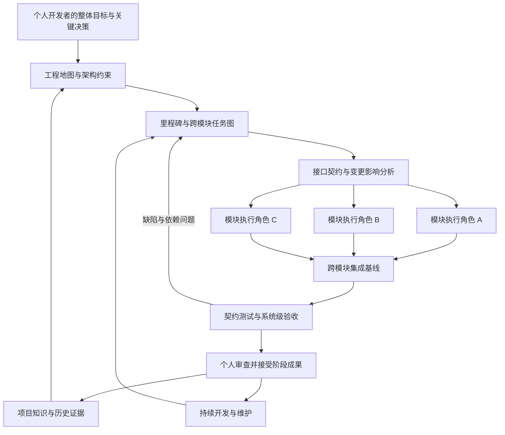

# BakaCoding

### 笨蛋编程助手

**让个人开发者能够完成超大规模软件的开发与维护。**

以知识为基础，以架构为约束，用受控多智能体持续推进完整工程。

[在线文档](https://akarin7784.github.io/BakaCoding/) · [文档源码](docs/product-design.md) · [核心架构](#核心架构) · [参与讨论](https://github.com/Akarin7784/BakaCoding/issues)

## 一个人也能掌握完整的大型工程

“Baka”取“笨蛋”之意。BakaCoding 希望把庞大软件中的任务组织、上下文整理、模块协调和集成验证交给工作台，让个人开发者能够持续理解、构建和维护复杂系统。

你负责目标、关键设计和最终验收；工作台维护项目全局，将目标拆成子系统、模块和功能，组织多个受控执行角色，并把局部实现集成为可运行的整体。

项目可以跨越大量模块、多个仓库和长期迭代。小功能是执行单位，整个软件的可运行性、架构一致性和可维护性才是目标。

BakaCoding 采用 MIT 协议开放源码，目标是让这套能力能够被自由使用、改进和分享。使用云模型或远程执行资源时，相关服务的费用由使用者自行承担。

**当前处于产品设计阶段。** 本仓库提供产品方案与架构分析，尚未提供可安装客户端或可运行代理。下文描述的是设计目标，规模与效果需要用真实大型工程验证。

## 核心问题

当软件越来越大，个人开发者面临的不只是代码写得慢：

- **全局难以掌握**：模块、接口和依赖越来越多，单次会话无法容纳全部工程知识。
- **局部正确，整体失败**：不同代理分别完成代码，却对接口、数据和设计作出不一致的判断。
- **跨模块变更难推进**：一个接口调整会影响多个实现、调用方和运行环境。
- **项目无法连续积累**：跨天、跨月后，目标、约束和未完成事项容易丢失。
- **规模越大，验证越难**：局部测试通过，仍不能说明系统级关键路径可以工作。

BakaCoding 用持续更新的工程知识、分层任务图和集成证据承接这些协调工作。

## 核心能力

| 能力 | 要解决的问题 | 设计方式 |
| --- | --- | --- |
| 分层工程地图 | 一个人如何掌握整个系统 | 总体目标、里程碑、子系统、模块、仓库与功能关联 |
| 架构一致性 | 多个执行角色如何遵守同一设计 | 版本化决策、模块边界、依赖规则和接口契约 |
| 依赖驱动拆分 | 超大目标如何持续推进 | 构建任务图，识别关键路径、阻塞和集成顺序 |
| 按需上下文 | 如何理解超过单个上下文窗口的工程 | 分区索引、增量更新、局部证据与全局约束结合 |
| 受控并行 | 如何扩大执行能力并避免互相覆盖 | 独立工作区、资源配额、逻辑写入所有权和任务租约 |
| 跨模块集成 | 如何把局部代码组成完整软件 | 跨仓库变更集合、兼容迁移和可重建集成基线 |
| 分层验证 | 如何证明整体可用 | 模块测试、契约测试、子系统与系统级验收 |
| 长周期记忆 | 如何跨会话和长期迭代继续工作 | 持久化目标、真实状态、原始证据和待办问题 |
| 持续维护 | 软件扩大后如何继续修改 | 变更影响分析、回归验证、依赖升级与技术债队列 |
| 个人控制入口 | 如何保持可审查和可接管 | 关键决策集中呈现，支持暂停、接管、恢复和导出 |

## 你将如何使用

1. **建立项目全局**：描述整体目标，接入相关仓库，整理子系统边界、架构约束和阶段成果。
2. **确认拆分与接口**：检查依赖图、公共契约和系统级验收，决定关键设计。
3. **分批推进实现**：工作台向模块角色分配局部任务，在依赖和权限允许的范围内并行执行。
4. **检查整体进度**：查看里程碑、阻塞链、架构风险和集成状态，按需接管。
5. **验收集成成果**：在明确的版本集合上验证关键用户路径，接受可运行的阶段交付。
6. **持续演进**：保留项目知识和真实状态，推进下一阶段功能、迁移、优化与维护。

例如，个人开发者构建一个可扩展的开发平台。身份权限、工作区、任务调度、插件运行时、存储和界面可以分别实现，但“插件提交任务、用户查看结果并取消”的完整路径，需要统一接口和跨模块验收。工作台负责把这些局部工作组织成可验证的整体成果。

## 核心架构

BakaCoding 保留 KFPA 的知识优先与按功能滚动交付思路，向上增加整体工程与里程碑管理，向下提供可扩展的受控执行和验证。

全局规划器维护总体目标、架构和依赖；局部角色获取所需上下文，处理明确的模块任务。程序约束状态、权限、资源和证据有效性。单个功能完成后，仍须在关联模块的实际版本组合上完成集成验证。

### 执行与存储

- 本地工作台作为个人控制入口，执行节点可位于本机或用户授权的远程环境。
- 单机状态可使用 SQLite；跨节点采用单一权威状态服务、租约和明确的恢复协议。
- Git worktree 隔离工作目录，受限执行环境约束文件、网络和工具权限。
- 项目知识按层级和版本管理，不依赖某个模型会话保存全局。
- 通过编码适配器接入执行能力，先验证一种正式接口，再扩展。
- 运行费用按任务、模块、里程碑和项目记录，资源规模由用户控制。

本地优先不要求整个工程的计算都发生在一台机器上。调用云模型或远程 worker 时，代码与上下文的数据流需要明确展示和授权。

## 如何定义完成

一个阶段成果需要同时满足：

- 范围内模块形成一致、可重建的版本集合。
- 公共接口、架构边界与兼容要求得到验证。
- 系统级关键路径实际通过，验收证据绑定代码与环境版本。
- 阻塞问题被处理，未完成事项和技术债保持可见。
- 后续功能仍能在已有成果上持续开发、验证和维护。

规模验证将覆盖代码量、模块数量、依赖复杂度、仓库数量和长期执行。百万行等档位是待验证目标，当前不宣称已经具备相应性能。

## 阅读产品方案

完整方案共 22 章、22 项功能需求及验收标准，覆盖定位、交互、代理协作、任务状态、知识、架构、数据与接口、运行资源、安全、超大工程组织和系统级验收。

- [在线文档网站](https://akarin7784.github.io/BakaCoding/)：直接在浏览器阅读完整方案，支持章节导航、架构图和打印。
- [产品设计文档 Markdown](docs/product-design.md)：适合在 GitHub 阅读、讨论和修改。
- [离线阅读版 HTML](https://akarin7784.github.io/BakaCoding/product-design.html)：可在线阅读，也可保存为 HTML 后离线打开。
- [原始 KFPA 架构图](docs/assets/kfpa-original.png)：方案的架构起点。

文档通过 GitHub Pages 托管。`docs/` 更新合并到 `main` 后，GitHub Actions 会自动部署；`docs/product-design.html` 同时作为网站首页，保持在线与离线版本一致。

技术调研核验于 **2026 年 10 月 17 日**，近期部分采用 **2026 年 9 月 17 日至 10 月 17 日**窗口内的 12 条官方资料。基础能力文档另列，已发布能力与设计建议分别说明。

## 参与共建

欢迎通过 [Issues](https://github.com/Akarin7784/BakaCoding/issues) 提交大型工程场景、架构问题和文档修订。建议描述项目规模、模块依赖、想推进的变更、当前协调困难，以及如何证明整体成果可用。

新能力提案应说明它如何帮助个人掌握并推进完整项目，以及对应的验收方式。公开讨论请勿附带密钥、隐私或未经授权的私有代码。

## 开源协议

[MIT License](LICENSE) · Copyright (c) 2026 Akarin7784
