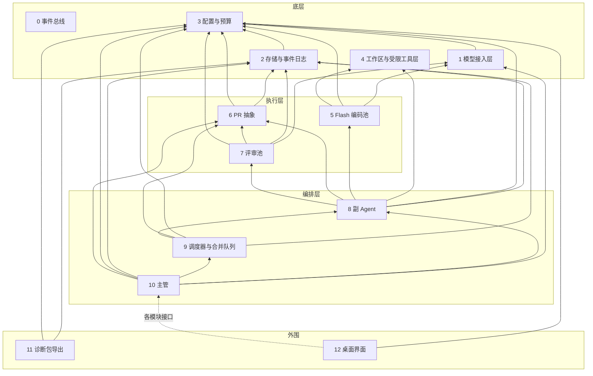

# BakaCoding 功能模块

2026 年 10 月 17 日（UTC+8）· 对应 [整体设计](product-design.md) v3.1（接口决定）

> 按功能模块切分是项目负责人提出的要求，模块边界由设计负责人决定（2026-10-17 05:56，05:58、05:59、06:01、06:03 修订；v3.0 定稿）。本文只描述边界、依赖和事件，不是开发排期。接口、事件和字段名都是**草案**；配置字段沿用整体设计 §10、§14 的草案名。下文「PD §n」指整体设计第 n 节。

## 分层

模块分四层共 13 个模块，**下层不依赖上层**。底层最下面是 0 事件总线，不依赖任何模块；底层内部其余依赖只有 1→3 和 2→3；4 没有依赖。上下层之间用事件解耦：下层发事件，上层订阅，都经 0 事件总线；2 订阅全部事件并落库（见「事件清单」）。

**依赖规则**：用到事件总线（发布或订阅）不算模块之间的依赖，只有直接调用才算。

**共享类型包** `@bakacoding/types`：只依赖 zod，放事件类型、常量和 zod schema（含 `permission_list`、`LedgerStore`、`DiagnosticsSource`、`call()` 的 `ctx`、diff 结构）。所有模块包都依赖它；它不是功能模块，依赖它不算模块之间的依赖，图中不画。

**组合根** `@bakacoding/app`（T-041a，蓝色大肥鱼 定 Q1 方案 A）：在编排层之上、12 之下，把 0/2/3/6 与 8/9/10 装到同一条事件总线上并做重启接管。它不是功能模块，不在 13 个模块里，图中不画；功能模块都不依赖它。见文末「组合根」一节。

| 层                                          | 模块                                                                               |
| ------------------------------------------- | ---------------------------------------------------------------------------------- |
| 底层（0 无依赖；其余内部依赖只有 1→3、2→3） | 0 事件总线 · 1 模型接入层 · 2 存储与事件日志 · 3 配置与预算 · 4 工作区与受限工具层 |
| 执行层                                      | 5 Flash 编码池 · 6 PR 抽象 · 7 评审池                                              |
| 编排层                                      | 8 副 Agent · 9 调度器与合并队列 · 10 主管                                          |
| 外围                                        | 11 诊断包导出 · 12 桌面界面                                                        |



箭头指向被依赖的模块。界面依赖各模块的接口，图中只画一条虚线示意。0 事件总线所有模块都可以用，按依赖规则不画连线。

## 底层

### 0. 事件总线

- **职责**：进程内的发布和订阅，所有模块都可以用。只负责传递事件，不落库（落库由 2 订阅完成）。
- **对外接口（草案）**：`publish(event)`、`subscribe(type | "*", handler)`；事件公共字段见「事件清单」，事件类型和 schema 在 `@bakacoding/types`。
- **语义**：进程内异步分发；支持 `*` 通配订阅；span 由发布方生成，`trace_id` 按需求生成；发布时用 zod 校验，失败不分发、不占序号；`seq` 由总线分配，`createEventBus({ initialSeq })` 指定起点；每个订阅者按发布顺序串行收到事件，积压超过 `maxQueue`（默认 10000）时告警但不丢；handler 出错交给 `onHandlerError`，回调自身出错兜底 `console.error`。
- **依赖**：无。
- **对应章节**：PD §12、§14（事件可追溯）。
- **配置字段**：无。

### 1. 模型接入层

- **职责**：按协议适配 Anthropic 兼容和 OpenAI 兼容两种接口（DeepSeek 默认走 Anthropic 兼容接口 `https://api.deepseek.com/anthropic`，与 harness 一致，见 [config.ts](https://github.com/deepseek-ai/deepseek-harness/tree/dsh-v0.2.1-alpha.5/packages/llm/llm-deepseek/src/config.ts)；OpenAI 兼容留作备选）；令牌桶限流，遇到 429 指数退避加抖动；思考档位映射：取值 `off` / `low` / `high` / `max`，配置字段 `effort` 与服务商无关，取值 `off` / `low` / `high` / `max`；映射由模块 1 的服务商能力表负责：DeepSeek → `output_config.effort`，OpenAI 兼容服务商 → `reasoning_effort`，不用数值档位（[serialize.ts](https://github.com/deepseek-ai/deepseek-harness/tree/dsh-v0.2.1-alpha.5/packages/llm/llm-deepseek/src/serialize.ts)）；服务商不支持的档位降到最高可用档并记一条警告，不报错，映射以能力表为准（配置不设 `effort_map`）；按调用计费，单价读 `config/pricing.json`，金额用整数微美元；每次调用前先向 3 预占预算（`reserve`），结束后释放。新服务商以补丁加配置接入，不改核心。令牌桶按账号全局共享，多个项目合用一个桶，不按 key 分（DeepSeek 并发按账号计，与 key 无关：https://api-docs.deepseek.com/quick_start/rate_limit ）。每个服务商一张能力表：思考档位映射到 `output_config.effort`，不依赖 `cache_control` 和 `budget_tokens`，需要串行调用工具时由本地保证，并记录兼容接口忽略的字段（例如 DeepSeek 忽略 `budget_tokens`、`cache_control`、`disable_parallel_tool_use` 等：https://api-docs.deepseek.com/guides/anthropic_api ）。DeepSeek 请求序列化和档位逻辑可搬 harness 的 MIT 代码（规则见 PD §15）。不直接写日志：每次调用完成后在总线上发「调用完成」事件。
- **对外接口（草案）**：`createModelGateway({ getConfig, pricing, budget, publish, getSecret?, fetch?, clock?, rateLimit?, onWarning? })` 返回以下五个方法。`chat({ role, provider, model, effort, system, tools, messages, ctx, signal? }) → { content, tool_calls, reasoning, effort, tokens, cache_hit, latency_ms, cost, rate_limited_retry }`：多轮工具调用，`tools` / `messages` / `tool_calls` 与 5 的 `ToolDefinition` / `ChatMessage` 同结构（`{ id, name, input }`），assistant 消息可带 `reasoning`（`{ text, signature? }[]`）原样回传思考内容；`call(role, provider, model, effort, prompt, ctx, { signal? }?) → { output, tokens, cache_hit, latency_ms, cost, rate_limited_retry }` 是 `chat` 的单轮包装；`rateLimitState({ provider, model? }?)` 返回账号级令牌桶（`capacity` / `available` / `waiting`）和按 provider/model 记的 429 退避状态（`limited` / `until` / `rate_limited_total`）；`capabilities(provider) → 能力表`；`testConnection({ provider, model? }, { signal? }?) → Promise<{ ok: true, latency_ms, cost_micro_usd } | { ok: false, reason, status? }>`（T-089，界面 `provider:test` 调它，IPC 在 UI-03b）：`model` 缺省取该服务商配置里的第一个模型；只发一个极小请求（单条 user 消息 `ping`、`max_tokens: 1`、`effort` 固定 `off` 关思考、不发降档警告、失败不重试），照常经 `reserve` 预占（按 `max_tokens: 1` 估）并发 `call_completed` 计入台账；**这笔花费记在主管名下**：`role: "supervisor"`、`requirement_id: "provider_test"`（导出常量 `PROVIDER_TEST_REQUIREMENT_ID`）、`ticket_id: null`，不新增角色，预算页按角色分列时算进主管；`reason` 取 `budget_exhausted`（预占被拒，不发请求，不当连接失败）/ `no_secret`（取不到密钥，不预占不发请求）/ `auth_failed` / `quota_exhausted`（服务商余额不足）/ `rate_limited` / `network` / `config_error`（服务商或模型没配置、没单价）/ `http_error`，HTTP 失败带 `status`；调用失败从不抛错，只有取消抛 AbortError；结果不含密钥和服务商原始报错；**遇到 429 只记入按 provider/model 的共享退避状态，不阻塞后续请求**：和正式调用共用同一份状态（`rateLimitState` 里该模型 `limited: true`、`until` 取退避结束时间、`rate_limited_total` 加 1），只供界面展示；令牌桶 `acquire` 不看这个状态，之后的正式调用和测试连接照常发出、不会等待（T-111）；事件：调用完成。`ctx` 必填：`{ role, requirement_id, ticket_id | null, is_resubmit, trace }`，没有单号的调用（如主管）`ticket_id` 为 `null`，`role` 必须与 `ctx.role` 一致。
  - **协议细节**：DeepSeek 两种协议都发 `thinking: { type: enabled | disabled }`；Anthropic 协议档位写 `output_config.effort`，OpenAI 协议写 `reasoning_effort`（`low` / `high` / `max`）。OpenAI 协议下 assistant 消息的 `reasoning` 写回 `reasoning_content`：DeepSeek 要求带 `tools` 的请求回传之前所有轮次的 `reasoning_content`，否则返回 400（https://api-docs.deepseek.com/guides/thinking_mode ）；通用 OpenAI 服务商不发 `thinking`、不回传。v1 非流式。
  - **输出上限与超时**：模型配置可选 `max_tokens`。Anthropic 协议的 `max_tokens` 是必填项，一律传：有配置值用配置值，没有就用能力表的输出上限（`default_max_tokens`）；OpenAI 协议填了才传，不填用服务端默认值。服务商配置可选 `request_timeout_ms`，默认 600000（10 分钟），从发出请求到读完响应体计时。
  - **预算**：调用前按「输入估算 + 输出上限」向 3 预占（输入按请求体字符数、未命中价估；输出按模型的 `max_tokens`，没填按能力表 `default_max_tokens`，按输出价估），预占失败抛 `BudgetExceededError`（`code: "BUDGET_EXCEEDED"`，`scope: daily | ticket`），不发请求也不发事件；预占成功后无论成功、失败、取消还是抛异常，都在 `finally` 里释放（`call_completed` 记进台账之后），实际花费以台账为准；判断时不计本次估算，所以最多超出一个进行中调用的费用。
  - **重试**：429、500 / 502 / 503 / 504、响应到达之前的连接错误和超时会重试，合计最多 3 次；退避 1s 起翻倍、加 0~50% 抖动、上限 60s，429 取与 `retry-after` 的较大值；每次重试前检查 `signal`。`rate_limited_retry` 只数 429 的重试。其他错误不重试。限流参数（桶容量 8、每秒补 4、重试次数、退避）是 `createModelGateway({ rateLimit })` 的选项，不进配置文件。
  - **错误**：服务商失败抛 `ModelGatewayError`（`code`：`AUTH` / `QUOTA` / `RATE_LIMIT` / `INVALID_REQUEST` / `CONTEXT_WINDOW_EXCEEDED` / `SERVER` / `NETWORK` / `BAD_RESPONSE` / `CONFIG`，超时归 `NETWORK`，信息里不含密钥）；`signal` 取消时中止 HTTP 请求并抛 `AbortError`。
  - **调用完成事件**：只有请求真的发出去了才发 `call_completed`（还没发出就取消、预算不足、配置错误都不发）。成功时 `error: null`；失败时 `error: { code }`，code 取上面的错误码，取消为 `ABORTED`；旧事件没有 `error` 字段，按成功处理。失败时回复里已经解析出用量的按实际 token 计费，否则 token 和 `cost` 记 0。`prompt` 记全部模型输入：`chat` 是 `{ system, messages, reply_reasoning? }` 的 JSON（messages 含工具调用、工具结果和回传的思考），`call` 是 prompt 原文；本轮回复的思考内容属于模型内容，只记在 `prompt`（`reply_reasoning`，`call` 追加在 `[reasoning]` 之后，桌面会遮蔽），不进 `output`；`output` 只有本轮回复文字，`chat` 有工具调用时再追加一行 `[tool_calls] 工具名, …`。span：每次调用发一个子 span（`parent_span_id` = `ctx.trace.span_id`）。
  - **token 定义**：`input` = 全部输入 token（含缓存命中），`cache_hit_input` = 缓存读取（命中）的 token，未命中 = `input − cache_hit_input`，`output` = 输出 token；`cost` 按命中价、未命中价、输出价三项分别计（3 的 `computeCost`）。Anthropic 协议换算：`input = input_tokens + cache_read_input_tokens + cache_creation_input_tokens`，`cache_hit_input = cache_read_input_tokens`；OpenAI 协议：`input = prompt_tokens`，`cache_hit_input` 取 `prompt_tokens_details.cached_tokens` 或 `prompt_cache_hit_tokens`。
- **依赖**：3（读 key、配置和预算状态）。
- **对应章节**：PD §5、§10、§13、§15。
- **配置字段**：各角色的 `provider` / `model` / `effort`（与服务商无关，由本模块能力表映射；`roles.supervisor`、`roles.review_board.members[]`、`roles.sub_agent`、`roles.coder`）。

### 2. 存储与事件日志

- **职责**：SQLite（WAL），单一写入者加租约，配合幂等键，支持重启恢复；保存 PR 记录（按轮次）、主管的项目决策记忆、合并结果、基线 commit 与上下文包；从 0 用 `*` 通配订阅全部事件并落库，每条带 `trace_id`、`span_id`、`parent_span_id`（含「调用完成」写调用日志）；收到「项目已创建」后建群记录；保存项目群消息和主管待办指标；落库前调用 3 的脱敏函数做轻脱敏；完整提示词和输出保留 30 天，过期只留摘要和统计，「收进评测集」的单永久保留；打开写库后自动清理过期数据（T-118：先清一次，之后每 `purge_interval_ms`（默认 24 小时，0 关闭）清一次，失败只记日志、不挡启动，`close()` 停掉定时器，只读连接不跑）。
- **对外接口（草案）**：`openStorage({ path, retention_days, purge_interval_ms })` 打开库（拿不到写入租约时报 `StorageLeaseError`）；`attach(bus, { onError })` 用 `*` 订阅落库（落库失败交给 `onError`，默认 `console.error`）；`health()` 返回落库失败次数、最近一次失败和租约是否丢失；`nextSeq()`（传给总线 `initialSeq`）、`maxSeq()`（库里最大 seq，空库为 `null`）；`openStorageReadonly({ path, nativeBinding? })` 只读打开（给 12 等读方用：不跑迁移、不拿也不动租约，库版本不对时报可读的错误，调用写方法抛 `StorageReadonlyError`），只暴露读方法（`health`、`nextSeq`、`maxSeq`、`queryEvents`、`query`、`getTicket`、`listTickets`、`listPrRounds`、`listDecisions`、`listProjects`、`groupMessages`、`listSupervisorMessages`、`backlogMetrics`、`diagnosticsSource`、`prStore()` 的 `get` / `list`、`ledger` 的汇总）；`nativeBinding` 可指向为 Electron 另编的 better-sqlite3（驱动 12.x）；`queryEvents(filter)`、`savePrRecord(round)`（轮次可带结构字段 `reviewer`：成员 id、`"supervisor"` 或 `null`，原样往返不脱敏，旧记录读出 `null`）、`prStore()`（实现 6 的 `PrStore`，结构字段原样往返、只拒带凭据的 URL（T-059 起判断调 3 的 `isCredentialUrl`；T-058 起只拒真凭据，宁可误拒不漏放：先 trim，字符串里任何位置出现 `scheme:` 后接 `user:pass@` 就拒（含 `https:/\user:tok@h`、`https:user:tok@h`、嵌在文字里的 URL）；本身和嵌在里面的每个 URL 再查：userinfo 带密码或解码后的用户名含 `:`（`%3A`）、任何 scheme 的用户名像 token（`ghp_…`、`github_pat_…`、`glpat-…`、`x-access-token`、`oauth2` 等）、用户名 20 个字符及以上且全是十六进制或全是 base64 字符、http(s) 用户名不符合 `^[A-Za-z0-9][A-Za-z0-9._-]{0,38}$`、查询参数或 `#` 后的参数里 `token` / `access_token` / `private_token` / `api_key` / `sig` / `X-Amz-Signature` 等非空（键末尾 `[]` 先去掉）；`ssh://git@`、`https://eva@`、SSH 简写 `git@host:o/r.git` 放行），自由文本轻脱敏，`kind` 单独存、只能是 `ticket` / `integration`）、`listPrRounds(ticket_id) → RoundRecord[]`（该单全部轮次按轮次升序，旧记录 `reviewer` 读出 `null`，单不存在返回空数组；写入方和只读连接都有）、`saveTicket(ticket)`（T-055 起可带 `fields`：需求单结构化字段，如 `write_scope`、`interfaces`、`depends_on`、`priority`、`kind`、`origin`、trace，字段由 10 定义，2 只按 JSON 原样存取、不脱敏；必须是能 JSON 往返的普通对象，否则抛 `TypeError`；不传时保留库里原值，8 回写权限清单不会把它冲掉，传 `{}` 才清空）、`getTicket(ticket_id) → StoredTicket | undefined`、`listTickets({ project_id?, requirement_id?, status? }) → StoredTicket[]`（T-055，按 `created_at`、`ticket_id` 升序；`StoredTicket` 是需求单那一行，不含轮次，旧记录 `fields` 读出 `null`，库里的 `fields` 损坏或不是对象时也读成 `null` 并经可选的 `logger`（T-057 起同一连接里同一单号只警告一次，正常读到后清掉记录、再坏会再报；`warn` 抛错也不影响读取）（`openStorage` / `openStorageReadonly` 的 `{ warn }`，默认 `console.warn`）记一条警告；写入方和只读连接都有。`fields` 不脱敏，11 导出诊断包时不能原样带上）、`saveMergeResult(ticket_id, result)`、`query(filter)`、`saveDecision` / `listDecisions`、`listProjects() → { project_id, name, created_at, repo_path }[]`（按创建时间排序；`name` 自 T-055 起返回；T-142 起不返回已删除的项目，`repo_path` 只由 `setProjectRepoPath` 写入、不进任何事件，老记录和新登记的项目为 `null`，只给桌面端主进程用，诊断包导出时由 11 去掉（T-143）；写入方和只读连接都有）、**T-142** `removeProject(project_id) → { removed: boolean }`（只有写入方：只删 `projects` 里的记录，不动仓库，不删历史事件；项目不存在返回 `{ removed: false }`、不抛错；`project_id` 为空或不是字符串抛 `TypeError`（`code: "invalid_project_id"`，消息不带值）；落库收到 `project_removed` 事件时做同样的删除；删掉后再收到**新的** `project_created`（同一 `project_id`）会重新登记，同一条事件重投不会；库版本 v6 给 `projects` 加可空列 `repo_path`，不从旧事件回填）、**T-142** `setProjectRepoPath(project_id, path: string | null) → { updated: boolean }`（只有写入方，只读连接上没有：只改 `projects.repo_path`，不发事件，事件查询结果里永远没有 `repo_path`；`null` 清空；项目不存在或已删除返回 `{ updated: false }`、不抛错；`project_id` 不合法抛 `TypeError`（`code: "invalid_project_id"`），`path` 既不是非空字符串也不是 `null` 抛 `TypeError`（`code: "invalid_repo_path"`），消息只有错误码、不带路径或其他值；删除后重新登记的项目 `repo_path` 从 `null` 开始）、`registerRequirement(requirement_id, project_id)`（群消息只在需求未登记时登记，不覆盖）、`markForEvalSet(ticket_id)`、`purgeExpired()`；`diagnosticsSource()` 实现 `@bakacoding/types` 的 `DiagnosticsSource`，启动时注入给 11；实现 `@bakacoding/types` 的 `LedgerStore`，启动时注入给 3（3 不因此依赖 2）；台账条目 `LedgerEntry` 用 `event_id`（对应的 `call_completed` 事件）做幂等键，按 UTC 日期汇总；`totalsByDay` / `totalsByTicket` / `totalsByProject` 返回 `LedgerBreakdown`（`LedgerTotals` 加 `by_role`，四个角色都列，没花费为 0）；**T-090** `totalsByProject(project_id)`：项目全部时间的累计花费，按 `requirements` 表的 `requirement_id` 把台账关联到项目，没登记过的需求不计入任何项目，未知项目返回全 0、不抛错，`project_id` 为空或不是字符串抛 `TypeError`（`code: "invalid_project_id"`，消息不带值）；写入方和只读连接都有；库版本 v5 只给 `ledger(requirement_id)` 加索引 `ledger_requirement`，不改表；**T-133** 新增 `setTicketField(ticket_id, key, value)`：在同一个 IMMEDIATE 事务里只改需求单 `fields` 里的**一个键**（`value` 为 undefined 删键），不读改写整行、不碰别的列；单不存在或 `fields` 为 null / 损坏时返回 false 且不动数据（不会把旧单写成不完整的 fields 被 10 判 `fields_invalid`）。
- **主管对话存储**（T-091，接口 10-18 获批，表 `supervisor_messages`，库版本 v4）：`SupervisorMessage = { message_id, project_id: string | null, role: "user" | "supervisor", kind: ChatReplyKind | null, content, requirement_id: string | null, ticket_ids: string[], created_at, in_reply_to?: string | null }`（`created_at` 为毫秒时间戳，`message_id` 由 10 生成、作主键，`ticket_ids` 存 JSON；`ChatReplyKind` 是 10 `ChatReply` 的五种 kind，2 是底层不能依赖 10，所以在 2 里单独写一份同样的字面量联合，须和 10 的 `ChatReplyKind` 保持同步，10 增删 kind 时 2 要一起改）。`appendSupervisorMessage(msg) → { inserted }` 只有写入方：`message_id` 已存在就忽略、返回 `inserted: false`，先写的为准（内容不同也不覆盖），供 10 重试时幂等；`role` 为 user 时 `kind` 必须为 null，为 supervisor 时必须是五种之一，不符报 `StorageError("invalid_message")`；`content` 落库前轻脱敏。`listSupervisorMessages({ project_id?, before?, limit? }) → SupervisorMessage[]` 写入方和只读连接都有：按 `created_at`、`message_id` 升序；`project_id` 只作可选过滤，不传读整条对话；给 `before`（`message_id` 游标）时取按上述顺序严格在它之前最近的 `limit` 条，仍升序返回，游标不存在报 `StorageError("invalid_cursor")`；`limit` 默认 50、最大 200（超过按 200），≤0 或非整数报 `RangeError`。`StorageError { code }` 为 T-091 新增，code 小写下划线，消息不带路径和值。**T-152**（库版本 v7）：`supervisor_messages` 加可空列 `in_reply_to`（回复对应的用户消息 `message_id`，由 10 写入），不加索引、不加外键、不校验指向；写入时可不传，按 `null` 存，传了必须是非空字符串，否则报 `invalid_message`；`listSupervisorMessages` 读出时总带这个字段，旧记录为 `null`；幂等重试先写为准，同一 `message_id` 再写不同的 `in_reply_to` 不覆盖。
- **依赖**：3（脱敏函数、保留期配置）。
- **对应章节**：PD §7、§12、§14、§16。
- **配置字段**：`diagnostics.retention_days`（由 12 的 `startBackend` 先读配置、再传给 `openStorage`，T-128）。

### 3. 配置与预算

- **职责**：加载并校验配置（schema 严格校验，未知字段直接报错，JSON 里不加注释字段），主管模型和每日预算必填，缺失时不启动；校验 `roles.supervisor` 必填且 `effort` 固定 `max`（`review_board.members` 不含主管）；密钥只从环境变量（`DEEPSEEK_API_KEY`、`GITHUB_TOKEN`）读，不读本地密钥文件（`config/secrets.local.json` 不读）；预算台账（按需求单含复投、副 Agent、评审组分列，复投费用单列；按缓存命中/未命中、闲时/高峰分开计价）和每单上限；脱敏规则和脱敏函数；从总线订阅「调用完成」记台账；项目导入（项目配置、导入时按清单文件识别语言，完成后发「项目已创建」）；各角色的提示词模板（放在 `packages/config-budget/prompts/`）；台账通过注入的 `LedgerStore` 落库；单价表和优惠时段读 `config/pricing.json`（数值取自 DeepSeek 官方价格页，注明链接和查阅日期；高峰时段 `peak_hours_utc` 只在周一至周五生效，`cn_public_holidays` 按北京时间日期认定、全天算闲时，列表人工维护并逐年写明国务院办公厅放假通知来源，缺的日子按高峰价算，`source` 写价格页原文和查阅时间）；闲时偏好开关 `budget.offpeak_preference`（默认关，打开后预算紧张时 `priority=deferred` 的单优先等到闲时再跑，由 9 判断；v1 只做这一个开关；DeepSeek 闲时价格为高峰的一半：https://api-docs.deepseek.com/quick_start/pricing ）。
- **对外接口（草案）**：`getConfig()`、`validate() → errors[]`（T-098：`validate` 和 `getConfig` 抛的 `ConfigError` 都用 `formatConfigIssue` 拼错误，不含配置原值，也不出现 zod 的 `received`；字段路径和未知键名最后再按 `redact` light 脱敏一次；`custom` 用 schema 里的固定文案，`roles.supervisor.effort` 现在报「应为 "max"」；`getConfig` 读不到文件只报文件名和错误码（如「无法读取配置文件 models.json（ENOENT）」），不带完整路径；JSON 解析失败不拼 `err.message`，只报「配置文件不是合法 JSON（第 L 行第 C 列）」，Node 报错里没有位置时只报「配置文件不是合法 JSON」；`formatConfigIssue` 从 write-config.ts 挪到 config.ts，导出名不变；T-099 起这些文案工具在内部文件 `safe-error.ts`，不进 index，config.ts 照旧再导出 `formatConfigIssue`）、`getSecret(name)`（读 `DEEPSEEK_API_KEY`、`GITHUB_TOKEN`）、`writeConfig(path, config, { env? }?) → Promise<{ ok: true } | { ok: false, errors: string[] }>`（T-087：设置页保存模型配置用，经组合根再导出；只能写文件名为 `models.json` 的文件，`pricing.json` 走 `writePricing`，其它文件都不可写；先用与 `validate` 相同的 schema 校验，但错误由 `formatConfigIssue(issue)` 只按 `issue.path`、`issue.code` 和 schema 自身的期望值（类型名、枚举选项、上下限）拼中文，不用 zod 默认 message（里面有 `received` 原值），`custom` 用 schema 里的固定文案；再用 `findSecretLikeValues(config, env?)` 查键和值里像密钥的字符串，标准是 `redact` 的 light 规则，外加「等于当前环境变量里的 `SECRET_NAMES` 值」，full 专属的 home 路径 / IP / 主机名不拦，因为 `base_url` 填内网地址是正常用法（与最初批准的「按 full」不同，评审已同意）；错误只含字段路径和规则名，所有错误信息再脱敏一次，不含配置值和文件路径；写入调用方给的原始对象、不展开默认值，2 空格缩进、末尾换行；同目录临时文件（按 0600 建，rename 后会覆盖原文件的权限）→ fsync → rename，Windows 上 rename 遇 EPERM / EBUSY / EACCES 重试 5 次，失败时原文件不变、删掉临时文件，目录不存在就建；热加载由 12 按切换项目的路径在进程内重建后端，不在这里做）、`writePricing(path, pricing, { env? }?) → Promise<{ ok: true } | { ok: false, errors: string[] }>`（T-114，配置向导写价格表用，常量 `WRITABLE_PRICING_FILE = "pricing.json"`：只能写文件名为 `pricing.json` 的文件，其它一律拒绝、不写；先用 `PricingSchema` 校验，错误只含字段路径和规则（同 `loadPricing` 的校验错误），再用 `findSecretLikeValues` 查像密钥的值，所有错误再脱敏一次，不含配置值和文件路径；写入方式与 `writeConfig` 完全相同，两者共用同一个内部原子写入函数：原始对象、不展开默认值、2 空格缩进、末尾换行，同目录 0600 临时文件 → fsync → rename，Windows 上 EPERM / EBUSY / EACCES 重试 5 次，失败时原文件不变、删掉临时文件，目录不存在就建；`writeConfig` 行为不变）、`createBudget({ budget, pricing, ledger, now? })` 返回 `{ recordCost, budgetState, reserve, attach }`：`recordCost(entry: LedgerEntry)`（手工补记，`entry_id` 幂等）、`attach(bus, { onError })`（订阅 `call_completed` 记台账，`entry_id` 取 `event_id`，闲时按事件 `ts` 判断，失败交给 `onError`）、`budgetState(ticket_id?) → Promise<BudgetState>`（当日 UTC 上限 / 已花 / 复投 / 剩余 / `daily_exhausted`、每单上限 = 每日预算 × `per_ticket_ratio` 向下取整、按角色分列、`offpeak_now`、`offpeak_preference`；传 `ticket_id` 时另带该单已花 / 复投 / 剩余 / `exhausted`；已花 ≥ 上限即 exhausted；另带进行中调用的预占额 `reserved_today_micro_usd`、单的 `reserved_micro_usd`）、`ledgerSummary(ledger, { project_id }) → Promise<{ project: LedgerBreakdown }>`（T-090，`ledger` 只需 `totalsByProject`：返回项目全部时间的累计花费，口径同 2 的 `totalsByProject`；`project_id` 为空或不是字符串抛 `TypeError`（`code: "invalid_project_id"`，消息不带值），不查台账；不带当日花费，当日花费只从 `budget:status`（`budgetState`）取；IPC 不在本单）、`reserve({ ticket_id | null, amount_micro_usd }) → { ok: true, release() } | { ok: false, scope: daily | ticket }`（模块 1 调用前预占：已花 + 其他调用的预占 ≥ 每日或每单上限时拒绝，否则记下；本次预占额不参与自己的判断，因此最多超出一个进行中调用的费用；预占与释放串行执行，释放在台账写入之后，因此任何一次判断都能看到预占或实际花费；只存在本进程内存，重启清空）；`loadPricing(path) → Pricing`（T-099：失败一律抛 `ConfigError`，不再抛 ZodError / SyntaxError；读不到只报文件名和错误码，如「无法读取价格表 pricing.json（ENOENT）」，JSON 坏只报「价格表 pricing.json 不是合法 JSON（第 L 行第 C 列）」，校验错误同 `validate`、前面加文件名；都不含文件内容、配置原值和完整路径）、`computeCost(pricing, model, tokens, at) → { cost_micro_usd, offpeak }`（命中、未命中、输出分开计价，按调用时刻选高峰或闲时价，向上取整到微美元，未知模型报错，供 1 计费）、`redact(text, level: light | full) → { text, report }`（T-059 起所有规则线性，10 万字符输入在 2s 内（T-068 由 500ms 放宽）；`url_credentials` 规则与 `isCredentialUrl` 同一套判定，只遮凭据那一段：userinfo、`?` / `#` 之后，解析不了的遮 `://` 之后全部；`github_token`（`ghp_` / `gho_` / `ghu_` / `ghs_` / `ghr_`、`github_pat_`）和新增的 `gitlab_token`（`glpat-`）任何位置都遮；邮箱逐个 `@` 向左右扩、不设长度上限；内网主机名最多 16 段起匹配、往前扩到整条，更长的也整条遮掉）、`isCredentialUrl(s) → boolean`（T-059：带凭据 URL 的共用判断，规则见 2 的 prStore 一节，2 拒写调它）、`credentialUrlRanges(text) → [start, end][]`（`redact` 用的遮挡片段）、`CREDENTIAL_CASES: CredentialCase[]`（`{ name, build(): { text, secret }, expect: "reject" | "allow", rule?: "url_credentials" | "token" }`，2、3、11 的测试共用；reject 都带 `secret`，`rule` 缺省为 `url_credentials`，`token` 表示不在 URL 里、由 token 规则遮）、`importProject(path, { publish?, trace?, name?, languagesFile? }?) → Project`（T-008：只读不写，不要求是 git 仓库；只看根目录的清单文件，按 `prompts/languages.json` 的顺序识别语言，第一个命中的是主语言 `language`，都没命中为 `"unknown"`，另带全部命中的 `languages` 和 `manifests`；读 `.git` 的 config（worktree 跟 `gitdir` / `commondir`）里各 `[remote]` 的 `url`，指向 github.com 即 `has_github_remote`；`project_id` = 名称 slug + 真实路径 sha256 前 8 位，同一路径重复导入得到同一个 id，传不同的 `name` 得到不同的 id；git 元数据按不可信文件读：非阻塞打开、只读普通文件、上限 1 MiB，否则当作没有远程；路径不存在或不是目录报 `ProjectImportError`（T-099：文案不带路径和 `String(e)`，只有「项目路径不存在或无法访问（错误码）」「项目路径不是目录」，`stat` / `readdir` 根目录失败也包一层，只报「项目路径无法访问（错误码）」「读不到项目目录（错误码）」；`loadLanguageManifests` 读不到 / JSON 坏 / 格式不对也报 `ProjectImportError`，只带文件名、错误码、行列号和脱敏后的校验问题）；给了 `publish` 时发 `project_created`，`requirement_id` / `ticket_id` 为 `null`，不给 `trace` 就新开一条）、`promptTemplate(role, { dir?, architecture_constraints?, logger? }?) → Promise<string>`（T-008：读 `packages/config-budget/prompts/<role>.md`，四个角色都有；每次都读文件，去 BOM、换行统一 LF、去首尾空白，同样内容逐字节相同，缓存由调用方按内容哈希做；`reviewer` 模板带 `{{input}}`，7 替换或追加；给了非空 `architecture_constraints` 时加一节「## 项目架构约束」，有 `{{input}}` 放在它前面，没有就接在末尾，按可信文本给出，约束里字面的 `{{input}}` 先去掉；未知角色或读不到文件报 `PromptTemplateError`（T-099：读不到只报角色、`<role>.md` 和错误码，不带目录路径和 `String(e)`））、`setUserSecret(name, value, deps?) → Promise<{ ok: true; last4? } | { ok: false; reason: "invalid_value" | "unsupported_platform" | "write_failed" }>`、`clearUserSecret(name, deps?) → Promise<{ ok: true } | { ok: false; reason: "not_owned" | "not_set" | "unsupported_platform" | "write_failed" }>`、`secretStatus(name, deps?) → Promise<{ set, source: "bakacoding" | "system" | null, last4? }>`（T-088，`secrets.ts`，界面 `secret:set` / `secret:clear` / `secret:status` 调它；`deps = { env?, markerPath?, userEnv?, now? }`；保存：值去首尾空白后须非空、无换行 / NUL、不超过 4096 字符，写 `HKCU\Environment`（默认实现走 PowerShell（内部文件 `secrets-powershell.ts`，不进 index），值经 stdin 传，不进命令行，名字拼进脚本前按 `SECRET_NAMES` 白名单再核一次（T-107 有测试守着）；非 Windows 且没注入 `userEnv` 报 `unsupported_platform`）→ 更新本进程 `process.env` → 写标记；`getSecret` 不变，照旧读 `process.env`，所以保存后立即生效、不用重启；标记写失败时把 HKCU 和 `process.env` 恢复原值再返回 `write_failed`；标记文件 `secret-markers.json`，12 传 `userData` 下的路径，默认 `%APPDATA%\BakaCoding\`，内容 `{ [name]: { source: "bakacoding", saved_at, last4? } }`，0600 原子写；`last4` 只在保存那一刻、值长度 ≥ 8 时记一次；状态：标记在、变量没了 → 未设置并清标记；标记在但当前值末 4 位与 `last4` 对不上（外面改过）→ `system` 并清标记；没标记有变量 → `system`；`system` 不回 `last4`；清除只清 BakaCoding 自己存的那份，`system` 报 `not_owned`，没设置报 `not_set`；密钥值不回传，不进日志、事件、标记文件和错误信息）；事件：项目已创建。
- **依赖**：无。
- **对应章节**：PD §2、§10、§11、§13、§15。
- **配置字段**：`roles.supervisor`（必填）、`budget.daily_micro_usd`（必填，整数微美元）、`budget.per_ticket_ratio`、`budget.offpeak_preference`（默认 `false`）、`pipeline.max_turns`（默认 40，Flash 代理每单最多调用模型的轮数，由 5 读取），以及所有草案字段的加载入口。

### 4. 工作区与受限工具层

- **职责**：每单创建 Git worktree 和工作分支（路径 `.bakacoding/worktrees/<ticket_id>-r<n>`，`n` 为轮次；从确认基线创建，不带入未跟踪的密钥文件；`ensureBakacodingIgnored(dir): Promise<boolean>` 把整个 `/.bakacoding/` 写进 dir 所在仓库的 `.git/info/exclude`，不改用户的 `.gitignore`，幂等，dir 不是 git 仓库时返回 false 不抛错；`WorktreeManager.ensureIgnored()` 调它；通用接口 `ensureExcludeLines(dir, lines: ExcludeRule[]): Promise<boolean>`（`ExcludeRule = string | { line, equivalents? }`，T-082）确保 exclude 里有每条规则，缺哪条按顺序追加哪条、已有行不动，是否已存在按 git 语义比较（去行尾未转义空格、行首空格算数、忽略注释和空行，`normalizeIgnoreLine`），exclude 位置用 `git rev-parse --git-common-dir` 定位，dir 不是 git 仓库返回 false，规则为空 / 含换行 / 是注释抛 TypeError；`ensureBakacodingIgnored` 就是它的一次调用，两者都经组合根再导出，12 的导入写 `/config/*.json` 时用它（T-081）。12 的 `startBackend` 在拿写入锁、建数据库之前对仓库根调一次（经组合根再导出，失败只 warn），装配时和建 worktree 前也会调，T-078），把路径交给 6，用完清理；提供五个文件工具，对齐 [DeepSeek Harness](https://github.com/deepseek-ai/deepseek-harness)（tag dsh-v0.2.1-alpha.5） 完整模式：`read`、`write`（整文件写）、`edit`（`old_string` / `new_string` / `replace_all`，字面量唯一匹配，换行统一 LF，不模糊匹配）、`glob`、`grep`（[工具目录](https://github.com/deepseek-ai/deepseek-harness/tree/dsh-v0.2.1-alpha.5/docs/tool-catalog.md)）；先读后写和陈旧版本检测；错误码 `FS_EDIT_NOT_FOUND` / `FS_AMBIGUOUS_EDIT` / `FS_NOT_OBSERVED` / `FS_STALE_VERSION` 及文案照搬，失败时文件不动、错误返回模型重试（[fsio.ts](https://github.com/deepseek-ai/deepseek-harness/tree/dsh-v0.2.1-alpha.5/packages/fs/fs-local/src/fsio.ts)、[error.ts](https://github.com/deepseek-ai/deepseek-harness/tree/dsh-v0.2.1-alpha.5/packages/fs/tool-fs/src/error.ts)）；与「只给基础编码工具、不给 shell」一致；按三级权限清单（读写、只读、拒绝，未列出的默认拒绝）执行；守住外层硬边界（只在本单工作区、按真实路径解析、处理符号链接、密钥和 `.env` 类文件不放行，`.env.example` 只读放行，不给 shell、网络、git）；只负责执行权限清单，不写 PR 记录。越界时在总线上发「需要扩大写入范围」，从总线收「已批准」「已拒绝」后执行。
- **对外接口（草案）**：`createWorktree(ticket_id, base_commit) → { path, branch }`、`cleanup(ticket_id)`、`createTools({ ticket_id, worktree_path, permission_list, registry?, scope_requests?, grep_timeout_ms? }) → { read, write, edit, glob, grep }`（每个 `(input) → Promise<{ ok: true, output } | { ok: false, code, message }>`，参数名同 harness：`read(file_path, offset?, limit?)`、`write(file_path, content)`、`edit(file_path, old_string, new_string, replace_all?)`、`glob(pattern, path?)`、`grep(pattern, path?, include?)`）与 `FILE_TOOL_DEFINITIONS`（五个工具的 JSON Schema，5 放进公共前缀；整棵深冻结，字节不变）；路径越界报 `FS_OUTSIDE_WORKSPACE`，`.git` / `.env` 类 / 私钥类报 `FS_PROTECTED_PATH`，权限不够报 `FS_PERMISSION_DENIED`；grep 正则超过 `GREP_PATTERN_MAX_LENGTH`（1000 字符）报 `FS_INVALID_INPUT`，匹配在独立线程里跑，一次调用超过 `grep_timeout_ms`（默认 `GREP_TIMEOUT_MS` = 10 秒）终止线程并报 `FS_GREP_TIMEOUT`；权限清单后面的条目覆盖前面的；`applyPermissions(ticket_id, permission_list)`，`permission_list` 格式为 `[{ glob, level: "rw" | "ro" | "deny" }]`，未匹配即拒绝；不安全的 glob 由导出的 `isUnsafeGlob(glob)` 判定（全项目唯一一份，8、9 也调它）：有一整段正好是 `..`（`..`、`../x`、`src/../x`；花括号 / extglob / 字符类里的 `..` 展开后可能变成一段，也算；文件名里连续的 `..` 如 `a..b.txt`、`src/a..b.ts` 算安全，T-119）、`.` 段或空段、`/` 开头、盘符、`~` 开头、反斜杠、NUL、`!` / `#` 开头、花括号或小括号里带 `/` 或有备选正好是 `.`、空串；登记清单时不安全的 `rw` 条目丢弃、不安全的 `ro` 条目原位改成 `deny`（后条覆盖前条，丢掉会让它要加的限制失效），都记警告，`deny` 条目保留；越界写申请时目标路径带通配字符 `* ? [ ] { } ( ) ! + @`（与 8 的 T-053 同一字符集，T-054）或不能表达成安全范围就直接拒绝、不发事件，批准的范围里不安全的条目不生效；清单登记在进程内的 `PermissionRegistry`（默认 `defaultPermissionRegistry`，`createTools` 建工具时登记调用方给的清单），`applyPermissions` 整份替换后同一单的工具立刻按新清单判定，不落库；越界写：`createTools` 传了 `scope_requests: { bus, ctx: { requirement_id, trace }, timeout_ms? }` 时，写 / 改被权限清单拒绝就发「需要扩大写入范围」（`requested_scope` 为目标路径），等同一 `request_id` 的「已批准」后把 `granted_scope` 以 `rw` 追加到清单末尾再判，「已拒绝」或超时（默认 5 分钟）返回 `FS_PERMISSION_DENIED` 带原因；受保护路径和工作区外路径不申请；不传 `scope_requests` 直接拒绝；批准的范围需跨轮次保留时由调用方写回需求单记录；事件：需要扩大写入范围。
- **仓库检查与修复组（T-086，`docs/ui-design.md` §4.1，经组合根再导出，界面只调用，写操作都要用户先确认）**：`checkRepo(dir, { timeout_ms? }?) → { items: [{ id, ok, code?, detail?, current? }], current_branch, default_branch: string | null, identity: { name, email } }`，只读，`items` 固定为 `git` / `commit` / `main` / `ignored` 四项，code 取 `not_git` / `nested_repo` / `no_commits` / `no_main` / `not_ignored`（`no_commits`、`no_main` 与组合根 T-084 的 `RepoNotReadyError` 同名；T-120 起 `main` 项表示「仓库有可用的默认分支」，不再要求分支名必须叫 main：返回新增的 `default_branch`，按 `origin/HEAD` 指向的远程默认分支（本地有同名分支且有提交）→ 本地 `main` → 当前检出分支（有提交）的顺序识别，都没有时为 null；`no_main` 表示找不到可用的默认分支，此时带 `current`（当前检出的分支名，分离 HEAD 时缺省）），dir 必须本身是仓库根；dir 在另一个仓库里面（是外层仓库的子目录，或 dir 还不存在、最近的已有上级在仓库里）时 `git` 项为 `nested_repo`（T-114，固定文案「这个文件夹在另一个 Git 仓库里面。请导入上层仓库的根目录，或把文件夹移到仓库外再初始化」，不回外层仓库路径）。判断方法：先看 `rev-parse --show-toplevel`，顶层与 dir 的真实路径不同即嵌套；`rev-parse` 失败（不是仓库，或 git 因所有权等原因拒绝）时再从上级目录往上逐层 `lstat` 找 `.git`（目录或文件都算），找到也算嵌套；dir 自己已经是一个嵌套在外层里的仓库根时仍算仓库根，前一项不通过时后面各项一律不通过，`detail` 是中文、不含路径，分支名在 `detail` 里截断到 100 字符以内（`current` 给完整名），`identity` 只回 `{ name: boolean, email: boolean }`（是否配了 `user.name` / `user.email`），不回实际值，界面确认框缺哪项让用户填哪项；`not_ignored` 是相对设计稿新增的码；`initRepo(dir, { identity? }?)`（`identity` 是 `{ name?, email? }`，至少给一项，只写给了的那几项，T-108）：dir 不存在先建，`git init` 后 HEAD 指向 `main`（不依赖 `-b`），给了 identity 只写本仓库 `.git/config`，最后调 `ensureBakacodingIgnored`，dir 已是仓库根抛 `repo_exists`、dir 在另一个仓库里面抛 `nested_repo`（T-114，在建目录、`git init`、写忽略之前），都什么都不改；`listInitialCommitFiles` / `initialCommit` / `createMainBranch` 对嵌套目录抛 `nested_repo`，不是仓库的抛 `not_git`；`listInitialCommitFiles(dir) → { include, excluded: [{ path, reason }] }`：已暂存加未跟踪且未被忽略的文件，默认排除 `isProtectedPath(rel, "ro")` 命中的（`reason: "protected"`，`.env.example` 不排除）和 `.bakacoding/` 下的（`reason: "bakacoding"`）；`initialCommit(dir, ({ files } | { empty: true }) & { identity? }) → { commit }`：只在没有任何提交时执行（否则 `has_commits`），`files` 每项都必须在 `include` 里，否则整体拒绝（`invalid_files`），用临时索引 `write-tree` + `commit-tree`（不跑 hooks），`main` 用「必须不存在」的方式写入，HEAD 指向 main，最后 `read-tree HEAD` 把暂存区重置为这次提交：用户之前暂存但没选进首次提交的文件会变回未暂存，内容不丢，界面在确认框里提示一句「你之前暂存的文件会变回未暂存，内容不会丢」；工作区文件不动，符号链接只提交链接本身；`identity` 可以只给 name 或只给 email（T-108，界面只让用户补缺的那项），只写给了的那几项、只写本仓库 `.git/config`；给的加上仓库已配的还凑不齐 `user.name` 和 `user.email` 时抛 `no_identity`（不用默认名字提交）；文件和身份都先校验、全部通过才写 `.git/config`，`invalid_files` / `invalid_identity` / `no_identity` 时 `.git/config` 不改；`createMainBranch(dir) → { from }`：从当前 HEAD 只新建 `main`，不切换、不改名、不删原分支，`from` 是当前分支名（分离 HEAD 时是提交哈希），没提交抛 `no_commits`，已存在抛 `main_exists`。所有 git 调用带超时（默认 `REPO_GIT_TIMEOUT_MS` = 30 秒），环境变量用 `gitEnv(extra?)`（只用于本地仓库操作，不用于 fetch / push 等远程操作）：先剔掉继承来的所有 `GIT_` 开头的变量（`GIT_DIR`、`GIT_WORK_TREE`、`GIT_INDEX_FILE`、`GIT_AUTHOR_*` / `GIT_COMMITTER_*`、`GIT_CONFIG_*` 等），再加 `GIT_TERMINAL_PROMPT=0`、`LC_ALL=C` 和显式给的 `extra`；本模块 `worktree.ts` 的 git 调用也用它，模块 4 导出，其它直接调 git 的地方（T-094 清理、桌面主进程）同样用它。失败抛 `RepoFixError { code, step? }`，`step` 是显式传的 git 子命令名；相对设计稿新增的码有 `has_commits`、`invalid_identity`、`invalid_files`、`timeout`、`git_failed`、`nested_repo`（T-114）（另有 `not_git`、`repo_exists`、`no_commits`、`main_exists`、`no_identity`），`message` 是固定中文文案，不含路径和 git 原始输出。
- **分支状态（T-155，给界面 Git 区 `git:status` 用，只读）**：`branchStatus(dir, { base_branch?, integration_branch?, timeout_ms? }?) → Promise<{ current_branch: string | null, ahead: number }>`，在 `repo.ts`。`base_branch` 默认 `main`（`MAIN_BRANCH`），`integration_branch` 默认 `bakacoding/integration`（`DEFAULT_INTEGRATION_BRANCH`，与模块 6 的 `INTEGRATION_BRANCH` 同值，4 不依赖 6）；`ahead` = `git rev-list --count refs/heads/<base>..refs/heads/<integration>`（只数集成分支有而基线没有的提交）；`current_branch` 为当前检出分支名，分离 HEAD 时为 null。dir 须是仓库根（同 `checkRepo`）。不改仓库、不拿 git 写锁，git 调用都带超时。失败抛 `BranchStatusError`，`code` 取 `not_git` / `nested_repo` / `invalid_branch`（分支名为空、以 `-` 开头或含空白，不跑 git）/ `no_base` / `no_integration` / `timeout` / `git_failed`，`message` 是固定中文文案，不含路径、分支名和 git 原始输出。
- **合入后清理与 git 写锁**（T-094）：`cleanupMerged(ticket_id, { merged_into, remote? }) → { removed_worktrees, deleted_branches, kept_branches: { branch, reason: "not_merged" | "checked_out" | "protected" }[], errors: { target, message }[] }`（`WorktreeManager` 方法，函数版 `cleanupMergedWorktrees(repoRoot, …)`，在 `cleanup.ts`）：清该单所有轮次 `<ticket_id>-r<n>` 的 worktree（含目录已不在、只剩登记的，只动 `.bakacoding/worktrees/` 下按真实路径判定的目录）和本地分支 `bakacoding/<ticket_id>-r<n>`（含只剩分支的）；分支头已包含在 `refs/heads/<merged_into>` 或 `refs/remotes/<remote>/<merged_into>` 里才删（`update-ref -d` 带旧值），否则保留；`bakacoding/integration` 永不删；不碰远程分支。删 worktree 用 `git -c core.longpaths=true worktree remove --force`（长路径只对这条命令开），失败按 0.5 / 2 / 5 秒重试，仍失败用 `fs.rm`（递归、强制、`maxRetries: 5`）兜底再 `worktree prune`，目录还在就记进 `errors`、不删它的分支；锁文件冲突（`isGitLockError`）同样重试；每项单独处理，**从不抛错**。受管目录判定：只有 worktrees 根目录 `lstat` 报 `ENOENT` 时按字面路径判断；`lstat` 其它错误（EACCES、ENOTDIR 等）一律当不受管；根目录在时按真实路径必须落在根下，`realpath` 出错（含根目录是悬空符号链接）也当不受管（宁可漏删）。不受管的 worktree 不删，它的分支也保留。git 调用的环境用 T-086 的 `gitEnv()`，只做本地操作（读远程跟踪引用不算远程操作，不 fetch / push）；每条 git 带超时 `git_timeout_ms`（默认 `REPO_GIT_TIMEOUT_MS` = 30 秒，定义在 `git-env.ts`，`repo.ts` 再导出），超时的命令被杀掉、记进 `errors`，写锁随之释放。`errors[].message` 带 git 命令行和绝对路径，目前只进日志；若要显示到界面，先过 `sanitizeSyncErrorMessage`。`withGitWriteLock(repoRoot, fn)`（`git-lock.ts`）：同一仓库（按真实路径）的 git 写操作在本进程内串行，不同仓库互不等待，fn 抛错不影响后来者，不可重入；`createWorktree`、`cleanup`、`cleanupMerged` 和 T-086 的 `initRepo` / `initialCommit` / `createMainBranch` 都在锁里；6 的 merge 落到 target 那段经组合根注入同一把锁。`WorktreeManager` 的每条 git 也带超时（`open(dir, { git_timeout_ms? })`，默认 `REPO_GIT_TIMEOUT_MS`）。`cleanup(ticketIdOrPath)` 签名不变，T-094 起逐项处理、最后 prune，有失败时处理完再抛一个汇总错误。
- **依赖**：无。
- **对应章节**：PD §5、§6、§11。
- **配置字段**：设计中没有专用字段；执行环境见 `config/execution.example.json`。

## 执行层

### 5. Flash 编码池

- **职责**：临时 Flash 代理的生命周期（每单一个，跑完即销毁，不共享会话状态）；编码槽位只计编码阶段，统一由 9 管理，5 本身不设并发上限；提示词公共前缀在前、需求单在后；同一项目的系统提示、工具定义、架构约束组成逐字节固定的公共前缀，不放时间戳和单号，否则无法命中 DeepSeek 缓存（新版缓存须完整匹配前缀单元：https://api-docs.deepseek.com/guides/kv_cache ）；后备做法：确需中途改提示时，新内容作为一条 system 消息追加到历史末尾，工具定义只增不改，开头不动以保留前缀缓存（[models.ts](https://github.com/deepseek-ai/deepseek-harness/tree/dsh-v0.2.1-alpha.5/packages/llm/llm-deepseek/src/models.ts)、[serialize.ts](https://github.com/deepseek-ai/deepseek-harness/tree/dsh-v0.2.1-alpha.5/packages/llm/llm-deepseek/src/serialize.ts)）；Flash 只用 4 的五个文件工具（同 harness 完整模式）直接改 worktree，不给 shell、网络、git。
- **对外接口（草案）**：`createCoderPool(deps) → { runTicket, prefix }`。
  - `runTicket({ ticket, prompt, worktree_path, permission_list, effort, feedback?, ctx, signal?, scope_requests? }) → { status: "done" | "gave_up" | "turn_limit" | "budget_exceeded", summary, changed_files }`，不返回补丁。
  - 5-1 提交由调用方调 6 的 `commitWorktree`，5 自己不提交；`changed_files` 是 `write` / `edit` 成功过的文件：取调用参数 `file_path`，按 4 的规则规范成相对 worktree 的路径（反斜杠转 `/`、去 `./`、合并 `..`），去重，按首次修改顺序（T-034）。
  - 5-2 `prompt` 是 8 写好的需求单部分；5 只拼公共前缀（`promptTemplate("coder")` + 结束协议 + 项目架构约束作系统提示，加五个工具定义；工具定义直接用 4 的 `FILE_TOOL_DEFINITIONS`，5 加载时深拷贝并冻结，不再自己定义，T-034）。前缀按项目缓存、按内容哈希失效：每次 `runTicket` 都取模板和架构约束，对内容算 sha256，哈希没变就复用缓存的前缀（逐字节相同），变了就重拼。`feedback`（上一轮评审理由、冲突文件或上一轮 diff）先按码点截断（默认 20000）再转义，包进不可信区块，接在需求单后面，不动前缀；转义会把 `<` 换成 `&lt;`，所以结果可能略超 20000 字符上限。转义与包装用 `@bakacoding/types` 的 `escapeUntrusted` / `wrapUntrusted` / `untrustedNotice`（5、7 共用）：区块写成 `<untrusted-<nonce> kind="…">…</untrusted-<nonce>>`，nonce 由池在创建时用 `node:crypto` 随机生成，同一池内不变；转义在归一化视图（逐码点 NFKD 后去掉组合符号 `\p{M}`，忽略零宽字符 U+200B..U+200D、U+2060、U+FEFF 和软连字符 U+00AD；T-034 起由 NFKC 改为此法，拦住 `<` + U+0338 / 预组合 `≮`）上匹配 `<`、`</` 后跟 `untrusted` / `untrusted-*` 或旧的 `feedback` 标签名（大小写、空白、带属性、缺 `>` 都算），只把原文里产生那个 `<` 的码点（含全角 `＜`、小号 `﹤`、预组合 `≮`）换成 `&lt;`，其余原文不改；西里尔字母等同形字不处理。nonce 不进公共前缀：前缀里只用通用说法描述「不可信区块」，具体标签名在需求单之后就地说明，前缀跨进程逐字节稳定。
  - 5-3 不收 `attempt`：`effort` 由 8 算好传入，复投次数由 8 计；`ctx.is_resubmit` 由 8 填，5 原样传给 1（`role` 为 `coder`，`provider` / `model` 取 `roles.coder`）。
  - 5-4 worktree 由 8/9 管，5 只用传进来的 `worktree_path`，不建不清。
  - 5-5 越界写由 4 自己发 `write_scope_requested`、8 审批并回复（T-038 起；范围外的由 8 交 9 的 `extendScope` 加锁），5 不加回调；工具返回的拒绝和错误（含 `FS_*` 错误码、未知工具、工具抛错）原样作为工具结果交还模型。工具实例默认用 4 的 `createTools({ ticket_id, worktree_path, permission_list, registry, scope_requests? })`（`deps.createTools` 可注入替身），参数名以 4 为准。`scope_requests?`（T-045，类型即 4 导出的 `ScopeRequestOptions`）由调用方传给 `runTicket`，5 原样交给 `createTools`，不传就不带这个字段（越界写直接 `FS_PERMISSION_DENIED`）；批准方归 8（T-038），批准范围写回需求单归 8（T-048），5 都不做。
  - 5-6 没有 `slots()`，5 不设并发上限。
  - 5-7 5 不发事件，调用记录靠 1 的 `call_completed`。
  - 5-8 每次调模型算一轮，到 `pipeline.max_turns`（默认 40）仍未结束返回 `turn_limit`。
  - 5-9 `signal?: AbortSignal`（可选，T-044）：原样传给每次 `chat()`（没传就不带这个字段）；进入时、每次调模型前、每个工具调用前、返回 `turn_limit` 前都检查。已中止时 `runTicket` 抛 `signal.reason`（没有则抛名为 `AbortError` 的错误，与 7 一致），不返回部分结果：调用中途取消时 1 抛的 `AbortError` 也改抛 `signal.reason`；1 没理会 signal、取消后才返回的那一轮整轮丢弃，不执行它的工具调用；已开始的工具调用不打断（4 的工具不收 signal），跑完后不再执行同一轮剩下的工具。没传 signal 时行为不变。
  - 结束：模型不再调工具时，最后一条回复是 `{"status":"done"|"gave_up","summary":"…"}`（```json 代码块优先）；解析不了时追加一条 user 消息要求按约定格式再回一轮（计入 `max_turns`）：再回的一轮解析成功就按它返回，仍解析不了返回 `gave_up`、summary 放原文；那一轮如果又调了工具就照常继续，之后的结束回复重新计；格式提示那轮碰到 `max_turns` 仍返回 `turn_limit`。1 报预算耗尽（调用抛错，默认看 `error.code === "BUDGET_EXCEEDED"`，可注入判断）时返回 `budget_exceeded`；其他错误照常抛出。
  - 多轮工具调用：用 1 的 `chat()`。5 的注入接口 `ModelChat` 是它的子集 `chat({ role, provider, model, effort, system, tools, messages, ctx, signal? }) → { content, tool_calls, reasoning? }`，可直接传 `gateway.chat`（T-044）。
  - 5-10 思考回传（T-044）：每轮把 `chat()` 返回的 `reasoning`（`{ text, signature? }[]`）原样放进这一轮的 assistant 消息（含 `signature`，不改写、不截断、不合并），之后每次请求都带上全部历史，由 1 按协议回传（Anthropic 写回 `thinking` 块，DeepSeek OpenAI 接口写回 `reasoning_content`；DeepSeek 带 tools 时不回传会 400）；那一轮没有思考内容（缺省或空数组）就不带 `reasoning` 字段。格式提示那一轮的回复同样回传。思考只进 `messages`，不进 `system` / `tools`，公共前缀不变。
  - 5-11 权限清单释放（T-045）：`registry` 取 `deps.registry`（可注入，默认 4 的 `defaultPermissionRegistry`），传给 `createTools`；从建工具起，`runTicket` 不论怎么结束（`done` / `gave_up` / `turn_limit` / `budget_exceeded`、抛错、取消、`createTools` 自己抛错）都在 `finally` 里对这张单 `registry.release(ticket_id)` 刚好一次；注入了 `createTools` 替身时 5 同样对自己的 `registry` 释放。进入时已取消则不建工具、不释放。`release` 抛错只记 warn（`deps.logger`，默认 console），不覆盖原结果或原错误。批准的范围随清单一起释放，下一轮靠 8 从需求单记录带进 `permission_list`。
- **依赖**：1、3（未合入前以注入方式接入）、4（T-034 起直接用 `@bakacoding/workspace` 的 `FILE_TOOL_DEFINITIONS` 和 `createTools`）。
- **对应章节**：PD §5、§8。
- **配置字段**：`roles.coder`（`provider` / `model`）、`pipeline.max_turns`（并发字段 `pipeline.concurrency_max` / `pipeline.concurrency_hard_max` 由 9 读取；5 不再读 `roles.coder.resubmit_effort`）。

### 6. PR 抽象

- **职责**：一套接口两种实现：有 GitHub 时推工作分支开真 PR、轮到时合入集成分支；没有远程仓库或读不到 `GITHUB_TOKEN`（经 3 的 `getSecret`）时只建本地 PR 记录。Flash 产出的补丁由 6 转成 commit。worktree 路径和分支由 4 交来，6 自己用 git 读 diff。单张 PR 和集成分支的 CI check 都由 6 读，集成分支也作为一种 PR 记录。本地记录为准，GitHub 状态同步回本地，差异记入日志；6 自己处理不了的 GitHub 情况发「上报」事件。
- **对外接口（草案）**：`open(ticket_id, worktree_path, branch) → pr_id`、`openIntegration(branch = INTEGRATION_BRANCH, target = "main") → pr_id`、`commitPatch(ticket_id, worktree_path, patch) → sha`、`commitWorktree(ticket_id, worktree_path) → sha`、`diff(pr_id) → { base_sha, head_sha, files: [{ path, status, additions, deletions, patch }] }`、`merge(pr_id, target)`、`checks(pr_id) → results`、`close(pr_id, reason)`、`sync() → [{ pr_id, from, to, merge_sha? }]`（状态有变化的记录；`merge_sha` 只在 `to: "merged"` 时由 GitHub 实现取 `merge_commit_sha` 填上，拿不到就缺省（T-046）；本地实现返回空数组）；事件：上报（`reason: github_manual`，只在三种情况下由 6 发：非限流的鉴权失败（401/403）、用户在 GitHub 手动关闭未合并的 PR、合并前推送时远程工作分支已分叉；写 `detail`，不带 `resubmit_counts`。合并冲突、`merge_blocked`、限流 6 都不发，见下条）。
- **集成分支记录**（T-018）：默认集成分支名为导出常量 `INTEGRATION_BRANCH = "bakacoding/integration"`（v1 写死，不设配置项）。`openIntegration` 在分支不存在时从 `target` 建出（不 checkout）；同一对 `(branch, target)` 只保留一条未结束的记录，重复调用返回已有 `pr_id`（格式 `local-integration-<n>`），合入后再调用新建一条。`PrRecord` 按 `kind` 区分：`ticket` 必带 `ticket_id`、`worktree_path`；`integration` 不带这两个字段。集成记录复用 `diff`、`checks`、`merge`：未合入时 `diff` 每次现算，`base_sha = merge-base(target, branch)`、`head_sha` 取集成分支当前 HEAD；合入后按记录值冻结。
- **GitHub 实现**（T-016）：读得到 `GITHUB_TOKEN` 且 `origin` 是 github.com（https / ssh）时用 `GithubPrProvider`，否则用本地实现；内部包一个本地实现，本地记录为准。`git push` 用用户自己的 git 凭据，token 只放在 REST 请求头，不进命令行、git 配置、日志、错误或 `detail`。`open` 只建本地记录，远程没有集成分支就先推上去；**不推工作分支、不开远程 PR**（此时分支还没有提交，GitHub 会回 422 No commits between）。**远程 PR 在第一次 `commitWorktree` 之后才有**（T-047，见下条）。`openIntegration` 推集成分支，比 `target` 有新提交时才开 base 为 `target` 的 PR，否则等 `merge` 时补开；PR 号和链接记在记录的 `remote: { number, url }`。`merge` 遇到没有 `remote` 的记录（还没提交过，或 `commitWorktree` / `openIntegration` 的 push、开 PR 中途失败）先补推、补开 PR（先查同名 open PR，有就复用，不开第二个）并写回 `remote`；分支比 base 没有新提交时不推、不开 PR，`merge` 抛错说明还没有新提交（不会 422）。合并前仍推一次本单分支作兜底，只推本单分支、绝不强推，远程分支已分叉（push 被拒、非快进）时上报并抛错；再按 `head_sha` 校验合并（`merge_method: merge`），成功后 fetch 并更新本地分支和记录。405/409 时用本地 `merge-tree` 算冲突文件：有冲突文件返回 `{ merged: false, conflict: true, conflicted_files }`；没有则视为分支保护或必需的 check 未通过，返回 `{ merged: false, conflict: false, reason: "merge_blocked", detail }`（`detail` 带 GitHub 的 message，已脱 token），记录状态不变，6 不上报。限流（429，或 403 且 `x-ratelimit-remaining` 为 0 / 带 `retry-after`）时 6 不重试、不等待、不上报，所有 REST 调用统一抛可重试的 `GithubRateLimitError`（`retryable: true`，`retry_after_ms` 取 `retry-after`，其次 `x-ratelimit-reset`，都没有用 60 秒）；不是限流的 401/403 才按鉴权失败处理。`checks` 读 head 提交的 check-runs；**评审读 CI 用 push 之后的 head sha**：未结束的单张记录取本单分支的本地 HEAD（`commitWorktree` 已推上去的那个提交），若远程分支不是这个 sha 或还没有 `remote`（上次 push / 开 PR 失败），先补推并补开 PR 再查，补做失败就抛错，不拿远程没有的 sha 去查（T-047）。`sync` 把用户在 GitHub 上的手动合并同步为 `merged` 并记差异日志，手动关闭同步为 `closed` 并上报。从 store 读到缺 `kind` 的记录直接报错。
- **提交与关闭**（T-028）：`commitWorktree` 把 worktree 里的全部改动（`git add -A`，含新增和删除）提交到当前分支并返回新 sha；worktree 必须对应一条未结束（open / conflict）的 ticket 记录且当前分支与记录一致，否则抛 `WorktreeMismatchError`；没有改动抛 `NoChangesError`，不产生空提交；`commitPatch` 保留。GitHub 实现（T-047）：本地提交成功后**只推本单分支**（`refs/heads/<branch>:refs/heads/<branch>`，快进，不碰集成分支和 target），再开 base 为集成分支的远程 PR（已有就复用）；复投时推新提交，远程 PR 自动更新。远程分支已分叉（非快进被拒）时上报 `github_manual` 并抛 `GithubBranchDivergedError`，不强推。push 或开 PR 失败时本地提交保留、抛错，下次 `commitWorktree` / `merge` / `checks` 时补做。`close` 把记录标成 `closed` 并写 `closed_by: "bakacoding"`、`close_reason`（自由文本），不发上报；已 merged 抛错，已 closed 幂等，集成记录也可关闭。GitHub 实现先写本地记录，再对有 `remote` 的记录 `PATCH state=closed` 关远程 PR（远程关闭失败时重复调用会再试；限流照旧抛 `GithubRateLimitError`）。`sync` 跳过 `closed_by: "bakacoding"` 的记录，并在判定「用户手动关闭」前重读记录，BakaCoding 自己关的 PR 不上报；没有 `closed_by` 的远程关闭才算用户手动关闭并上报。
- **合入后取 diff**（T-094）：已结束的单张 PR 在 worktree 已不在（合入后被 4 清掉）时，`diff` 改在主仓库（`repo`）里按记录的 `base_sha` / `head_sha` 算；已合入但这两个提交取不到（分支删掉后对象不可达、被 gc）时改用记录的 `merge_sha`（本地 `merge`、GitHub `merge` 和 `sync` 手动合入都会写），算 `<merge>^1..<merge>`；合并提交也取不到照旧由 git 报错。公开接口不变。`LocalPrProviderOptions.gitWriteLock?`（T-094，`<T>(fn) => Promise<T>`）：组合根注入 4 的 `withGitWriteLock(repo, fn)`，本地 `merge` 落到 target（`merge --ff-only` / `update-ref`）那段、GitHub 实现快进本地 target 那段在锁里跑（在 `mergeLock` 之内；清理只拿写锁不拿 `mergeLock`，不会死锁）；6 不依赖 4，不注入时不加锁。
- **diff 的复制检测**（T-121）：本地 `diff` 的三处 git 调用（`--name-status`、`--numstat`、逐文件 patch）统一用 `git diff -M -C`；复制出来的文件按 `status: "added"` + `old_path`（源路径）报，**不新增 `copied` 状态**（共享类型 `DiffFile.status` 保持 `added` / `modified` / `deleted` / `renamed`）。检出复制时逐文件 patch 只保留目标路径那一块——`git diff -M -C -- <源> <目标>` 会同时输出源文件的改动块，不能混进复制文件的 patch。只检测本 diff 里改动过的源文件；源文件没改动的复制仍按 `added` 报、不带 `old_path`（不加 `--find-copies-harder`，避免全仓相似度扫描），复制检测对 8 的高风险判定没有负面影响（源文件仍在，复制文件按新增检查）。文件名含非 ASCII、引号、换行等时 git 会把 header 里的路径写成 C 风格引号 + 八进制转义，逐文件 patch 的解块按解转义后的路径比较（T-131）；文件名带空格时不转义、直接按后缀比较。
- **git 调用的环境与超时**（T-097）：6 内部统一经 `packages/pr/src/git.ts` 的 `git()` 调 git（execFile，不经 shell）。本地仓库操作（diff / merge-base / merge-tree / commit-tree / update-ref / apply / add / commit / reset / status / rev-parse / show-ref / worktree list / remote get-url 等）的环境一律用模块 4 的 `gitEnv(extra?)`：剔掉继承的所有 `GIT_` 变量（`GIT_DIR`、`GIT_WORK_TREE`、`GIT_INDEX_FILE` 等不会把操作带到别的仓库或索引上），提交身份 `GIT_AUTHOR_*` / `GIT_COMMITTER_*` 作为 `extra` 显式传入；默认超时 `REPO_GIT_TIMEOUT_MS`（30 秒），超时抛 `GitError`（`code: null`，信息写明超时）。**例外**：① 访问远程的调用（GitHub 实现里的 `fetch`、`push`、`ls-remote`）传 `remote: true`，沿用继承的 `process.env`（保留 `GIT_SSH_COMMAND`、`GIT_ASKPASS` 等用户凭据配置，另加 `GIT_TERMINAL_PROMPT=0`），环境不变；T-110 起默认超时 `REMOTE_GIT_TIMEOUT_MS`（120 秒，`GithubPrProviderOptions.remoteGitTimeoutMs?` 可覆盖，0 不限），接 `signal`（见下条「远程 git 与本地 git 的超时、取消」）；② `commitPatch` / `commitWorktree` 里的 `git commit` 会跑用户仓库的 hook，耗时不可控，不设超时（`timeoutMs: 0`），环境仍用 `gitEnv()`。
- **请求超时与取消**（T-102a）：`PrProvider` 每个方法多一个可选 `opts?: PrCallOptions`（`{ signal?: AbortSignal }`），`merge` 为 `opts?: { expected_head?: string; signal?: AbortSignal }`；本地实现进入时 signal 已中止就抛。GitHub 实现的每个 REST 请求带请求级超时：导出常量 `GITHUB_REQUEST_TIMEOUT_MS = 30_000`，`GithubPrProviderOptions.requestTimeoutMs?` 可覆盖（0 不限时），用 `AbortSignal.any([外部 signal, 超时])`，计时覆盖到读完响应体。超时抛 `GithubTimeoutError extends GithubApiError`（`status: null`、`op`、`timeout_ms`，`retryable: true`），6 不重试、不上报；外部 `signal` 中止原样抛 `signal.reason`（没有则抛名为 `AbortError` 的错误，导出 `abortReason`），不包装、不改记录，已中止时不发请求。405 / 409 回查用同一个 `signal`，回查超时 / 中止直接抛出，不判冲突也不判 `merge_blocked`。PUT 已发出、响应未回就超时的，GitHub 可能已合入，下次 `merge` 先 GET（T-103）按已合入记账。远程 git（fetch / push / ls-remote）不受影响（T-110）。
- **远程 git 与本地 git 的超时、取消**（T-110）：`git()` 改用 spawn。超时（本地默认 `REPO_GIT_TIMEOUT_MS` 30 秒、远程默认 `REMOTE_GIT_TIMEOUT_MS` 120 秒，二者都从包入口导出）抛 `GitTimeoutError extends GitError`（`code: null`、`args`、`timeout_ms`，信息格式与之前的超时 GitError 相同，**不带 `retryable`**，调用方行为不变）。超时或中止时先 SIGTERM，`GIT_KILL_GRACE_MS`（5 秒）后仍未退出再 SIGKILL；Windows 上没有优雅信号，超时 / 中止 / 输出超限时直接用 `%SystemRoot%\System32\taskkill.exe /PID <pid> /T /F`（绝对路径、不走 PATH 防劫持；拿不到 `SystemRoot` 才退回命令名）结束整棵进程树（T-123），git 派生的 ssh 等孙进程随之结束、不在后台残留（taskkill 起不来时退回 `child.kill()`）；以 git 子进程退出为准，不等孙进程关管道。`PrProvider` 各方法的 `opts.signal` 经 `withGitSignal`（AsyncLocalStorage）带到方法内所有 git 调用：远程 git 和本地只读 git 收到中止立刻 kill，抛 `signal.reason`；本地写命令（add / apply / commit / commit-tree / update-ref / merge / reset）只在执行前检查，已开始的跑完（仍受超时限制），不留 index.lock 或改了一半的 ref。本地只读命令都加 `--no-optional-locks`（`status` 不顺手刷新索引）；6 用的 `diff` 都是两个提交之间比较，不碰索引（实测工作区形式的 `git diff` 即使加了这个选项仍会刷新索引，6 没有这种用法）。超时 / 中止不改记录：`commitWorktree` 的 push 失败本地提交保留、下次补推（T-047）；`merge` 在 PUT 前的 push 失败记录不变，PUT 成功后的 fetch 失败由下次 `merge` 先 GET 按已合入记账（T-103）。`close` 在 PATCH 失败后的回查被中止时原样抛 `signal.reason`（记录保持已写的 `closed`），其他回查失败照旧吞掉。输出上限与之前 execFile 的 `maxBuffer` 一致：stdout / stderr 各 64 MiB，恰好等于上限且之后没有数据不算超出、之后再来任何数据都算超出（与 execFile 实测一致），超出时 kill 子进程，抛 `GitError`（`code: null`，信息 `git … 失败（退出码 null）：<stderr>`）。signal 上下文按调用隔离，并发调用互不影响；公开方法内部再调公开方法而没传 signal 时沿用外层的。**事件在 signal 上下文之外发布**（T-136）：`escalated` 等事件经内部的 `outsideGitSignal`（`AsyncLocalStorage.exit`）调注入的 `publish`，订阅方里同步调 6、或经定时器 / 微任务 / 没 await 的 promise 延后再调 6，没传 signal 时都拿不到发布方这次调用的 signal（要受停止约束就显式传自己的 signal）；`publish` 仍被 await，异常照旧传给调用方。注意：除发布事件外，AsyncLocalStorage 的上下文仍会带进 `withGitSignal` 里注册的延后回调（定时器、事件监听等），在那里跑的 git 也受这个 signal 约束；6 以后若新增回调订阅方的地方，同样要包在 `outsideGitSignal` 里。`mergeCommitContaining` 只在包内用，不从包入口导出。
- **合并重试幂等**（T-103）：`merge` 在写完 target 之后、记 `merged` 之前中断（重启后 9 的 takeOver 会重新调 `merge`），重试不重复合并，公开接口不变。本地实现：在 mergeLock 内读到 target 后先查 `merge-base --is-ancestor <head> <target>`，head 已被 target 包含就直接记 `merged`，不 commit-tree、不动 target；`merge_sha` 与正常路径同义：沿 target 的第一父链取最早一个包含 head 的提交 C（`rev-list --first-parent --ancestry-path head..target` 的最后一行），C 的第一父就是 head（当时是快进）或 target 就是 head 时记 head，否则 C 是当时的合并提交，记 C（中断后又有别的单合入也取 C，不取 target 最新提交），所以 T-094 合入后取 diff 回退用的 `<merge>^1..<merge>` 仍是本单带进来的改动；返回 `{ merged: true, sha: merge_sha, fast_forward: merge_sha === head }`；集成记录的 `base_sha` 非快进时取 `merge-base(C^1, head)`，快进时沿用记录值。分支本来就没有 target 之外的提交时也走这条（以前会多做一个空合并提交）。GitHub 实现：推分支之前先 `GET /pulls/{n}`，已合入（`merged` / `merged_at`）就不推分支（GitHub 可能已自动删掉分支，再推会建回来）、不 PUT，直接 fetch、快进本地 target（advanceLocal 已一致不动、分叉只记日志）、记 `merged`，`merge_sha` 取 GitHub 的 `merge_commit_sha`（缺省时 fetch 后沿远端 target 的第一父链找把 head 带进来的提交，与本地实现共用导出的 `mergeCommitContaining`，当时是快进则记 head；不取远端 target tip，T-102a），`merged_into` 取 PR 的 base；PUT merge 回 405 / 409 时也先回查一次，已合入同样按已合入返回，不再判为 `merge_blocked` 或冲突。以合并前先 GET 判断为主，405 / 409 回查只是兜底；「对已合入的 PR 再 PUT 会回 405」是按 GitHub 文档写的，没在真实仓库上验证过（测试用 mock）。查 PR 遇到限流 / 鉴权失败照旧抛 `GithubRateLimitError` / 鉴权错误。
- **依赖**：2、3（`GITHUB_TOKEN`）、4（`gitEnv`、`REPO_GIT_TIMEOUT_MS`）。
- **对应章节**：PD §2、§7、§9、§15。
- **配置字段**：设计中没有专用字段。

### 7. 评审池

- **职责**：评审池成员按负载分配，复投的单交给原来的模型，被限流的模型跳过；评审输入固定为「diff + 需求单 + 精简摘要」，从 6 读 diff，对照需求单审查（是否完成需求、是否越界、有没有明显 bug、是否违反架构约束），给出评审结论；判不过的门槛待实测，由 11 的诊断包统计评审精度后再定；成员数为 0 时由主管兼任。
- **对外接口（草案）**：`createReviewPool(deps)` 返回 `review({ ticket, pr_id, permission_list, summary, ctx, signal?, high_risk? }) → { verdict, reasons[], reviewer }` 和 `backlog() → { pending, capacity }`；事件：评审积压 `review_backlog`（9 订阅，9 不直接调用 7）。`ctx` 即 1 的 `call()` 的 `ctx`，是否复投看 `ctx.is_resubmit`（不再传 `attempt`）。`verdict` 取 `pass` / `fail`；`reasons[]` 每项 `{ category, detail, file?, line? }`，`category` 取 `incomplete` / `out_of_scope` / `bug` / `arch_violation` / `ci_failed`，`fail` 至少一条；`detail` 要写成编码代理能直接照着改的修改要求，8 会把 `reasons` 原样作为下一轮 `runTicket` 的 `feedback`。`reviewer` 是给出结论的评审组成员 id，供 8 写进轮次记录和群消息；CI 失败直接判不过、没调模型时为 `null`。类型和 zod schema（`ReviewResultSchema`、`ReviewReasonSchema`、模型输出用的 `ReviewModelOutputSchema`）放在 `@bakacoding/types`。
- **评审规则**（T-030）：
  - 精简摘要由 8 写好作为 `summary` 传入，7 不另调模型；评审输入固定为「diff（6 的 `diff(pr_id)`）+ 需求单 + 精简摘要」，另附 `permission_list`（判断越界）和需求单里的架构约束。需求单原文、精简摘要、架构约束（来自需求单）和 diff 是不可信文本，各自转义后包进不可信区块（写法与 5 的 feedback 相同，见第 5 节 5-2），区块前就地说明本池的标签名；区块内写的 `## 输出格式` 等不能冒充段落；`permission_list` 由系统生成，不包；模板部分不含 nonce。提示词模板取 3 的 `promptTemplate("reviewer")`（3 尚未提供，暂由调用方注入）。
  - 先调 6 的 `checks(pr_id)`：有结论为 `failure` / `timed_out` 的 check 就直接判 `fail`，每个失败的 check 一条 `ci_failed`，不读 diff、不调模型；check 还在跑或没配 CI 的不等，照常评审。
  - 成员数为 0 时主管兼任：用 `roles.supervisor` 的 provider / model，`effort` 固定 `max`，调用和事件里 `role` 记 `reviewer`（台账随之记在评审组一栏）；7 不依赖 10。容量按 1 个成员算。
  - 分配：非复投按 `review_assignment`（目前只有 `least_busy`：未限流、未满 `reviews_per_member` 的成员里正在评审数最少的，平手按配置顺序）。复投且 `sticky_on_resubmit` 时交给上一轮的成员（忙就排队等它）；它被限流或已不在配置里就换人。记住成员用注入的 `AssignmentStore { get(ticket_id), set(ticket_id, member_id) }`，默认内存实现；要跨重启保留用 `createRoundAssignmentStore({ rounds })`（T-034）：`get` 先看本进程 `set` 过的值，再从 2 的 PR 轮次记录里按轮次从新到旧取第一个非空的 `reviewer`（`null` 即 CI 失败那轮跳过，沿用更早一轮的成员；`"supervisor"` 原样返回，主管仍兼任就交回主管，已配了成员就换人），读出错记 warn 并退回按负载分配；`set` 只记内存，轮次记录由 8 用评审结果的 `reviewer` 写，7 不写 PR 记录。`storageRoundSource(storage)`（T-045）用 2 的 `listPrRounds(ticket_id)` 按单号读轮次，写入连接和只读连接都能传，单不存在即没有记录。`skip_rate_limited` 时用 1 的 `rateLimitState()`（注入为 `isRateLimited({ provider, model })`）跳过被限流的成员；全忙或全被限流时排队等待并定时重查，不交给主管。
  - 模型须输出 JSON，用 zod 校验；解析不了就换一个成员重试一次（只有一个成员就同一个再试），仍不行判 `fail`，`{ category: "bug", detail: "评审输出无法解析" }`。解析顺序：先取标了 json 的代码块（多个时取第一个能通过 `ReviewModelOutputSchema` 校验的），再按出现顺序取其余代码块里第一个能通过校验的，最后试整段文本；都不行才算解析不了。
  - `review_backlog`：`pending` = 已进入 `review()`、尚未返回的单数（含正在评审和排队），`capacity` = 成员数 × `backpressure.reviews_per_member`（0 成员按 1 算）；任一值变化时经 0 发出；**项目级事件**（T-066）：`requirement_id` / `ticket_id` 均为 `null`，`trace_id` / `span_id` 新开，不借用本单 `ctx`；相同值不重复发。
  - `signal?: AbortSignal`（可选，#27 评审意见）：进入 `review()` 前已中止就直接抛 `signal.reason`（没有则抛名为 `AbortError` 的错误），不查 CI、不调模型、不计入 `pending`；排队等成员时（含所有成员一直被限流、轮询等待）中止就立刻出队，不占成员，队列空了清掉轮询定时器，`pending` 减回并发 `review_backlog`，不影响其他排队者；拿到成员后调模型时把 signal 作为 1 的 `call()` 的第 7 个参数 `{ signal }` 传下去（没给 signal 就不传，T-044），解析不了换人重试的那次也传；中途取消由 1 中止请求（`call_completed.error.code = ABORTED`），1 抛的 `AbortError` 由 7 改抛 `signal.reason`，释放成员、不写复投成员记录、不再重试；1 没理会 signal、取消后才返回时同样丢弃结论、不写复投成员记录、释放成员并抛出。`checks` / `diff` 也带同一个 signal（T-122）：给了 signal 时这两个方法第二参传 `{ signal }`（模块 6 的 T-102a / T-110 起支持请求级超时与取消），没给就不传第二个参数；在途时中止由 6 抛 `signal.reason`、7 原样抛，6 没理会 signal、取消后才返回时 7 同样丢弃结果并抛出，两种情况都不再读 diff / 不调模型。7 是单轮调用，不涉及思考回传。
  - `high_risk?: boolean`（可选，T-038）：8 判定的依赖类单传 `true`，评审提示词最前面加一段「## 高风险单（系统说明）」（要求逐项核对依赖增删改、清单与锁文件一致、版本来源），放在所有不可信区块之外；`false` 或不给时提示词与之前逐字相同。（模块 7 的改动需经执行层确认）
- **依赖**：1（`call`、`rateLimitState`）、2（复投成员记录：PR 轮次的 `reviewer` 字段）、3（配置、提示词模板）、6（`diff`、`checks`）。
- **对应章节**：PD §8、§10。
- **配置字段**：`roles.review_board.members`、`roles.review_board.review_assignment`、`roles.review_board.sticky_on_resubmit`、`roles.review_board.skip_rate_limited`、`backpressure.reviews_per_member`。

## 编排层

### 8. 副 Agent

- **职责**：一单一个：用 3 的模板写编码提示词；按单设计 Flash 权限（三级格式：读写、只读、拒绝，默认全部拒绝），审批范围内的中途申请，权限清单（含批准写回的范围）直接写进 2 的需求单记录（`tickets.permission_list`），不经过 6；发起评审；不通过时驱动复投，评审不过最多 3 次，超限发「上报」事件；派单回报、评审结论、复投记录以「群消息」事件写入。依赖类需求单标为高风险。订阅 `interface_changed`：把摘要附进本单下一轮上下文包；本单在 `affected_ticket_ids` 中则触发重审。
- **对外接口（草案）**：`handle(ticket) → outcome`（通过 / 超限上报）；事件：上报、群消息、`write_scope_granted` / `write_scope_denied`（T-038）；订阅 `interface_changed`（`attach(bus)`）。
- **主流程**（T-037，`@bakacoding/sub-agent`）：`createSubAgent(deps) → { handle, resume, resubmitConflict, reReview, onInterfaceChanged, attach }`，依赖全部注入。T-038 起 `recordGrantedScope` 不再公开（不在实例上、不从 index.ts 导出），只留 8 内部在审批通过后调用；同包测试从 `packages/sub-agent/src/internal.ts` 导入 `recordGrantedScope(agent, ticket, scope)`。T-048 删掉了 `projectOf`（7 改用 2 的 `listPrRounds`，见 T-045）。
  - `deps`：`getConfig()`（读 `roles.coder.effort` / `roles.coder.resubmit_effort`、`pipeline.resubmit_limits.review`）、`coder`（5 的 `runTicket`）、`review`（7 的 `review`）、`pr`（6 的 `open` / `commitWorktree` / `diff`）、`budgetState(ticket_id)`（3）、`rounds.save`（2 的 `savePrRecord`，`rounds.list?` 续编轮次号）、`tickets.setStatus(ticket_id, status)`（与 T-035 同形）、`resubmitHistory(ticket_id) → { review }`（评审复投计数的跨重启来源，用 `eventLogResubmitHistory(storage)`）、`worktreeRoot`（4 的 worktree 根目录 `<repo>/.bakacoding/worktrees`）、`submit`（9 的 `submit`，形状同 T-035）、`publish`（发 `group_message` / `escalated`）；可选 `worktrees.create(ticket_id, base, round)`（`handle` 没收到 worktree 时建 `r0`）、`resolveBase(worktree_path)`（冲突复投时求新 worktree 的基线 sha；T-039 起 9 直接传 sha，可不注入）、`prRecords.get(pr_id)`（2 的 `prStore()`，重启后重审用，T-039）、`loadTicket(ticket_id)`、`architectureConstraints(project_id)`、`buildPrompt` / `promptTemplate("sub_agent")`（3 未提供前注入）、`summarize`、`isBudgetExceeded`、`permissions`（T-048，见下）、`interfaceNotes`（T-133：接口变更说明的持久存取，生产注入 `storageTicketInterfaceNotes(storage)`，不注入用进程内存）、`scopeRequests`（T-048，见下）、`logger`。
  - 需求单 `SubAgentTicket`：`ticket_id`、`project_id`（必填，缺了直接报错）、`requirement_id`、trace 三个字段（同 9 的 `SchedulerTicket`）、`ticket_text`、`base_commit`、`permission_list`（主管拆单时的建议，可为空）、`write_scope?`（T-048，同 9 的 `SchedulerTicket.write_scope`，不给按 `**`）、`architecture_constraints?`（不给按 `project_id` 取）。T-048 起单上的 `permission_list` 只作生成清单的起点，编码池和评审用的是需求单记录里的清单（见「每单权限清单」）；仍不调 `sub_agent` 模型设计权限。`resume`、`resubmitConflict`、`reReview` 只要 `{ ticket_id }`（或 `SchedulerTicket`）：先查本进程登记过的单，再 `loadTicket`，都没有就报错；`loadTicket` 由 10 的 `loadTicket` 提供（T-040，装配在 T-041）。
  - **状态归属**：8 只在 `handle`（及 handle 模式的 `resume`）里写 `merge_queued` 及之前的状态：首跑 `coding`、复投 `resubmitting`、评审 `in_review`、当日预算暂停 `pending`、进队前上报 `escalated`，通过时**先写 `merge_queued` 再调 `submit`**。交给 9 之后的所有状态（`conflict`、`resubmitting`、`re_reviewing`、`merged`、之后的 `escalated` / `pending` / `merge_queued`）都归 9：`resubmitConflict`、`reReview` 以及从这两条路径暂停后的 `resume` 里，8 不写任何状态（上报时只发 `escalated` 事件，状态由 9 写）。
  - `handle(ticket, { worktree?, pr_id?, worktree_round? }) → SubAgentOutcome`：`runTicket` 的 `effort` 按复投次数 k（评审复投 + 冲突复投）取：首跑用 `roles.coder.effort`，第 k 次用 `resubmit_effort[k-1]`，超出取最后一项；`ctx.role` 为 `sub_agent`，`is_resubmit` 由 8 填。`done` 时第一次先 `open` 再 `commitWorktree`（6 要求提交前已有未结束的 PR 记录；GitHub 实现先开 PR 会 422，由执行层在 6 里修），之后的评审复投复用同一 worktree、分支和 `pr_id`。改动文件一律取 6 的 `diff(pr_id)`（群消息、评审摘要都用它），不用编码池自报的 `changed_files`。`NoChangesError` 当 `gave_up`（`detail` 记 `done_no_changes`），`CommitPatchError`（如 hook 拒绝）也当 `gave_up`、错误信息作下一轮 feedback（`commit_failed`）。`gave_up` / `turn_limit` 在同一 worktree 复投，summary 作 feedback，**计入评审复投计数**；超过 `resubmit_limits.review` 发 `escalated(coder_failed)`，`detail` 写最后一次状态。评审输入 `{ ticket: { ticket_id, ticket_text, architecture_constraints }, pr_id, permission_list, summary, ctx }`；`fail` 时 `reasons` 原样（JSON）作下一轮 feedback，超限发 `escalated(review_limit)`；`pass` 时调 9 的 `submit({ ticket_id, pr_id, worktree_path, round, review_resubmits, base_commit })`，`round` 是本轮 worktree 的轮次 n（`-r<n>`），`base_commit` 是本轮 worktree 的基线（r0 为需求单的 `base_commit`，冲突复投为 `resolveBase` 求出的 sha，没注入就用 9 传来的值）。上报都带 `resubmit_counts`。
  - **未分类异常**（handle 模式）：8 自己接住并上报，不让单子停在 `coding`：6 / 9 的调用（`open`、`commitWorktree` 的其他错误、`diff`、`submit`）出错报 `github_manual`，评审调用、写轮次记录、读预算出错报 `internal_error`，编码池抛错报 `coder_failed`；`detail` 写 `<阶段>_error: <name> [code]: <message>`（截到 500 字符）。冲突复投、重审路径的异常照常抛给 9（9 自己上报）。
  - **worktree 路径校验**：`handle` 收到的 worktree、`resume` 凭据里的、`resubmitConflict` 传来的路径，按真实路径解析后必须在 `worktreeRoot` 下（不能等于根目录），否则直接报错，不写状态、不调编码池。
  - **复投计数跨重启**：编码池没交出改动的那次不写轮次记录；评审复投计数（含编码池失败）靠 2 的事件日志恢复：8 每计一次评审复投恰好发一条 `group_message(kind: "resubmit", sender: "sub_agent")`，其他时候不发这个 kind；`eventLogResubmitHistory(storage)` 按 `ticket_id` 数这些事件。`handle` / `resume` / `resubmitConflict` 进来时取 `max(传入计数, 事件日志计数)`，重启后再失败照样按上限上报。冲突复投计数由 9 计并传入。
  - 群消息：派单 `dispatch`（首跑、重启接着跑、冲突复投开始、预算续跑）、编码回报 `report`、评审结论 `review_verdict`、复投 `resubmit`（只在计数时发）、上报 `escalation`（`sender: sub_agent`，`flash_calls` 暂为空数组）。
  - 轮次记录：每次评审返回后写一条：`round` 从 1 起逐单递增（先看本进程，再看 `rounds.list`）、`diff`（6 的 `diff(pr_id)`）、`verdict`、`fail_reasons`（`category (file:line): detail`）、`review_comments`（这一轮带进去的 feedback）、`reviewer`（7 返回的成员 id、`"supervisor"` 或 `null`，原样保存）。7 的 `createRoundAssignmentStore` 接 `storageRoundSource(storage)`（T-045 起按单号走 2 的 `listPrRounds`，不再需要 `projectOf`）。
  - 预算：编码池返回 `budget_exceeded`，或评审抛出 `isBudgetExceeded` 认得的错误时，8 查 `budgetState(ticket_id)`：当日预算用完（`daily_exhausted`）且本单没用完 → 不上报、不计复投（handle 模式写 `pending`），返回 `requeue_budget` 和续跑凭据 `ResumeToken`（worktree、分支、本轮基线 `base_commit` 与轮次 `worktree_round`、`pr_id`、计数、暂停阶段 `coding` / `review`、入口 `mode`、原 feedback）；9 等预算重置后调 `resume(ticket, token)`，同一 worktree 保留已有改动，`coding` 阶段的 feedback 以「预算暂停后续跑」说明开头，`review` 阶段直接重评审、不重新编码；评审通过一律调 `submit`（含冲突复投途中暂停的单）。其余情况发 `escalated(budget_exceeded)`，不复投。
  - **新增接口（对齐 T-035）**：`resubmitConflict(req)`（9 建好 `r<n+1>` worktree 后调用：8 开新 PR，冲突文件作 feedback，冲突计数用 9 给的，不调 `submit`，旧 PR 由 9 关）与 `reReview(req)`（同一 PR 再评一次，不计复投；再评不过按评审复投走），返回 `{ pr_id, review_resubmits } | { escalated: true, pr_id? } | { requeue_budget: true, resume }`。`reReview` 注入了 `prRecords`（2 的 `prStore()`）时以 PR 记录为准（T-039）：核对是本单当前 PR（`kind: ticket`、单号一致、状态 open / conflict，worktree 在根目录下），worktree / 分支 / 基线取记录里的；本进程跑过同一个 PR 时沿用内存里的编码摘要和计数，重启后评审复投数取事件日志、冲突复投数取 worktree 轮次 n。不注入时只认本进程跑过的单。
  - **取消**（T-039）：`handle(ticket, { signal })`、`resume(ticket, token, { signal })` 收可选 `AbortSignal`，原样传给 5 的 `runTicket` 和 7 的 `review`（T-044 的 `signal?`）；中止后 8 抛 `signal.reason`（没有则抛名为 `AbortError` 的错误），不上报、不写状态、不计复投，没有 `aborted` 状态。9 在 `stop()` 时中止。T-102b 起 9 的两个入口也收：`resubmitConflict(req, { signal }?)`、`reReview(req, { signal }?)`（选项类型 `SchedulerCallOptions`，同形于 9 的 `SubAgentCallOptions`），语义同上；`reReview` 只用这次传进来的 signal，不沿用 handle 时的，不传就不带。四个入口的 signal 也交给 8 调的 6（`open` / `commitWorktree` / `diff`，T-102a 的 `PrCallOptions`，没有 signal 时不加这个参数）：6 的 REST 请求收到中止即抛 `signal.reason`，本地方法只在进入时检查，所以中止后要等在途的那次 6 调用返回、到下一个检查点才抛。交出前重取 diff 被中止时原样抛，不当「取不到 diff」按高风险继续；交给 9 之前再检查一次，中止后不写 `merge_queued`、不调 `submit`。
  - **每单权限清单**（T-048）：格式与默认拒绝沿用 `@bakacoding/types` 的 `PermissionList` / `DEFAULT_PERMISSION_LEVEL`（模块 4，T-011），8 不另定义。
    - 权威来源是 2 的需求单记录（`tickets.permission_list`）：8 直接读写，不经过 6。拆单时记录里写空数组 `[]`，表示「8 还没生成」。存取接口 `deps.permissions: TicketPermissionStore`（`get(ticket) → PermissionList | undefined`、`set(ticket, list)`），生产环境注入 `storageTicketPermissions(storage)`：读用 2 的 `query({ project_id, ticket_id })`，写用 2 的 `saveTicket` 整行 upsert，只换 `permission_list`、其余列原样带回，记录不存在时按需求单建一条；2 不加新方法。不注入时用进程内存（重启即丢，只适合测试）。
    - 生成（记录里为空或没有记录时）：起点是单上的 `permission_list`，空就用 `[{ "**", ro }, ...write_scope 各条 rw]`；`rw` 条目不完全落在 `write_scope` 里的降为 `ro`；glob 不安全的 `rw` 条目丢掉、不安全的 `ro` 条目原位改成 `deny`（T-038 起，蓝色大肥鱼 裁定；清单「后面覆盖前面」，如 `src/** rw` + `src/../src/secret/** ro` 之后 `src/secret` 不可写），记一条 `logger.warn("[bakacoding/sub-agent] <ticket_id> 权限清单里有 N 条权限超出写入范围 … 或不安全，已裁剪 …")`（每条注明 `outside_write_scope` / `unsafe_glob`；改成 deny 的 ro 也列在 `cut` 里）。不安全（`isUnsafeGlob`，#47 安全修复；T-038 起 8 的 `isUnsafeGlob` 转调模块 4 的同名函数（T-051），标 `@deprecated`，规则以模块 4 为准）指：有一整段正好是 `..`（组里的 `..` 也算，文件名里连续的 `..` 算安全，T-119），有 `.` 段或空段，`/` 开头、盘符、`~` 开头，含反斜杠或 NUL，`!` / `#` 开头（minimatch 的否定 / 注释），或花括号 / 小括号里有 `/` 或备选正好是 `.`；不安全的 glob 不算落在任何写入范围里（没写 `write_scope` 时也一样），`write_scope` 里不安全的条目不匹配任何东西（全不安全时什么都不能写）；安全的 `ro` 与所有 `deny` 原样；结果为空时写一条 `{ "**", deny }`（记录里不留空清单）。包含判断用 `globWithinScope`：字面量路径按 4 的 `permissionFor` 判，带通配的按段保守判断（拿不准就裁）。记录里已有非空清单时作为权威，不按需求单重新生成，但每次读回都按「`write_scope` ∪ 已批准范围」重新裁剪（`clampPermissionList`，#47：记录可能是修复前生成的或被别处写过），有降级 / 丢弃 / 改 deny 就记 warn 并写回记录。已批准范围 = `deps.grantedScopes(ticket_id)`（注入 `eventLogGrantedScopes(storage)`：2 的事件日志里本单所有 `write_scope_granted` 的 `granted_scope`）∪ 本进程经 `recordGrantedScope` / `scopeRequests` 写回过的范围（内存）；不安全的批准范围不算、也不写回。不注入 `grantedScopes` 时，重启后没有对应事件的批准范围会被降为只读。
    - 读回：每次调 5 的 `runTicket` 之前（首跑、评审复投、冲突复投、续跑）和每次评审之前都从需求单记录读，传给 `runTicket` 和 7 的评审输入；读写出错时 handle 模式上报 `internal_error`（`detail` 以 `permissions_error:` 开头），其他模式抛给 9。
    - 批准写回（内部，T-038 起不公开）：`recordGrantedScope(ticket | { ticket_id }, granted_scope) → PermissionList` 把批准的范围以 `rw` 追加到记录里清单的末尾（同 4 的 `PermissionRegistry.grant`，同一 glob 最后一条已是 `rw` 时不重复追加），不按写入范围裁剪，接受任何安全 glob（含 `**`；不安全的 glob 记 warn 不写回）；只能在审批通过且已发 `write_scope_granted` 之后由 8 内部调用；同一单的生成与写回串行执行，读之前先等没写完的写回。5 在 `runTicket` 结束时 release 4 的登记表（T-045），批准的范围随之清空，下一轮靠这份记录带回来。
    - 越界写申请与审批（T-048 / T-038）：注入 `deps.scopeRequests: { bus, timeout_ms? }`（`bus` 为 4 的 `ScopeBus`）时，8 每次调 `runTicket` 都带 `scope_requests`（4 的 `ScopeRequestOptions`：本单 `requirement_id` 与 `{ trace_id, span_id }`、包装后的 `bus`、`timeout_ms`），5 原样交给 4 的 `createTools`；不注入就不带（越界写直接 `FS_PERMISSION_DENIED`）。`registry` 不经过 8：组合根把同一个 `PermissionRegistry` 注入 5 的 `CoderPoolDeps.registry`。
      - **8 是 `write_scope_requested` 的唯一答复方**（T-038，9 不再订阅）：包装后的 `bus` 把 4 发的申请原样发到总线，然后 8 审批：⓪ 最先检查（T-053）：模块 4 申请的是具体文件路径（`createTools` 写 / 改时取规范化后的路径和真实路径，不会转成目录 glob），任一条含通配字符 `* ? [ ] { } ( ) ! + @` 整条 `write_scope_denied`（原因「申请的是具体路径，不接受通配字符：…」），不交 9、不写回、不发 granted，避免字面名 `docs/**` 被批成整个目录可写；文件名自带这些字符的路径（如 `app/[id]/page.tsx`）只能在拆单时放进 `write_scope`；① 申请里有不安全的路径（`isUnsafeGlob`）→ `write_scope_denied`，不交 9、不写回；② 被本单权限清单显式 `deny`（最后一条匹配的条目是 `deny`）→ denied；③ 全部落在「`write_scope`（没写按 `**`）∪ 已批准范围」里 → 直接批；④ 否则把范围外的部分交 `deps.scheduler.extendScope(ticket_id, scope)`（9 重新加锁，失败时 9 发 `escalated(scope_lock_failed)`），成功才批，失败回 denied（`reason` 取 9 的）；没注入 `deps.scheduler` 时范围外一律 denied。答复用 `deps.publish` 发（`span_id` 新生成，`parent_span_id` 为申请的 span），须与 `scopeRequests.bus` 是同一条总线，4 才收得到。
      - **所有写范围批准都必须发 `write_scope_granted` 事件，需求单记录不加列**。8 先发事件（4 据此放行；2 的事件日志据此经 `eventLogGrantedScopes` 跨重启保留批准范围），发成功后再内部调 `recordGrantedScope` 写回需求单记录；事件发失败就不写回（4 等不到批复按超时拒绝）；写回失败只记 warn（本进程靠内存、重启后靠事件日志）。`granted_scope` 等于申请的范围。
      - 申请的单号与本次编码的单不一致时不答复（记 warn）。
    - **不变量：同一单不能同时有两个 `runTicket`**。4 的登记表按 `ticket_id` 存和释放，5 在一次 `runTicket` 结束时 `release(ticket_id)` 会把同一单另一个还在跑的工具实例的清单一起删掉（之后它的读写全被拒绝）。8 在进程内按 `ticket_id` 守住：已有一个在跑时再调直接报错（handle 模式上报 `internal_error`，`detail` 为 `permissions_error: … 已有一个 runTicket 在跑`），不调编码池。8 的多个实例之间由 9 保证同一单只派一次（见 9 的「派单、写入范围锁、编码槽位」）。
  - **接口变更通知**（T-038）：`onInterfaceChanged(e)` 是纯入口（可直接测），`attach(bus)` 订阅总线上的 `interface_changed` 转给它并返回取消订阅（处理出错只记 warn）。对 `affected_ticket_ids` 里的每张单（合并的那张除外）记一条说明（合并的单号、PR、新基线、改动的接口 `file#symbol`、`summary` 截到 2000 字，**整条说明截到 4096 码点**，T-133），每单最多攒 20 条；T-133 起说明同时写进 `deps.interfaceNotes`（生产注入 `storageTicketInterfaceNotes(storage)`，落 2 的 `tickets.fields.interface_notes`，**只改这一个键**，走 2 的 `setTicketField`，不读改写整行），进程重启后不丢；不注入用进程内存。读 / 写失败只 `logger.warn`（旧单没有可写结构化字段时同一单只 warn 一次），不挡编码 / 评审，后续事件到达时再试着写：
    - 下一次 `runTicket` 前把**内存 + 2 里**的说明合并去重后作为反馈接在 `feedback` 后面（标题「接口变更通知…」；没有评审 feedback 时单独作 feedback），由 5 按 T-043 包进不可信区块，8 不转义；`runTicket` 正常返回（非预算暂停）后才处理持久化：**写回「还没交付的剩余」**——本轮编码期间才到达的说明不会被清掉（T-133 评审 P1），已交付的那批随之移除、下一轮不重复带；`runTicket` 抛错时把本轮的说明合回内存和 2 里；预算暂停时说明留在 2 里、也进续跑凭据；轮次记录的 `review_comments` 不含它。`onInterfaceChanged` 追加说明时，把「2 里还没交付的」+「内存里的」+ 新说明合并写回，**但滤掉本轮已交付、还没清的说明**（不读回它们，避免下一轮重复交付）。
    - 预算暂停时没用上的说明进 `ResumeToken.interface_notes?`，`resume` 时带回，与 2 里存着的合并去重（T-133 起跨重启不丢；凭据本身仍只在 9 的进程内存里）。
    - 本单还在 8 手里（没交给 9：handle 调 `submit` 之前，或冲突复投 / 重审返回结果之前）、评审期间收到影响本单的通知且评审通过：交出去之前再评审一次，不计复投、不发 `resubmit`，发一条 `report` 群消息；再评不过按普通评审复投走。编码之后才收到、还没带给编码池的说明也接在给 7 的精简摘要后面（摘要整体由 7 包进不可信区块）。
  - **依赖类单标高风险**（T-038）：需求单 `kind: "dependency"`，或本轮 diff（6 的 `diff`）里有文件匹配 `@bakacoding/types` 的 `DEPENDENCY_MANIFEST_GLOBS`（依赖清单与锁文件，只改锁文件也算，匹配规则同 4）时为高风险：给 7 的 `ReviewInput.high_risk: true`（7 在评审提示词最前面、不可信区块之外加一段系统说明）、9 的 `submit({ …, high_risk: true })`、`merge_queued` 结果 `high_risk: true`。普通单不带这个字段。T-041c 起：判定改用评审前取的那份 6 的 diff（**绑定那次 diff 的 `head_sha`**：评审通过、交给 9 之前再取一次 diff，head 变了按新 diff 重判，重取失败按高风险；评审前已判高风险的不再重取），规则抽成导出的 `isHighRiskDiffFile(file)`（依赖文件**一律按文件名（basename）匹配**，任意子目录里的 `package.json`、`pnpm-lock.yaml`、`package-lock.json`、`yarn.lock`、`*.lock` 等都算，`docs/package.json.md` 这类不算；**删除的也算**；`renamed` 一律算，因为 6 的 `DiffFile` 没有旧路径，看不出是不是把依赖文件改名走了，T-065 加 `old_path` 后只改这一处收窄），`isDependencyFile(path)` 也导出；组合根重启补判用同一个函数。另导出纯函数 `highRiskEvidence({ kind, files })`（`files: null` 表示取不到 diff）→ `{ reasons, files, files_more }`，理由 `HighRiskReason`：`dependency_kind`（依赖类单）、`dependency_file`（diff 改了依赖文件，含改名兜底）、`diff_unavailable`（取不到 diff）、`unverified`（9 标了高风险但现在的 diff 看不出）；命中文件最多 `HIGH_RISK_FILES_MAX` = 20 个，其余计数。9 的闸门打开时（组合根固定打开）高风险单在合并队列里扣着，等用户裁决（见 9、10）。
  - 不在 T-037 / T-038：按单设计权限和用 `sub_agent` 模型写提示词（3 的 `promptTemplate` 未提供）。
- **依赖**：2、3（提示词模板）、4、5、6、7。
- **对应章节**：PD §6、§7、§8、§10、§16。
- **配置字段**：`sub_agent`、`pipeline.resubmit_limits.review`。

### 9. 调度器与合并队列

- **职责**：写入范围逻辑锁、独占区域单独排队；8 转来的范围外写入申请（`extendScope`，T-038 起不再订阅「需要扩大写入范围」）重新加锁，加锁失败发「上报」；依赖已合并才放行，接口按生产者→消费者排序；需求单的接口声明必填；合并成功后发 `interface_changed` 事件（含受影响的在途单 `affected_ticket_ids`）；合并前检测冲突，有冲突退回复投，最多 2 次，超限发「上报」；基线前进且涉及的接口或依赖有变化时重新评审，不计复投；读 3 的闲时开关和单子的 `priority`（`normal` / `deferred`，与思考档位无关），决定 `deferred` 的单是否等闲时再跑；统一管理编码槽位（`pipeline.concurrency_max` / `pipeline.concurrency_hard_max`，只计编码阶段）；反压（按订阅到的 `review_backlog` 评审积压、从 2 读到的主管待办指标、API 并发和成本调整编码并发）。CI 结果只从 6 取。
- **对外接口（草案）**：`enqueue(ticket)`、`lock(ticket_id, write_scope) → ok | fail`、`mergeResult(pr_id) → { conflict, base_changed, re_reviewed, merged, reason? }`（`reason: "target_dirty"` 表示目标分支工作区不干净，排队重试，不计复投；`reason: "merge_blocked"` 表示 GitHub 因分支保护或必需的 check 拒绝合并，9 不复投，由 9 发一次上报（`github_manual`，带 6 给的 `detail`），6 不会重复上报；6 抛 `GithubRateLimitError` 时由 9 按 `retry_after_ms` 等待后重试，连续超过 3 次仍限流由 9 发上报（`github_manual`，`detail` 写 `rate_limit`）；hook 失败按一次尝试算，由 8 走复投）、`backpressureState()`；事件：已批准、已拒绝、上报、`interface_changed`；订阅 `review_backlog`。
- **合并队列与反压信号**（T-035，`@bakacoding/scheduler`）：`createScheduler(deps)`，依赖全部注入：总线（发 `escalated` / `interface_changed`，订阅 `review_backlog` / `supervisor_backlog`）、`createPr({ eventContext })`（启动时调用，把 9 的 `eventContext` 注入 6；组合根里包一层 6 的 `createPrProvider`）、配置（`pipeline`、`backpressure`）、`targetHead()`（目标分支当前 HEAD 的 sha，如 `git rev-parse <target>`；`start()` 时读一次作为合并日志的起点，基线定不了时合并前再读）、3 的 `budgetState()`、`tickets.setStatus(ticket_id, status)`（写 2 的 TicketStatus）、可选 `saveMergeResult`、4 的 worktree（`create(ticket_id, base, round)` / `cleanup(path)`）、8 的 `resubmitConflict` / `reReview`（8 未实现前注入 mock）、时钟（`now` / `sleep`）。9 用到的需求单字段 `SchedulerTicket`：`ticket_id`、`requirement_id`、trace 三个字段、`depends_on?`、`write_scope?`、`interfaces?`（文件 + 符号）。
  - **合入后清理**（T-094）：`SchedulerWorktrees` 可选 `cleanupMerged(ticket_id, merged_into)`（组合根转调 4 的 `cleanupMerged`，`merged_into` 为 9 的 `target`）。`onMerged` 与 `applyManualMerge`（sync 手动合入、对账、`adopt` 的 `already_merged`）在发完 `interface_changed` 之后把它丢到后台：不 await、不卡合并循环，`stop()` 不等它；抛错或结果带 `errors` 只调 `onError`，状态保持 `merged`，不上报、不发 `merged_but`；`stop()` 之后才结束的清理不再回调 `onError`，`onError` 自己抛错也被接住（不产生未处理的 rejection）。清理只碰 git 和文件系统，不写数据库，所以停机、关库后仍在跑也安全。不注入时行为不变。实例暴露只读 `target`（合入目标分支）。已知行为（v1 接受）：`applyManualMerge` 合入的是旧轮 PR、而 9 已为冲突复投建了 `r<n+1>` worktree 时，清理会把 `r<n+1>` worktree 一并 `--force` 删掉（单子已是 merged，这一轮不再需要）。
  - 接口：`start()` / `stop()`（T-096 起返回 `Promise<void>`，见下文「`stop(): Promise<void>`」；停掉合并循环、取消等待中的定时器（限流 / `target_dirty` 的等待、T-064 定时 sync），之后不再出队）、`enqueue(ticket)`（登记，状态 `pending`）、`submit({ ticket_id, pr_id, worktree_path, round?, review_resubmits?, base_commit? })`（8 评审通过后交进合并队列，状态 `merge_queued`；已在队里、正在合并、冲突复投 / 重审进行中或已是终态的单再交报错，不会重复入队、重复合并；`base_commit` 不传时取 6 的 `diff(pr_id).base_sha`）、`eventContext({ pr_id, ticket_id })`（按 ticket_id，其次按 pr_id（含被取代的旧 PR）返回本单 trace；查不到的 PR（集成记录、重启后不认识的 PR）不抛错，返回最小上下文，见下条）、`mergeResult(pr_id) → { conflict, base_changed, re_reviewed, merged, reason? }`（最近一次合并尝试，`reason` 取 `target_dirty` / `merge_blocked` / `rate_limit`）、`sync()`、`startSyncLoop()`（T-064：开始定时 sync，幂等；组合根在 `takeOver` 之后才调）、`syncState()`（T-064：同步状态只读查询）、`backpressureState()`、`dependencyState(ticket_id) → ready | waiting | held`、`status(ticket_id)`、`snapshot()`、`idle()`。
  - **重启接管 `adopt`**（T-041a，提案 R3）：`adopt(ticket, { pr_id, head_sha, worktree_path, round?, base_commit?, review_resubmits?, conflict_resubmits?, high_risk?, already_merged?, merge_sha? }) → "adopted" | "already" | "merged"`（T-064）。把重启前已在合并队列里的单直接登记成 `merge_queued`、排到队尾，**不派单**（不交 8 的 `handle`，只触发合并循环）。`already_merged: true` 时按手动合入记 `merged`、放锁、合法 `merge_sha` 才发 `interface_changed`（B2）。
    - `pr_id`、`head_sha`、`worktree_path` 任一为空就抛错、不登记（蓝色大肥鱼：只收已有 PR id 和 head 的单）。
    - 幂等：同一单已用同一个 PR 接回（还没到终态、不是 `pending`）再调返回 `"already"`，什么都不改；已用别的 PR 登记、`enqueue` 过或已到终态时抛错。
    - 基线取 `base_commit`（组合根传 PR 记录的 `base_sha`）；重启后合并日志定不了它，合并前和 `targetHead()` 比，相同直接合，不同保守重审（同 `submit` 的 base_unknown）。冲突复投数默认取 `round`（worktree 轮次 n，同 8 的做法），评审复投数默认 0（8 的事件日志另有）。
    - 写入范围锁按原 `write_scope` 加，规则同派单（`tryLock`）：与其他持锁单可能重叠、或碰独占区域而另一张独占单正持锁，就抛错（写明冲突的单号、是否因独占区域），不登记、不入队、不写状态，10 记进 `TakeOverReport.failed`。重启前经 `extendScope` 扩出的范围由组合根从事件日志补回 `write_scope` 再交 9（T-041b，见「组合根」），9 本身不读日志。10 先 `adopt` 再 `enqueue` 其余单，让它们先占锁。
    - 写状态失败回滚（T-041b，#62 评审）：加锁、登记之后写 2 的 `merge_queued` 抛错时，撤掉登记和 `pr_id` 映射、放掉锁，原样抛错；状态写成功后才入队，不会留下「锁着却不在队里」的单。
  - 不认识的 PR 的事件上下文：默认 `requirement_id` / `trace_id` 为 `unattributed:<pr_id>`、`span_id` 新生成、`parent_span_id: null`，可用 `unknownEventContext` 注入替换。v1 采用 `unattributed:<pr_id>`，不改共享 schema（设计负责人已定）。说明：裁决要的「`project_id` 取自 PR 记录、`ticket_id` 为 null」现有类型表达不了——6 的 `EventContext` 只有 `requirement_id` 和三个 trace 字段，没有 `project_id` / `ticket_id`；`ticket_id` 由 6 按 PR 记录自己填（集成记录为 null）；`PrRecord` 没有 `project_id`；`escalated` 的 `requirement_id` 必须非空。要按裁决落地需改 `@bakacoding/pr` 的 `EventContext` / `PrRecord` 或 `@bakacoding/types` 的事件公共字段，T-035 没改。
  - 出队：先来先合，取第一张依赖全部 `merged` 的单；依赖没合入（或未登记、成环）的跳过不出队（`waiting`）；任一依赖（含间接依赖）已 `escalated` 则挂起（`held`），不出队、不发事件。合入目标默认 `INTEGRATION_BRANCH`。
  - 基线前进：本单基线是本会话内某次合并的 sha 时，从它之后算；是 `start()` 时读到的目标分支 HEAD 时，本会话的合并都算；之后有合并，且合并的单是本单依赖、或改了本单接口声明里的文件 / 符号 → 状态 `re_reviewing`，交 8 的 `reReview` 重审，不计复投，通过后回到队首；不涉及就直接合，`base_changed` 记 true。合并日志定不了基线时（重启后、基线不是本会话见过的提交、`base_commit` 和 `diff` 都拿不到），合并前读 `targetHead()` 比对：相同就直接合；不同（或基线未知）就保守地重审（`reReview` 带 `base_unknown: true`、`target_head`，`merged_since` 为空），绝不因为记录缺失跳过重审。
  - `merge` 结果：成功 → `merged`，经 6 的 `diff` 取改动文件，发 `interface_changed`（`base_commit` 为合并 sha；`changed_interfaces` 为本单接口声明里落在改动文件上的项；`affected_ticket_ids` 为写入范围匹配改动文件、或接口声明与改动文件 / 接口相交的未结束单）；冲突 → `conflict`，冲突复投未到 `pipeline.resubmit_limits.conflict` 时计 1 次、状态 `resubmitting`，用 4 从集成分支建 `r<n+1>` worktree 交 8 的 `resubmitConflict`，8 返回新 PR 后 9 关旧 PR（`close`，`closed_by: bakacoding`）、再清旧 worktree，新 PR 回到队尾；超限发 `escalated(conflict_limit)`，带 `resubmit_counts`（评审复投数由 8 经 `submit` / 复投结果报给 9，两类分开计）；`target_dirty` → 等 `target_dirty_retry_ms`（默认 30 秒）重试，不计复投；同一 PR 连续重试 10 次（`TARGET_DIRTY_MAX_RETRIES`）后第 11 次发 `escalated(github_manual, detail: "target_dirty: <worktree_path>")`；`merge_blocked` → 发一次 `escalated(github_manual, detail 取 6 的)`，不复投。
  - 6 抛错：`GithubRateLimitError` 按 `retry_after_ms` 等待后重试（等待期间队列不前进，限流按账号算），同一 PR 连续第 4 次限流发 `escalated(github_manual, detail: "rate_limit")`，其他结果清零连续计数；`GithubAuthError` / `GithubBranchDivergedError` 6 已上报，9 只把状态改为 `escalated`；其他（不认识的）错误发 `escalated(github_manual, detail: "merge_error: <message>")`（截到 500 字符）。
  - 后台任务出错：冲突复投（建 worktree、8 的 `resubmitConflict`、关旧 PR、清旧 worktree）或重审（8 的 `reReview`）抛错时，先调 `onError`，再直接发 `escalated(github_manual)`，`detail` 写 `resubmit_error: <message>` / `re_review_error: <message>`（截到 500 字符），状态改 `escalated`，不让单子停在 `resubmitting` / `re_reviewing`。 9 自己建的 `r<n+1>` worktree 在最终上报（含 `conflict_limit`、8 自己上报、后台出错、用户手动关闭）时清掉，失败只调 `onError`。复投结果回来时先记新 PR（`pr_id` 映射、本单当前 PR），再关旧 PR、清旧 worktree；等 8 期间单子已到终态（如用户手动关闭）时不覆盖终态、不再排队。合并循环（`step`、`onMerged` 收尾）抛错时，正在处理的那张单发 `escalated(github_manual)`，队列继续：合并还没成功时 `detail` 写 `merge_error: <message>`；合并已经成功、之后的收尾（`diff`、`saveMergeResult`、发 `interface_changed` 等）失败时（T-038）状态保持 `merged`（代码已在集成分支上，依赖它的单照常放行），另发 `escalated(merged_but)`，`detail` 写 `merged_but: <message>`、带 `resubmit_counts`，主管据此处理。T-046 起写状态、`saveMergeResult` 各自 try，失败照旧报 `merged_but`（detail 格式不变），但不挡 `interface_changed`；`interface_changed` 发失败时进进程内的待补发列表（按「单号 + 合并 sha」去重，同一事件只排一条），只在入列时发一次 `escalated(merged_but)`，`detail` 写 `merged_but: interface_changed_unsent: <message>`（截到 500 字符）；每轮合并循环前、每次 `sync()`（应用完本次变化后）重试，不设上限，补发时按当时状态重算 `affected_ticket_ids`（排除终态单），成功即移出、不另发事件；补发有重入保护，合并循环和 `sync()` 同时触发时后来的直接返回，同一事件不会发两次；列表不持久化。所有补发都走注入的同一条 `deps.bus`；所有 `pump` 调用都接住 rejection，不会产生未处理的 rejection。合并循环运行期间来的触发（`submit`、`sync`、后台任务结束等）只置「运行中被触发」标记，循环每轮开始时清掉；循环体退出后、收尾前才到的触发由收尾检查这个标记补跑一轮，不会丢（T-061）。每轮选单都跳过后台任务（冲突复投、重审）还在进行中的单，让它留在队里，等后台任务结束再触发。
  - 当日预算暂停（对齐 T-037）：8 的 `resubmitConflict` / `reReview` 多一支结果 `{ requeue_budget: true, resume }`。9 不上报、不加任何复投计数，把单子拿出合并队列、状态写回 `pending`，原样存下续跑凭据（9 不解析）；冲突复投途中暂停时，新 `r<n+1>` worktree 记为本单当前 worktree，旧 PR、旧 worktree 暂不动。`resumeBudgetPaused()` 在当日预算未用完时把这些单交回 8 的 `resume(ticket, token)`（新注入依赖，结果与 8 的 `SubAgentOutcome` 同形：`merge_queued` / `escalated` / `requeue_budget`），返回续跑的单号，T-039 在派单闸门打开时调用；`budgetPaused()` 列出等续跑的单，T-039 不要把它们当新单再派。续跑时 8 走主流程，评审通过自己调 9 的 `submit`，9 在 `submit` 里看到新 PR 才关冲突复投前的旧 PR、清旧 worktree；又碰上预算用完就换新凭据继续等；8 上报时 9 只写 `escalated`；续跑抛错发 `escalated(github_manual, detail: "resume_error: <message>")`。注意 8 的 `resume` 要完整的 `SubAgentTicket`，9 只有 `SchedulerTicket`，组合根需按单号补全（或 8 的 `resume` 像 `resubmitConflict` 一样自己 lookup）。
  - **派单、写入范围锁、编码槽位**（T-039）：
    - 派单：注入 8 的 `handle`（`subAgent.handle(ticket, { signal })`，组合根按单号补全成 `SubAgentTicket`）后 9 自动派单；不注入时只做合并队列（T-035 行为）。`dispatch()` 跑一轮，返回新派出的单号；入队、`submit`、合并、上报、8 返回、积压事件时自动触发，另有 `dispatch_poll_ms`（默认 60 秒，0 关闭）轮询接住预算重置、进入闲时、反压恢复。
    - 闸门：只读 `backpressureState()`；`paused`（评审积压、主管待办、待合并 PR 超 `pending_pr_limit`、当日预算用完）时不派新单、不续跑。闸门打开时先调 `resumeBudgetPaused()` 的同一逻辑把预算暂停的单交回 8 续跑（续跑又碰上预算用完的单，自动派单隔一个轮询间隔再试，免得空转；显式调 `resumeBudgetPaused()` 不受限），`budgetPaused()` 里的单不当新单派。
    - 选单：按入队顺序，取 9 内存状态为 `pending`、没派过、依赖全部 `merged`（`dependencyState === ready`）、能加上写入范围锁的单；`priority: deferred` 的单在 3 的 `offpeak_preference` 打开且 `offpeak_now` 为 false 时不派（v1 不另判「预算紧张」）。**等锁防饿死（T-116）**：某张 `pending` 单连续 `LOCK_WAIT_AGING_ROUNDS`（2）轮派单都因写入范围锁加不上被跳过之后，同一轮里与它锁冲突（`scopesOverlap`）的新单让它一轮、不派；没有这种等待者时派单顺序和结果与之前一致。计数记在 9 的内存条目里（`lock_wait_rounds`，派出时清 0），不落库、不跨重启。
    - 编码槽位：`min(backpressureState().concurrency, concurrency_hard_max)`。占槽位的是 9 派出、还没 `submit` 的单和正在续跑的单；8 不向 9 报告编码→评审的切换，所以评审阶段在 `submit` 前仍占槽位（偏保守）。
    - 写入范围锁：`lock(ticket_id, write_scope) → ok | fail` 把范围并进本单的锁；与其他在途单的锁可能重叠（先展开花括号（T-048，同 4 用的 minimatch：`{a,b}`、嵌套、`{1..3}` / `{a..c}` 序列；`{a}`、`{}` 按字面量；展开超过 `MAX_BRACE_EXPANSIONS`（256）条按 `**`），再按段比较，`**` 匹配零段或多段，同一段两边都带通配时保守算重叠（通配含 `*` / `?` / `[...]` 字符类，T-115；一边是字面量时按 minimatch 语义精确判断字符类，如 `src/[ab].ts` 与 `src/a.ts` 重叠、与 `src/c.ts` 不重叠；未闭合的 `[`、空类和非法字符类（如 `[z-a]` 反向区间）按字面量、不抛错））就 `fail`，如 `src/{a,b}.ts` 与 `src/a.ts` 重叠。不安全的写入范围（`isUnsafeScope`，#47 安全修复；T-038 起转调模块 4 的 `isUnsafeGlob`（T-051），标 `@deprecated`，规则以模块 4 为准，结尾的 `/` 也算不安全）与任何范围都算重叠、也算落在独占区域。没写 `write_scope` 按 `**`（与所有单互斥）。单子到终态（merged / escalated）自动释放。独占区域（`deps.exclusive_zones`，默认 `DEFAULT_EXCLUSIVE_ZONES`：依赖清单、锁文件、全局配置、迁移、`**/types/**` 与 `*.d.ts`）单独排队：写入范围落在独占区域（`inExclusiveZone`）的单，同一时刻最多一张持锁：花括号展开后任一模式的代表路径（`samplesOf`，每段的 `*` / `?` 换成 `x`，`[...]` 字符类取能匹配的字符，T-115）匹配区域；或者（T-048）范围末段带通配（含 T-115 的 `[...]` 字符类）但不是单纯的 `*` / `**`、能匹配区域末段的字面量文件名（如 `package.json`、`go.mod`），且整条 glob 与该区域重叠，如 `src/**/*.json` 落在 `**/package.json`；或者（T-064 N6）代表路径经 8 的 `isDependencyFile` 判定为依赖文件（T-065 合入后文件名不区分大小写，`Package.json` 也算；合入前仍区分大小写）。`src/**`、`src/*` 这类目录范围仍不算；区域末段本身带通配的（`*.d.ts`、`*.lock`、`requirements*.txt`）仍只按代表路径判断。`globsOverlap` / `scopesOverlap` 不改（依赖文件走独占区串行化）。**已知缺口（T-041c，v1 接受）**：`DEPENDENCY_MANIFEST_GLOBS` 补了子目录形式（`**/pnpm-lock.yaml`、`**/pnpm-workspace.yaml`、`**/Gemfile`、`*.lock` 等），默认独占区域以它开头，所以任意子目录里的 `package.json` / 锁文件现在都算独占区域：写入范围碰到它们的单同一时刻只能有一张持锁，monorepo 里各子包改依赖的单不能再并行，并发降低。
    - 同一单只派一次：已派出、还没 `submit` / 终态 / 预算暂停的单不再派，续跑也只交回一次。这也是 8 的不变量「同一单不能同时有两个 `runTicket`」在 8 之外的保证（4 的权限登记表按 `ticket_id` 释放，T-048）。
    - 写入范围扩大（T-038）：`extendScope(ticket_id, scope) → { ok: true } | { ok: false, reason }`，由 8 对范围外的越界写申请调用（9 不再订阅 `write_scope_requested`，也不发 granted / denied，答复归 8）。对本单重新加锁：成功把范围并进本单 `write_scope`；失败不改锁、发 `escalated(scope_lock_failed)`（带 `resubmit_counts`，`reason` 写冲突的单号），这时单子还在 8 手里（进队前），9 不改 TicketStatus。未登记或已终态的单返回失败。不安全的范围按与所有范围重叠处理（有在途单就失败）。
    - 换依赖（T-041b，提案 R2）：`replaceDependency(old_id, new_ids) → string[]`，由 10 重拆后调用：在 9 已登记、未到终态的单里，把 `depends_on` 里的 `old_id` 原位换成 `new_ids`（去重，跳过本单自己），返回改过的单号，再触发派单和合并循环。被换掉依赖的单原本因 `old_id` 已上报而 `held`，换完按新单的状态重新判断（`waiting` / `ready`）。只改 9 的内存，2 里的 `fields.depends_on` 由 10 自己写回。
    - 高风险标记（T-038）：`submit({ …, high_risk? })` 记下 8 打的标，`snapshot()` 每项带 `high_risk`。
    - 高风险闸门（T-041c，提案 R1）：`SchedulerDeps.holdHighRisk?: boolean`，默认 `false`（只打标、照常合并，**只适用于单独使用 9**；组合根固定打开）。打开后：
      - `high_risk` 的单在合并队列里扣着：状态停在 `merge_queued`、留在队里、写入范围锁照占，选单时跳过它，不挡后面不相干的单；`snapshot()` 每项带 `held_high_risk`（闸门开、高风险、`merge_queued`、当前 PR 没放行）。
      - 第一次扣住某个 PR 时调一次可选的 `onHighRiskHeld({ ticket_id, pr_id, requirement_id, cause })`（同一 PR 只调一次；`cause`：`submit` 评审通过刚交进来、`adopt` 重启接管接回、`resubmit` 放行后冲突复投换了新 PR）。
      - 裁决都**按 `pr_id` 绑定**，不能裁决时抛 `HighRiskDecisionError`（包内导出，带 `code`；`isStalePrError(err)` 判 `stale_pr`）。错误码 `HIGH_RISK_DECISION_ERROR_CODES`：`not_found`（9 没登记）、`terminal`（已 merged / escalated）、`gate_off`（闸门没开，只在放行时）、`not_high_risk`、`not_held`（不在 `merge_queued`、还没 PR，或拒绝时当前 PR 已放行）、`stale_pr`（传入的不是当前被扣的 PR，界面提示「PR 已更新，请重新查看」）、`merge_in_progress`（拒绝时正在合并或后台复投 / 重审中）；`already_merged`、`unavailable` 只由 10 抛（见 10）。
      - `checkHighRisk(ticket_id, pr_id) → void`：只校验能不能拒绝，不改状态（10 在关 PR 之前调）。
      - `releaseHighRisk(ticket_id, pr_id) → "released" | "already"`：记下「当前 `pr_id` 已放行」并触发合并循环；同一 PR 已放行过返回 `already`。之后冲突复投换了新 PR 就重新扣，按旧 `pr_id` 再放行抛 `stale_pr`；放行只在进程内，重启后重新扣。
      - `rejectHighRisk(ticket_id, pr_id, detail) → Promise<void>`：同 `checkHighRisk` 校验后发 `escalated(high_risk_rejected, detail)`（带 `resubmit_counts`），状态写 `escalated`、放锁、清 9 自建的 worktree，下游单 `held`，单子不再进合并队列。**9 不关 PR**：关 PR 由 10 在调它之前经 041b 的 `closeTicketPr` 做（N5）。闸门关着也能调。
    - 反压暂停通知（T-041c）：`backpressureState().pending_prs` 多一个 `high_risk_held`（`merge_queued` 里被闸门扣着、等用户裁决的 PR 数；闸门关时恒为 0）。可选的 `onBackpressurePaused(state)` 只在反压**从未暂停变成暂停**时调一次（一直暂停着、多轮派单 / 合并循环都不重复调；恢复后再暂停才再调），组合根接给 10 通知用户。
    - 8 的结果：`merge_queued`（8 已 `submit`）只核对；`escalated` / `requeue_budget` 时 8 已写好状态，9 只更新内存（释放锁 / 存续跑凭据）；8 没接住的异常由 9 发 `escalated(internal_error, detail: "dispatch_error: …")`、写 `escalated`。
    - 冲突复投传 sha：先读 `targetHead()`，用这个 sha 建 `r<n+1>` worktree，同一个 sha 作 `base_commit` 交给 8；新 PR 的基线按这个 sha 在合并日志里定位。
    - 终态保护：后台任务（冲突复投、重审、续跑、派单）出错时，单子若已是终态（如 `sync` 期间已标 `merged`）不改成 `escalated`、不发上报，只调 `onError`。合并循环里本单刚合并成功、收尾失败的 `merged_but`（T-038）也不改状态：保持 `merged`，只另发 `escalated(merged_but)`。
    - 取消：`stop()` 中止传给 8 的 `signal`；被取消的 `handle` / `resume` 不上报、不改状态（续跑凭据放回）。T-102b 起冲突复投、重审调 8 时也带同一个 signal：`SchedulerSubAgent.resubmitConflict(req, options?: SubAgentCallOptions)`、`reReview(req, options?)`，被中止的调用同样不上报、不改状态（停在 `resubmitting` / `re_reviewing`），冲突复投新建的 `r<n+1>` worktree 记在 9 名下，旧 PR、新旧 worktree 都不动，下次启动由 `takeOver` 接手。组合根原样透传 `options`。T-112 起 9 自己调 6 的六处也带同一个 signal（6 的 `PrCallOptions`，`SchedulerPr` 和公开的 `sync()` 签名不变）：合并队列的 `merge`、`sync`、`close` 两处（冲突复投返回新 PR 后关旧 PR；预算续跑开出新 PR 后经 `submit` 关旧 PR）、`diff` 两处（合入后取改动文件；`submit` 没带 `base_commit` 时取 `base_sha`）。6 被中止时原样抛 `signal.reason`，9 照 8 的做法处理：不当合并失败、冲突、高风险或「取不到 diff」，不上报、不改状态，有上层调用方的原样往上抛（`sync()`、`submit` 取 `base_sha`），没有的交 `onError`；`merge` 被中止仍是 `merge_queued`、不记 `mergeResult`，下次启动由 `takeOver` 重新 `merge`（6 的合并重试幂等，T-103）；关旧 PR 被中止时旧 PR 留着、旧 worktree 不清（冲突复投那处状态停在 `resubmitting`），下次启动再关；`sync` 停在当前记录，中止前 6 已处理完、随 `SyncPartialError` 带出的变化照常应用（T-042），之后的记录不动，再抛 `signal.reason`；定时 sync 被中止不计失败、不写 `last_error`、不退避。启动清理（组合根 `assemble.ts` 在 9 `start()` 之前调的 `close` / `diff`）不在此列。
  - **`stop(): Promise<void>`**（T-096）：
    - 同步效果不变：置停止标记、中止 `signal`、清派单轮询和等待中的定时器（限流 / `target_dirty` 的等待、定时 sync）、退订、叫醒等待中的 `sleep`；之后不再出队、不再派单、不再开定时 sync。
    - 返回的 Promise 在在途工作都收尾后 resolve：派单（`handle`）、续跑（`resume`）、冲突复投 / 重审（后台任务）、合并循环、在途的 `sync()`（显式和定时的）。resolve 之后 9 不再写库、不再发事件。
    - 从不 reject；收尾里的错误照旧交 `onError`，`onError` 自己抛错也被吞掉，不会 reject、不会有未处理的 rejection。重复调用返回同一个 Promise（同步效果只做一次）。
    - 被 stop 中止、或 stop 之后才回来的调用**不写失败、不复投、不上报**，状态保持原样，留给下次启动的 `takeOver` 接管：被取消的 `handle` / `resume` 同上条；合并在 stop 之后才回来、没合进去（冲突 / `target_dirty` / `merge_blocked`）或抛错时，单子仍是 `merge_queued`，不记 `mergeResult`；冲突复投 / 重审的 8 调用被中止（T-102b）或在 stop 之后抛错时只调 `onError`，状态停在 `resubmitting` / `re_reviewing`。合并在 stop 之后才回来、已经合进去的照常收尾（先写 `merge_followup` 标记，再写 `merged`、`saveMergeResult`），因为代码已在目标分支上；T-112 起之后取改动文件的 `diff` 带 signal，被中止时原样抛：本次不发 `interface_changed`、不报 `merged_but`、不排合入后清理（只交 `onError`，状态保持 `merged`），标记留着，下次启动由 takeOver 补发（见下条「合入后补做」），不再是缺口。
    - 收尾要多久（T-102b 定稿，T-112 更新）：9 **不设总超时**，上限由调用方定。用到的常量：每条本地 git ≤ 模块 4 的 `REPO_GIT_TIMEOUT_MS`（30 秒）；每个 GitHub REST 请求 ≤ 模块 6 的 `GITHUB_REQUEST_TIMEOUT_MS`（30 秒，计时到读完响应体）。stop 之后各条在途工作并行收尾，总时长取最慢的那条，不相加。
      - (a) 带 signal（9 在 `stop()` 时中止，组合根即如此）：
        - 8 的四个入口和 9 自己调 6 的六处（T-112：`merge`、`sync`、两处 `close`、两处 `diff`）都带同一个 signal：5 的编码、7 的评审、6 的 REST 请求收到中止即抛（已中止时不发请求，GitHub 模式 `merge` / `sync` / `close` 在途的请求立刻中止，不再按请求数累加）；6 的远程 git 和本地只读 git 收到中止立刻 kill（T-110）；本地写 git 只在执行前检查、已开始的跑完，所以**最多再等 1 条本地写 git（≤ 30 秒）**；`git commit` 的 hook 例外（见下）。
        - 9 自己不经 6 的调用：`targetHead()`、建 / 清 worktree 每条本地 git ≤ 30 秒，同一时刻在途最多一条。
        - 合起来：git 和 GitHub 都正常时一般几秒内收尾；最坏约 30 秒（卡住的一条本地写 git，或 9 自己的一条本地 git，并行收尾取最慢），hook 除外。
      - (b) 不带 signal（单独用 9 / 8、调用方没传）：在途的 8 调用一直跑到 8 返回，可能是一整轮编码 / 评审（含复投），**没有上限**；6 的请求只受各自 30 秒超时，按条数累加：GitHub `merge` 最坏 5 个串行请求 × 30 秒 = 150 秒，`sync` 为记录数 × 30 秒，本地 `merge` / `diff` 为其中的本地 git 条数 × 30 秒；在途远程 git 每条最多 120 秒（`REMOTE_GIT_TIMEOUT_MS`，T-110）。这些按条数累加的上限只在不带 signal 时出现。
      - 远程 git 与 hook：① 远程 git（`fetch` / `push` / `ls-remote`）T-110 起不再没有上限：传 signal 时收到中止立刻 kill，不影响桌面 35 秒；不传 signal 时在途远程 git 每条最多 120 秒。以 git 子进程退出为准；Windows 上 kill 会连同整棵进程树一起结束（T-123，`taskkill /T /F`），git 派生的 ssh 等孙进程不再残留；② 6 的 `git commit` 会跑用户仓库的 hook，不设超时（§6 例外 ②），两种情况都没有上限（已知缺口），不另开单。
      - 桌面端（§12「应用退出」）最多等 `QUIT_STOP_TIMEOUT_MS` = `REPO_GIT_TIMEOUT_MS + 5` 秒 = 35 秒，到点强退，没收尾的单由下次启动的 `takeOver` 接手。组合根带 signal，T-110 + T-112 后 (a) 的最坏约 30 秒都在 35 秒内，包括 9 在途的 GitHub `merge`、`sync` 和远程 git；盖不住的只剩 hook（和 Windows 上残留的孙进程，已由 T-123 修掉、不挡退出），靠 `takeOver` 和 6 的合并重试幂等（T-103）兜底。35 秒不用改。
  - **合入后补做**（T-112）：可选 `SchedulerDeps.mergeFollowup?: { mark(ticket_id, { pr_id, merge_sha }), clear(ticket_id) }`（组合根接 2 的需求单 `fields.merge_followup = { at, pr_id, merge_sha }`，读回整行只改这一个键，`storageMergeFollowup`），表示「已合入、但 `interface_changed` / 合入后清理还没做完」。
    - 写：合并队列合入成功（`onMerged`）和手动合入（sync / 对账 / `adopt` 的 `already_merged`，且 `merge_sha` 合法、要发 `interface_changed`）都**先 `mark` 再写 `merged`**，库里不会有「`merged` 却没标记」的单。`mark` 抛错时**不写 `merged`**（库里仍是 `merge_queued`），报一次 `escalated(merged_but)`（`detail` 以 `merged_but: merge_followup_unsaved: ` 开头），本进程照常发 `interface_changed`；重启后 takeOver 按 `merge_queued` 接回、重新 `merge`（6 的合并重试幂等，T-103），会再发一次 `interface_changed`（接受，见下）。没合法 `merge_sha` 的手动合入本来就不发 `interface_changed`，不记标记。
    - 清：`interface_changed` 发出去、合入后清理排上之后才 `clear`；发失败进待补发列表的，等补发成功再 `clear`。`clear` 失败只交 `onError`，下次启动会再补发一次（至多重复一次，接受）。
    - 补：`recoverMergeFollowup(ticket, { pr_id, merge_sha }) → "emitted" | "failed"`，由 10 的 takeOver 在 adopt / enqueue 之后调用（见 §10）。把单登记成终态 `merged`（已登记且不是 `merged` 的抛错），带 stop 的 signal 重取 `diff(pr_id)`，发一次 `interface_changed`（`base_commit` 为标记里的 `merge_sha`，合并日志记空串、同手动合入，受影响单按当时在 9 里的单重算），排合入后清理，再 `clear`，返回 `emitted`；取 diff 失败返回 `failed`、标记留到下次启动；没发出去的进待补发列表、返回 `failed`，补发成功时再 `clear`。清掉之后再重启不会重复发。
    - 重复收到同一条 `interface_changed`（上面两种接受的情况）：8 照常处理，受影响的单最多多带一条相同的说明、在手的单最多多评审一次（不计复投），不报错、不上报。
  - TicketStatus 的写入方（裁决）：8 只写到 `merge_queued`（含）为止，单子进入合并队列之后的所有状态（`conflict`、`resubmitting`、`re_reviewing`、预算暂停后的 `pending`、`merged`、`escalated`）都由 9 写，9 不依赖 8 写这些状态。
  - `sync()`：只处理本单当前 PR；被冲突复投取代、由 9 自己关闭的旧 PR（9 在调 `close` 之前就记下）一律跳过，不改状态、不算用户手动关闭、不进返回值；`to: merged`（用户在 GitHub 手动合并）→ `merged`（写状态失败照旧报 `escalated(merged_but)`，detail 格式同合并队列）；合并日志里这次合并的 sha 一律记空串（手动合并在合并序列里的位置未知，按发现顺序记 sha 会让以它为基线的单误判基线已含之后 9 合入的改动，跳过重审；记空串则以它为基线的单按基线未知、和目标分支 HEAD 比后保守重审）。`merge_sha` 合法（`/^[0-9a-f]{40}$/`）时只用作 `interface_changed` 的 `base_commit` 和待补发去重键，按 `onMerged` 同一套逻辑（取改动文件、算受影响单、经 `deps.bus` 发，发失败进待补发列表）发出（T-046）；缺省或不合法时不发、不拿 `targetHead()` 兜底（可能已含后续提交），只调 `onError`，状态仍是 `merged`；`to: closed`（用户手动关闭）→ `escalated`，6 已上报，9 不重复发。 每条变化单独处理，一条出错只调 `onError`，不影响其余。
  - **定时 sync 与对账**（T-064）：`SchedulerDeps.sync_poll_ms`（默认 `DEFAULT_SYNC_POLL_MS` = 60_000，0 关闭）、可选 `timers`（同 10，测试注入；不用 `clock.sleep`）、可选 `prRecord(pr_id)`（组合根接 2 的 PR 记录）。`start()` 不自动开定时同步；组合根在 `takeOver()` 之后调 `startSyncLoop()`（N2）。一轮接一轮的 `setTimeout`（不叠跑）：成功后隔 `sync_poll_ms`；`GithubRateLimitError` 等 `max(retry_after_ms, sync_poll_ms × 2^(k-1))`（`retry_after_ms` 不设上限，指数项封顶 `SYNC_BACKOFF_MAX_MS` = 600_000），并记账号级 `rate_limited_until`（只挡定时同步，不挡合并循环和显式 `sync`）；其他错误指数退避到同一上限并调 `onError`；`GithubAuthError` 停掉定时同步（`syncState().disabled_reason = "auth"`），显式 `sync()` 成功后恢复。显式 `sync()` 正在跑时本轮定时跳过。`sync()` 应用完 6 的变化后，若注入了 `prRecord`，再对 `merge_queued`、没在跑后台、不是 current 的单对账（N3）：记录 `merged` → 手动合入；`closed` 且非 `closed_by: bakacoding` → 手动关闭；其余不动。`stop()` 清定时器。定时失败不通知用户，只进 `syncState()` / `onError`（Q-4）；桌面端经 IPC `sync:state` 展示（T-067）。
  - `backpressureState() → { paused, concurrency, reasons[], review_backlog, supervisor_backlog, pending_prs: { merge_queued, in_review, total, limit, high_risk_held }, daily_budget_exhausted }`，T-039 派单只读它：评审积压 > 容量 × `halve_at` 并发减半（至少 1），> 容量 × `pause_at` 暂停；回落到容量以下后每 `recover_interval_min` 分钟加 `recover_step` 个，直到 `concurrency_max`；主管待办 > `pipeline.supervisor_backlog_limit`、排队中（`merge_queued`）+ 评审中（`review_backlog.pending`）的 PR > `backpressure.pending_pr_limit`、当日预算用完（`daily_exhausted`）都暂停派新单；在途的单照常编码、合并，预算重置后自动恢复。`reasons` 取 `review_backlog_halve` / `review_backlog_pause` / `review_backlog_recovering` / `supervisor_backlog` / `pending_pr_limit` / `daily_budget`。
- **依赖**：2、3、6、8。
- **对应章节**：PD §4、§6、§8、§9。
- **配置字段**：`pipeline.resubmit_limits.conflict`、`backpressure.*`（T-035 新增 `backpressure.pending_pr_limit`，默认 16；默认值 16 没有实测依据，取的是 `concurrency_max` 默认值的 2 倍，待实测后再定）、`pipeline.supervisor_backlog_limit`、`pipeline.concurrency_max`（反压调的就是这个数）、`pipeline.concurrency_hard_max`。

### 10. 主管

- **职责**：用户提需求和人工介入的唯一对接方（项目导入、设置、Git 侧栏等配置操作直接在 12 上做，不经过主管）；订阅「项目已创建」并在 1:1 里告知用户；对话（未说明项目时追问）、拆单（需求单接口声明必填；把项目决策记忆附进上下文包，记忆存在 2）、订阅「上报」处理（重拆，同一需求已重拆次数 ≥ `pipeline.resplit_limit`（默认 2）时不再重拆，交给用户；`budget_exceeded`、`internal_error` 不重拆，直接交给用户）、裁决高风险 PR（T-041c：v1 只交用户放行 / 拒绝，主管模型不审）；合入 main 前审集成分支整体 diff，CI 结果从 6 取（配了 CI 的须为绿），按 `main_merge` 通知用户或直接合入；把自己的待办数量作为指标写进 2；派单以「群消息」事件写入。
- **对外接口（草案）**：`chat(message) → reply`；`split(requirement) → tickets[]`（含推理摘要）；`reviewIntegration() → ok | blocked`；`mergeMain()`；事件：主管待办指标、群消息、单级警告。
  - T-040 已实现 `createSupervisor(deps) → { chat, split, start, createManualTicket, loadTicket }`，另导出 `validateWriteScope`、`SPLIT_MAX_ATTEMPTS`（3）和类型。上报处理和装配是 T-041；高风险裁决是 T-041c。
  - **集成分支审查与合入 main**（T-042）：
    - `reviewIntegration(opts?) → IntegrationReview`：`openIntegration` → `diff` / `checks` → 主管模型（`effort: max`，严格 schema，diff 等不可信包装；截断上限 `INTEGRATION_DIFF_MAX_CODEPOINTS` = 200000 码点，**没有实测依据**；调用用 `requirement_id = integration-<短 id>`）。CI：`cancelled` 算不过；无 check 视为未配 CI（`ci: "none"`）。解析/调用失败 → `review_failed`（挡）。有在途单 → `tickets_in_flight`。通过的结果按 `head_sha` 记内存，供 `mergeMain` 绑定。
    - `mergeMain({ by, head_sha })`：未审过 / head 对不上 → `not_reviewed` / `stale_head`。合前重取 head（缩小窗口）；合入时把当前 head 传给 6 的 `merge(..., { expected_head })`（T-066 已落地）。`main_merge=user` 且 `by:"supervisor"` → 只通知，返回 `notified`。**C3**：本地模式且用户 worktree 正检出 main 时，`by:"supervisor"` 不得自动合，通知用户并返回 `notified`；只有 `by:"user"` 可动用户工作区。
    - 自动触发（Q-1）：`start()` 订阅 `interface_changed`；无在途单时自动 `reviewIntegration`，同一 head 只自动审一次；用户按钮仍可随时调。
    - `SupervisorDeps.pr` / `integration.idle` / `integration.userMainWorktree`（可选；组合根注入）。
    - **主管待办** `supervisor_backlog`：`pending` = 在途 chat/split + 上报串行队列中 + 审查中(0/1)；等用户裁决的高风险 PR **不计入**（T-070：它已计入 9 的待合并 PR 数，即 `pending_pr_limit` 那边，只算一边；照样在 `pendingHighRisk()` 里展示）；`capacity` = `pipeline.supervisor_backlog_limit`。数字变化才发；**项目级**：`requirement_id` / `ticket_id` 为 `null`，trace 新开。

  - 依赖全部注入：1 的 `call`（`role: "supervisor"`，`ctx.ticket_id` 为 `null`，档位取 `roles.supervisor.effort`）；3 的 `promptTemplate("supervisor")`（10 不带默认模板，提示词 = 模板 + 10 代码里的输出格式说明 `OUTPUT_SPEC.chat` / `OUTPUT_SPEC.split`（包内常量，同 7 的 `OUTPUT_SPEC` 约定，不写进 `prompts/supervisor.md`）+ 不可信区块）；2 的 `listProjects`（带 `name`）、`listDecisions`、`saveDecision`、`registerRequirement`、`saveTicket`、`getTicket`、`listTickets`（T-055，全部同步，直接传 `Pick<Storage, …>`；结构化字段 `{ write_scope, interfaces, depends_on, priority, kind, origin, trace }` 写在 `saveTicket` 的 `fields` 里，读回时按 10 的格式校验）；9 的 `enqueue`；总线的 `publish` / `subscribe`；`targetHead(project_id)`（集成分支 HEAD，作新单基线）；可选 `listFiles(project_id, commit)`（拆单上下文、判断裸目录）；`notifyUser`（1:1 出口）；可选 `chatLog`（T-092，2 的 `appendSupervisorMessage` / `listSupervisorMessages`，组合根注入 storage）。
  - `chat({ text, project_id? })`：先让主管模型判断意图（`requirement` / `decision` / `answer`，输出严格校验，不合格式回一句兜底、无副作用）。定项目：界面传的 `project_id` → 原文里字面提到且只提到一个项目（项目名或 id；项目名 / id 的匹配忽略大小写：纯 ASCII 的按词边界（`ui` 不匹配「rebuild the login page」），含非 ASCII 字符的（如中文名）按子串；少于 2 个字符的名字不参与匹配。）→ 只有一个项目时直接用；后两种回复里写明「按项目 X 处理」；多个项目没说清时每次都追问，暂存这条需求（只在本进程）。下一条回复里只用项目名认领暂存的需求（界面传了 `project_id` 就用它；否则原文里恰好提到一个项目才认领，提到多个项目或一个都没提到（如「第一个吧」）时都不认领、再问一次，`kind` 为 `ask_project`，暂存的需求保留、不调模型，什么都不丢），去掉项目名后剩下的内容（去掉标点和「是 / 就 / 吧 / 项目」等虚词后至少 2 个字）当一条新消息照常处理，不丢掉顺带提的新需求；两条的回复文字拼接、单号合并，新消息还要追问项目时 `kind` 为 `ask_project`。意图判断那次模型调用也预先生成 `requirement_id`（1/2/3 的台账、调用日志和 `call_completed` 都要求必填），不是需求的消息也会留下一个未登记的需求号。`decision` 调 2 的 `saveDecision`；`requirement` 走 `split`。返回 `ChatReply { text, kind: answer | ask_project | decision_saved | dispatched | split_failed, project_id?, requirement_id?, ticket_ids? }`，由 12 展示，`chat` 不另调 `notifyUser`。
  - **1:1 历史**（T-092）：注入了 `chatLog` 时，`chat` 先存用户消息（`role: user`，`kind: null`），再调模型，拿到回复后再存主管回复（`role: supervisor`，`kind` = `ChatReply.kind`，带 `project_id` / `requirement_id` / `ticket_ids`）；模型失败时只留用户消息。`UserMessage.message_id` 由调用方给时直接用作用户消息 id（重试带回同一个 id，存储幂等，`inserted: false` 不算错）；否则 10 生成 `m<13 位毫秒>-<6 位序号>-<随机>`，同一毫秒内序号递增，时钟回拨时沿用上一个毫秒，`created_at` 与 id 一起单调，按 (created_at, message_id) 排序即生成顺序。主管回复的 id 固定为 `<用户消息 id>-r`（T-144）：上次回复已存、调用方带同一个 id 重试时，回复同 id，由存储幂等去重，历史里不会出现两条回复；回复的 `created_at` 仍取 10 的单调时间（调用方自带 id 时至少比用户消息晚 1 毫秒），同毫秒时 `-r` 后缀也排在用户消息之后。`ChatReply.message_id`（T-148，必填）即这条回复自己的 id，与 `history()` 里这条回复的 `message_id` 相同，幂等重试时返回同一个 id；调用方只按值比对，不要依赖 `-r` 格式。主管回复落库时带 `in_reply_to` = 对应用户消息的 `message_id`（T-150，用户消息为 null），`history()` 原样返回；幂等重试时存储先写为准，回复仍指向原来那条用户消息。落库失败只记 warn，不影响回复。`history({ before?, limit? }) → SupervisorMessage[]` 透传给 2，升序；`before` 是 message_id 游标（非法游标照抛 2 的错）；没注入 `chatLog` 时 `chat` 照常、`history` 返回 `[]`。`ChatReply["kind"]` 与 2 的 `ChatReplyKind` 由包内不导出的编译期断言守着互相可赋值。IPC 不在本单（UI-04）。
  - `split({ project_id, text, requirement_id?, base_commit?, feedback? })`：提示词带项目、决策记忆、本项目已有单号、文件清单、`feedback`（T-041b 重拆用）、重拆时被取代单的需求原文（`original_requirement`，T-041b）和需求原文，全部按不可信输入包装。模型输出严格 schema（`{ summary, tickets: [{ key, ticket_text, write_scope, interfaces, depends_on?, priority?, kind? }] }`，1～20 张，多字段即无效），再做语义校验：`write_scope` 必填非空，不许以 `/` 结尾、`isUnsafeGlob`（4）为真、第一段不是字面量（含 `* ? [ ] { } ( ) ! + @`，如 `**`、`**/*`、`*`、`*/**`、`{**,x}`、`?(**)`、`[!_]**`、`**/package.json`，都可能写到整个仓库，报 `write_scope_whole_repo`；字符集在 10 里自己定义，与 4 的 T-054、8 的 T-053 同一字符集，有测试守着；v1 不给 `**/package.json` 开白名单）、写成裸目录名（应写 `dir/**`，给了 `listFiles` 才判）；`interfaces` 必填（可为 `[]`），文件路径须安全；`depends_on` 只能指本批次 key 或本项目已有单号，不许成环。任一张不合法整批退回（错误作为不可信区块追加在提示词末尾），最多调 3 次模型；仍不合法则不建单、抛错（`chat` 回 `split_failed`）。合法后：单号 `<requirement_id>-<n>`（同一需求续编），`requirement_id` 默认 `req-<短 id>`；每个需求一条 trace、一个根 span，每张单一个子 span（同一需求重拆沿用 trace）；依次 `registerRequirement` → 每张单 `saveTicket`（`status: pending`、`permission_list: []`、推理摘要写 `decomposition_summary`）→ 按依赖顺序 `enqueue` → 每张单一条 `group_message { sender: supervisor, kind: dispatch }`。同一批次写入范围重叠不判无效，由 9 的锁保证。
  - `createManualTicket({ project_id, ticket_text, origin: manual | test, write_scope?, interfaces?, depends_on?, priority?, requirement_id?, base_commit? })`：`**` 只能从这里来——不给 `write_scope`，或任一条第一段不是字面量（含整仓 `**`）时按 `["**"]` 派单，并发 `ticket_warning { code: "write_scope_defaulted" }`；其他校验规则同上，不合法直接报错、无副作用。
  - 写入范围首尾空白（T-041b，Q-B）：`validateWriteScope` 对首尾带空白的条目（`/^[\s\u200B\uFEFF]|[\s\u200B\uFEFF]$/u`，含全空白、制表符、换行、全角空格；T-041c 起也含零宽空格 U+200B 和 U+FEFF；中间的空格合法）一律报 `write_scope_unsafe`，不 trim；split / manual / test 都一样。这条检查排在「以 `/` 结尾」「不安全」「第一段不是字面量」之前，所以手动单的 `" **"` 直接报错，不会按整仓 `**` 兜底。只有「整条没给 `write_scope`」和「第一段不是字面量（不带首尾空白）」两种情况仍按默认 `**` 派单。旧单存了这类条目的，`loadTicket` 复查不过，按 `fields_invalid` 处理（已知缺口）。
  - `loadTicket(ticket_id) → SubAgentTicket | undefined`：从 2 的 `getTicket` 还原，装配时注入 8 的 `deps.loadTicket`。`fields` 为 `null`（T-055 之前的旧单、库里损坏）、不合 10 的格式，或写入范围按本单来源（split / manual / test）用 `validateWriteScope` 复查不过（如 split 单存了 `**`）时：经注入的 `publish` 发 `ticket_warning { code: "fields_invalid" }`（字段解得出 trace 就沿用，否则以 `requirement_id` 作 trace_id；发失败只记警告），记一条警告（「没有结构化字段 / 结构化字段不合格式 / 写入范围复查不过，不能续跑，需要重拆或人工处理」），返回 `undefined`：不按整仓 `**` 兜底续跑，以免把写权限放宽到整个仓库；8 据此按「单不存在」报错，9 转上报，由 T-041 决定重拆还是交用户。重拆时这类旧单的单号仍算「本项目已有单号」，但不提供 trace。
  - `start()`：订阅「项目已创建」和「上报」（T-041b），返回退订函数；退订后不再处理上报，并清掉关旧 PR 的重试定时器。
  - 需求原文入库（T-041b，N2）：`split` 把需求原文写进每张单的 `fields.requirement_text`（手动单存 `ticket_text`），超过 20000 个码点（`MAX_REQUIREMENT_TEXT`）截断，并对本批次发**一条** `ticket_warning { code: "requirement_truncated" }`（挂在批次第一张单上，Q-F）。重拆出的新单另写 `resplit`（本需求第几次重拆）和 `resplit_of`（被取代的单号）。这些都是 `fields` 里的可选字段，旧单没有不算格式错。
  - 上报处理（T-041b）：订阅 `escalated`，按单逐条串行处理：
    - `resplit_limit`（10 自己发的）忽略。没单号的（如 `github_manual` 鉴权失败）只通知用户。
    - `merged_but`、`scope_lock_failed` 只通知用户，**不写** `escalation_handled`：前者单子仍是 `merged`，后者单子还在 8 手里，写了会挡住它以后真正的上报。
    - 其余原因先把 `fields.escalation_handled { action, at, reason }` 写进 2（Q10），再动手；单子已有这个标记（处理过）就只通知、不再重拆。
    - `review_limit` / `coder_failed` / `conflict_limit` 重拆；本需求已重拆次数 ≥ `pipeline.resplit_limit` 时不再重拆，发 `escalated(resplit_limit)` 并交用户（Q-C）。没有 `requirement_text` 的旧单、`fields` 不合格式的单不重拆，交用户。`budget_exceeded` / `internal_error` / `github_manual` 交用户。
    - 重拆前先关旧 PR（N1）：调组合根注入的 `closeTicketPr(ticket_id, reason) → "closed" | "none" | "merged"`，结果写进 `fields.pr_close_done`。返回 `merged`（远端已合入）→ 不重拆，交用户。抛错 → 不关、不重拆，发一次 `ticket_warning { code: "pr_close_failed" }`，按 30 秒、2 分钟、10 分钟（`PR_CLOSE_RETRY_MS`，定时器可注入）重试，仍失败交用户，单子停在 `escalated`。没注入 `closeTicketPr` 时记警告、按 `none` 继续。
    - 重拆：以失败单的 `requirement_text` 调 `split`（同一 `requirement_id`、沿用 trace，`feedback` 写上报原因和 detail）。新单的依赖去掉被取代的单号、继承旧单的依赖。之后调可选的 `deps.replaceDependency`（组合根接 9 的）让下游单改依赖新单，并把 2 里下游单的 `fields.depends_on` 也改掉。拆单失败在 `escalation_handled.error` 里记原因、交用户，重启后不再重试。
    - 不清旧单的 worktree（Q-G，已知缺口）。
  - 下游挂起（T-041b，N4）：依赖（含间接）已上报又没被取代的单，在 9 里是 `held`；重启时 10 也不接回它，记进 `TakeOverReport.held` 并通知用户一次（同一进程只通知一次）。
  - `takeOver() → Promise<TakeOverReport>`（T-041a，重启接管，由组合根在 9 启动、8 / 10 订阅之后调用一次）：扫描 2 的 `listTickets()`，按 `tickets.status` 分类，每张单只进一类：
    - `pending` / `coding` / `in_review` / `resubmitting` → 先 `loadTicket` 复查，过了就 `enqueue` 回 9（`enqueued`）；`depends_on` 里已 `merged` 的单去掉（9 重启后不认识它们，留着会一直 `waiting`）。派单时组合根按 2 的 PR 记录带 `HandleOptions.pr_id` / `worktree` 交给 8，不重复开 PR（PD §12，见「组合根」）。
    - `loadTicket` 返回 `undefined`（`fields_invalid`）→ 不接回、不重拆、不发 `escalated`（Q7）；通知用户靠 `loadTicket` 已发的那一条 `ticket_warning(fields_invalid)`（12 已能显示），同一进程里再次 `takeOver` 不重复发（`skipped_invalid`）。
    - `merge_queued` / `conflict` / `re_reviewing` → 先于其余单处理：`loadTicket` 复查后经可选的 `deps.adopt`（组合根注入，按 2 的 PR 记录转调 9 的 `adopt`）直接接回合并队列，**一律记成 `merge_queued`**、不派单（`adopted`）。`conflict` 的单合并循环会再试一次合并：仍冲突就照常冲突复投（计数接着 `round`）；`re_reviewing` 的单重启后基线定不了，合并前和目标分支 HEAD 比，不同就重审。不 `enqueue`（会从 `pending` 重新派单、和已有 PR 抢跑，Q6 不采用方案 B）。没注入 `deps.adopt`（单独使用 10）时只列进 `awaiting_adopt`。`adopt` 返回 `"merged"`（T-064 B2：停机期间已合入）记进 `merged`；抛错（如既没有未结束的 PR 也没有 merged 记录、worktree 不在了）记进 `failed`。
    - `escalated` → 全部列进 `escalated`。先于其余单处理（T-041b）：没有 `escalation_handled` 的，按 `deps.lastEscalation(ticket_id)`（组合根从事件日志取最后一条要处理的 `escalated`）补跑一次上报处理，查不到原因就写标记、交用户；标记为重拆、但没有 `pr_close_done` 的，从关旧 PR 这一步接着做；旧 PR 已关、新单却没落库（中途崩溃）的只通知用户，不自动再拆（Q-D）。补跑在 `takeOver` 里同步进行，每次最多 5 张（`TAKEOVER_REPLAY_LIMIT`，Q-E），其余记进 `held`（`blocked_by: []`）、通知用户，下次启动再补（已知缺口）。补跑结果记进 `escalations: { ticket_id, action }[]`。
    - 补跑之后重读 `listTickets`：依赖里被重拆取代的单换成新单（并写回 2，修复「新单已落库、下游依赖还没改」时崩溃的情况）；依赖（含间接）已上报又没被取代、或依赖 `fields_invalid` 的单进 `held: { ticket_id, blocked_by }[]`，不接回，每张只通知一次。
    - `merged` → 跳过（`merged`）。带 `fields.merge_followup` 标记的（T-112：已合入、但 `interface_changed` / 合入后清理没做完，见 §9「合入后补做」）在**所有 `adopt` / `enqueue` 之后**（受影响的在途单这时才都在 9 里）经可选的 `deps.recoverMergeFollowup(ticket, { pr_id, merge_sha })`（组合根转调 9 的 `recoverMergeFollowup`）补做一次，结果记进 `followups: { ticket_id, result: "emitted" | "failed", error? }[]`；`ticket` 带单号、trace，结构化字段读得出时再带 `write_scope` / `interfaces`。`failed`（取 diff 失败、没发出去或抛错）标记留着，下次 `takeOver` 再补；没注入时不补做、`followups` 为空。标记在 `MarkersSchema.merge_followup = { at, pr_id, merge_sha }`，和其他标记一样宽松读。
    - `enqueue` / `adopt` 抛错 → 记进 `failed: { ticket_id, error }`（截到 500 字），不影响其余单，下次 `takeOver` 再试。本进程已交给 9 的单（拆单、手动单、已接管的）不重复 `enqueue`。**T-117**：接回顺序按依赖拓扑交付，父单先于子单（稳定排序，保持「先 `adopt` 再 `enqueue`」；成环或依赖不在本次接管集合里时不调整）；失败单的直接 / 间接下游本轮**不再交给 9**（9 不认识没登记的单，会一直 `waiting`），进 `held`（`blocked_by` 写直接依赖）并通知一次；下次 `takeOver` 重试失败单，成功后下游照常接回，同一进程不重复通知。 **T-141**：没注入 `deps.adopt` 时，记进 `awaiting_adopt` 的单没交给 9，它的直接 / 间接下游同样不交给 9、进 `held`（`blocked_by` 直接依赖）并通知一次。
  - 类型 `TakeOverReport = { enqueued, adopted, skipped_invalid, awaiting_adopt, escalated, merged: string[]; escalations: { ticket_id, action }[]; held: { ticket_id, blocked_by: string[] }[]; followups: { ticket_id, result, error? }[]; failed: { ticket_id, error }[] }`（`escalations`、`held` 为 T-041b 新增，`followups` 为 T-112 新增），单号一般按 `listTickets()` 顺序；**T-117 起**有依赖边的单按依赖拓扑交付（父先于子），`enqueued` / `adopted` / `failed` 的顺序是拓扑序，无依赖边时仍是 `listTickets()` 顺序。`SupervisorDeps.adopt?(ticket)`（T-041a，可选）：参数是 `SchedulerTicket` 加可选 `kind`。
  - T-041b 新增的可选依赖：`closeTicketPr`、`lastEscalation`、`replaceDependency`、`timers { setTimeout, clearTimeout }`（关旧 PR 重试用）；`getConfig` 多取 `pipeline.resplit_limit`；`publish` 可发 `escalated`；`subscribe` 可订阅 `escalated`。新导出类型 `EscalationAction`（`resplit` / `notify_user` / `resplit_limit` / `ignored`）。
  - **高风险 PR 裁决**（T-041c，提案 S5、S7、Q4 A + b）：只由用户裁决，主管模型不审。
    - `SupervisorDeps.highRisk?: { check(ticket_id, pr_id); release(ticket_id, pr_id) → "released" | "already"; reject(ticket_id, pr_id, detail) }`，组合根接 9 的 `checkHighRisk` / `releaseHighRisk` / `rejectHighRisk`。
    - `decideHighRisk(ticket_id, pr_id, "release" | "reject", detail?) → Promise<{ decision: "release", result: "released" | "already" } | { decision: "reject", pr_close: "closed" | "none" | "unconfirmed" }>`：只由用户做，不调模型；同一进程内的裁决串行。不能裁决时**抛** 9 的 `HighRiskDecisionError`（码见 9；10 自己抛的：`stale_pr`——10 记着的当前 PR 不是传入的 `pr_id`；`already_merged`——拒绝时发现 PR 已合入；`unavailable`——没注入 `highRisk`）。拒绝时 `detail` 不给按「用户拒绝」。
      - 拒绝的顺序（N5）：9 的 `check` → 041b 的 `closeTicketPr`（组合根的 `closeTicketPrs`：先 `sync()`、只关 `kind: "ticket"` 记录、`PrAlreadyMergedError` 算 `merged`）→ 把结果写进 `fields.high_risk_close = { at, pr_id, state, error? }` → 9 的 `reject`（发 `escalated(high_risk_rejected)`）。
      - **PR 已合入**（`closeTicketPr` 返回 `merged`）：抛 `already_merged`，不让 9 上报、单子留在 9 里（这是保留的规则：已经合入的改动不能「拒绝」，交用户看集成分支；9 的 `sync()` 会把它记成合入）。
      - **关 PR 之后 9 的 `reject` 抛错**（`check` 与 `reject` 之间 PR 换了，9 按 `pr_id` 重新校验抛 `stale_pr`；或其他码）：不静默——发 `ticket_warning(high_risk_reject_not_applied)`（`detail` 写「PR <id> 已关、裁决未生效（<码>）：…」，没 PR / 关失败时写「没有找到要关的 PR / 关闭未确认、裁决未生效」），在 1:1 通知用户「PR 已关、裁决未生效」并请重新查看再裁决，错误照抛给调用方。不重试关 PR、不上报 `escalated`；`high_risk_close` 留着那次关 PR 的结果；9 那边的新 PR 照常扣着。
      - **关 PR 失败**（`sync()` / `close` 抛错，如 `GithubRateLimitError`）：照样拒绝、照样上报 `high_risk_rejected`；`high_risk_close.state = "unconfirmed"`，本地 PR 记录**不**标关闭；首次发 `ticket_warning(pr_close_failed)`，按 041b 的间隔 30 秒 / 2 分钟 / 10 分钟重试关 PR（重试成功改写 `state`），仍失败通知用户手动关。单子已 `escalated`，不会再进合并队列。重试只在进程内（同 041b）。
    - `highRiskHeld({ ticket_id, pr_id, requirement_id, cause, pr_url?, diff_files? })`（组合根接 9 的 `onHighRiskHeld`，补上 2 的 PR 链接和 diff 文件；`diff_files: null` = 取不到）：用 8 的 `highRiskEvidence` 算理由和命中文件，记进待裁决清单；通知用户这张单的 PR 属于高风险（写明理由和文件），等放行或拒绝，不处理就一直扣着、不会合入；`cause: adopt`（重启后）写明「放行不跨重启保存，重启前已放行的要再放行一次」，`cause: resubmit` 写明「冲突重做换了新 PR，要重新裁决」。同一 PR 在本进程只通知一次。
    - `pendingHighRisk() → PendingHighRisk[]`，每项 `{ ticket_id, project_id, pr_id, pr_url?, reasons, files, files_more, held_at }`：等用户裁决的高风险单（T-042 主管待办、T-062 界面用）。**同步、只读内存**，不调 GitHub / 6 / 9；理由和文件是扣住时（重启后是 N4 补判时）那份 diff 算的。放行、拒绝、本单上报或 2 里已到终态时去掉。只在进程内。
    - 上报处理收到 `high_risk_rejected`：不重拆、交用户，通知按 `high_risk_close.state` 写「已关闭」/「没有要关的 PR」/「关 PR 还没成功，会自动重试」。
    - `backpressurePaused({ reasons, pending_prs: { total, limit, high_risk_held } })`（组合根接 9 的 `onBackpressurePaused`，Q-7）：通知用户已暂停派新单和原因，写明待合并 PR 数；原因含 `pending_pr_limit` 或 `high_risk_held > 0` 时写明「其中 N 张是等你裁决的高风险 PR」。
    - **界面入口（T-062）**：12 经 IPC 调 `decideHighRisk` / `pendingHighRisk()`，顶部「高风险 PR 待裁决」面板放行 / 拒绝；`stale_pr` 提示「PR 已更新，请重新查看」。GitHub 上手动合并 / 关闭被扣的 PR 由 9 的定时 `sync()`（T-064）一轮内生效。
- **依赖**：1、2、3（提示词模板）、4（只用 `isUnsafeGlob`）、6（CI 结果）、8、9。
- **对应章节**：PD §3、§4、§8、§9、§10、§16。
- **配置字段**：`roles.supervisor`、`pipeline.resplit_limit`、`pipeline.main_merge`、`pipeline.supervisor_backlog_limit`。

## 外围

### 11. 诊断包导出

- **职责**：按单张需求单、一个需求或某个时间段导出（一个包只放一个项目，按时间段导出须选项目）；zip 内含 JSONL 和原始文件；导出前调用 3 的脱敏函数做完整脱敏并附脱敏报告；默认只带 diff 和上下文片段；结果标签和重放格式；可选的 `eval_task` 段：只有标记进评测集的单必须填测试名列表和运行命令，由用户在导出界面人工补填，存在诊断包的 `eval_task` 段里，2 不额外采集（v1 不跑测试），GitHub CI check 里有测试名时预填作参考；可导出为 SWE-bench 风格 JSONL（SWE-bench 实例格式含 `FAIL_TO_PASS`、`PASS_TO_PASS` 等字段：https://github.com/SWE-bench/SWE-bench ）。统计评审精度（判不过门槛待实测的依据）。用于排查问题和离线分析，不是验收。
- **对外接口（草案）**：`export(options, deps) → zip_path`，`options = { project_id, scope, include_full_repo }`；schema `bakacoding-diag/v1.1`（含可选 `eval_task`；v1.1 只加字段，读取时也接受 `bakacoding-diag/v1` 旧包）；`toSweBenchJsonl(package) → jsonl`。
  - `.env` 类文件（任何一段路径是 `.env`、`.env.*`、`.envrc` 或 `.envrc.*`，大小写不敏感）默认不进包，完整仓库和上下文片段都适用；manifest 只记个数（`excluded_env_files`、`excluded_context_env_files`），不记路径。
  - `scope` 是按 `kind` 区分的联合类型：`ticket` / `requirement` / `time_range`；`time_range` 两端都包含，用 ISO 8601 UTC 时间。
  - 数据源通过 `deps` 注入：接口 `DiagnosticsSource` 定义在 `@bakacoding/types`（与 `LedgerStore` 放在一起），模块 2 写适配器实现，不为诊断单独加查询接口。
  - 按字段名去掉的键（T-143）：结构化内容（事件、单子记录、费用、manifest）里任意嵌套深度的 `repo_path` 键连同值整段去掉（值为 null 也去），不看事件类型；它是仓库在本机的路径（2 的 `projects` 表和「项目已创建」事件数据，T-142），只给桌面端主进程用。v1 诊断包不导出 2 的项目记录（`DiagnosticsSource` 没有取项目的方法），以后要导出也须走同一条去键规则。
  - 路径脱敏（T-146，`path-redaction.ts` 的 `redactPaths`）：所有字符串（值、键名、`trace_id` 这类 id 字段、原始文件内容和 zip 条目名）在 3 的 `redact(…, "full")` 之后再遮一遍绝对路径和 home 目录：运行时 `os.homedir()` 的字面值（正反斜杠两种写法，home 短于 2 个字符时不用）→ `home_dir`；`file:` URL 整条 → `file_url`；UNC `\\server\…` → `unc_path`；`C:\…`、`C:/…` → `windows_path`；`~/…`（在 3 之前整条遮，因为 3 只换 `~`）→ `tilde_path`；POSIX `/…` → `abs_path`。路径遇到空白、引号、括号、逗号、分号、`|`、`<>` 截止；带空格的路径（T-147）：空白（空格 / 制表符，不跨换行）后面 3 个词以内如果出现含 `/` 或 `\` 的词，就把中间的词连同它一起并入路径遮掉，可连续续接（`/Volumes/Data Disk/x`、`C:\Program Files\x`、`\\srv\my share\x` 整条遮）；以 `//` 开头或含 `://` 的词不续接；3 个词以内没有分隔符就停下，所以路径后面的普通句子保留，代价是路径最后一段带空格且后面再没有分隔符时（如 `/Volumes/Data Disk` 结尾）空格后的部分仍会留下，以及路径后 3 个词内出现 `and/or` 这类词时会多遮（宁可多遮）；紧挨引号（`"` `'` 反引号）起头的路径遮到同一种引号为止（不跨行，最长 4096 字符），引号保留，如 `"C:\Program Files\x"`、`'/a b/c'` 整段遮。不遮：相对片段（`a/b`、`./x`、`../x`）、带斜杠的日期和分数、`//` 注释、`https://` 等网络 URL（`://` 后面不当本地路径，保持原有行为，其中 `/home/<u>` 仍由 3 遮）、diff 头的 `/dev/null`、3 已遮的 `[REDACTED:home_path]/…` 后面的 home 内相对部分。命中次数按规则名记进脱敏报告。`DROPPED_KEYS`（`repo_path`）和密钥脱敏不变。
  - 纯函数版（T-154，`path-redaction-core.ts`，从包入口导出）：`redactPathsPure(text, { home, rules?, fullWidthStop? }) → PathRedactResult`，不 import 任何 node 模块，home 由调用方传入（空串则跳过 `home_dir`）。主进程的 `redactPaths` 只补 `os.homedir()` 默认值后转给它，输出不变；渲染进程（12 的 `renderer/lib/redact.ts`）经 `@bakacoding/diagnostics/dist/path-redaction-core.js` 直接调用，传 `home: ""`、`fullWidthStop: true`（全角标点 `，。；：、！？（）「」『』《》“”‘’` 也当截止符，中文句子里不吞后文；主进程默认不开）。T-147 已接受的三条限制写在该文件头并有测试钉住：句尾最后一段带空格时最后一个词漏出；续接窗口仍是 3 个词；引号里不紧挨引号起头的路径只按空格规则处理。
  - 人工补填的 `eval_task` 由 `deps.eval_tasks` 传入，它是外部读入的数据，不算导出选项。
  - v1 按项目过滤由数据源负责：事件公共字段不加 `project_id`（`project_created`、`group_message` 的 `payload` 本来就带）；2 落库时记下需求所属项目，按项目过滤在存储层完成。多项目共用一个库时再单独提。
- **依赖**：2、3（可与编排层并行开发）。
- **对应章节**：PD §14、§18。
- **配置字段**：`diagnostics.retention_days`（间接）。

### 12. 桌面界面

- **职责**：Electron + React 三栏对话界面；导入项目时调用 3 的导入接口，展示 2 建好的群：主管 1:1 对话（唯一可发消息处，含设置入口和导出入口）；项目群（展示 2 中的群消息，按需求分话题、只读、Flash 调用默认折叠）；右侧边栏（编码池状态一行、Git 区、PR 列表、导出入口）；极简视觉规则。选型：electron-vite-react 壳子模板、shadcn/ui 组件、lucide 图标。
- **对外接口（草案）**：只消费各模块接口和事件；用户输入只发往模块 10；订阅 `escalated`（`reason: resplit_limit`），提示「需要人工介入」。
- **主进程后端（T-063）**：`startBackend`——仓库路径 `--repo` > `BAKACODING_REPO` > 上次导入（T-072）> cwd；库默认 `<repo>/.bakacoding/bakacoding.db`；配置 `--config` > `BAKACODING_CONFIG` > `<repo>/config/models.json`。启动：`requestSingleInstanceLock` → `acquireWriterLock` → `getConfig` → `openStorage`（唯一写连接；`retention_days` 取配置 `diagnostics.retention_days`，配置缺失 / 坏在建库之前就退只读，T-128）→ `createDefaultDeps` → `assemble`（含一次 `takeOver`）。失败（缺 `DEEPSEEK_API_KEY`、坏配置、锁被占、`StorageLeaseError`）退回只读，`backend:status` 的 `reason` 只写变量名 / 错误名、不含密钥值；只读端仍用 `openStorageReadonly`。关机：`app.stop()` → `dispose()` → 关库 → 释放锁。`supervisor:notify` 在渲染就绪前缓冲最多 200 条（满则丢最旧并 warn），就绪后回放一次再清空。
- **高风险 PR 裁决 UI（T-062）**：IPC `high-risk:pending` / `high-risk:decide` / `high-risk:pending-update` 接 10 的 `pendingHighRisk()` / `decideHighRisk`（按 `pr_id` 绑定；`stale_pr` 提示「PR 已更新，请重新查看」）。清单刷新：`onHighRiskHeld`（经通知）、`escalated` / `ticket_warning`、裁决后、事件轮询（覆盖 sync 引起的 PR 状态变化）；不新增事件。命中文件用 8 的 `HighRiskFile`（`old_path` 时显示 `旧 → 新`）。警告列表：按 `ticket_id+code` 去重、约 50 条可见、detail 截断；`requirement_truncated` / `pr_close_failed` / `high_risk_reject_not_applied` / `takeover_skipped` 配中文。`syncState()` 接线见下条。
- **同步状态（T-067）**：IPC `sync:state`（invoke，取一次）/ `sync:state-update`（主进程 → 渲染进程）接 9 的 `syncState()`，不改 9 的接口。主进程每 2s 读一次（同步内存读），内容变化才推。下发形状 `DesktopSyncState`：live 为 `{ available: true, ...SyncState }`，`last_error.message` 先把 env 里像密钥的变量值换成 `[REDACTED:变量名]`、再走 3 的 `redact(light)`、截到 4000 字，`name` 只留标识符字符；只读 / 未接线为 `{ available: false, reason }`（`reason` 只写变量名 / 错误名）。界面一行：运行中 / 未运行 / 已停止、上次成功、下次尝试；鉴权停（`disabled_reason: "auth"`）提示「鉴权失败，同步已停止，请检查 GITHUB_TOKEN」；限流（`rate_limited_until` 未到，或最近错误是 `GithubRateLimitError` 且在退避）提示「触发限流，将在 … 后重试」（取窗口结束和 `next_at` 较晚者）；其他失败提示连续次数和重试时间；错误详情按警告同样约 500 字截断。
- **编码池状态（UI-06b）**：IPC `pool:state`（通道 `bakacoding:pool:state`，invoke，无参数）→ `DesktopPoolStateResult` = `{ ok: true; state: BackpressureState } | { ok: false; reason: string }`，`state` 原样取自 9 的 `backpressureState()`（只拷 `BackpressureState` 的字段，不改 9 的接口）；preload 为可选的 `getPoolState()`。只读 / 未接线固定 `ok:false`（「编码池状态暂不可用（后端只读或未接线）」），`backpressureState()` 抛错固定「读取编码池状态失败」，不透出错误原文。渲染进程不轮询：快照对象每变一次（初次加载、增量更新）重取一次。右面板编码池行「并发 X/Y · 反压 开/关」：X = 全部项目快照 tickets 里状态为 `coding` 的单数（`resubmitting` 不算；桌面快照不带 9 的 `QueueEntryView.coding` 字段，只能按状态数），Y = `concurrency`；反压直接跟 `paused`，开时整行用强调色，并在行尾跟原因文字（「 · 」后按 `、` 连接）；只降并发（有 `reasons` 但未 `paused`）时显示「反压 关」、行里不另标；不显示原因个数。有 `reasons` 时悬停（`title`）逐条列出全部原因，固定文案：`review_backlog_halve`「评审积压：并发减半」、`review_backlog_recovering`「评审积压：恢复中」、`review_backlog_pause`「评审积压：暂停派单」、`supervisor_backlog`「主管积压」、`pending_pr_limit`「待合入 PR 达到上限」、`daily_budget`「今日预算已用完」（`Record<BackpressureReason, string>` 穷举，新增原因编译不过）。`ok:false` 时整行显示原因文案；无 preload API（假数据）时回退 `view.pool`。
- **主管对话（T-071）**：IPC `supervisor:chat`（invoke）参数为 10 的 `UserMessage`（`{ text; project_id?; message_id? }`，界面选中项目时带 `project_id`），返回 `DesktopChatResult` = `{ ok: true; reply: ChatReply } | { ok: false; reason: string }`，`ChatReply` 原样取自 10，不改 10 的接口。只读 / 未接线（`reason` 为「只读模式：…」，只写变量名 / 错误名）、空消息、超过 20000 字、`chat()` 抛错（预算耗尽、网络、限流重试用尽等）都是 `ok:false`；`reason` 与同步错误同一套脱敏：先把 env 里像密钥的变量值换成 `[REDACTED:变量名]`，再 `redact(light)`，截到 2000 字；渲染进程再按约 500 字预览。界面按 `kind` 穷举渲染（新增 kind 编译不过）：answer「回答」、ask_project「需要选项目」、decision_saved「已记下决策」、dispatched「已派单」（列出 `ticket_ids`，单子列表靠事件轮询刷新）、split_failed「拆单失败」（失败样式，原因在 text 里）。`chat()` 有状态：一个窗口一次只发一条，等待中显示「主管思考中…」并禁用发送；IPC 本身被拒只显示「和主进程通信失败，请重试」，不透出错误原文。`chat()` 不调 `notifyUser`，其他主动通知仍走 `supervisor:notify`。
- **主管对话跟进（T-072）**：`backend.supervisorChat` 在主进程用串行队列调 10 的 `chat()`（前一条回来才调下一条，前一条失败不挡后一条）；渲染进程的对话记录和「等待中」放在组件外的 store，切面板 / 卸载不丢、仍挡重复发送。选中项目时群聊下方嵌一个主管对话框，消息带该项目的 `project_id`。`reason` 里的错误名只留标识符字符；截断按码点。
- **导入项目（T-072）**：三个通道的 handler 都在 `ipc.ts` 的 `serveProjectSettings`（都是无参数 `() =>`，受 T-074 的 handler 形状 / 通道全覆盖测试约束），辅助函数在 `project-settings-ipc.ts`。IPC `project:import`（invoke，无参数）→ `{ ok: true; project: Project; note?: string } | { ok: false; canceled?: true; missing?: string[]; reason?: string } | { ok: false; needsPrep: true; reason: string; note?: string }`（`needsPrep` 见下文 UI-03b），`Project` 原样取自 3 的 `importProject`。v1 一次组装对应一个仓库；仓库路径优先级 `--repo` > `BAKACODING_REPO` > 上次导入的路径（Electron userData 下 `desktop-state.json`，Windows 为 `%APPDATA%\BakaCoding`）> cwd。设了 `--repo` 或 `BAKACODING_REPO`，或 `--db` / `BAKACODING_DB_PATH` 是绝对路径（所有仓库会共用一个库；`--db` 优先于环境变量）时直接拒绝（「仓库已被启动参数 / 环境变量锁定…」），不弹目录框；相对的库路径在每个仓库里解析，不锁。主进程弹目录框后按顺序：(a) ~~git 仓库检查~~（UI-03b 起不是 Git 仓库不再拒绝，`.git` 不进 `missing`）、`config/models.json` 和 `config/pricing.json` 是否存在（配置路径复用后端的 `resolveConfigPath`：`--config` > `BAKACODING_CONFIG`（空字符串按未设）> 仓库里的 models.json，相对路径相对所选目录；指定的文件不存在就拒绝，原因写一次路径；成功结果带 `note`「当前使用 --config / BAKACODING_CONFIG 指定的配置：<路径>」，写明来源）；(b) 3 的 `validate(raw)`（对仓库的 models.json 或 BAKACODING_CONFIG 指向的文件）/ `loadPricing(path)` 校验内容（T-100：models.json 读不到只报错误码，坏 JSON 只报行列号、取不到位置就说「不是合法 JSON」，不拼 `e.message`；价格表直接用 3 抛的 `ConfigError` 各条（T-099 已脱敏），别的错误只说「校验失败」），错误先换密钥值再 `redact(light)`、截到 2000 码点；(c) 忙时拒绝：N = ticket_id 并集的大小——2 的 `listTickets()` 里状态不是 merged / escalated 的单（与 10 的 `integrationIdle` 共用组合根导出的 `isTicketActive`，没有状态按 pending）∪ 10 的 `pendingHighRisk()` 的单（高风险单在库里本是非终态，取并集不重复计），N > 0 返回「还有 N 张单在进行中，完成后再切换项目」，没有强制选项；(d) 拆旧后端：`app.stop()`（10 的 start 退订 → 8 → 9 `stop()`（含定时 sync）→ 2 attach 退订）→ dispose → 关库 → 释放写入锁；(e) 在新仓库组装（库在 `<repo>/.bakacoding/`）；新后端已在运行但 3 的 `importProject` 失败时仍记下路径（和实际运行的仓库一致），原因写「已切换到新仓库，但导入项目失败：…」；新后端组装抛错或没进 live 就拆掉、用原仓库重新组装：成功才说「已回到原仓库」；原仓库也起不来就进只读（`mode: readonly`），原因写明两次失败、提示重启；错误名只留标识符字符，消息同一套脱敏。切换或导入失败时保留渲染就绪状态，之后的通知直接送达；(f) 用新后端的总线调 3 的 `importProject(path, { publish })`（T-145：`publish` 要等落库订阅处理完才返回，所以返回时 `project_created` 已落库），再调 2 的 `setProjectRepoPath(project.project_id, repoRoot)` 把用户选的仓库路径写进项目记录（不进任何事件；返回 `updated: false` 或抛错只记一条不带路径的 warn，导入照样成功；移除后再导入会重新写入），再记下路径。桌面侧 `serveSyncState` / `serveHighRisk` / 事件 reader 经 `BackendSwitcher` 转到新后端（reader 关掉重开到新库）；渲染进程导入成功后重新加载，新后端的通知（含「项目已导入」）缓冲到渲染就绪再回放，只回放一次。10 的内存状态（待裁决高风险、暂存的 ask_project 需求、集成审查结果）切换后丢失，所以忙时拒绝。
- **导入缺配置时用默认模板创建（T-081）**：`project:import` 失败结果新增 `canCreateDefaultConfig?: true`，只在「是 git 仓库（失败结果不带 `notGit`）、`missing` 只含 `config/models.json` / `config/pricing.json`、`--config` / `BAKACODING_CONFIG` 指向的文件存在（不带 `envConfigMissing`）、主进程有模板目录」时给；缺失清单只在 `reason` 里说一次（「缺少 a、b」），并附「模板在安装目录的 config-templates 文件夹，可点「用默认模板创建」」（不写绝对路径）。新 IPC `project:createDefaultConfig`（invoke，**无参数**）→ 同 `project:import` 结果。目录只认主进程记下的「上次导入对话框选中、且只缺配置」的目录（导入成功或再次导入即清掉），渲染进程传不进任何路径；模板目录由 main 决定：打包版 `path.dirname(process.execPath)/config-templates/`，开发时仓库根 `config/`（`ProjectSettingsDeps.templateDir`，测试注入）。只补缺的文件（`copyFile` + `COPYFILE_EXCL`，已有的绝不覆盖）：`models.example.json` → `config/models.json`，`pricing.json` → `config/pricing.json`；用了 `--config` / `BAKACODING_CONFIG` 只补 pricing.json。不是 git 仓库、`config/` 或目标是符号链接（含悬空）、`config` 不是目录、模板缺失都拒绝且一个文件都不写。之后对本次新建的文件调 `ProjectSettingsDeps.ensureExcludeLines(dir, ["/config/models.json", …])`（模块 4 的 `ensureExcludeLines`，T-082 起经 `@bakacoding/app` 再导出、`main.ts` 注入真实实现；只传本次新建的文件；抛错或返回 false（不是 git 仓库）都只在 note 里提醒（补完后内容校验仍不过时，提醒并进失败原因），报错只留错误码、不带路径、不挡导入），再跑一遍 `checkProjectDir`：内容校验不过返回失败，通过就走与 `project:import` 相同的切换 / 记路径流程，`note` 写「已用默认模板创建 …」。只读模式下与导入一致（允许）。
- **导出诊断包（T-072）**：IPC `diagnostics:export`（invoke，无参数）→ `{ ok: true; path: string } | { ok: false; canceled?: true; reason: string }`。主进程弹保存框（默认用户下载目录、文件名 `bakacoding-diag-<时间>.zip`；不重新弹框，直接返回错误，界面提示「导出失败：保存位置是符号链接，请换个位置」或「导出失败：不能把诊断包保存到仓库目录里，请换个位置」。判断不做词法规范化：相对路径只拼上 cwd 前缀；目标本身是符号链接（含悬空链接）直接拒绝、不跟进去；取 `dirname` 的真实路径（失败就拒绝，不往上找）再接上文件名，与仓库真实路径比 `path.relative`，`rel` 为空或不是 `..` / `../…` / 绝对路径即在里面（`..foo` 目录、指进仓库的目录链接、`<out>/link/../x.zip` 都算在里面）；win32 下不区分大小写。复制用 `COPYFILE_EXCL`，检查之后才冒出来的链接也不跟随；保存框里选了覆盖已有的普通文件时先删再复制），调 11 的 `exportPackage`（11 自己的 `redact(full)` 完整脱敏），范围为当前仓库项目最近 24 小时（`time_range`），先导到临时目录再复制到所选路径。只读模式时先拒绝、不弹保存框（T-077）；错误脱敏同上。
- **只读设置（T-072）**：IPC `settings:get`（invoke）→ `{ repo: string | null; env: { name: string; set: boolean }[]; mode: "local" | "github" | "readonly" }`。`env` 先列 3 的 `SECRET_NAMES`（`DEEPSEEK_API_KEY`、`GITHUB_TOKEN`），再列 `BAKACODING_REPO` / `BAKACODING_CONFIG` / `BAKACODING_DB_PATH`；主进程只做 `!!process.env[name]`，不调 `getSecret()`，值不过 IPC。`mode`：后端只读时为 `readonly`（界面显示「只读」，标题为「设置（只读）」；其他模式标题为「设置」，T-077）；否则看已组装的 `app.pr` 是不是 `GithubPrProvider`（6 的 `createPrProvider` 决定）。
- **报错文案（T-077）**：主进程返回的 `reason` 只写原因，不带动作前缀；catch 到的错误经 `errorDetail` 变成一句话：泛化的 `Error` 只给信息，具体错误名（如 `ConfigError`）经 `sanitizeErrorName` 过滤后写成「名字：信息」，信息照旧脱敏截断。渲染进程统一用 `shared/error-text.ts` 的 `failureText(前缀, reason)` 拼「导入失败 / 导出失败 / 发送失败：…」：前缀只出现一次，去掉 Electron 的 `Error invoking remote method '…':` 包装和泛化的 `Error:` 前缀。项目群和未归属的「只读」标签只在后端只读（`backend:status` 的 mode 为 readonly）时显示。
- **重载后端（T-093）**：IPC `backend:reload` 与 `backend:reconnect`（通道 `bakacoding:backend:reload` / `bakacoding:backend:reconnect`，invoke，无参数）→ `DesktopReloadResult` = `{ state: "reloaded" } | { state: "queued"; waitingTickets: number; waitingChat: boolean } | { state: "failed"; reason: string }`；preload 为 `reloadBackend()` / `reconnectBackend()`。两条通道走 `BackendSwitcher.reload()` 同一条路径（`reconnect()` 是别名，供只读横幅「重新连接」）：同一仓库拆旧后端、重新组装，复用切换项目的拆旧 / 组装步骤（`await backend.stop()`（`app.stop()` → dispose → 关库 → 释放写入锁）→ `startBackend`），事件 reader 经 `onSwap` 重开，渲染就绪状态保留。 排队时只等排队那一刻在途的单（快照）；快照之后才派出的单在重载时会被拆掉，重启后由 takeOver 接手，可能白费一次模型调用，v1 接受这个代价。
  - **忙的判定**：在途单 = 状态为 `coding` / `in_review` / `resubmitting` / `re_reviewing` / `merge_queued` / `conflict` 的单 ∪ 10 的 `pendingHighRisk()` 的单（按 ticket_id 去重，`BackendHandle.runningTicketIds()` / `runningCount()`）；`pending` 不算（重载后按新配置派单）。主管对话在途也算忙：主进程串行调 10 的 `chat()` 的队列（`createSerialQueue().pending()`）里有没结束的调用（含这次调用里触发的拆单派单）时 `chatInFlight()` 为 true；不改 10 的接口，对话不被中止，回复或失败结果返回之后才拆旧。只读后端两者都按空闲，直接重新组装。
  - **排队**：忙时返回 `queued`，并快照此刻在途的 ticket_id，只等这些单跑完、在途对话结束；排队之后才派出的单不等（防饿死；拆旧时它们被中止，重启后由 takeOver 接手，9 不改）。`waitingTickets` = 快照里还没跑完的单数，`waitingChat` = 对话是否在途。主进程每 1s 检查一次，两者都清零时自动重载。没有「立即重载」。
  - **合并与互斥**：排队中再调返回 `queued`（不重新快照、不重复排队）；停起中再调拿到同一个结果，只组装一次。排队或停起中 `project:import` 拒绝（「正在等待重载后端，完成后再切换项目」），切换项目中 `reload` 返回 `failed`。停起用独立的 `restarting` 标志，不复用切换项目的 `switching`。
  - **退出**：`stop()` 先置退出标志、清排队，再等进行中的重载 / 切换结束（它们见标志不装新后端，并拆掉已组装的），最后拆当前后端；退出后 `reload` / `switchTo` 都拒绝。
  - **应用退出（T-105）**：主进程在 `before-quit` 里先 `preventDefault`，等 `BackendSwitcher.stop()` 结束再调 `app.quit()`；最多等 `REPO_GIT_TIMEOUT_MS + 5` 秒（`QUIT_STOP_TIMEOUT_MS`），超时只写一条固定 warn（不带路径、不带原始错误）就退出，没收尾的单留给下次启动的 `takeOver`（只卡住一条 git 或一个请求时在上限内；同一次 6 调用里连续卡住多条 git、远程 git 和跑 hook 的 `git commit` 可能超过，见 §9「收尾要多久」）。只 stop 一次：收尾中再触发退出仍拦下、不重复 stop，自己发起的那次直接放行。收尾期间 IPC 照常开着，stop 结束后才注销 IPC、关只读连接。后端的 `stop()`（含启动失败时的 `cleanupPartial`）先 await `app.stop()`，resolve 之后才 dispose deps、关库、释放写入锁；重复调用返回同一个 Promise。
  - **退出中提示（T-106）**：IPC `app:quitting`（通道 `bakacoding:app:quitting`，主进程 → 渲染进程，不带内容）；preload 为可选的 `onQuitting(listener): () => void`（返回取消订阅，旧版 preload 可以没有）。quit guard 第一次拦下退出、开始收尾时（`stop()` 之前）经 `onStopping` 调 `notifyAppQuitting` 发一次；收尾中重复触发退出不再发；窗口没有 / 已销毁就跳过，取窗口或 `send` 抛错也吞掉，不影响收尾和退出。窗口的 `close` 事件经 `createWindowCloseHandler`：Windows / Linux 空闲时点关闭先拦下窗口关闭、调 `app.quit()`（走同一个 quit guard），窗口留着显示提示；收尾中再点关闭仍拦下、不重复发起；收尾结束后 guard 调 `app.quit()` 关窗口时放行；macOS 空闲时关窗口不退出程序，行为不变。渲染进程收到后在内容区标题栏下显示中性横幅 + 转圈，固定文案「正在退出…」「正在等后台任务收尾，完成后窗口会自动关闭」（`role="status"`），不是遮罩、不禁用操作（收尾中切换 / 重载仍由 switcher 以「程序正在退出」拒绝）。
  - **状态与失败**：`backend:status`（`BackendStatus`）带 `repoSource: "arg" | "env" | "last_import" | "cwd"`（UI-03a 评审 B1）：仓库根按上面的解析顺序从哪一档来的，分别对应 `--repo` 参数、`BAKACODING_REPO`、上次导入、当前工作目录（空字符串当没给）；`startBackend` 一定给，重载 / 切换失败退回原仓库时 switcher 把原来源传给 `start(repo, source)`（main 对 cwd 来源不把仓库当「上次导入」传，重载后仍是 cwd），新切换的仓库按上次导入；组装都失败的只读占位后端沿用原来源，不知道时不出现，界面和主进程都按 cwd 处理。可选字段 `reload` 为 `{ state: "queued"; waitingTickets; waitingChat }`（实时值）或 `{ state: "running" }`，没有重载时不出现。重新组装抛错或没进 live：拆掉它，装只读占位后端；`reason` 先把仓库根换成 `<仓库>`、其余绝对路径换成 `<路径>`，再走与同步错误相同的密钥 / `redact(light)` 脱敏，截到 500 码点（IPC 层兜底异常同样处理，仓库根取 `switcher.repoRoot()`）。
  - **预算**：3 的 `budgetState()` 每次从 2 的台账（`ledger.totalsByDay`，由 `call_completed` 记入库）汇总，重建后当日已用不清零。不改 8、9、10 的接口。
- **仓库检查与修复（UI-03a，`docs/ui-design.md` §4.1）**：IPC `repo:check` / `repo:init` / `repo:list-initial-files` / `repo:initial-commit` / `repo:create-main`（通道 `bakacoding:repo:*`，invoke，handler 在 `ipc.ts` 的 `serveRepoFix`，处理函数和参数校验在 `repo-fix-ipc.ts`），只转给 4 的 `checkRepo` / `initRepo` / `listInitialCommitFiles` / `initialCommit` / `createMainBranch`（经组合根再导出），仓库固定是当前后端的仓库根（`BackendSwitcher.repoRoot()`），渲染进程不能指定目录。参数：`repo:init` 为 `{ identity?: { name?; email? } }`（UI-03b 起可以只给一项）；`repo:initial-commit` 为 `({ files: string[] } | { empty: true }) & { identity? }`；其余无参数。结果：`repo:check` → `{ ok: true; check: { items; current_branch; identity: { name: boolean; email: boolean } }; folder }`（`folder` 是仓库根的最后一级文件夹名，不带上级路径，最多 255 字符；准备页标题和三个确认框都显示它，界面再截到 32 字符、超出用「…」），`repo:list-initial-files` → `{ ok: true; include; excluded: { path; reason: "protected" | "bakacoding" }[] }`，写操作 → `{ ok: true; reload: DesktopReloadResult; commit?; from? }`；失败一律 `{ ok: false; code; reason }`，`code` 取 4 的 `RepoFixError` 码，`reason` 是它的固定中文文案（不含路径和 git 原始输出），不是 `RepoFixError` 的异常记成 `git_failed`。**仓库来源是当前工作目录（`repoSource` 为 `cwd` 或不明）时**，`repo:init` / `repo:initial-commit` / `repo:create-main` 一律拒绝，不调 4、不 reconnect，回 `{ ok: false; code: "cwd_repo"; reason: "还没选项目文件夹：请先导入项目，再准备仓库" }`（桌面端自己的固定码和文案，纵深防御：Windows 双击启动时当前目录是解压目录，不能在那里 init / 提交）；`repo:check`、`repo:list-initial-files` 只读，照常可用。主进程先做类型校验：identity 可以只给 name 或只给 email（UI-03b，接 T-108），给了的必须是字符串（长度上限同 4），两项都没有或类型不对时 `invalid_identity`，多余字段丢掉；`files` 必须是 1～20000 个非空字符串，不含 NUL，不是绝对路径（posix、Windows 盘符、UNC），任何一段都不是 `..`，`files` 和 `empty: true` 只能给一个，否则 `invalid_files`；之后 4 的 `initialCommit` 再要求每个文件都在 `listInitialCommitFiles` 的 `include` 里（同样 `invalid_files`）。identity 只经 4 写进本仓库 `.git/config`（`--local`），不碰全局。写操作成功后主进程自动调 `BackendSwitcher.reconnect()`（同 `backend:reconnect`），结果放在 `reload`；reconnect 抛错时修复仍算成功，`reload` 为 `{ state: "failed", reason: "重新连接失败" }`。界面：只读横幅在 `repoFixRoute()` 有结果（`not_git` / `no_commits` / `no_main`，且 `repoSource` 不是 cwd、也不是不明）时多一个［准备仓库］；来源是 cwd 或不明时 `repoFixRoute()` 不给路由、不显示［准备仓库］（准备页即使开着也收起），横幅原因后面提示「还没选项目文件夹，请先导入项目」并给［导入项目］（同标题栏的导入）；打开项目准备页（占内容区，左栏选别的或点［返回］关闭）；准备页按 git → commit → main → ignored 逐项显示，前一项不过后面灰掉，第一项没通过的给主按钮，写操作都先弹确认框；首次提交确认框列 include 与 excluded（带原因）并提示「你之前暂存的文件会变回未暂存，内容不会丢」；身份表单按 `check.identity` 只显示缺的字段（UI-03b：只缺一项时只要那一项，只把那一项交给主进程，不再提示命令行 `git config`）；`no_identity` / `invalid_identity` 的 toast 用界面固定文案（「还缺 Git 用户名或邮箱，请在确认框里填上缺的那一项」/「Git 用户名或邮箱格式不对，请检查后再试」），不用主进程原文；ignored 项没有按钮，连上后端时 `startBackend` 自动写 exclude。启动失败（含缺配置的 `ConfigError`）先用 `checkRepo` 查，`not_git` 优先报。
- **密钥与测试连接（UI-03b，`docs/ui-design.md` §4.1、§4.6、§7.1；UI-07 复用）**：IPC `secret:status` / `secret:set` / `secret:clear` / `provider:test`（通道 `bakacoding:secret:status` / `bakacoding:secret:set` / `bakacoding:secret:clear` / `bakacoding:provider:test`，invoke，handler 在 `ipc.ts` 的 `serveSecretProvider`，处理函数和参数校验在 `secret-provider-ipc.ts`）。`secret:*` 只转给 3 的 `secretStatus` / `setUserSecret` / `clearUserSecret`，`SecretDeps.markerPath` 由 main 传 `join(app.getPath("userData"), SECRET_MARKER_FILE)`（不在仓库里）；`provider:test` 只转给当前后端的 `BackendHandle.testConnection`（组合根 `DefaultDepsHandle.testConnection`，同一个网关、同一份预算预占和台账，1 的语义不变；后端只读时回 `unavailable`、不发请求）。参数：`secret:status` / `secret:clear` 为 `{ name }`，`secret:set` 为 `{ name; value }`，`provider:test` 为 `{ provider; model? }`。主进程先做类型校验：`name` 必须是 3 的 `SECRET_NAMES` 之一（`DEEPSEEK_API_KEY`、`GITHUB_TOKEN`；`DESKTOP_SECRET_NAMES` 与它一致，测试锁住），否则 `invalid_name`；`value` 必须是 1～4096 个字符的字符串，否则 `invalid_value`（内容规则再由 3 校验）；`provider` / `model` 必须是 1～128 个 `[A-Za-z0-9._:/-]`（首字符是字母或数字），否则 `invalid_target`；不合法时不调 3 / 1。结果：`secret:status` → `{ ok: true; status: { set; source: "bakacoding" | "system" | null; last4? } }`（只挑这三个字段，`last4` 只在来源 bakacoding 时给）；`secret:set` → `{ ok: true; status; reload? }`（后端只读时保存后自动 `reconnect`，结果在 `reload`；live 时不重连，网关每次调用现读 `process.env`）；`secret:clear` → `{ ok: true; status }`；`provider:test` → `{ ok: true; latency_ms; cost_micro_usd } | { ok: false; code; reason; status? }`。失败一律 `{ ok: false; code; reason }`，`code` 是 3 / 1 的失败码（`invalid_value` / `unsupported_platform` / `write_failed` / `not_owned` / `not_set`；`budget_exhausted` / `no_secret` / `auth_failed` / `quota_exhausted` / `rate_limited` / `network` / `config_error` / `http_error`）加桌面端的 `invalid_name` / `invalid_target` / `unavailable` / `failed`（3 / 1 抛错或回了不认识的码），`reason` 是 `shared/secret-text.ts` 按码给的固定中文文案（不拼值、路径和原始报错），其中 `quota_exhausted`「服务商账户余额不足，请先去服务商那里充值」、`config_error`「模型配置有问题：服务商或模型没配置，或者没有单价」、`budget_exhausted`「今日预算已用完，没有发出请求（这不算连接失败）」、`rate_limited`「服务商限流了，请稍后再试」（429 只记进 1 按 provider/model 的共享退避状态，不挡后面的请求，文案不暗示后面会等待或退让），`http_error` 另带 `status`。密钥值只在 `secret:set` 这一次调用里经过主进程：不回传、不写日志、不进错误信息。界面：密钥项 `SecretItem`（设置弹层里替换原来只读的两行；旧版 preload 没有 `secret:*` 时仍只读）显示「未设置」/「已设置（末 4 位 XXXX）」/「已设置」（来源 bakacoding 但没有末 4 位，3 对 8 位以下的值不记）/「已设置（来自系统环境变量）」，输入框是 password，点［保存］先清空输入框再调 `setSecret`，组件状态里不留值；只有来源 bakacoding 时给［清除］，系统来源不给并写明不能清；下方提示已打开的其他程序（如 PowerShell）要重开才能读到新值。模型设置向导 `ModelSetupWizard`（弹层，不新开页面）：1 密钥（DeepSeek 的密钥项）→ 2 测试连接（只传 `{ provider: "deepseek" }`，成功显示用时和花费，失败显示主进程的固定文案，`http_error` 加状态码，没发请求的几种再写一句「没有发出请求」）；入口在设置弹层（密钥下的［模型设置向导］）和项目准备页（检查都通过后的［设置模型］）。
- **导入还没准备好的文件夹（UI-03b）**：`project:import` 不再因为不是 Git 仓库拒绝（`checkProjectDir` 只看配置，配置都对但没有 `.git` 时回 `{ ok: true; notGit: true }`；Git 仓库缺配置照旧拒绝、走 T-081；T-113 起不是 Git 仓库的文件夹本仓库配置缺了或不合法也不拒绝，见下文「生成配置」）。`BackendSwitcher.switchTo` 的新后端没进 live、但只读原因是准备页能修的（`needsRepoPrep`：`not_git`，或 `RepoNotReadyError` 的 `no_commits` / `no_main`）时不回滚原仓库，装上新仓库的只读后端（来源 `last_import`，B1 保护不变：只有 `last_import` / `arg` / `env` 来源能写），回 `{ ok: false; switched: true; needsPrep: true; reason }`；`project:import` 记下路径、回 `{ ok: false; needsPrep: true; reason; note? }`，界面不重载，toast「已导入文件夹，还要先做几步准备（比如初始化 Git）」并直接打开项目准备页。准备好后第一次 `reload` / `reconnect` 进 live 时，switcher 补调一次 `importCurrentRepo()`（失败只写一条不带路径的 warn）。其他原因没进 live（缺密钥等）照旧回到原仓库。
- **生成配置与嵌套仓库（T-113，`docs/ui-design.md` §4.1；用基础层 T-114 的 `writePricing` 与 4 的 `nested_repo`）**：IPC `repo:init-config`（通道 `bakacoding:repo:init-config`，invoke，handler 在 `ipc.ts` 的 `serveRepoFix`，处理函数在 `config-fix.ts`，配置检查在 `config-inspect.ts`，`project-import.ts` / `backend.ts` 照旧再导出原来的名字）。`repo:check` 在 git 项通过时多带 `config: { models; pricing: "ok" | "missing" | "invalid"; models_external; errors }`（`inspectConfig`：models 路径同 `resolveConfigPath`，`models_external` 表示用的是 `--config` / `BAKACODING_CONFIG` 指定的文件；读不到、坏 JSON、3 的 `validate` / `loadPricing` 不过都算 invalid；`errors` 同导入检查的脱敏，最多 20 条）。准备页顺序改成 git → **模型配置** → commit → main → ignored。参数 `{ daily_micro_usd?; confirm_overwrite? }`：要写 models.json 时 `daily_micro_usd` 必填（1～10¹² 的整数，界面填美元、最多 6 位小数，不预填、没有默认值），不合法回 `invalid_budget`；要覆盖不合法的文件时 `confirm_overwrite` 必须为 true，否则 `confirm_required`。处理：来源是 cwd 或不明 → `cwd_repo`；先用 4 的 `checkRepo`，git 项不过回 `not_git`，`nested_repo` 回 `nested_repo`；只写缺的或不合法的、且不是另外指定的文件（只剩另外指定的 models 不对时 `external_config`）；仓库根取真实路径，`config/` 和目标文件是符号链接或别的类型时 `unsafe_path`；模板来自安装包 `config-templates/`（`scripts/package-app.mjs` 的 `extraFiles`，开发时是仓库根 `config/`）的 `models.example.json` / `pricing.json`，读不到 `template_missing`；models.json 是模板对象只把 `budget.daily_micro_usd` 换成用户填的值，经 3 的 `writeConfig` 写；pricing.json 是模板对象，经 3 的 `writePricing(path, pricing, opts?) → Promise<WriteConfigResult>`（T-114）写（main 直接 import 3 的真函数），桌面端不自己复制文件；`serveRepoFix` 没接上生成配置依赖时回 `unavailable`；不合法的旧文件先 `copyFile(COPYFILE_EXCL)` 备份成同目录 `<文件名>.bak-<UTC 时间>`（同一秒重名加 `-1`…），再覆盖；写失败 `write_failed`、写完 `inspectConfig` 复查不过 `verify_failed`，两种都撤回（原来缺的删掉，原来坏的从备份恢复）；成功后把这次写了的文件（`/config/models.json`、`/config/pricing.json`）和备份规则 `/config/*.json.bak-*` 经 `ensureExcludeLines` 写进 `.git/info/exclude`（不进首次提交），再 `reconnect`。结果 `{ ok: true; written; backups（只给文件名）; excluded; reload } | { ok: false; code; reason; errors? }`，`reason` 是 `shared/config-text.ts` 的固定文案，不带路径和配置值。启动只读原因：ConfigError 时本仓库配置缺了 / 不合法（准备页能修的）报 `config_missing` / `config_invalid`（固定文案），`checkRepo` 的 `nested_repo` 报固定提示「这个文件夹在另一个 Git 仓库里面。请导入上层仓库的根目录，或把文件夹移到仓库外再初始化」（与 4 的文案一致），都排在缺密钥等之前；三者都算 `needsRepoPrep`，`repoFixRoute` 分别给 `init_config` / `init_repo`。导入：不是 Git 仓库的文件夹，`checkProjectDir` 不再因为本仓库的配置缺了或不合法拒绝（回 `{ ok: true; notGit: true; configNeedsPrep: true }`，导入后在准备页先初始化再生成配置）；是 Git 仓库时缺配置照旧拒绝、给 T-081 的「用默认模板创建」，配置不合法照旧拒绝并报脱敏后的错误；`--config` / `BAKACODING_CONFIG` 指定的文件不存在或不合法照旧拒绝。嵌套仓库：准备页 git 项只显示固定提示、不给［初始化 Git］；`repo:init` 先查 `checkRepo`，`nested_repo` 时不调 4、回 `{ ok: false; code: "nested_repo"; reason }`；4 的修复抛 `RepoFixError("nested_repo")`（T-114 的 `requireRoot`）时经 T-114 加的 `FIX_CODES` 原样回 4 的同一句固定文案。界面上嵌套仓库的［初始化 Git］显示但禁用。
- **已知缺口（§12）**：
  - Windows 注销或关机时，退出最多会拖 35 秒（REPO_GIT_TIMEOUT_MS+5s），这一点已经接受。
  - 导入还没准备好的文件夹后、准备好之前重启了程序：补调 `importProject` 的标记只在内存里，重启后不会补；再导入一次同一文件夹即可（UI-03b）。
  - 「生成配置」的 models.json 和模板对象一致、只差每日预算，但经 3 的 `writeConfig` 按 `JSON.stringify(_, null, 2)` 重新排版，短数组（如 `resubmit_effort`）会展开成多行，和模板文本不是逐字节一致；pricing.json 同理（T-113）。
  - 「没有提交进仓库」的说明只在这次生成过配置后显示（页上和首次提交确认框里）；重启后不再显示，exclude 里的规则仍在（T-113）。
  - 3 的 `writePricing` 只在 `@bakacoding/config-budget` 导出，组合根没有再导出；桌面端 main 直接从 3 import（T-113）。
  - 模型设置向导只有密钥和测试连接两步；设计稿里的角色分配、预算两步要写 `config/models.json`，放到 UI-07 的设置 › 模型 / 预算（UI-03b）。
- **布局骨架与窗口外框（UI-02，`docs/ui-design.md` §2）**：左栏 260（收起 56，宽窗口下的收起偏好存 localStorage `bakacoding.sidebarCollapsed`；窗口 < 1024 自动收起，此时展开只是临时的、不改偏好）；中间内容区正文最大宽 760、居中；右面板 360，默认关、不持久化，标签「概览」（暂放原右侧边栏的编码池 / Git / PR）/「动态」（空壳，后续接活动流）；窗口 < 1200 时右面板改为覆盖式抽屉（点遮罩或 Esc 关闭）。主管页的导入 / 导出移到中间标题栏，设置入口移到左栏底部、以弹窗打开（内容仍是原设置页）。全局快捷键（macOS 用 ⌘）：Ctrl+N 回主管对话并聚焦输入框、Ctrl+K 搜索与跳转（Command 面板）、Ctrl+, 设置、Ctrl+B 左栏、Ctrl+. 右面板；输入法组字中、带 Alt / Shift 时不拦；输入框的 Enter / Shift+Enter 不变。窗口最小 960×640；Windows / Linux 用 `titleBarStyle: "hidden"` + `titleBarOverlay`（最小化 / 最大化 / 关闭仍由系统绘制，高 40，底色与符号色取 `--background` / `--foreground` 的 sRGB 值），macOS 用 `hiddenInset`；拖拽区由渲染进程自绘（`app-drag` / `app-no-drag`），标题栏给系统按钮留位（Windows / Linux 右侧 138，macOS 左侧 76）。IPC `window:theme`（invoke，参数 `"system" | "light" | "dark"`）→ `{ ok: true; dark: boolean } | { ok: false; reason: string }`：主进程设 `nativeTheme.themeSource` 并按结果 `setTitleBarOverlay`；不认识的取值拒绝且不碰 nativeTheme；主进程出错时 `reason` 为固定文案「主题设置失败」，不带原始错误和路径（T-105）；渲染进程启动时和主题偏好变化时各发一次，跟随系统时系统深浅变化由主进程监听 `nativeTheme` 的 `updated` 刷新标题栏。
- **状态与反馈（UI-08，`docs/ui-design.md` §3、§4.7、§4.8）**：
  - **只读横幅**：后端只读（`backend:status` 的 `mode: readonly`，或运行中 `storage.lease_lost`）时，内容区标题栏下一条浅红横幅「只读模式：<原因>」+［查看详情］［重新连接］。`backend:status` 新增可选 `error: { name; message; code?; cause?: { name; message } }`：后端起不来时 catch 到的错误，名字只留标识符字符，信息和一层 cause 先遮仓库路径与其他绝对路径（同 T-093 的 `sanitizeReloadReason`），再换 env 里像密钥的值、`redact(light)`、截到 2000 码点；错误码只认标识符。写入锁被占等没有错误对象的情况不出现。UI-03：组合根的 `RepoNotReadyError`（按 `name` 认，`code` 只认 `no_commits` / `no_main`）时横幅原因就是它的 `message`（仍过同一套脱敏），`error.code` 即该 code；其他未归类的启动错误先用 4 的 `checkRepo()` 查一次，`git` 项为 `not_git` 时原因是固定文案「这个文件夹还不是 Git 仓库」，`error` 为 `{ name: "Error", message: 同一句, code: "not_git" }`，git 原始报错不进状态和日志；渲染进程 `repoFixRoute()` 按这三个 code 路由一键修复（入口待仓库修复 IPC 定稿后接）。主进程日志里的错误（`pendingHighRisk` 失败、写 exclude 失败、交给组合根的 `logger` / `onError`）一律经 `backendLogDetail`（同 `sanitizeReloadReason`，截到 500 字）写成一行字符串，不再把原始错误对象交给 console；切换项目失败原因经 `sanitizeSwitchReason`（新 / 原仓库根换成「<新仓库>」「<原仓库>」，其余绝对路径和密钥值同 `sanitizeReloadReason`）。「重新连接」调 T-093 的 `backend:reconnect`（reloaded / queued / failed 各一条 toast），之后再取一次状态。渲染进程每 5s 取一次 `backend:status`。
  - **只读禁用**：输入框禁用、占位「只读模式下不能发消息」；高风险裁决、合入 main、导出（标题栏和 PR 行）禁用，悬停说明原因。
  - **toast**：导入 / 导出 / 重新连接的结果走右下角 toast（sonner）：成功 5 秒消失；错误不自动消失、带「复制详情」。内容区顶部的结果小字、数据库提示和同步状态行去掉。
  - **全局状态点**：左栏底部齿轮旁。灰 = 空闲；强调色呼吸 = 有单在 coding / in_review / re_reviewing / resubmitting / merge_queued；红 = 需要你处理（只读、数据库打不开、同步鉴权停 / 失败 / 限流、待裁决高风险、conflict / escalated 的单、未归属上报）。点开状态卡：需要处理的事、后端模式、在跑张数、数据库路径、同步状态、未归属上报数（原左栏「未归属」入口并到这里）。
  - **右面板抽屉**（窗口 < 1200）：改用 Radix Dialog（`role="dialog"`，打开时焦点移入、Tab 困在抽屉里，关上后焦点回到标题栏开关），底下一层 `--overlay` 淡遮罩。停靠模式不变。
  - **窗口按钮留位**：优先用 `navigator.windowControlsOverlay.getTitlebarAreaRect()`（`geometrychange` 时重算），取不到时退回固定值（右 138 / 左 76）。
  - **启动不闪**：`window:theme` 成功后主进程把偏好写到 userData 的 `window-theme.json`（T-105：同目录临时文件 + `rename` 原子写，失败删临时文件、旧文件不动）；下次启动在建窗口前同步读出、设 `nativeTheme.themeSource`，标题栏叠层颜色和窗口底色一开始就对。`window:theme` 失败时 `reason` 一律是固定文案「主题设置失败」，不传任何原始错误内容（T-105，取代 UI-08 的脱敏透传）。
- **右面板动态（T-127，`docs/ui-design.md` §4.5.1）**：右面板第二个标签只显示 Agent 之间的消息，数据来自现有 `group_message` 事件（**不新增事件、不改 IPC**）。每条：头像、发送方 → 接收方（事件只有 `sender`，接收方按消息类型推：主管发的派给该单副 Agent，副 Agent 发的回主管）、时间（本地 HH:mm）、类型标签、正文超 3 行折叠；右上角按单过滤（选项取消息里出现过的 `ticket_id`）；最新在底部，贴底时自动滚到底，用户上翻后停止自动滚并给「回到最新」；底部一行当前状态取 `prs` 里在跑的单（coding / in_review / resubmitting / re_reviewing / merge_queued / conflict，与全局状态点同一套）。面板关着、或打开但停在概览时来了新消息，「动态」标签和标题栏右面板开关亮一个小点；打开动态标签即已读，按项目分别记已读，切项目不会把别的项目的旧消息当新消息；首次看到某项目时的历史消息不算新消息。
- **关于（UI-07a，`docs/ui-design.md` §4.6「关于」）**：新 IPC `app:about`（invoke，无参数）→ `DesktopAbout { version: string | null; commit: string | null; runtime: { electron; chrome; node: string | null } }`，preload 为可选 `getAbout?()`。main 注入 `app.getVersion()`、构建时 commit（`vite.config.ts` 在主进程构建里 `define __BAKACODING_COMMIT__` = `git rev-parse HEAD`，不在 git 仓库里构建就是 null）和 `process.versions`；主进程按白名单过滤（版本号 `^[0-9A-Za-z][0-9A-Za-z.+-]{0,63}$`，commit 7–40 位十六进制，统一小写），格式不对或取值抛错一律回 null，结果里不会有路径。设置弹层改为左侧 7 个标签（UI-07a），只是界面重排，`settings:get` / `secret:*` / `diagnostics:*` 接口不变。
- **模型设置（UI-07b，`docs/ui-design.md` §4.6「模型」）**：两个新 IPC，preload 为可选 `getModelConfig?()` / `saveModelConfig?(input)`，逻辑在 `electron/model-settings.ts`。
  - `settings:config-get`（invoke，无参数）→ `DesktopModelConfigResult`：`{ ok: true; source: "repo" | "--config" | "BAKACODING_CONFIG"; readonly; providers: { id; models: string[]; credential: { name; set } | null }[]; form: DesktopModelForm; pricing: Record<模型名, { peak; offpeak }>; running; pipeline?: { resubmit_limits: { review: number } } }`，或 `{ ok: false; code: "cwd_repo" | "read_failed" | "invalid_config" | "failed"; reason }`（固定文案，`shared/config-text.ts` 的 `MODEL_SETTINGS_TEXT`）。`form` 只有这页能改的字段：主管 provider / model（档位固定 max）、编码 provider / model / effort、评审池成员 id / provider / model / effort。密钥只回 credential_ref 指向的变量名和 `!!env[name]`，绝不回值；不回 base_url 和路径；万一配置键名就是某个密钥的值，那段字符串整段换成「(已隐藏)」。来源按 `--config` > `BAKACODING_CONFIG` > 仓库 `config/models.json`，前两种 `readonly: true`，界面整页只读并说明原因。`running` = 在途单数 + 主管对话在途。`pipeline`（UI-05c 新增，可选）只回 models.json 里 `pipeline.resubmit_limits.review`（评审复投上限，只读，不在 `form` 里、`settings:save` 不改）；取自过 3 的 `validate` 之后的配置（没写时为 3 的默认值 3）；字段可选是为兼容旧主进程，缺省时界面用默认值 3（`renderer/lib/reviewLimit.ts`）；需求页评审上限显示为 `review + 1`。
  - `settings:save`（invoke，参数 `DesktopModelSaveInput { form; pricing }`）→ `DesktopModelSaveResult`：`{ ok: true; written: ["models", "pricing"]; reload: DesktopReloadResult }`，或 `{ ok: false; code; reason; written; errors?: { field; message }[] }`。顺序固定：参数形状检查（名字字符集、档位枚举、单价非负整数，多余键拒绝）→ 合并进现有 models.json / pricing.json（其余字段原样）后用 3 的 `validate` / `PricingSchema` 校验，并查角色的服务商、模型、单价都在（字段错误映射成 `supervisor.model` / `reviewers.0.effort` / `pricing.<模型名>` 等）→ 3 的 `writeConfig` 写 `config/models.json` → 3 的 `writePricing` 写 `config/pricing.json` → `backend.reload()`（T-093：有在途单时文件照写、重载排队，结果原样回）。外部配置来源 `external_config`、没选仓库 `cwd_repo` 都在写之前拒绝；config 目录或文件是符号链接 `unsafe_path`。config 写成而 pricing 没写成时回 `partial_write` + `written: ["models"]`，不重载，界面照 `written` 说明写了哪个、没写哪个。所有报错和重载失败原因经 `cleanWriteError`，不带绝对路径。
- **预算设置（UI-07c，`docs/ui-design.md` §4.6「预算」）**：一个新 IPC `budget:status`，保存复用 `settings:save`；preload 为可选 `getBudgetStatus?()` / `saveBudget?(input)`（`saveBudget` 发的就是 `settings:save`），逻辑同在 `electron/model-settings.ts`。界面叫「每日预算」。
  - `budget:status`（invoke，无参数）→ `DesktopBudgetStatusResult`：`{ ok: true; source; readonly; budget: { daily_micro_usd; per_ticket_ratio; offpeak_preference }; today: { day; spent_micro_usd; reserved_micro_usd; daily_limit_micro_usd; per_ticket_limit_micro_usd } | null; running }`，或 `{ ok: false; code: "cwd_repo" | "read_failed" | "invalid_config" | "failed"; reason }`（固定文案 `BUDGET_STATUS_TEXT`，不带路径和原始报错）。`budget` 读 models.json（先过 3 的 `validate`）；`today` 原样取当前后端 3 的 `budgetState()`（`BackendHandle.budgetState()`，转给组合根同一个 `deps.budget`），桌面端不自己从台账算；只读后端或抛错时为 `null`。界面的「今天已花费」只来自这里。来源与只读规则同 `settings:config-get`。
  - `settings:save` 也接 `DesktopBudgetSaveInput { budget: { daily_micro_usd; per_ticket_ratio; offpeak_preference } }`（恰好这三个键，类型数字 / 数字 / 布尔，否则 `invalid_input`）：外部配置来源 `external_config`、没选仓库 `cwd_repo` 照样先拒绝 → 查 config 目录和 models.json 不是符号链接（不要求 pricing.json）→ 范围检查（每日预算正整数微美元、≤ 1e12；比例在 (0, 1]，0、负数、>1、NaN、Infinity 都拒绝，字段错误 `budget.daily_micro_usd` / `budget.per_ticket_ratio`）并把合并后的整份配置过 3 的 `validate` → 3 的 `writeConfig` 只改 models.json 的 `budget` 段（其余原样，不碰 pricing.json）→ 同 07b 的 `backend.reload()`。成功回 `{ ok: true; written: ["models"]; reload }`。每日预算低于今天已花费不拦，只在界面警告。界面上每日预算必填、不给默认金额（只放配置里已有的值）。
- **项目设置（UI-07d，`docs/ui-design.md` §4.6「项目」）**：三个新 IPC，preload 为可选 `listProjects?()` / `removeProject?(project_id)` / `openProjectFolder?(project_id)`，逻辑在 `electron/project-list-ipc.ts`（`serveProjectList` 在 `ipc.ts`）。
  - `project:list`（invoke，无参数）→ `{ ok: true; projects: { project_id; name; repo_path: string | null }[] } | { ok: false; reason }`，数据是模块 2 的 `listProjects()`（已移除的不在里面）；后端只读（没有存储）时回固定文案。列表每行显示名称和 `repo_path`（老记录为 null，显示「未记录仓库路径」）。
  - `project:remove`（invoke，参数 project_id）：界面先弹确认框（危险按钮只在确认框里），确认后主进程调后端 `removeProject`：先调模块 2 的 `removeProject`（只删记录，不动仓库、不删历史事件），删掉了再由 12 发 `project_removed`（payload 只有 `project_id`，不带路径；2 的订阅再删一次是空操作）；已经不在回 `removed: false`、不发事件。只读模式不调后端，回固定文案。移除后界面重新取 `project:list`。
  - `project:open-folder`（invoke，参数 project_id）：界面传不了路径；主进程按 id 取记录里的 `repo_path`，空 → 拒绝，不是绝对路径 → 拒绝，不存在或不是目录 → 拒绝，都通过才 `shell.openPath`。界面上路径为空时按钮禁用。所有失败回固定文案，不带路径，日志也只记固定文案。
  - `UI_EVENT_TYPES` 不加 `project_removed`：按本文件约定 `project_removed` 只有模块 2 订阅，界面的项目列表来自 `project:list` 而不是事件流；移除是界面自己发起的，完成后重新取列表即可，不需要靠事件刷新。
  - `repo_path` 只在主进程和设置页显示用：不进事件、日志和诊断包（模块 11 的诊断源本来不含项目记录，`DROPPED_KEYS` 也会去掉 `repo_path`）。
  - UI-07d 同时把 07b / 07c 两页在外部配置（--config / BAKACODING_CONFIG）下的只读提示统一为「配置来自外部文件，此页只读」（`shared/config-text.ts` 的 `EXTERNAL_CONFIG_READONLY_HINT`）。
- **项目累计花费（UI-07e，`docs/ui-design.md` §4.6「预算」的「本项目已花费（来自台账）」）**：新 IPC `ledger:summary`（invoke，无参数），preload 为可选 `getLedgerSummary?()`，逻辑在 `electron/project-list-ipc.ts` 的 `summary()`（随 `serveProjectList` 注册 / 清理）。后端 `BackendHandle.ledgerStore()` 只开放存储台账的 `totalsByProject`（只读后端为 null，`BackendSwitcher` 透传当前后端）；对 `listProjects()` 的每个项目（已移除的不在里面，也就不显示）调 3 的 `ledgerSummary(ledger, { project_id })`，每行只拷 `project_id`、`name` 和 `project` 的 `total_micro_usd` / `resubmit_micro_usd` / `entries` / `by_role`，不带 `repo_path`、不带当日花费（当日只看 `budget:status`）。→ `{ ok: true; projects: DesktopProjectSpendRow[] } | { ok: false; reason }`，只读回固定文案；抛错回固定文案，日志只记错误名。界面 `ProjectSpend` 放在预算页「今天已花费」块下面，加载 / 出错 / 空 / 列表四种状态，每行「名称 $累计」，复投花费大于 0 时加「（含复投 $x）」。
- **主管对话历史（UI-04a）**：新 IPC `supervisor:history`（invoke，参数 `{before?, limit?}`，limit 默认 50、夹到 1..200，before 为 `message_id` 游标），preload 为 `getSupervisorHistory(query?)`，在 `electron/ipc.ts` 的 `serveSupervisorHistory` 注册（与 `serveSupervisorChat` 同处）。后端 `BackendHandle.supervisorHistory` 转给 10 的 `history()`（`BackendSwitcher` 透传；只读后端 / 未接线回 `{ ok: true, messages: [] }`）。→ `{ ok: true; messages: SupervisorMessage[] } | { ok: false; reason }`；出错时 reason 只带错误名和 2 的错误码（如 `StorageError(invalid_cursor)`），再过 `sanitizeChatReason`，不带 message、不带路径。整条对话一条流，不按项目筛选（项目靠消息上的 chip 区分，T-148 不做）。界面 `chatStore` 用存储形状，`hydrate(messages)` 放首屏 50 条，往上滚到顶 `loadOlder(before)` 再取 50 条，不满一页即到头；记录按 `message_id` 去重。发送时界面生成 `message_id`（`u-<uuid>`），重试沿用同一个（10 / 2 按 `message_id` 幂等）；实时回复按 `ChatReply.message_id`（T-148）与历史去重，界面不假定回复 id 的格式（T-149）。`sanitizeChatReason` 先用模块 11 的 `redactPaths` 遮掉路径（home_dir / file_url / unc_path / windows_path / tilde_path / abs_path），再换密钥值、过 light、截断（T-149）。
- **主管输入框（UI-04b）**：自建 `renderer/components/Composer.tsx`（ui-design.md §4.2 / §6）：底部圆角框（radius 16），左下项目 chip 用 shadcn `DropdownMenu`，列表复用 `project:list`（`listProjects`，不新增 IPC），末项「不指定」；右下 lucide `ArrowUp` 图标按钮（`aria-label="发送"`），内容为空 / 只读 / 等待回复时置灰。Enter 发送，Shift+Enter 换行，输入法组字中的 Enter 不发。chip 默认值：外层传入的 `projectId` → 上次用的项目（渲染进程 localStorage `bakacoding.lastProject`，和 UI-02 左栏偏好同一方式）→ 不指定；选中项目随 `supervisor:chat` 传 `project_id`，「不指定」不传。文案在 `lib/copy.ts` 的 `COMPOSER_COPY`。04a 的 hydrate / loadOlder 和重试沿用 `message_id` 不变。
- **主管回复卡片（UI-04c）**：新增 `renderer/components/MessageItem.tsx`，按 `ChatReply.kind` 呈现（ui-design.md §4.2），实时回复和历史记录走同一个组件：`answer` 普通文本；`ask_project` 下方一排项目按钮（复用 `project:list`），点了等于回复——以项目名为文本、带该 `project_id` 和新 `message_id` 再发一次 `supervisor:chat`（由 10 认领暂存的需求）；`decision_saved` 带「已记下」小标签；`dispatched` 是「已派单」卡片（需求号 + 拆出 N 张单 + 单号；「查看需求」等 UI-05 需求页有了再加，现在不显示）；`split_failed` 带「重试拆单」。另有等待回复三点动画、失败气泡「没发出去 · 重试」（沿用原 `message_id`）、空状态（一句引导 + 三个示例，点了只填输入框不发送）。文案在 `lib/copy.ts` 的 `CHAT_COPY`。
- **`supervisor:split`（UI-04c）**：新 IPC `bakacoding:supervisor:split`，入参 `{project_id, text, requirement_id?}`，直接转 10 的 `sup.split(request)`（经 `chatQueue` 串行），不经 chat。`text` 取这条 `split_failed` 回复所回答的用户消息原文：按回复的 `in_reply_to`（T-152 / T-150）在 chatStore 里找对应的用户消息：实时回复在本地写成发送时的用户 `message_id`（与 10 落库的值一致），历史回复由 `supervisor:history` 原样透传（类型仍是可选字段）；不从 `-r` 之类 id 后缀推断，也不取「前面最近一条」。项目先用回复的 `project_id`，没有再用那条用户消息的（T-151）。`in_reply_to` 为 null / 没有该字段、找不到对应用户消息、或两处都没有项目时不显示「重试拆单」（T-150 之前落库的旧回复都属此类）。`requirement_id` 有就原样传回。结果只回 `{ok:true, requirement_id, ticket_ids}` 或 `{ok:false, reason}`；失败原因过 `sanitizeChatReason`，不带路径；只读后端固定回「只读模式：不能重试拆单」。`BackendSwitcher` 原样转发。成功后渲染进程本地补一条「已派单」卡片（不落库）。
- **`ticket_status_changed` 与 `requirement:detail`（UI-05a）**：`UI_EVENT_TYPES` 加 `ticket_status_changed`（事件表见下，`ticket_id` / `requirement_id` 在公共信封上，payload 为 `project_id`、`from`（可为 `null`）、`to`），reader 按白名单下发，只用于步骤条小标记和时间线；步骤条的当前状态仍取快照 `tickets`，右面板状态行留给 UI-06。新只读 IPC `bakacoding:requirement:detail`，入参 `{requirement_id}`，主进程只调 2 的 `listTickets({requirement_id})` 和 `listPrRounds(ticket_id)`，返回 `{ok:true, detail:{requirement_id, name, requirement_text, decomposition_summary, tickets:[{ticket_id, status, rounds:[{round, verdict, fail_reasons, review_comments, reviewer}]}]}}`：字段按白名单挑，不下发整个 `fields`（`requirement_text` 取第一张带它的单的 `fields.requirement_text`，摘要取第一个 `decomposition_summary`，没有为 `null`；旧单无状态按 `pending`）；`name` 取第一张单原文首个非空行，先脱敏再截到 80 字。所有文本过 `sanitizeChatReason`（含 11 的路径脱敏和密钥值替换，上限用 `CHAT_TEXT_MAX`）。不返回评审上限，界面复用 `settings:config-get`。失败为 `{ok:false, reason}`，reason 只有固定文案（后端只读 / 编号不合法 / 找不到这个需求 / 读取失败），不带路径和用户输入。`BackendSwitcher` 原样转发，只读后端固定失败。
- **`TicketStepper` 与 `StatusIcon`（UI-05b）**：纯组件，不接页面、不调 IPC。`TicketStepper` 入参 `{ticket: TicketView, events: UiEvent[], reviewLimit, onEscalationAction?}`：当前所在步只看 `ticket.status`（9 个状态映射到 排队→编码→评审→合并队列→已合入 五步，`resubmitting` 落在编码、`re_reviewing` 落在评审、`conflict` 落在合并队列、`escalated` 不落步），事件不覆盖状态；`ticket_status_changed` 按 `ticket_id` 过滤，只用来在评审步打「重新评审」、在合并队列步打「冲突」小标记（`payload.to` 进入该状态一次算一次），T-085 之前的旧单没有事件就不显示标记；评审步显示「第 N 轮 / 上限」，N = `resubmit_count + 1`，上限由页面从 `settings:config-get` 读出后传入；`escalated` 整行标红（`bg-danger-soft`）并给「需要你处理」次按钮，点击回调 `onEscalationAction(ticket_id)`。文案集中在 `lib/copy.ts` 的 `STEPPER_COPY`，面向用户不出现「复投」。
- **需求页 `RequirementPage`（UI-05c）**：路由 `#requirement=<id>` 打开，顶部原文（超 3 行折叠）、拆单时间（快照单子最早 `created_at`）、拆单摘要（默认折叠），每张单一行 `TicketStepper`（状态只看快照 `tickets`），评审上限 = `settings:config-get` 新增的可选字段 `pipeline.resubmit_limits.review` + 1（8 的 loop 先判 `counts.review >= limit` 再复投，最多 limit + 1 轮），时间线按 `requirement_id` 聚合五类事件、相邻模型调用折成一行、合并只显示「已合入」，文本全部过 `lib/redact.ts`（3 的 light + 11 的 `redactPathsPure`，T-154）；`requirement:detail` 失败（如后端只读）时显示固定提示，进度照样从快照出。
- **`git:status` 与右面板 Git 区（UI-06c）**：新只读 IPC `bakacoding:git:status`（无参数），主进程调 4 的 `branchStatus(repoRoot, {integration_branch})`（T-155，经 `@bakacoding/app` 再导出，同 T-078 先例），集成分支用 6 的 `INTEGRATION_BRANCH`，`main_merge` 取启动时加载配置的 `pipeline.main_merge`（缺省 `user`）。返回 `{ok:true, current_branch, integration_branch, ahead, main_merge}`（分离 HEAD 时 `current_branch` 为 `null`；`ahead` = 集成分支领先 main 的提交数）或 `{ok:false, reason}`：`BranchStatusError.code` 逐个映射成固定文案（`GIT_STATUS_CODE_TEXT`，穷举 `BranchStatusCode`），其他异常一律「读取 Git 状态失败」，都不带路径和原始错误；只读后端 / 未接线固定「Git 状态暂不可用（后端只读或未接线）」。`BackendSwitcher` 原样转发。界面：右面板 Git 区显示当前分支、集成领先 main 和「上次同步：<最后一次成功同步时间>」（从没成功为「还没有成功过」；同步状态不可用时不显示；不再显示运行中 / 下次尝试）；同步出错时再显示一句固定文案（鉴权停 = `SYNC_AUTH_STOPPED_HINT`、限流 =「同步触发限流，稍后自动重试」、其他失败 =「同步失败，稍后自动重试」，不透出 `last_error` 原文）。同步状态原在左下状态卡，现挪走；左下只留状态点，状态卡保留后端 / 数据库 / 待处理，同步出错时待处理列表固定一句「同步异常，见右面板 Git 区」（`SYNC_ALERT_ATTENTION`，替换原「GitHub 同步出了问题」）。Git 区快照有新事件、tickets 变化或同步状态推送时重取，不轮询；没有 `getGitStatus`（旧 preload / 无 API）时退回示例数据。「合入 main」按钮留给 UI-06d。桌面测试断言 4 的 `DEFAULT_INTEGRATION_BRANCH` 等于 6 的 `INTEGRATION_BRANCH`。
- **需求页高风险待办 + 左栏红点（UI-05d）**：`RequirementPage` 收 `highRisk` / `onDecideHighRisk` / `readonly`，按本需求快照单号过滤待裁决高风险（`lib/attention.ts` 的 `highRiskOfRequirement`），在单子进度上方显示红底（`bg-danger-soft`）待办卡片：理由、命中文件（过 `redactForView`）、「放行 / 拒绝」，拒绝需填理由、作为现有 `high-risk:decide` 的 `detail` 传出（`usePendingHighRisk.decide` 加可选第 4 参，不加新接口）；只读时禁用。顶部高风险横条（T-062）保留兜底。左栏项目行红点（`attentionOf`：待裁决高风险 + `escalated` 的单），需求级集合留给 05e 的左栏需求列表。
- **项目页 + 左栏需求列表（UI-05e）**：`ProjectPage` 取代项目视图里的项目群平铺（上报 / 警告提示照旧在顶部），只读，列本项目需求（`lib/requirementList.ts` 的 `listRequirements`：需求名 = 最早一张单原文第一行过 `redactForView` 后截 80 字；分类 需要处理（`attentionOf().requirements`）> 已完成（全部 merged）> 进行中；按单子 created_at 与事件 ts 的最近活动倒序），顶部三类计数可点过滤，空状态「还没有需求，去主管对话里提一个」+ 按钮；点行走 `useRequirementRoute` 打开 `#requirement=<id>`。左栏每个项目下列需求（收起时不列），红点标在需求行；项目行汇总红点只在左栏收起、或该项目需要处理的事归不到列出的需求时显示。红点规则：需求行带红点；项目行只在左栏收起、或项目需要你处理但没有列出的需求能承载红点（那张单不在快照里）时才带红点。项目页本身不可编辑，下方的小号主管输入框保留，作为提需求的入口。不加新接口。
- **需求页菜单与入口（UI-05f）**：需求页标题旁「⋯」（`RequirementMenu`）：「导出这个需求的诊断包」→ `exportDiagnostics({ scope: { kind: "requirement" } })`，「导出单张单」下列本需求每张单 → `{ kind: "ticket" }`（诊断包照旧整体脱敏），「在主管对话里追问」→ 回主管对话，输入框预填「关于需求「名字」（id）：」，只填不发。需求页 TicketStepper 的「需要你处理」同样回主管对话，草稿「T-x（需求「名字」）需要我处理：」。主管对话 dispatched 卡片有需求号时给「查看需求」，打开 `#requirement=<id>`。不加新接口。
- **派单卡片需求名与 Ctrl+N（UI-05g）**：「已派单」卡片的需求一行显示需求名，规则同项目页（App 的 `requirementNameOf`：快照里该需求最早一张单原文第一行，`requirementName` 先脱敏再截 80 字），快照里没有这个需求的单或名字为空时回退显示需求号。Ctrl+N 新需求先清掉 `#requirement` 路由再回主管对话并聚焦输入框。「查看需求」会选中所属项目；需要你处理 / 追问回主管对话后光标在输入框里。不加新接口。
- **诊断导出界面（T-130，`docs/ui-design.md` §4.6「诊断」、UI-09）**：设置弹层里新增「诊断」段（`DiagnosticsPanel`）：粒度单选「最近 24 小时 / 指定时间段 / 按需求 / 按单张单」，时间段用 `datetime-local` → ISO（两端都包含），需求 / 单张单下拉取 `getSnapshot().tickets`（按 `requirement_id` 去重）。IPC `diagnostics:export` 从无参数改为**可选** `DesktopExportOptions`（`{ scope?: DesktopExportScope }`，与 11 的 `ExportScope` 同形：`time_range` / `ticket` / `requirement`）；省略参数 = 最近 24 小时，标题栏一键导出行为不变。主进程先校验（类型、id 1–200 字符、ISO 可解析、from ≤ to，非法回固定文案「导出参数不合法」且不弹保存框），再交给 11 的 `exportPackage`；保存路径仍由主进程弹保存框决定，渲染进程传不了路径。新 IPC `diagnostics:open-data-dir`（invoke，无参数）→ `{ ok: true } | { ok: false; reason }`，main 注入 `shell.openPath(userData)`（`%APPDATA%\BakaCoding`，状态 / 标记文件所在；主进程目前没有落盘日志，所以不是「日志文件夹」），失败固定文案不带路径。面板只读时禁用导出并说明，打开数据目录照常；另显示 `backend:status.error`（最近一次启动错误，已是脱敏内容）。`eval_task` 人工补填与 SWE-bench JSONL 导出不在本单（11 的接口已支持，12 的 UI 与新的导出格式另开）。
- **依赖**：3（项目导入）、`@bakacoding/app`（组合根）及各模块的接口。
- **对应章节**：PD §15、§16。
- **配置字段**：设计中没有专用字段；设置入口编辑模块 3 的配置。

## 组合根

### `@bakacoding/app`（T-041a、T-041b、T-041c、T-063、T-064、T-079、T-084）

- **定位**：不是功能模块。在编排层之上、12 之下；12 的主进程经 `createDefaultDeps` + `assemble` 调用它（T-063）。功能模块都不依赖它。
- **对外接口**：
  - `assemble(deps: AppDeps) → Promise<App>`，`App = { bus, supervisor, scheduler, subAgent, pr, takeOver: TakeOverReport, stop(): Promise<void> }`（`stop` 见「启动顺序」，T-096）。
  - `createDefaultDeps(config, storage, opts) → Promise<DefaultDepsHandle>`（T-063）：按**仓库**组装默认 `AppDeps`（只建对象，不 `takeOver`、不派单）。`opts`：`repoRoot`、`notifyUser`，可选 `pricingPath`（默认 `<repoRoot>/config/pricing.json`）、`env`、`logger`、`onError`。返回 `{ deps, dispose, registry, reviewPr, bus, testConnection }`（`testConnection` 是 UI-03b 加的：转给本组装里同一个 1 的网关的 `testConnection`，同一份预算预占、台账和总线，只转发、不改 1 的语义；结果类型 `TestConnectionResult` / `TestConnectionFailure` 由组合根再导出，12 不直接依赖 1）。**最先查仓库**（T-084，早于密钥检查，没准备好时什么都不建）：集成分支和基线分支 `main` 都没有就抛 `RepoNotReadyError`。缺 `DEEPSEEK_API_KEY` 抛 `ConfigError`（信息不含值）；缺 `GITHUB_TOKEN` 时 6 走本地模式、不抛。`dispose()` 取消 `storage.attach` 与 `budget.attach`。
  - `RepoNotReadyError extends Error`（T-084）：`name = "RepoNotReadyError"`，`code: "no_commits" | "no_main"`（与 4 的 `checkRepo()` 对应两项用同一个字符串），`no_main` 时带 `current?: string`（当前检出的分支名，分离 HEAD 时缺省）。`message` 是中文原因、不含路径：`no_commits` 为「仓库没有任何提交，请先提交一次再启动」；`no_main` 为「仓库里没有 main 分支（当前是 X），这一版只支持 main」，X 是 `current`（T-096：超过 100 个字符截成 99 个字符加「…」，同 4 的 `checkRepo()`；`current` 字段仍是完整分支名），分离 HEAD 时写「分离 HEAD」。HEAD 解析不出提交且本地没有任何分支算 `no_commits`，其余（含 HEAD 在未出生的分支上、但别的分支有提交）算 `no_main`。不是 git 仓库时照抛 git 的错，不归到这两种。12 按 `code` / `message` 显示只读原因（UI-03 接）。
  - `targetHead()`（T-079 / T-084）：组合根传的是 `integrationTargetHead(repoRoot, BASE_BRANCH)`：集成分支 `bakacoding/integration` 在就读它；还没建（第一张单合入前）就读基线分支 `main`；两者都没有时**不再退回检出的 HEAD**，抛 `RepoNotReadyError`（规则同上）。`BASE_BRANCH` 固定 `main`，同一个值也是 6 的 `baseBranch`。仓库检查和 `targetHead` 调的 git 子进程不继承外部的 `GIT_*` 环境变量（`GIT_DIR`、`GIT_WORK_TREE` 等），env 用 4 的 `gitEnv()`（只显式加 `GIT_TERMINAL_PROMPT=0`、`LC_ALL=C`），超时用 4 的 `REPO_GIT_TIMEOUT_MS`。T-101 起组合根所有 git 调用（上面两项，加上 `listFiles` 的 `ls-tree`、`userMainWorktreeFor` 的 `worktree list`、重启补清理的 `for-each-ref`）都经内部文件 `repo-git.ts` 的 `repoGit`（不进 index）：同样的 env 和超时，输出缓冲默认 1 MiB，`listFiles` 单独放到 16 MiB；`userMainWorktreeFor` 超时或出错照旧返回 `null`。
  - `acquireWriterLock(dbPath) → { release() } | { heldBy: pid }`（T-063）：锁文件 `<库所在目录>/writer.lock`，`wx` 创建，JSON 含 `pid` / `hostname` / `started_at` / `token`。同机陈旧锁（`kill(pid,0)` 失败且非 EPERM）可接管一次；不同主机名绝不接管；`release()` 仅当 token 一致时删除。
  - `AppDeps`：`config`（3 的 `getConfig()` 结果）、`storage`（2 的写入连接；组合根会 `attach`，`createDefaultDeps` / 桌面主进程可在 assemble 前先 attach，重复 attach 按 `event_id` 幂等；关库归调用方）、`call`（1）、`promptTemplate`（3）、`coder`（5 的 `runTicket`）、`review`（7）、`budget`（3 的 `budgetState`）、`createPr({ eventContext, publish, store }) → PrProvider`（6，通常包一层 `createPrProvider`；`store` 即 2 的 `prStore()`）、`worktrees` / `worktreeRoot`（4）、`targetHead()`、`notifyUser`；可选 `listFiles`、`architectureConstraints`、`bus`、`scheduler`（9 的 `target` / `clock` / `target_dirty_retry_ms` / `exclusive_zones` / `dispatch_poll_ms` / `sync_poll_ms`（T-064））、`scopeTimeoutMs`、`onError`、`logger`、`newId`。
- **一条总线**：只建（或用传进来的）一条 `EventBus`（新建时 `initialSeq = storage.nextSeq()`）。8 的 `publish`、8 的 `scopeRequests.bus`（4 的越界写申请经它到 8、8 的批复经它回 4）、8 的 `attach`（`interface_changed`）、9 的 `bus`、10 的 `publish` / `subscribe`、6 的 `publish`、2 的 `attach` 全是它。`createDefaultDeps` 在 `assemble` 之前对同一条总线做 `storage.attach` 与 `budget.attach`（1 的 `publish` 也接这条）；`assemble` 仍会再 `storage.attach` 一次（落库按 `event_id` 幂等）。
- **接线**：8 的 `loadTicket` = 10 的 `loadTicket`；8 的 `submit` / `scheduler.extendScope` = 9 的；10 的 `enqueue` = 9 的；6 的实例只建一个，8 和 9（`createPr`）共用，6 的 `eventContext` 转调 9 的；8 的 `permissions` / `interfaceNotes` / `resubmitHistory` / `grantedScopes` / `prRecords` 接 2（`storageTicketPermissions`、`storageTicketInterfaceNotes`（T-133，写走 `setTicketField` 只改 `fields.interface_notes` 一个键）、`eventLogResubmitHistory`、`eventLogGrantedScopes`、`prStore().get`）；TicketStatus 写回 2（读回整行只换 `status`，不带 `fields`）；写库成功且状态真的变了之后在同一条总线上发 `ticket_status_changed { project_id, from, to }`（T-085，见「事件清单」；同状态重复写、写库抛错不发；不等订阅者，seq 在调用时分配，顺序与写库一致），适配器 `storageTicketStatus(storage, warn, publish, newId?)` 从 `assemble.ts` 导出供测试。9 的 `subAgent.handle` / `resume` 只拿到 `SchedulerTicket`，组合根用 10 的 `loadTicket` 补全（`resume` 交 `{ ticket_id }` 由 8 自己补全）。5 的 `PermissionRegistry` 由调用方建 5 时注入（`CoderPoolDeps.registry`），不经过组合根。
- **重启不重复开 PR**（PD §12）：9 派单时组合根查 2 的 PR 记录（`kind: ticket`、本单号、状态 `open` / `conflict` 里 `created_ts` 最新的一条），有就带 `HandleOptions.pr_id` 和记录里的 `worktree`（路径、分支）交给 8；记录里的 worktree 已不存在时直接抛错（9 报 `escalated(internal_error, dispatch_error: …)`），不另建 r0、不开新 PR。
- **重启接管已在合并队列的单**：10 的 `takeOver` 调组合根注入的 `adopt`：查 2 里本单当前未结束的 PR 记录（规则同上），转调 9 的 `adopt({ pr_id, head_sha, worktree_path, base_commit: base_sha, round（从路径 -r<n> 解析）, high_risk（需求单 kind: dependency 或 N4 补判时）})`；找不到未结束的 PR、但有本单 `merged` 记录时（T-064 B2）转调 `adopt({ already_merged: true, merge_sha? })`，返回 `"merged"`，10 记进 `TakeOverReport.merged`；既没有 open 也没有 merged、或 worktree 不在了就抛错（记进 `failed`），不派单、不开新 PR。
- **重启补清理**（T-094）：`assemble` 在 `takeOver()` 之后启动、放到后台跑（不 await，失败只 `logger.warn`，不阻塞启动和定时 sync），找出还留着 worktree 目录（`<worktreeRoot>/<id>-r<n>`）或分支（`bakacoding/<id>-r<n>`）且 2 里已是 `merged` 的单，逐张调 `worktrees.cleanupMerged(id, scheduler.target)`。整轮总超时 `AppDeps.cleanupSweepTimeoutMs`（默认 `CLEANUP_SWEEP_TIMEOUT_MS` = 5 分钟），到点不再开始新的单、剩下的留到下次启动；2 的读取在第一个 await 之前做完，`app.stop()` 后不再开始新的单、不再警告；读分支在 `AppDeps.repoRoot`（`createDefaultDeps` 传 4 的 `worktrees.repoRoot`；不从 `worktreeRoot` 推）里跑，git 用 `gitEnv()`、带 `REPO_GIT_TIMEOUT_MS`；不给 `repoRoot` 就只按 worktree 目录找残留。`createDefaultDeps` 还给 6 注入 `gitWriteLock`。`createDefaultDeps` 的 `cleanupMerged` 转调 4，另认 `origin/<目标分支>`（GitHub 模式本地集成分支可能没快进；只读，不删远程分支）。
- **上报处理接线**（T-041b）：
  - 10 的 `closeTicketPr` = 组合根的 `closeTicketPrs`：先调 9 的 `sync()`（内部调 6 的 `sync`，其他单的变化也照常应用），再只看 2 里本单 `kind: ticket` 的 PR 记录。不传 `pr_id`（041b 重拆）时：有 `merged` 的返回 `merged`；否则关掉所有 `open` / `conflict`，以及本地已 `closed_by: bakacoding` 的记录再调一次 `close`（T-064 B3 / Q-6，远程 PATCH 可能上次失败），返回 `closed`；都没有则 `none`。传了 `pr_id`（T-064 N5，高风险拒绝）时只处理那一条：单号/kind 对不上 → `none`；`merged` → `merged`；open/conflict 或 `closed_by: bakacoding` → 再 `close` → `closed`；用户关的 closed → `none`。`close` 抛 `PrAlreadyMergedError` 算 `merged`。`sync` 或 `close` 抛其他错照抛（10 据此不重拆、重试）。
  - 10 的 `lastEscalation` = `lastEscalationFrom(storage)`：取事件日志里本单最后一条 `escalated`，跳过 `scope_lock_failed` / `merged_but` / `resplit_limit`。
  - 10 的 `replaceDependency` = 9 的。
  - 重启恢复扩出的写入范围：`enqueue` / `adopt` 交给 9 之前，把事件日志里本单经 `extendScope` 批准的范围（`eventLogGrantedScopes`，过滤掉不安全的 glob）并进 `write_scope`；`write_scope` 为空（按 `**`）的不动。
- **启动顺序**：建总线、2 `attach` → 建 6 → 建 10、8、9 → 9 `start()` → 8 `attach` → 10 `start()` → 10 `takeOver()` → 9 `startSyncLoop()`（T-064 N2：接回之后才开定时 sync）。`stop()` 按相反顺序退订并停 9，不关存储。T-096 起 `stop(): Promise<void>`：退订和 9 的 `stop()` 同步生效，再等 9 的 `stop()` 收尾（语义和收尾时间见 §9「`stop(): Promise<void>`」）后 resolve；从不 reject，重复调用安全。不理返回值的调用方行为同 T-096 之前。调用方要在 resolve 之后再关库、放写锁；等多久由调用方定（9 不设总超时，模型调用靠 `AbortSignal` 很快结束，通常最多再等一条本地 git 或一个 GitHub 请求，各 ≤ 30 秒；同一次 6 调用里连续卡住多条 git、远程 git 和跑 hook 的 `git commit` 例外，见 §9「收尾要多久」）。注意 2 的 `attach` 也在同步退订之列：收尾期间才发出的事件（如 stop 后才合进去的单的 `interface_changed`）不再经总线落库；TicketStatus 直接写 2，不受影响。桌面端（T-105）：`cleanupPartial` / `stop()` 先 await `app.stop()` 再 dispose、关库、放写锁；应用退出等 `backend.stop()`，见 §12「应用退出」。
- **集成分支**（T-042）：10 注入同一 6 实例为 `pr`；`integration.idle` = 2 里没有非终态单；`integration.userMainWorktree` = 本地模式下 `git worktree list` 看 main 是否被检出（C3）；仓库根取 `AppDeps.repoRoot`，没给时才从 `worktreeRoot`（`<repo>/.bakacoding/worktrees`）往上推两级（T-096）。`start()` 后订阅 `interface_changed` 自动审。
- **高风险闸门**（T-041c）：建 9 时固定传 `holdHighRisk: true`，`AppDeps.scheduler` 关不掉（Q-3）；默认关闭只适用于单独使用 9。9 的 `onHighRiskHeld` 接 10 的 `highRiskHeld`，`onBackpressurePaused` 接 10 的 `backpressurePaused`；10 的 `highRisk` 接 9 的 `checkHighRisk` / `releaseHighRisk` / `rejectHighRisk`。9 扣住时组合根先补 PR 链接（2 的 PR 记录 `remote.url`）和 diff 文件（重启接回的用 N4 补判时那份，否则现取一次；取不到给 null）再交 10。
- **重启补判高风险**（T-041c，N4）：`adopt` 前除了需求单 `kind: dependency`，还按 6 的 `diff(pr_id)` 用 8 的 `isHighRiskDiffFile` 补判（`judgeHighRiskOnTakeover`，包内导出）；8 按 diff 判出的高风险不落库，不补判的话重启后会不经扣留直接合并。`diff` 出错按高风险处理（宁可错扣，不可漏扣）。`judgeHighRiskOnTakeover` 返回 `{ high_risk, files }`（取不到 diff 时 `files: null`），组合根把 `files` 留给扣住时用。
- **v1 限制**：一次组装对应一个仓库（9 只有一个合入目标、一个 `targetHead()`，10 的 `targetHead(project_id)` 也用它）。

## 事件清单

事件经 0 事件总线发布和订阅，2 订阅全部事件并落库。名称和字段均为**草案**，字段只列设计文档或外部来源有依据的内容。

**公共字段**（每个事件都带，放在事件顶层）：`type`、`trace_id`、`span_id`、`parent_span_id`、`ts`（ISO 8601 UTC 时间，必须以 `Z` 结尾）、单调递增的 `seq`（由 0 分配，重启时从库里最大 `seq` + 1 接着编），以及 `event_id`、`requirement_id`、`ticket_id`。`ticket_id` 可为 `null`（没有单号的事件）；`requirement_id` 必填，只有项目级事件可以为 `null`，目前有「项目已创建」`project_created`、「项目记录已删除」`project_removed`（T-142），以及评审积压 `review_backlog`、主管待办指标 `supervisor_backlog`（T-066，见 `PROJECT_LEVEL_EVENT_TYPES`），其他事件传 `null` 时校验报错（T-020）。各事件自己的字段放进 `payload`，下表「字段」列即 `payload` 的内容。事件类型和 zod schema 在 `@bakacoding/types`。金额（如 `cost`）一律整数微美元。

**角色取值**：事件里的 `role` 取 `supervisor` / `reviewer` / `sub_agent` / `coder`。`reviewer` 指单个评审成员，对应配置 `roles.review_board.members[]` 中的一项；`review_board` 指整个评审组（评审池成员加分配规则），不作为事件角色出现。其余三个与 `roles.supervisor`、`roles.sub_agent`、`roles.coder` 一一对应。一个需求对应一条 trace，每张单是其中一个 span。命名向 OpenTelemetry GenAI 约定靠拢，但该约定仍处于 Development 阶段，只做映射，不直接采用（https://opentelemetry.io/docs/specs/semconv/gen-ai/ ）。

| 事件                                     | 发送方                                                                                                                                                                                                                                                                                                                                                                                                                                                                                                                                                                                                                                                                                                                                                                                                                           | 订阅方                                                                | 字段（草案）                                                                                                                                                                                                                                                                                                                                           | 依据                            |
| ---------------------------------------- | -------------------------------------------------------------------------------------------------------------------------------------------------------------------------------------------------------------------------------------------------------------------------------------------------------------------------------------------------------------------------------------------------------------------------------------------------------------------------------------------------------------------------------------------------------------------------------------------------------------------------------------------------------------------------------------------------------------------------------------------------------------------------------------------------------------------------------- | --------------------------------------------------------------------- | ------------------------------------------------------------------------------------------------------------------------------------------------------------------------------------------------------------------------------------------------------------------------------------------------------------------------------------------------------ | ------------------------------- |
| 项目已创建 `project_created`             | 3                                                                                                                                                                                                                                                                                                                                                                                                                                                                                                                                                                                                                                                                                                                                                                                                                                | 2（建群记录、登记项目）、10（在 1:1 告知用户）、12（展示）            | `project_id`、`name`、`language`、`has_github_remote` （T-142 起仓库路径不进本事件，由 2 的 `setProjectRepoPath` 单独写入）                                                                                                                                                                                                                            | PD §2、§16                      |
| 项目记录已删除 `project_removed`         | 12（`project:remove`，T-142 起）                                                                                                                                                                                                                                                                                                                                                                                                                                                                                                                                                                                                                                                                                                                                                                                                 | 2（删项目记录，不删历史事件）                                         | `project_id`                                                                                                                                                                                                                                                                                                                                           | T-142                           |
| 调用完成 `call_completed`                | 1                                                                                                                                                                                                                                                                                                                                                                                                                                                                                                                                                                                                                                                                                                                                                                                                                                | 2（写调用日志）、3（预算台账）                                        | `ticket_id`、`role`、`provider`、`model`、`effort`、`prompt`、`output`、`tokens`（`input` 为全部输入 token，包含 `cache_hit_input`；另有 `output`）、`cache_hit`、`latency_ms`、`cost`、`is_resubmit`、`rate_limited_retry`、`error`（可选；成功 `null`，失败 `{ code }`，取消为 `ABORTED`；旧事件没有该字段按成功处理；只有请求真的发出去才发本事件） | PD §13、§14                     |
| 需要扩大写入范围 `write_scope_requested` | 4                                                                                                                                                                                                                                                                                                                                                                                                                                                                                                                                                                                                                                                                                                                                                                                                                                | 8（T-038 起；范围外的由 8 调 9 的 `extendScope`）                     | `ticket_id`、`request_id`、`requested_scope`、`reason`                                                                                                                                                                                                                                                                                                 | PD §6                           |
| 已批准 `write_scope_granted`             | 8（所有批准都发；需求单记录不加列）                                                                                                                                                                                                                                                                                                                                                                                                                                                                                                                                                                                                                                                                                                                                                                                              | 4、2（事件日志，跨重启的批准来源）                                    | `ticket_id`、`request_id`、`granted_scope`                                                                                                                                                                                                                                                                                                             | PD §6                           |
| 已拒绝 `write_scope_denied`              | 8                                                                                                                                                                                                                                                                                                                                                                                                                                                                                                                                                                                                                                                                                                                                                                                                                                | 4                                                                     | `ticket_id`、`request_id`、`requested_scope`、`reason`                                                                                                                                                                                                                                                                                                 | PD §6                           |
| 上报 `escalated`                         | 6（`github_manual`：鉴权失败或需要手动解冲突）、8（评审不过超限）、9（冲突超限、加锁失败；`merged_but`：已合入集成分支、之后的收尾出错，单子状态保持 `merged`，`detail` 写 `merged_but: …`，T-038）、8（`coder_failed`：编码池返回 `gave_up` / `turn_limit`（或 `done` 但提交时 `NoChangesError`）超过复投上限，`detail` 写最后一次状态；`budget_exceeded`：本单预算用完，不复投，主管直接交给用户，由用户决定加预算还是取消；`internal_error`：评审调用、写轮次记录、读预算等内部出错，`detail` 写 `<阶段>_error: …`，主管不重拆、直接交给用户）、10（重拆超限 `resplit_limit`，由主管自己发出）、9（T-041c：`high_risk_rejected`，用户拒绝了被高风险闸门扣着的 PR，`detail` 写用户给的原因，主管不重拆、交用户；PR 由 10 在上报前关，关失败时照样上报，关 PR 状态记在 `fields.high_risk_close`（`unconfirmed` 时进程内重试）） | 10；`resplit_limit` 由 12 订阅，提示「需要人工介入」                  | `ticket_id`、`requirement_id`、`reason`（`review_limit` / `conflict_limit` / `scope_lock_failed` / `resplit_limit` / `github_manual` / `coder_failed` / `budget_exceeded` / `internal_error` / `merged_but` / `high_risk_rejected`）、`resubmit_counts`（可选；`github_manual` 不带）、`detail`（可选，自由文本；`github_manual` 必写）                | PD §6、§7、§8                   |
| 接口已变更 `interface_changed`           | 9（合并队列合并成功后；用户在 GitHub 手动合并、`sync()` 拿到 `merge_sha` 时；发失败后的补发，T-046）                                                                                                                                                                                                                                                                                                                                                                                                                                                                                                                                                                                                                                                                                                                             | 8                                                                     | `pr_id`、`ticket_id`（必填）、`base_commit`（合并后新基线）、`changed_interfaces`（改动的接口列表，每项为文件 + 符号）、`summary`、`affected_ticket_ids`（写入范围或接口声明与本次改动有交集的在途单）                                                                                                                                                 | PD §9                           |
| 评审积压 `review_backlog`                | 7（`pending` 或 `capacity` 变化时）                                                                                                                                                                                                                                                                                                                                                                                                                                                                                                                                                                                                                                                                                                                                                                                              | 9（反压）                                                             | `pending`（进入评审尚未返回的单数，含排队）、`capacity`（成员数 × `reviews_per_member`，0 成员按 1 算）；公共字段：`requirement_id`/`ticket_id` 为 null，trace 新开（T-066）                                                                                                                                                                           | PD §9                           |
| 主管待办指标 `supervisor_backlog`        | 10                                                                                                                                                                                                                                                                                                                                                                                                                                                                                                                                                                                                                                                                                                                                                                                                                               | 9                                                                     | `pending`、`capacity`；项目级事件，`requirement_id` 可为 null（T-066）                                                                                                                                                                                                                                                                                 | PD §9                           |
| 群消息 `group_message`                   | 8、10                                                                                                                                                                                                                                                                                                                                                                                                                                                                                                                                                                                                                                                                                                                                                                                                                            | 2（存储）、12（展示）                                                 | `project_id`、`requirement_id`（话题）、`sender`（主管 / 副 Agent）、`kind`（派单 / 回报 / 评审结论 / 复投记录 / 上报 `escalation`）、`content`、`flash_calls`（折叠的调用引用）                                                                                                                                                                       | PD §16                          |
| 单级警告 `ticket_warning`                | 10（T-040：`write_scope_defaulted`，手动 / 测试单按 `**` 处理；`fields_invalid`，`loadTicket` 读到结构化字段缺失 / 损坏 / 复查不过的单；T-041b：`requirement_truncated`，需求原文超过 20000 个码点被截断，每批次一条；`pr_close_failed`，重拆前关旧 PR 失败、暂不重拆，等重试；T-041c 起也用于拒绝高风险 PR 后关 PR 失败、等重试）；T-041c：`high_risk_reject_not_applied`，拒绝高风险 PR 时已关（或试图关）PR，但 9 的拒绝没生效（如 PR 中途换了、`stale_pr`），用户要重新裁决；以后所有单级警告都用它                                                                                                                                                                                                                                                                                                                          | 2（存储）、12（展示，另开单接线）                                     | `ticket_id`（必填）、`requirement_id`、`project_id`、`code`（`TICKET_WARNING_CODES`，目前有 `write_scope_defaulted`、`fields_invalid`、`requirement_truncated`、`pr_close_failed`、`high_risk_reject_not_applied`，只加不改）、`detail`                                                                                                                | PD §4                           |
| 单子状态变更 `ticket_status_changed`     | 组合根（T-085：8 和 9 写 TicketStatus 都经组合根的 `tickets.setStatus`，只在这一处发；写库成功且状态真的变了才发，同状态重复写、写库抛错、找不到单、新建单子都不发；发布失败只记警告，不影响状态写入）                                                                                                                                                                                                                                                                                                                                                                                                                                                                                                                                                                                                                           | 2（事件日志，重启后时间线还在）、12（步骤条、底部状态行，UI-05 接线） | `ticket_id`（必填）、`requirement_id`、`project_id`、`from`（`TicketStatus`；旧记录没有状态时为 `null`）、`to`（`TicketStatus`）；trace 取单子 `fields.trace`，在本单 span 下开子 span，`fields` 缺失或损坏时 `trace_id` 用 `requirement_id`                                                                                                           | `docs/ui-design.md` §8（T-085） |

## 开发顺序

按四层自下而上排，不含工时估算。

1. **最先一起定下**：`@bakacoding/types` 的事件格式和共享类型、0 的总线接口、3 的读密钥和读配置接口。所有模块都要用到这三项。
2. **底层**：0、1、2、3、4 并行开发。
3. **执行层**：5 Flash 编码池、6 PR 抽象、7 评审池。7 依赖 6，6 的 diff 接口要先定。
4. **编排层**：8 副 Agent → 9 调度器与合并队列 → 10 主管（按依赖顺序）。
5. **外围（与编排层并行）**：11 诊断包导出只依赖 2、3；12 桌面界面依赖 3，在接口定下来后先做壳子，再随编排层接入。

## 已定与待确认

05:59 之前列出的待确认事项和 06:01 前指出的 5 处矛盾已全部由设计负责人定下，结论已写入上文各模块和「事件清单」。令牌桶按账号全局共享也已定。导入算界面操作、不经过主管，也已定（06:03）。

v3.0 设计定稿：原「待项目负责人确认」的 5 项（`eval_task`、闲时开关与 `priority`、固定前缀、能力表、事件公共字段）以及接口变更推送（`interface_changed` 事件）、决策记忆、评审输入、三级权限、界面选型均已定，结论已写入上文各模块和「事件清单」。修正：`eval_task` 的测试名列表和运行命令只在导出时人工补填，2 不额外采集；`priority` 取值为 `normal` / `deferred`。

v3.1 接口决定（设计负责人拍板）：共享类型包、降档加警告、去掉 `effort_map`、`call()` 的 `ctx`、`getSecret`、`commitPatch` 与 diff 结构、6 依赖 3、`review_backlog` 事件与编码槽位由 9 管理、`LedgerStore` 注入、总线语义、`permission_list` 格式、worktree 路径、时间格式与 `seq`、微美元、提示词模板目录、`config/pricing.json`；事件结构（公共字段顶层、`payload`、`ts`、`request_id`、`escalated.reason`、两个积压事件同结构、`role` 取值），已写入上文。

仍待实测：7 的判不过门槛。观察项和不采纳项见整体设计 §19。
