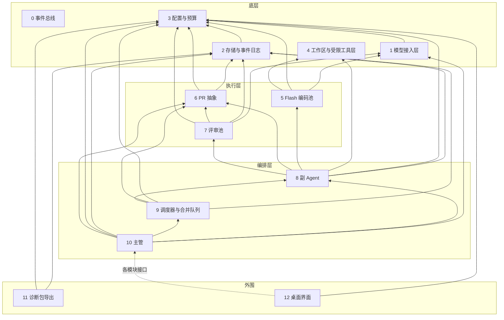

# BakaCoding 功能模块

2026 年 10 月 17 日（UTC+8）· 对应 [整体设计](product-design.md) v3.1（接口决定）

> 按功能模块切分是项目负责人提出的要求，模块边界由设计负责人决定（2026-10-17 05:56，05:58、05:59、06:01、06:03 修订；v3.0 定稿）。本文只描述边界、依赖和事件，不是开发排期。接口、事件和字段名都是**草案**；配置字段沿用整体设计 §10、§14 的草案名。下文「PD §n」指整体设计第 n 节。

## 分层

模块分四层共 13 个模块，**下层不依赖上层**。底层最下面是 0 事件总线，不依赖任何模块；底层内部其余依赖只有 1→3 和 2→3；4 没有依赖。上下层之间用事件解耦：下层发事件，上层订阅，都经 0 事件总线；2 订阅全部事件并落库（见「事件清单」）。

**依赖规则**：用到事件总线（发布或订阅）不算模块之间的依赖，只有直接调用才算。

**共享类型包** `@bakacoding/types`：只依赖 zod，放事件类型、常量和 zod schema（含 `permission_list`、`LedgerStore`、`call()` 的 `ctx`、diff 结构）。所有模块包都依赖它；它不是功能模块，依赖它不算模块之间的依赖，图中不画。

| 层 | 模块 |
| --- | --- |
| 底层（0 无依赖；其余内部依赖只有 1→3、2→3） | 0 事件总线 · 1 模型接入层 · 2 存储与事件日志 · 3 配置与预算 · 4 工作区与受限工具层 |
| 执行层 | 5 Flash 编码池 · 6 PR 抽象 · 7 评审池 |
| 编排层 | 8 副 Agent · 9 调度器与合并队列 · 10 主管 |
| 外围 | 11 诊断包导出 · 12 桌面界面 |

箭头指向被依赖的模块。界面依赖各模块的接口，图中只画一条虚线示意。0 事件总线所有模块都可以用，按依赖规则不画连线。

## 底层

### 0. 事件总线
- **职责**：进程内的发布和订阅，所有模块都可以用。只负责传递事件，不落库（落库由 2 订阅完成）。
- **对外接口（草案）**：`publish(event)`、`subscribe(type | "*", handler)`；事件公共字段见「事件清单」，事件类型和 schema 在 `@bakacoding/types`。
- **语义**：进程内异步分发；支持 `*` 通配订阅；span 由发布方生成，`trace_id` 按需求生成。
- **依赖**：无。
- **对应章节**：PD §12、§14（事件可追溯）。
- **配置字段**：无。

### 1. 模型接入层
- **职责**：按协议适配 Anthropic 兼容和 OpenAI 兼容两种接口（DeepSeek 默认走 Anthropic 兼容接口 `https://api.deepseek.com/anthropic`，与 harness 一致，见 [config.ts](https://github.com/deepseek-ai/deepseek-harness/tree/dsh-v0.2.1-alpha.5/packages/llm/llm-deepseek/src/config.ts)；OpenAI 兼容留作备选）；令牌桶限流，遇到 429 指数退避加抖动；思考档位映射：取值 `off` / `low` / `high` / `max`，配置字段 `effort` 与服务商无关，取值 `off` / `low` / `high` / `max`；映射由模块 1 的服务商能力表负责：DeepSeek → `output_config.effort`，OpenAI 兼容服务商 → `reasoning_effort`，不用数值档位（[serialize.ts](https://github.com/deepseek-ai/deepseek-harness/tree/dsh-v0.2.1-alpha.5/packages/llm/llm-deepseek/src/serialize.ts)）；服务商不支持的档位降到最高可用档并记一条警告，不报错，映射以能力表为准（配置不设 `effort_map`）；按调用计费，单价读 `config/pricing.json`，金额用整数微美元；每次调用前先查 3 的 `budgetState()`。新服务商以补丁加配置接入，不改核心。令牌桶按账号全局共享，多个项目合用一个桶，不按 key 分（DeepSeek 并发按账号计，与 key 无关：https://api-docs.deepseek.com/quick_start/rate_limit ）。每个服务商一张能力表：思考档位映射到 `output_config.effort`，不依赖 `cache_control` 和 `budget_tokens`，需要串行调用工具时由本地保证，并记录兼容接口忽略的字段（例如 DeepSeek 忽略 `budget_tokens`、`cache_control`、`disable_parallel_tool_use` 等：https://api-docs.deepseek.com/guides/anthropic_api ）。DeepSeek 请求序列化和档位逻辑可搬 harness 的 MIT 代码（规则见 PD §15）。不直接写日志：每次调用完成后在总线上发「调用完成」事件。
- **对外接口（草案）**：`call(role, provider, model, effort, prompt, ctx) → { output, tokens, cache_hit, latency_ms, cost, rate_limited_retry }`；`rateLimitState()`；`capabilities(provider) → 能力表`；事件：调用完成。`ctx` 必填：`{ role, requirement_id, ticket_id | null, is_resubmit, trace }`，没有单号的调用（如主管）`ticket_id` 为 `null`。
- **依赖**：3（读 key、配置和预算状态）。
- **对应章节**：PD §5、§10、§13、§15。
- **配置字段**：各角色的 `provider` / `model` / `effort`（与服务商无关，由本模块能力表映射；`roles.supervisor`、`roles.review_board.members[]`、`roles.sub_agent`、`roles.coder`）。

### 2. 存储与事件日志
- **职责**：SQLite（WAL），单一写入者加租约，配合幂等键，支持重启恢复；保存 PR 记录（按轮次）、主管的项目决策记忆、合并结果、基线 commit 与上下文包；从 0 用 `*` 通配订阅全部事件并落库，每条带 `trace_id`、`span_id`、`parent_span_id`（含「调用完成」写调用日志）；收到「项目已创建」后建群记录；保存项目群消息和主管待办指标；落库前调用 3 的脱敏函数做轻脱敏；完整提示词和输出保留 30 天，过期只留摘要和统计，「收进评测集」的单永久保留。
- **对外接口（草案）**：`queryEvents(filter)`、`savePrRecord(round)`、`query(filter)`、`markForEvalSet(ticket_id)`、`purgeExpired()`；实现 `@bakacoding/types` 的 `LedgerStore`，启动时注入给 3（3 不因此依赖 2）；台账条目 `LedgerEntry` 用 `event_id`（对应的 `call_completed` 事件）做幂等键，按 UTC 日期汇总。
- **依赖**：3（脱敏函数、保留期配置）。
- **对应章节**：PD §7、§12、§14、§16。
- **配置字段**：`diagnostics.retention_days`。

### 3. 配置与预算
- **职责**：加载并校验配置（schema 严格校验，未知字段直接报错，JSON 里不加注释字段），主管模型和每日预算必填，缺失时不启动；校验 `roles.supervisor` 必填且 `effort` 固定 `max`（`review_board.members` 不含主管）；密钥优先从环境变量（`DEEPSEEK_API_KEY`、`GITHUB_TOKEN`）读，本地配置文件 `config/secrets.local.json` 只作备选（已在 `.gitignore`）；预算台账（按需求单含复投、副 Agent、评审组分列，复投费用单列；按缓存命中/未命中、闲时/高峰分开计价）和每单上限；脱敏规则和脱敏函数；从总线订阅「调用完成」记台账；项目导入（项目配置、导入时按清单文件识别语言，完成后发「项目已创建」）；各角色的提示词模板（放在 `packages/config-budget/prompts/`）；台账通过注入的 `LedgerStore` 落库；单价表和优惠时段读 `config/pricing.json`（数值取自 DeepSeek 官方价格页，注明链接和查阅日期；高峰时段 `peak_hours_utc` 只在周一至周五生效，`cn_public_holidays` 按北京时间日期认定、全天算闲时，列表人工维护并逐年写明国务院办公厅放假通知来源，缺的日子按高峰价算，`source` 写价格页原文和查阅时间）；闲时偏好开关 `budget.offpeak_preference`（默认关，打开后预算紧张时 `priority=deferred` 的单优先等到闲时再跑，由 9 判断；v1 只做这一个开关；DeepSeek 闲时价格为高峰的一半：https://api-docs.deepseek.com/quick_start/pricing ）。
- **对外接口（草案）**：`getConfig()`、`validate() → errors[]`、`getSecret(name)`（读 `DEEPSEEK_API_KEY`、`GITHUB_TOKEN`）、`recordCost(ticket_id, role, cost, is_resubmit)`、`budgetState()`、`redact(text, level: light | full) → { text, report }`、`importProject(path) → project`、`promptTemplate(role)`；事件：项目已创建。
- **依赖**：无。
- **对应章节**：PD §2、§10、§11、§13、§15。
- **配置字段**：`roles.supervisor`（必填）、`budget.daily_micro_usd`（必填，整数微美元）、`budget.per_ticket_ratio`、`budget.offpeak_preference`（默认 `false`），以及所有草案字段的加载入口。

### 4. 工作区与受限工具层
- **职责**：每单创建 Git worktree 和工作分支（路径 `.bakacoding/worktrees/<ticket_id>-r<n>`，`n` 为轮次；从确认基线创建，不带入未跟踪的密钥文件），把路径交给 6，用完清理；提供五个文件工具，对齐 [DeepSeek Harness](https://github.com/deepseek-ai/deepseek-harness)（tag dsh-v0.2.1-alpha.5） 完整模式：`read`、`write`（整文件写）、`edit`（`old_string` / `new_string` / `replace_all`，字面量唯一匹配，换行统一 LF，不模糊匹配）、`glob`、`grep`（[工具目录](https://github.com/deepseek-ai/deepseek-harness/tree/dsh-v0.2.1-alpha.5/docs/tool-catalog.md)）；先读后写和陈旧版本检测；错误码 `FS_EDIT_NOT_FOUND` / `FS_AMBIGUOUS_EDIT` / `FS_NOT_OBSERVED` / `FS_STALE_VERSION` 及文案照搬，失败时文件不动、错误返回模型重试（[fsio.ts](https://github.com/deepseek-ai/deepseek-harness/tree/dsh-v0.2.1-alpha.5/packages/fs/fs-local/src/fsio.ts)、[error.ts](https://github.com/deepseek-ai/deepseek-harness/tree/dsh-v0.2.1-alpha.5/packages/fs/tool-fs/src/error.ts)）；与「只给基础编码工具、不给 shell」一致；按三级权限清单（读写、只读、拒绝，未列出的默认拒绝）执行；守住外层硬边界（只在本单工作区、按真实路径解析、处理符号链接、密钥和 `.env` 类文件不放行，不给 shell、网络、git）；只负责执行权限清单，不写 PR 记录。越界时在总线上发「需要扩大写入范围」，从总线收「已批准」「已拒绝」后执行。
- **对外接口（草案）**：`createWorktree(ticket_id, base_commit) → { path, branch }`、`cleanup(ticket_id)`、`tools: read / write / edit / glob / grep`、`applyPermissions(ticket_id, permission_list)`，`permission_list` 格式为 `[{ glob, level: "rw" | "ro" | "deny" }]`，未匹配即拒绝；事件：需要扩大写入范围。
- **依赖**：无。
- **对应章节**：PD §5、§6、§11。
- **配置字段**：设计中没有专用字段；执行环境见 `config/execution.example.json`。

## 执行层

### 5. Flash 编码池
- **职责**：临时 Flash 代理的生命周期（每单一个，写完即销毁）；编码槽位只计编码阶段，统一由 9 管理，5 本身不设并发上限；提示词公共前缀在前、需求单在后；同一项目的系统提示、工具定义、架构约束组成逐字节固定的公共前缀，不放时间戳和单号，否则无法命中 DeepSeek 缓存（新版缓存须完整匹配前缀单元：https://api-docs.deepseek.com/guides/kv_cache ）；复投时升档（第 1 次 `low`，第 2、3 次 `high`）；后备做法：确需中途改提示时，新内容作为一条 system 消息追加到历史末尾，工具定义只增不改，开头不动以保留前缀缓存（[models.ts](https://github.com/deepseek-ai/deepseek-harness/tree/dsh-v0.2.1-alpha.5/packages/llm/llm-deepseek/src/models.ts)、[serialize.ts](https://github.com/deepseek-ai/deepseek-harness/tree/dsh-v0.2.1-alpha.5/packages/llm/llm-deepseek/src/serialize.ts)）；Flash 使用 4 的五个文件工具（同 harness 完整模式），不给 shell。
- **对外接口（草案）**：`runTicket(ticket, worktree_path, permission_list, attempt) → patch`；`slots() → { used, limit }`。
- **依赖**：1、3、4。
- **对应章节**：PD §5、§8。
- **配置字段**：`roles.coder.resubmit_effort`（并发字段 `pipeline.concurrency_max` / `pipeline.concurrency_hard_max` 由 9 读取）。

### 6. PR 抽象
- **职责**：一套接口两种实现：有 GitHub 时推工作分支开真 PR、轮到时合入集成分支；没有远程仓库或读不到 `GITHUB_TOKEN`（经 3 的 `getSecret`）时只建本地 PR 记录。Flash 产出的补丁由 6 转成 commit。worktree 路径和分支由 4 交来，6 自己用 git 读 diff。单张 PR 和集成分支的 CI check 都由 6 读，集成分支也作为一种 PR 记录。本地记录为准，GitHub 状态同步回本地，差异记入日志；需要人工处理 GitHub 时发「上报」事件。
- **对外接口（草案）**：`open(ticket_id, worktree_path, branch) → pr_id`、`commitPatch(ticket_id, worktree_path, patch) → sha`、`diff(pr_id) → { base_sha, head_sha, files: [{ path, status, additions, deletions, patch }] }`、`merge(pr_id, target)`、`checks(pr_id) → results`、`sync()`；事件：上报（`reason: github_manual`，鉴权失败或需要手动解冲突时发，写 `detail`，不带 `resubmit_counts`）。
- **依赖**：2、3（`GITHUB_TOKEN`）。
- **对应章节**：PD §2、§7、§9、§15。
- **配置字段**：设计中没有专用字段。

### 7. 评审池
- **职责**：评审池成员按负载分配，复投的单交给原来的模型，被限流的模型跳过；评审输入固定为「diff + 需求单 + 精简摘要」，从 6 读 diff，对照需求单审查（是否完成需求、是否越界、有没有明显 bug、是否违反架构约束），给出评审结论；判不过的门槛待实测，由 11 的诊断包统计评审精度后再定；成员数为 0 时由主管兼任。
- **对外接口（草案）**：`review(ticket, pr_id, permission_list, attempt) → { verdict, reasons[] }`；`backlog() → { pending, capacity }`；事件：评审积压 `review_backlog`（9 订阅，9 不直接调用 7）。
- **依赖**：1、2、3（提示词模板）、6。
- **对应章节**：PD §8、§10。
- **配置字段**：`roles.review_board.members`、`roles.review_board.review_assignment`、`roles.review_board.sticky_on_resubmit`、`roles.review_board.skip_rate_limited`、`backpressure.reviews_per_member`。

## 编排层

### 8. 副 Agent
- **职责**：一单一个：用 3 的模板写编码提示词；按单设计 Flash 权限（三级格式：读写、只读、拒绝，默认全部拒绝），审批范围内的中途申请，并通过 6 的 PR 记录接口写入权限清单（含申请、批准、拒绝）；发起评审；不通过时驱动复投，评审不过最多 3 次，超限发「上报」事件；派单回报、评审结论、复投记录以「群消息」事件写入。依赖类需求单标为高风险。订阅 `interface_changed`：把摘要附进本单下一轮上下文包；本单在 `affected_ticket_ids` 中则触发重审。
- **对外接口（草案）**：`handle(ticket) → outcome`（通过 / 超限上报）；事件：上报、群消息；订阅 `interface_changed`。
- **依赖**：2、3（提示词模板）、4、5、6、7。
- **对应章节**：PD §6、§7、§8、§10、§16。
- **配置字段**：`sub_agent`、`pipeline.resubmit_limits.review`。

### 9. 调度器与合并队列
- **职责**：写入范围逻辑锁、独占区域单独排队；订阅「需要扩大写入范围」重新加锁，回「已批准」或「已拒绝」，加锁失败发「上报」；依赖已合并才放行，接口按生产者→消费者排序；需求单的接口声明必填；合并成功后发 `interface_changed` 事件（含受影响的在途单 `affected_ticket_ids`）；合并前检测冲突，有冲突退回复投，最多 2 次，超限发「上报」；基线前进且涉及的接口或依赖有变化时重新评审，不计复投；读 3 的闲时开关和单子的 `priority`（`normal` / `deferred`，与思考档位无关），决定 `deferred` 的单是否等闲时再跑；统一管理编码槽位（`pipeline.concurrency_max` / `pipeline.concurrency_hard_max`，只计编码阶段）；反压（按订阅到的 `review_backlog` 评审积压、从 2 读到的主管待办指标、API 并发和成本调整编码并发）。CI 结果只从 6 取。
- **对外接口（草案）**：`enqueue(ticket)`、`lock(ticket_id, write_scope) → ok | fail`、`mergeResult(pr_id) → { conflict, base_changed, re_reviewed, merged, reason? }`（`reason: "target_dirty"` 表示目标分支工作区不干净，排队重试，不计复投；hook 失败按一次尝试算，由 8 走复投）、`backpressureState()`；事件：已批准、已拒绝、上报、`interface_changed`；订阅 `review_backlog`。
- **依赖**：2、3、6、8。
- **对应章节**：PD §4、§6、§8、§9。
- **配置字段**：`pipeline.resubmit_limits.conflict`、`backpressure.*`、`pipeline.supervisor_backlog_limit`、`pipeline.concurrency_max`（反压调的就是这个数）、`pipeline.concurrency_hard_max`。

### 10. 主管
- **职责**：用户提需求和人工介入的唯一对接方（项目导入、设置、Git 侧栏等配置操作直接在 12 上做，不经过主管）；订阅「项目已创建」并在 1:1 里告知用户；对话（未说明项目时追问）、拆单（需求单接口声明必填；把项目决策记忆附进上下文包，记忆存在 2）、订阅「上报」处理（重拆，同一需求最多 2 次，超出交给用户）、裁决高风险 PR；合入 main 前审集成分支整体 diff，CI 结果从 6 取（配了 CI 的须为绿），按 `main_merge` 通知用户或直接合入；把自己的待办数量作为指标写进 2；派单以「群消息」事件写入。
- **对外接口（草案）**：`chat(message) → reply`；`split(requirement) → tickets[]`（含推理摘要）；`reviewIntegration() → ok | blocked`；`mergeMain()`；事件：主管待办指标、群消息。
- **依赖**：1、2、3（提示词模板）、6（CI 结果）、8、9。
- **对应章节**：PD §3、§4、§8、§9、§10、§16。
- **配置字段**：`roles.supervisor`、`pipeline.resplit_limit`、`pipeline.main_merge`、`pipeline.supervisor_backlog_limit`。

## 外围

### 11. 诊断包导出
- **职责**：按单张需求单、一个需求或某个时间段导出（一个包只放一个项目，按时间段导出须选项目）；zip 内含 JSONL 和原始文件；导出前调用 3 的脱敏函数做完整脱敏并附脱敏报告；默认只带 diff 和上下文片段；结果标签和重放格式；可选的 `eval_task` 段：只有标记进评测集的单必须填测试名列表和运行命令，由用户在导出界面人工补填，存在诊断包的 `eval_task` 段里，2 不额外采集（v1 不跑测试），GitHub CI check 里有测试名时预填作参考；可导出为 SWE-bench 风格 JSONL（SWE-bench 实例格式含 `FAIL_TO_PASS`、`PASS_TO_PASS` 等字段：https://github.com/SWE-bench/SWE-bench ）。统计评审精度（判不过门槛待实测的依据）。用于排查问题和离线分析，不是验收。
- **对外接口（草案）**：`export({ project_id, scope: ticket | requirement | time_range, include_full_repo }) → zip_path`；schema `bakacoding-diag/v1`（含可选 `eval_task`）；`toSweBenchJsonl(package) → jsonl`。
- **依赖**：2、3（可与编排层并行开发）。
- **对应章节**：PD §14、§18。
- **配置字段**：`diagnostics.retention_days`（间接）。

### 12. 桌面界面
- **职责**：Electron + React 三栏对话界面；导入项目时调用 3 的导入接口，展示 2 建好的群：主管 1:1 对话（唯一可发消息处，含设置入口和导出入口）；项目群（展示 2 中的群消息，按需求分话题、只读、Flash 调用默认折叠）；右侧边栏（编码池状态一行、Git 区、PR 列表、导出入口）；极简视觉规则。选型：electron-vite-react 壳子模板、shadcn/ui 组件、lucide 图标。
- **对外接口（草案）**：只消费各模块接口和事件；用户输入只发往模块 10；订阅 `escalated`（`reason: resplit_limit`），提示「需要人工介入」。
- **依赖**：3（项目导入）及各模块的接口；接口定下来后可以先做壳子。
- **对应章节**：PD §15、§16。
- **配置字段**：设计中没有专用字段；设置入口编辑模块 3 的配置。

## 事件清单

事件经 0 事件总线发布和订阅，2 订阅全部事件并落库。名称和字段均为**草案**，字段只列设计文档或外部来源有依据的内容。

**公共字段**（每个事件都带，放在事件顶层）：`type`、`trace_id`、`span_id`、`parent_span_id`、`ts`（ISO 8601 UTC 时间，必须以 `Z` 结尾）、单调递增的 `seq`。各事件自己的字段放进 `payload`，下表「字段」列即 `payload` 的内容。事件类型和 zod schema 在 `@bakacoding/types`。金额（如 `cost`）一律整数微美元。

**角色取值**：事件里的 `role` 取 `supervisor` / `reviewer` / `sub_agent` / `coder`。`reviewer` 指单个评审成员，对应配置 `roles.review_board.members[]` 中的一项；`review_board` 指整个评审组（评审池成员加分配规则），不作为事件角色出现。其余三个与 `roles.supervisor`、`roles.sub_agent`、`roles.coder` 一一对应。一个需求对应一条 trace，每张单是其中一个 span。命名向 OpenTelemetry GenAI 约定靠拢，但该约定仍处于 Development 阶段，只做映射，不直接采用（https://opentelemetry.io/docs/specs/semconv/gen-ai/ ）。

| 事件 | 发送方 | 订阅方 | 字段（草案） | 依据 |
| --- | --- | --- | --- | --- |
| 项目已创建 `project_created` | 3 | 2（建群记录）、10（在 1:1 告知用户）、12（展示） | `project_id`、`name`、`language`、`has_github_remote` | PD §2、§16 |
| 调用完成 `call_completed` | 1 | 2（写调用日志）、3（预算台账） | `ticket_id`、`role`、`provider`、`model`、`effort`、`prompt`、`output`、`tokens`（`input` 为全部输入 token，包含 `cache_hit_input`；另有 `output`）、`cache_hit`、`latency_ms`、`cost`、`is_resubmit`、`rate_limited_retry` | PD §13、§14 |
| 需要扩大写入范围 `write_scope_requested` | 4 | 9 | `ticket_id`、`request_id`、`requested_scope`、`reason` | PD §6 |
| 已批准 `write_scope_granted` | 9 | 4 | `ticket_id`、`request_id`、`granted_scope` | PD §6 |
| 已拒绝 `write_scope_denied` | 9 | 4 | `ticket_id`、`request_id`、`requested_scope`、`reason` | PD §6 |
| 上报 `escalated` | 6（`github_manual`：鉴权失败或需要手动解冲突）、8（评审不过超限）、9（冲突超限、加锁失败）、10（重拆超限 `resplit_limit`，由主管自己发出） | 10；`resplit_limit` 由 12 订阅，提示「需要人工介入」 | `ticket_id`、`requirement_id`、`reason`（`review_limit` / `conflict_limit` / `scope_lock_failed` / `resplit_limit` / `github_manual`）、`resubmit_counts`（可选；`github_manual` 不带）、`detail`（可选，自由文本；`github_manual` 必写） | PD §6、§7、§8 |
| 接口已变更 `interface_changed` | 9（合并成功后） | 8 | `pr_id`、`ticket_id`（必填）、`base_commit`（合并后新基线）、`changed_interfaces`（改动的接口列表，每项为文件 + 符号）、`summary`、`affected_ticket_ids`（写入范围或接口声明与本次改动有交集的在途单） | PD §9 |
| 评审积压 `review_backlog` | 7 | 9（反压） | `pending`、`capacity` | PD §9 |
| 主管待办指标 `supervisor_backlog` | 10 | 9 | `pending`、`capacity` | PD §9 |
| 群消息 `group_message` | 8、10 | 2（存储）、12（展示） | `project_id`、`requirement_id`（话题）、`sender`（主管 / 副 Agent）、`kind`（派单 / 回报 / 评审结论 / 复投记录 / 上报 `escalation`）、`content`、`flash_calls`（折叠的调用引用） | PD §16 |

## 开发顺序

按四层自下而上排，不含工时估算。

1. **最先一起定下**：`@bakacoding/types` 的事件格式和共享类型、0 的总线接口、3 的读密钥和读配置接口。所有模块都要用到这三项。
2. **底层**：0、1、2、3、4 并行开发。
3. **执行层**：5 Flash 编码池、6 PR 抽象、7 评审池。7 依赖 6，6 的 diff 接口要先定。
4. **编排层**：8 副 Agent → 9 调度器与合并队列 → 10 主管（按依赖顺序）。
5. **外围（与编排层并行）**：11 诊断包导出只依赖 2、3；12 桌面界面依赖 3，在接口定下来后先做壳子，再随编排层接入。

## 已定与待确认

05:59 之前列出的待确认事项和 06:01 前指出的 5 处矛盾已全部由设计负责人定下，结论已写入上文各模块和「事件清单」。令牌桶按账号全局共享也已定。导入算界面操作、不经过主管，也已定（06:03）。

v3.0 设计定稿：原「待项目负责人确认」的 5 项（`eval_task`、闲时开关与 `priority`、固定前缀、能力表、事件公共字段）以及接口变更推送（`interface_changed` 事件）、决策记忆、评审输入、三级权限、界面选型均已定，结论已写入上文各模块和「事件清单」。修正：`eval_task` 的测试名列表和运行命令只在导出时人工补填，2 不额外采集；`priority` 取值为 `normal` / `deferred`。

v3.1 接口决定（设计负责人拍板）：共享类型包、降档加警告、去掉 `effort_map`、`call()` 的 `ctx`、`getSecret`、`commitPatch` 与 diff 结构、6 依赖 3、`review_backlog` 事件与编码槽位由 9 管理、`LedgerStore` 注入、总线语义、`permission_list` 格式、worktree 路径、时间格式与 `seq`、微美元、提示词模板目录、`config/pricing.json`；事件结构（公共字段顶层、`payload`、`ts`、`request_id`、`escalated.reason`、两个积压事件同结构、`role` 取值），已写入上文。

仍待实测：7 的判不过门槛。观察项和不采纳项见整体设计 §19。
