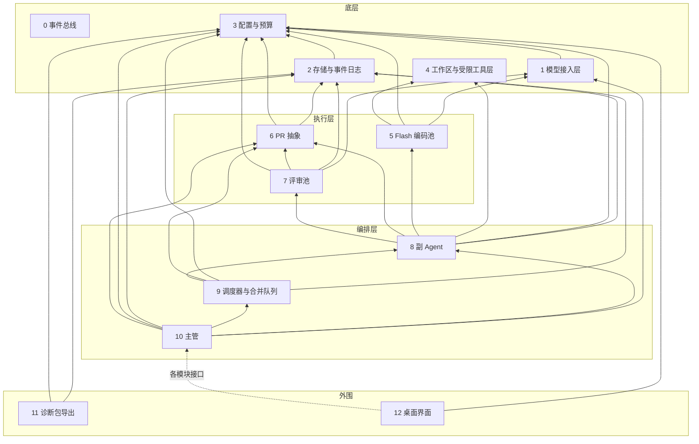

# BakaCoding 功能模块

2026 年 10 月 17 日（UTC+8）· 对应 [整体设计](product-design.md) v3.1（接口决定）

> 按功能模块切分是项目负责人提出的要求，模块边界由设计负责人决定（2026-10-17 05:56，05:58、05:59、06:01、06:03 修订；v3.0 定稿）。本文只描述边界、依赖和事件，不是开发排期。接口、事件和字段名都是**草案**；配置字段沿用整体设计 §10、§14 的草案名。下文「PD §n」指整体设计第 n 节。

## 分层

模块分四层共 13 个模块，**下层不依赖上层**。底层最下面是 0 事件总线，不依赖任何模块；底层内部其余依赖只有 1→3 和 2→3；4 没有依赖。上下层之间用事件解耦：下层发事件，上层订阅，都经 0 事件总线；2 订阅全部事件并落库（见「事件清单」）。

**依赖规则**：用到事件总线（发布或订阅）不算模块之间的依赖，只有直接调用才算。

**共享类型包** `@bakacoding/types`：只依赖 zod，放事件类型、常量和 zod schema（含 `permission_list`、`LedgerStore`、`DiagnosticsSource`、`call()` 的 `ctx`、diff 结构）。所有模块包都依赖它；它不是功能模块，依赖它不算模块之间的依赖，图中不画。

| 层 | 模块 |
| --- | --- |
| 底层（0 无依赖；其余内部依赖只有 1→3、2→3） | 0 事件总线 · 1 模型接入层 · 2 存储与事件日志 · 3 配置与预算 · 4 工作区与受限工具层 |
| 执行层 | 5 Flash 编码池 · 6 PR 抽象 · 7 评审池 |
| 编排层 | 8 副 Agent · 9 调度器与合并队列 · 10 主管 |
| 外围 | 11 诊断包导出 · 12 桌面界面 |



箭头指向被依赖的模块。界面依赖各模块的接口，图中只画一条虚线示意。0 事件总线所有模块都可以用，按依赖规则不画连线。

## 底层

### 0. 事件总线
- **职责**：进程内的发布和订阅，所有模块都可以用。只负责传递事件，不落库（落库由 2 订阅完成）。
- **对外接口（草案）**：`publish(event)`、`subscribe(type | "*", handler)`；事件公共字段见「事件清单」，事件类型和 schema 在 `@bakacoding/types`。
- **语义**：进程内异步分发；支持 `*` 通配订阅；span 由发布方生成，`trace_id` 按需求生成；发布时用 zod 校验，失败不分发、不占序号；`seq` 由总线分配，`createEventBus({ initialSeq })` 指定起点；每个订阅者按发布顺序串行收到事件，积压超过 `maxQueue`（默认 10000）时告警但不丢；handler 出错交给 `onHandlerError`，回调自身出错兜底 `console.error`。
- **依赖**：无。
- **对应章节**：PD §12、§14（事件可追溯）。
- **配置字段**：无。

### 1. 模型接入层
- **职责**：按协议适配 Anthropic 兼容和 OpenAI 兼容两种接口（DeepSeek 默认走 Anthropic 兼容接口 `https://api.deepseek.com/anthropic`，与 harness 一致，见 [config.ts](https://github.com/deepseek-ai/deepseek-harness/tree/dsh-v0.2.1-alpha.5/packages/llm/llm-deepseek/src/config.ts)；OpenAI 兼容留作备选）；令牌桶限流，遇到 429 指数退避加抖动；思考档位映射：取值 `off` / `low` / `high` / `max`，配置字段 `effort` 与服务商无关，取值 `off` / `low` / `high` / `max`；映射由模块 1 的服务商能力表负责：DeepSeek → `output_config.effort`，OpenAI 兼容服务商 → `reasoning_effort`，不用数值档位（[serialize.ts](https://github.com/deepseek-ai/deepseek-harness/tree/dsh-v0.2.1-alpha.5/packages/llm/llm-deepseek/src/serialize.ts)）；服务商不支持的档位降到最高可用档并记一条警告，不报错，映射以能力表为准（配置不设 `effort_map`）；按调用计费，单价读 `config/pricing.json`，金额用整数微美元；每次调用前先向 3 预占预算（`reserve`），结束后释放。新服务商以补丁加配置接入，不改核心。令牌桶按账号全局共享，多个项目合用一个桶，不按 key 分（DeepSeek 并发按账号计，与 key 无关：https://api-docs.deepseek.com/quick_start/rate_limit ）。每个服务商一张能力表：思考档位映射到 `output_config.effort`，不依赖 `cache_control` 和 `budget_tokens`，需要串行调用工具时由本地保证，并记录兼容接口忽略的字段（例如 DeepSeek 忽略 `budget_tokens`、`cache_control`、`disable_parallel_tool_use` 等：https://api-docs.deepseek.com/guides/anthropic_api ）。DeepSeek 请求序列化和档位逻辑可搬 harness 的 MIT 代码（规则见 PD §15）。不直接写日志：每次调用完成后在总线上发「调用完成」事件。
- **对外接口（草案）**：`createModelGateway({ getConfig, pricing, budget, publish, getSecret?, fetch?, clock?, rateLimit?, onWarning? })` 返回以下四个方法。`chat({ role, provider, model, effort, system, tools, messages, ctx, signal? }) → { content, tool_calls, reasoning, effort, tokens, cache_hit, latency_ms, cost, rate_limited_retry }`：多轮工具调用，`tools` / `messages` / `tool_calls` 与 5 的 `ToolDefinition` / `ChatMessage` 同结构（`{ id, name, input }`），assistant 消息可带 `reasoning`（`{ text, signature? }[]`）原样回传思考内容；`call(role, provider, model, effort, prompt, ctx, { signal? }?) → { output, tokens, cache_hit, latency_ms, cost, rate_limited_retry }` 是 `chat` 的单轮包装；`rateLimitState({ provider, model? }?)` 返回账号级令牌桶（`capacity` / `available` / `waiting`）和按 provider/model 记的 429 退避状态（`limited` / `until` / `rate_limited_total`）；`capabilities(provider) → 能力表`；事件：调用完成。`ctx` 必填：`{ role, requirement_id, ticket_id | null, is_resubmit, trace }`，没有单号的调用（如主管）`ticket_id` 为 `null`，`role` 必须与 `ctx.role` 一致。
  - **协议细节**：DeepSeek 两种协议都发 `thinking: { type: enabled | disabled }`；Anthropic 协议档位写 `output_config.effort`，OpenAI 协议写 `reasoning_effort`（`low` / `high` / `max`）。OpenAI 协议下 assistant 消息的 `reasoning` 写回 `reasoning_content`：DeepSeek 要求带 `tools` 的请求回传之前所有轮次的 `reasoning_content`，否则返回 400（https://api-docs.deepseek.com/guides/thinking_mode ）；通用 OpenAI 服务商不发 `thinking`、不回传。v1 非流式。
  - **输出上限与超时**：模型配置可选 `max_tokens`。Anthropic 协议的 `max_tokens` 是必填项，一律传：有配置值用配置值，没有就用能力表的输出上限（`default_max_tokens`）；OpenAI 协议填了才传，不填用服务端默认值。服务商配置可选 `request_timeout_ms`，默认 600000（10 分钟），从发出请求到读完响应体计时。
  - **预算**：调用前按「输入估算 + 输出上限」向 3 预占（输入按请求体字符数、未命中价估；输出按模型的 `max_tokens`，没填按能力表 `default_max_tokens`，按输出价估），预占失败抛 `BudgetExceededError`（`code: "BUDGET_EXCEEDED"`，`scope: daily | ticket`），不发请求也不发事件；预占成功后无论成功、失败、取消还是抛异常，都在 `finally` 里释放（`call_completed` 记进台账之后），实际花费以台账为准；判断时不计本次估算，所以最多超出一个进行中调用的费用。
  - **重试**：429、500 / 502 / 503 / 504、响应到达之前的连接错误和超时会重试，合计最多 3 次；退避 1s 起翻倍、加 0~50% 抖动、上限 60s，429 取与 `retry-after` 的较大值；每次重试前检查 `signal`。`rate_limited_retry` 只数 429 的重试。其他错误不重试。限流参数（桶容量 8、每秒补 4、重试次数、退避）是 `createModelGateway({ rateLimit })` 的选项，不进配置文件。
  - **错误**：服务商失败抛 `ModelGatewayError`（`code`：`AUTH` / `QUOTA` / `RATE_LIMIT` / `INVALID_REQUEST` / `CONTEXT_WINDOW_EXCEEDED` / `SERVER` / `NETWORK` / `BAD_RESPONSE` / `CONFIG`，超时归 `NETWORK`，信息里不含密钥）；`signal` 取消时中止 HTTP 请求并抛 `AbortError`。
  - **调用完成事件**：只有请求真的发出去了才发 `call_completed`（还没发出就取消、预算不足、配置错误都不发）。成功时 `error: null`；失败时 `error: { code }`，code 取上面的错误码，取消为 `ABORTED`；旧事件没有 `error` 字段，按成功处理。失败时回复里已经解析出用量的按实际 token 计费，否则 token 和 `cost` 记 0。`prompt` 记全部模型输入：`chat` 是 `{ system, messages, reply_reasoning? }` 的 JSON（messages 含工具调用、工具结果和回传的思考），`call` 是 prompt 原文；本轮回复的思考内容属于模型内容，只记在 `prompt`（`reply_reasoning`，`call` 追加在 `[reasoning]` 之后，桌面会遮蔽），不进 `output`；`output` 只有本轮回复文字，`chat` 有工具调用时再追加一行 `[tool_calls] 工具名, …`。span：每次调用发一个子 span（`parent_span_id` = `ctx.trace.span_id`）。
  - **token 定义**：`input` = 全部输入 token（含缓存命中），`cache_hit_input` = 缓存读取（命中）的 token，未命中 = `input − cache_hit_input`，`output` = 输出 token；`cost` 按命中价、未命中价、输出价三项分别计（3 的 `computeCost`）。Anthropic 协议换算：`input = input_tokens + cache_read_input_tokens + cache_creation_input_tokens`，`cache_hit_input = cache_read_input_tokens`；OpenAI 协议：`input = prompt_tokens`，`cache_hit_input` 取 `prompt_tokens_details.cached_tokens` 或 `prompt_cache_hit_tokens`。
- **依赖**：3（读 key、配置和预算状态）。
- **对应章节**：PD §5、§10、§13、§15。
- **配置字段**：各角色的 `provider` / `model` / `effort`（与服务商无关，由本模块能力表映射；`roles.supervisor`、`roles.review_board.members[]`、`roles.sub_agent`、`roles.coder`）。

### 2. 存储与事件日志
- **职责**：SQLite（WAL），单一写入者加租约，配合幂等键，支持重启恢复；保存 PR 记录（按轮次）、主管的项目决策记忆、合并结果、基线 commit 与上下文包；从 0 用 `*` 通配订阅全部事件并落库，每条带 `trace_id`、`span_id`、`parent_span_id`（含「调用完成」写调用日志）；收到「项目已创建」后建群记录；保存项目群消息和主管待办指标；落库前调用 3 的脱敏函数做轻脱敏；完整提示词和输出保留 30 天，过期只留摘要和统计，「收进评测集」的单永久保留。
- **对外接口（草案）**：`openStorage({ path, retention_days })` 打开库（拿不到写入租约时报 `StorageLeaseError`）；`attach(bus, { onError })` 用 `*` 订阅落库（落库失败交给 `onError`，默认 `console.error`）；`health()` 返回落库失败次数、最近一次失败和租约是否丢失；`nextSeq()`（传给总线 `initialSeq`）、`maxSeq()`（库里最大 seq，空库为 `null`）；`openStorageReadonly({ path, nativeBinding? })` 只读打开（给 12 等读方用：不跑迁移、不拿也不动租约，库版本不对时报可读的错误，调用写方法抛 `StorageReadonlyError`），只暴露读方法（`health`、`nextSeq`、`maxSeq`、`queryEvents`、`query`、`getTicket`、`listTickets`、`listPrRounds`、`listDecisions`、`listProjects`、`groupMessages`、`backlogMetrics`、`diagnosticsSource`、`prStore()` 的 `get` / `list`、`ledger` 的汇总）；`nativeBinding` 可指向为 Electron 另编的 better-sqlite3（驱动 12.x）；`queryEvents(filter)`、`savePrRecord(round)`（轮次可带结构字段 `reviewer`：成员 id、`"supervisor"` 或 `null`，原样往返不脱敏，旧记录读出 `null`）、`prStore()`（实现 6 的 `PrStore`，结构字段原样往返、只拒带凭据的 URL，自由文本轻脱敏，`kind` 单独存、只能是 `ticket` / `integration`）、`listPrRounds(ticket_id) → RoundRecord[]`（该单全部轮次按轮次升序，旧记录 `reviewer` 读出 `null`，单不存在返回空数组；写入方和只读连接都有）、`saveTicket(ticket)`（T-055 起可带 `fields`：需求单结构化字段，如 `write_scope`、`interfaces`、`depends_on`、`priority`、`kind`、`origin`、trace，字段由 10 定义，2 只按 JSON 原样存取、不脱敏；必须是能 JSON 往返的普通对象，否则抛 `TypeError`；不传时保留库里原值，8 回写权限清单不会把它冲掉，传 `{}` 才清空）、`getTicket(ticket_id) → StoredTicket | undefined`、`listTickets({ project_id?, requirement_id?, status? }) → StoredTicket[]`（T-055，按 `created_at`、`ticket_id` 升序；`StoredTicket` 是需求单那一行，不含轮次，旧记录 `fields` 读出 `null`，库里的 `fields` 损坏或不是对象时也读成 `null` 并经可选的 `logger`（`openStorage` / `openStorageReadonly` 的 `{ warn }`，默认 `console.warn`）记一条警告；写入方和只读连接都有。`fields` 不脱敏，11 导出诊断包时不能原样带上）、`saveMergeResult(ticket_id, result)`、`query(filter)`、`saveDecision` / `listDecisions`、`listProjects() → { project_id, name, created_at }[]`（按创建时间排序；`name` 自 T-055 起返回）、`registerRequirement(requirement_id, project_id)`（群消息只在需求未登记时登记，不覆盖）、`markForEvalSet(ticket_id)`、`purgeExpired()`；`diagnosticsSource()` 实现 `@bakacoding/types` 的 `DiagnosticsSource`，启动时注入给 11；实现 `@bakacoding/types` 的 `LedgerStore`，启动时注入给 3（3 不因此依赖 2）；台账条目 `LedgerEntry` 用 `event_id`（对应的 `call_completed` 事件）做幂等键，按 UTC 日期汇总；`totalsByDay` / `totalsByTicket` 返回 `LedgerBreakdown`（`LedgerTotals` 加 `by_role`，四个角色都列，没花费为 0）。
- **依赖**：3（脱敏函数、保留期配置）。
- **对应章节**：PD §7、§12、§14、§16。
- **配置字段**：`diagnostics.retention_days`。

### 3. 配置与预算
- **职责**：加载并校验配置（schema 严格校验，未知字段直接报错，JSON 里不加注释字段），主管模型和每日预算必填，缺失时不启动；校验 `roles.supervisor` 必填且 `effort` 固定 `max`（`review_board.members` 不含主管）；密钥优先从环境变量（`DEEPSEEK_API_KEY`、`GITHUB_TOKEN`）读，本地配置文件 `config/secrets.local.json` 只作备选（已在 `.gitignore`）；预算台账（按需求单含复投、副 Agent、评审组分列，复投费用单列；按缓存命中/未命中、闲时/高峰分开计价）和每单上限；脱敏规则和脱敏函数；从总线订阅「调用完成」记台账；项目导入（项目配置、导入时按清单文件识别语言，完成后发「项目已创建」）；各角色的提示词模板（放在 `packages/config-budget/prompts/`）；台账通过注入的 `LedgerStore` 落库；单价表和优惠时段读 `config/pricing.json`（数值取自 DeepSeek 官方价格页，注明链接和查阅日期；高峰时段 `peak_hours_utc` 只在周一至周五生效，`cn_public_holidays` 按北京时间日期认定、全天算闲时，列表人工维护并逐年写明国务院办公厅放假通知来源，缺的日子按高峰价算，`source` 写价格页原文和查阅时间）；闲时偏好开关 `budget.offpeak_preference`（默认关，打开后预算紧张时 `priority=deferred` 的单优先等到闲时再跑，由 9 判断；v1 只做这一个开关；DeepSeek 闲时价格为高峰的一半：https://api-docs.deepseek.com/quick_start/pricing ）。
- **对外接口（草案）**：`getConfig()`、`validate() → errors[]`、`getSecret(name)`（读 `DEEPSEEK_API_KEY`、`GITHUB_TOKEN`）、`createBudget({ budget, pricing, ledger, now? })` 返回 `{ recordCost, budgetState, reserve, attach }`：`recordCost(entry: LedgerEntry)`（手工补记，`entry_id` 幂等）、`attach(bus, { onError })`（订阅 `call_completed` 记台账，`entry_id` 取 `event_id`，闲时按事件 `ts` 判断，失败交给 `onError`）、`budgetState(ticket_id?) → Promise<BudgetState>`（当日 UTC 上限 / 已花 / 复投 / 剩余 / `daily_exhausted`、每单上限 = 每日预算 × `per_ticket_ratio` 向下取整、按角色分列、`offpeak_now`、`offpeak_preference`；传 `ticket_id` 时另带该单已花 / 复投 / 剩余 / `exhausted`；已花 ≥ 上限即 exhausted；另带进行中调用的预占额 `reserved_today_micro_usd`、单的 `reserved_micro_usd`）、`reserve({ ticket_id | null, amount_micro_usd }) → { ok: true, release() } | { ok: false, scope: daily | ticket }`（模块 1 调用前预占：已花 + 其他调用的预占 ≥ 每日或每单上限时拒绝，否则记下；本次预占额不参与自己的判断，因此最多超出一个进行中调用的费用；预占与释放串行执行，释放在台账写入之后，因此任何一次判断都能看到预占或实际花费；只存在本进程内存，重启清空）；`computeCost(pricing, model, tokens, at) → { cost_micro_usd, offpeak }`（命中、未命中、输出分开计价，按调用时刻选高峰或闲时价，向上取整到微美元，未知模型报错，供 1 计费）、`redact(text, level: light | full) → { text, report }`、`importProject(path, { publish?, trace?, name?, languagesFile? }?) → Project`（T-008：只读不写，不要求是 git 仓库；只看根目录的清单文件，按 `prompts/languages.json` 的顺序识别语言，第一个命中的是主语言 `language`，都没命中为 `"unknown"`，另带全部命中的 `languages` 和 `manifests`；读 `.git` 的 config（worktree 跟 `gitdir` / `commondir`）里各 `[remote]` 的 `url`，指向 github.com 即 `has_github_remote`；`project_id` = 名称 slug + 真实路径 sha256 前 8 位，同一路径重复导入得到同一个 id，传不同的 `name` 得到不同的 id；git 元数据按不可信文件读：非阻塞打开、只读普通文件、上限 1 MiB，否则当作没有远程；路径不存在或不是目录报 `ProjectImportError`；给了 `publish` 时发 `project_created`，`requirement_id` / `ticket_id` 为 `null`，不给 `trace` 就新开一条）、`promptTemplate(role, { dir?, architecture_constraints?, logger? }?) → Promise<string>`（T-008：读 `packages/config-budget/prompts/<role>.md`，四个角色都有；每次都读文件，去 BOM、换行统一 LF、去首尾空白，同样内容逐字节相同，缓存由调用方按内容哈希做；`reviewer` 模板带 `{{input}}`，7 替换或追加；给了非空 `architecture_constraints` 时加一节「## 项目架构约束」，有 `{{input}}` 放在它前面，没有就接在末尾，按可信文本给出，约束里字面的 `{{input}}` 先去掉；未知角色或读不到文件报 `PromptTemplateError`）；事件：项目已创建。
- **依赖**：无。
- **对应章节**：PD §2、§10、§11、§13、§15。
- **配置字段**：`roles.supervisor`（必填）、`budget.daily_micro_usd`（必填，整数微美元）、`budget.per_ticket_ratio`、`budget.offpeak_preference`（默认 `false`）、`pipeline.max_turns`（默认 40，Flash 代理每单最多调用模型的轮数，由 5 读取），以及所有草案字段的加载入口。

### 4. 工作区与受限工具层
- **职责**：每单创建 Git worktree 和工作分支（路径 `.bakacoding/worktrees/<ticket_id>-r<n>`，`n` 为轮次；从确认基线创建，不带入未跟踪的密钥文件），把路径交给 6，用完清理；提供五个文件工具，对齐 [DeepSeek Harness](https://github.com/deepseek-ai/deepseek-harness)（tag dsh-v0.2.1-alpha.5） 完整模式：`read`、`write`（整文件写）、`edit`（`old_string` / `new_string` / `replace_all`，字面量唯一匹配，换行统一 LF，不模糊匹配）、`glob`、`grep`（[工具目录](https://github.com/deepseek-ai/deepseek-harness/tree/dsh-v0.2.1-alpha.5/docs/tool-catalog.md)）；先读后写和陈旧版本检测；错误码 `FS_EDIT_NOT_FOUND` / `FS_AMBIGUOUS_EDIT` / `FS_NOT_OBSERVED` / `FS_STALE_VERSION` 及文案照搬，失败时文件不动、错误返回模型重试（[fsio.ts](https://github.com/deepseek-ai/deepseek-harness/tree/dsh-v0.2.1-alpha.5/packages/fs/fs-local/src/fsio.ts)、[error.ts](https://github.com/deepseek-ai/deepseek-harness/tree/dsh-v0.2.1-alpha.5/packages/fs/tool-fs/src/error.ts)）；与「只给基础编码工具、不给 shell」一致；按三级权限清单（读写、只读、拒绝，未列出的默认拒绝）执行；守住外层硬边界（只在本单工作区、按真实路径解析、处理符号链接、密钥和 `.env` 类文件不放行，`.env.example` 只读放行，不给 shell、网络、git）；只负责执行权限清单，不写 PR 记录。越界时在总线上发「需要扩大写入范围」，从总线收「已批准」「已拒绝」后执行。
- **对外接口（草案）**：`createWorktree(ticket_id, base_commit) → { path, branch }`、`cleanup(ticket_id)`、`createTools({ ticket_id, worktree_path, permission_list, registry?, scope_requests?, grep_timeout_ms? }) → { read, write, edit, glob, grep }`（每个 `(input) → Promise<{ ok: true, output } | { ok: false, code, message }>`，参数名同 harness：`read(file_path, offset?, limit?)`、`write(file_path, content)`、`edit(file_path, old_string, new_string, replace_all?)`、`glob(pattern, path?)`、`grep(pattern, path?, include?)`）与 `FILE_TOOL_DEFINITIONS`（五个工具的 JSON Schema，5 放进公共前缀；整棵深冻结，字节不变）；路径越界报 `FS_OUTSIDE_WORKSPACE`，`.git` / `.env` 类 / 私钥类报 `FS_PROTECTED_PATH`，权限不够报 `FS_PERMISSION_DENIED`；grep 正则超过 `GREP_PATTERN_MAX_LENGTH`（1000 字符）报 `FS_INVALID_INPUT`，匹配在独立线程里跑，一次调用超过 `grep_timeout_ms`（默认 `GREP_TIMEOUT_MS` = 10 秒）终止线程并报 `FS_GREP_TIMEOUT`；权限清单后面的条目覆盖前面的；`applyPermissions(ticket_id, permission_list)`，`permission_list` 格式为 `[{ glob, level: "rw" | "ro" | "deny" }]`，未匹配即拒绝；不安全的 glob 由导出的 `isUnsafeGlob(glob)` 判定（全项目唯一一份，8、9 也调它）：任何位置出现 `..`、`.` 段或空段、`/` 开头、盘符、`~` 开头、反斜杠、NUL、`!` / `#` 开头、花括号或小括号里带 `/` 或有备选正好是 `.`、空串；登记清单时不安全的 `rw` 条目丢弃、不安全的 `ro` 条目原位改成 `deny`（后条覆盖前条，丢掉会让它要加的限制失效），都记警告，`deny` 条目保留；越界写申请时目标路径带通配字符 `* ? [ ] { } ( ) ! + @`（与 8 的 T-053 同一字符集，T-054）或不能表达成安全范围就直接拒绝、不发事件，批准的范围里不安全的条目不生效；清单登记在进程内的 `PermissionRegistry`（默认 `defaultPermissionRegistry`，`createTools` 建工具时登记调用方给的清单），`applyPermissions` 整份替换后同一单的工具立刻按新清单判定，不落库；越界写：`createTools` 传了 `scope_requests: { bus, ctx: { requirement_id, trace }, timeout_ms? }` 时，写 / 改被权限清单拒绝就发「需要扩大写入范围」（`requested_scope` 为目标路径），等同一 `request_id` 的「已批准」后把 `granted_scope` 以 `rw` 追加到清单末尾再判，「已拒绝」或超时（默认 5 分钟）返回 `FS_PERMISSION_DENIED` 带原因；受保护路径和工作区外路径不申请；不传 `scope_requests` 直接拒绝；批准的范围需跨轮次保留时由调用方写回需求单记录；事件：需要扩大写入范围。
- **依赖**：无。
- **对应章节**：PD §5、§6、§11。
- **配置字段**：设计中没有专用字段；执行环境见 `config/execution.example.json`。

## 执行层

### 5. Flash 编码池
- **职责**：临时 Flash 代理的生命周期（每单一个，跑完即销毁，不共享会话状态）；编码槽位只计编码阶段，统一由 9 管理，5 本身不设并发上限；提示词公共前缀在前、需求单在后；同一项目的系统提示、工具定义、架构约束组成逐字节固定的公共前缀，不放时间戳和单号，否则无法命中 DeepSeek 缓存（新版缓存须完整匹配前缀单元：https://api-docs.deepseek.com/guides/kv_cache ）；后备做法：确需中途改提示时，新内容作为一条 system 消息追加到历史末尾，工具定义只增不改，开头不动以保留前缀缓存（[models.ts](https://github.com/deepseek-ai/deepseek-harness/tree/dsh-v0.2.1-alpha.5/packages/llm/llm-deepseek/src/models.ts)、[serialize.ts](https://github.com/deepseek-ai/deepseek-harness/tree/dsh-v0.2.1-alpha.5/packages/llm/llm-deepseek/src/serialize.ts)）；Flash 只用 4 的五个文件工具（同 harness 完整模式）直接改 worktree，不给 shell、网络、git。
- **对外接口（草案）**：`createCoderPool(deps) → { runTicket, prefix }`。
  - `runTicket({ ticket, prompt, worktree_path, permission_list, effort, feedback?, ctx, signal?, scope_requests? }) → { status: "done" | "gave_up" | "turn_limit" | "budget_exceeded", summary, changed_files }`，不返回补丁。
  - 5-1 提交由调用方调 6 的 `commitWorktree`，5 自己不提交；`changed_files` 是 `write` / `edit` 成功过的文件：取调用参数 `file_path`，按 4 的规则规范成相对 worktree 的路径（反斜杠转 `/`、去 `./`、合并 `..`），去重，按首次修改顺序（T-034）。
  - 5-2 `prompt` 是 8 写好的需求单部分；5 只拼公共前缀（`promptTemplate("coder")` + 结束协议 + 项目架构约束作系统提示，加五个工具定义；工具定义直接用 4 的 `FILE_TOOL_DEFINITIONS`，5 加载时深拷贝并冻结，不再自己定义，T-034）。前缀按项目缓存、按内容哈希失效：每次 `runTicket` 都取模板和架构约束，对内容算 sha256，哈希没变就复用缓存的前缀（逐字节相同），变了就重拼。`feedback`（上一轮评审理由、冲突文件或上一轮 diff）先按码点截断（默认 20000）再转义，包进不可信区块，接在需求单后面，不动前缀；转义会把 `<` 换成 `&lt;`，所以结果可能略超 20000 字符上限。转义与包装用 `@bakacoding/types` 的 `escapeUntrusted` / `wrapUntrusted` / `untrustedNotice`（5、7 共用）：区块写成 `<untrusted-<nonce> kind="…">…</untrusted-<nonce>>`，nonce 由池在创建时用 `node:crypto` 随机生成，同一池内不变；转义在归一化视图（逐码点 NFKD 后去掉组合符号 `\p{M}`，忽略零宽字符 U+200B..U+200D、U+2060、U+FEFF 和软连字符 U+00AD；T-034 起由 NFKC 改为此法，拦住 `<` + U+0338 / 预组合 `≮`）上匹配 `<`、`</` 后跟 `untrusted` / `untrusted-*` 或旧的 `feedback` 标签名（大小写、空白、带属性、缺 `>` 都算），只把原文里产生那个 `<` 的码点（含全角 `＜`、小号 `﹤`、预组合 `≮`）换成 `&lt;`，其余原文不改；西里尔字母等同形字不处理。nonce 不进公共前缀：前缀里只用通用说法描述「不可信区块」，具体标签名在需求单之后就地说明，前缀跨进程逐字节稳定。
  - 5-3 不收 `attempt`：`effort` 由 8 算好传入，复投次数由 8 计；`ctx.is_resubmit` 由 8 填，5 原样传给 1（`role` 为 `coder`，`provider` / `model` 取 `roles.coder`）。
  - 5-4 worktree 由 8/9 管，5 只用传进来的 `worktree_path`，不建不清。
  - 5-5 越界写由 4 自己发 `write_scope_requested`、8 审批并回复（T-038 起；范围外的由 8 交 9 的 `extendScope` 加锁），5 不加回调；工具返回的拒绝和错误（含 `FS_*` 错误码、未知工具、工具抛错）原样作为工具结果交还模型。工具实例默认用 4 的 `createTools({ ticket_id, worktree_path, permission_list, registry, scope_requests? })`（`deps.createTools` 可注入替身），参数名以 4 为准。`scope_requests?`（T-045，类型即 4 导出的 `ScopeRequestOptions`）由调用方传给 `runTicket`，5 原样交给 `createTools`，不传就不带这个字段（越界写直接 `FS_PERMISSION_DENIED`）；批准方归 8（T-038），批准范围写回需求单归 8（T-048），5 都不做。
  - 5-6 没有 `slots()`，5 不设并发上限。
  - 5-7 5 不发事件，调用记录靠 1 的 `call_completed`。
  - 5-8 每次调模型算一轮，到 `pipeline.max_turns`（默认 40）仍未结束返回 `turn_limit`。
  - 5-9 `signal?: AbortSignal`（可选，T-044）：原样传给每次 `chat()`（没传就不带这个字段）；进入时、每次调模型前、每个工具调用前、返回 `turn_limit` 前都检查。已中止时 `runTicket` 抛 `signal.reason`（没有则抛名为 `AbortError` 的错误，与 7 一致），不返回部分结果：调用中途取消时 1 抛的 `AbortError` 也改抛 `signal.reason`；1 没理会 signal、取消后才返回的那一轮整轮丢弃，不执行它的工具调用；已开始的工具调用不打断（4 的工具不收 signal），跑完后不再执行同一轮剩下的工具。没传 signal 时行为不变。
  - 结束：模型不再调工具时，最后一条回复是 `{"status":"done"|"gave_up","summary":"…"}`（```json 代码块优先）；解析不了时追加一条 user 消息要求按约定格式再回一轮（计入 `max_turns`）：再回的一轮解析成功就按它返回，仍解析不了返回 `gave_up`、summary 放原文；那一轮如果又调了工具就照常继续，之后的结束回复重新计；格式提示那轮碰到 `max_turns` 仍返回 `turn_limit`。1 报预算耗尽（调用抛错，默认看 `error.code === "BUDGET_EXCEEDED"`，可注入判断）时返回 `budget_exceeded`；其他错误照常抛出。
  - 多轮工具调用：用 1 的 `chat()`。5 的注入接口 `ModelChat` 是它的子集 `chat({ role, provider, model, effort, system, tools, messages, ctx, signal? }) → { content, tool_calls, reasoning? }`，可直接传 `gateway.chat`（T-044）。
  - 5-10 思考回传（T-044）：每轮把 `chat()` 返回的 `reasoning`（`{ text, signature? }[]`）原样放进这一轮的 assistant 消息（含 `signature`，不改写、不截断、不合并），之后每次请求都带上全部历史，由 1 按协议回传（Anthropic 写回 `thinking` 块，DeepSeek OpenAI 接口写回 `reasoning_content`；DeepSeek 带 tools 时不回传会 400）；那一轮没有思考内容（缺省或空数组）就不带 `reasoning` 字段。格式提示那一轮的回复同样回传。思考只进 `messages`，不进 `system` / `tools`，公共前缀不变。
  - 5-11 权限清单释放（T-045）：`registry` 取 `deps.registry`（可注入，默认 4 的 `defaultPermissionRegistry`），传给 `createTools`；从建工具起，`runTicket` 不论怎么结束（`done` / `gave_up` / `turn_limit` / `budget_exceeded`、抛错、取消、`createTools` 自己抛错）都在 `finally` 里对这张单 `registry.release(ticket_id)` 刚好一次；注入了 `createTools` 替身时 5 同样对自己的 `registry` 释放。进入时已取消则不建工具、不释放。`release` 抛错只记 warn（`deps.logger`，默认 console），不覆盖原结果或原错误。批准的范围随清单一起释放，下一轮靠 8 从需求单记录带进 `permission_list`。
- **依赖**：1、3（未合入前以注入方式接入）、4（T-034 起直接用 `@bakacoding/workspace` 的 `FILE_TOOL_DEFINITIONS` 和 `createTools`）。
- **对应章节**：PD §5、§8。
- **配置字段**：`roles.coder`（`provider` / `model`）、`pipeline.max_turns`（并发字段 `pipeline.concurrency_max` / `pipeline.concurrency_hard_max` 由 9 读取；5 不再读 `roles.coder.resubmit_effort`）。

### 6. PR 抽象
- **职责**：一套接口两种实现：有 GitHub 时推工作分支开真 PR、轮到时合入集成分支；没有远程仓库或读不到 `GITHUB_TOKEN`（经 3 的 `getSecret`）时只建本地 PR 记录。Flash 产出的补丁由 6 转成 commit。worktree 路径和分支由 4 交来，6 自己用 git 读 diff。单张 PR 和集成分支的 CI check 都由 6 读，集成分支也作为一种 PR 记录。本地记录为准，GitHub 状态同步回本地，差异记入日志；6 自己处理不了的 GitHub 情况发「上报」事件。
- **对外接口（草案）**：`open(ticket_id, worktree_path, branch) → pr_id`、`openIntegration(branch = INTEGRATION_BRANCH, target = "main") → pr_id`、`commitPatch(ticket_id, worktree_path, patch) → sha`、`commitWorktree(ticket_id, worktree_path) → sha`、`diff(pr_id) → { base_sha, head_sha, files: [{ path, status, additions, deletions, patch }] }`、`merge(pr_id, target)`、`checks(pr_id) → results`、`close(pr_id, reason)`、`sync() → [{ pr_id, from, to }]`（状态有变化的记录；本地实现返回空数组）；事件：上报（`reason: github_manual`，只在三种情况下由 6 发：非限流的鉴权失败（401/403）、用户在 GitHub 手动关闭未合并的 PR、合并前推送时远程工作分支已分叉；写 `detail`，不带 `resubmit_counts`。合并冲突、`merge_blocked`、限流 6 都不发，见下条）。
- **集成分支记录**（T-018）：默认集成分支名为导出常量 `INTEGRATION_BRANCH = "bakacoding/integration"`（v1 写死，不设配置项）。`openIntegration` 在分支不存在时从 `target` 建出（不 checkout）；同一对 `(branch, target)` 只保留一条未结束的记录，重复调用返回已有 `pr_id`（格式 `local-integration-<n>`），合入后再调用新建一条。`PrRecord` 按 `kind` 区分：`ticket` 必带 `ticket_id`、`worktree_path`；`integration` 不带这两个字段。集成记录复用 `diff`、`checks`、`merge`：未合入时 `diff` 每次现算，`base_sha = merge-base(target, branch)`、`head_sha` 取集成分支当前 HEAD；合入后按记录值冻结。
- **GitHub 实现**（T-016）：读得到 `GITHUB_TOKEN` 且 `origin` 是 github.com（https / ssh）时用 `GithubPrProvider`，否则用本地实现；内部包一个本地实现，本地记录为准。`git push` 用用户自己的 git 凭据，token 只放在 REST 请求头，不进命令行、git 配置、日志、错误或 `detail`。`open` 只建本地记录，远程没有集成分支就先推上去；**不推工作分支、不开远程 PR**（此时分支还没有提交，GitHub 会回 422 No commits between）。**远程 PR 在第一次 `commitWorktree` 之后才有**（T-047，见下条）。`openIntegration` 推集成分支，比 `target` 有新提交时才开 base 为 `target` 的 PR，否则等 `merge` 时补开；PR 号和链接记在记录的 `remote: { number, url }`。`merge` 遇到没有 `remote` 的记录（还没提交过，或 `commitWorktree` / `openIntegration` 的 push、开 PR 中途失败）先补推、补开 PR（先查同名 open PR，有就复用，不开第二个）并写回 `remote`；分支比 base 没有新提交时不推、不开 PR，`merge` 抛错说明还没有新提交（不会 422）。合并前仍推一次本单分支作兜底，只推本单分支、绝不强推，远程分支已分叉（push 被拒、非快进）时上报并抛错；再按 `head_sha` 校验合并（`merge_method: merge`），成功后 fetch 并更新本地分支和记录。405/409 时用本地 `merge-tree` 算冲突文件：有冲突文件返回 `{ merged: false, conflict: true, conflicted_files }`；没有则视为分支保护或必需的 check 未通过，返回 `{ merged: false, conflict: false, reason: "merge_blocked", detail }`（`detail` 带 GitHub 的 message，已脱 token），记录状态不变，6 不上报。限流（429，或 403 且 `x-ratelimit-remaining` 为 0 / 带 `retry-after`）时 6 不重试、不等待、不上报，所有 REST 调用统一抛可重试的 `GithubRateLimitError`（`retryable: true`，`retry_after_ms` 取 `retry-after`，其次 `x-ratelimit-reset`，都没有用 60 秒）；不是限流的 401/403 才按鉴权失败处理。`checks` 读 head 提交的 check-runs；**评审读 CI 用 push 之后的 head sha**：未结束的单张记录取本单分支的本地 HEAD（`commitWorktree` 已推上去的那个提交），若远程分支不是这个 sha 或还没有 `remote`（上次 push / 开 PR 失败），先补推并补开 PR 再查，补做失败就抛错，不拿远程没有的 sha 去查（T-047）。`sync` 把用户在 GitHub 上的手动合并同步为 `merged` 并记差异日志，手动关闭同步为 `closed` 并上报。从 store 读到缺 `kind` 的记录直接报错。
- **提交与关闭**（T-028）：`commitWorktree` 把 worktree 里的全部改动（`git add -A`，含新增和删除）提交到当前分支并返回新 sha；worktree 必须对应一条未结束（open / conflict）的 ticket 记录且当前分支与记录一致，否则抛 `WorktreeMismatchError`；没有改动抛 `NoChangesError`，不产生空提交；`commitPatch` 保留。GitHub 实现（T-047）：本地提交成功后**只推本单分支**（`refs/heads/<branch>:refs/heads/<branch>`，快进，不碰集成分支和 target），再开 base 为集成分支的远程 PR（已有就复用）；复投时推新提交，远程 PR 自动更新。远程分支已分叉（非快进被拒）时上报 `github_manual` 并抛 `GithubBranchDivergedError`，不强推。push 或开 PR 失败时本地提交保留、抛错，下次 `commitWorktree` / `merge` / `checks` 时补做。`close` 把记录标成 `closed` 并写 `closed_by: "bakacoding"`、`close_reason`（自由文本），不发上报；已 merged 抛错，已 closed 幂等，集成记录也可关闭。GitHub 实现先写本地记录，再对有 `remote` 的记录 `PATCH state=closed` 关远程 PR（远程关闭失败时重复调用会再试；限流照旧抛 `GithubRateLimitError`）。`sync` 跳过 `closed_by: "bakacoding"` 的记录，并在判定「用户手动关闭」前重读记录，BakaCoding 自己关的 PR 不上报；没有 `closed_by` 的远程关闭才算用户手动关闭并上报。
- **依赖**：2、3（`GITHUB_TOKEN`）。
- **对应章节**：PD §2、§7、§9、§15。
- **配置字段**：设计中没有专用字段。

### 7. 评审池
- **职责**：评审池成员按负载分配，复投的单交给原来的模型，被限流的模型跳过；评审输入固定为「diff + 需求单 + 精简摘要」，从 6 读 diff，对照需求单审查（是否完成需求、是否越界、有没有明显 bug、是否违反架构约束），给出评审结论；判不过的门槛待实测，由 11 的诊断包统计评审精度后再定；成员数为 0 时由主管兼任。
- **对外接口（草案）**：`createReviewPool(deps)` 返回 `review({ ticket, pr_id, permission_list, summary, ctx, signal?, high_risk? }) → { verdict, reasons[], reviewer }` 和 `backlog() → { pending, capacity }`；事件：评审积压 `review_backlog`（9 订阅，9 不直接调用 7）。`ctx` 即 1 的 `call()` 的 `ctx`，是否复投看 `ctx.is_resubmit`（不再传 `attempt`）。`verdict` 取 `pass` / `fail`；`reasons[]` 每项 `{ category, detail, file?, line? }`，`category` 取 `incomplete` / `out_of_scope` / `bug` / `arch_violation` / `ci_failed`，`fail` 至少一条；`detail` 要写成编码代理能直接照着改的修改要求，8 会把 `reasons` 原样作为下一轮 `runTicket` 的 `feedback`。`reviewer` 是给出结论的评审组成员 id，供 8 写进轮次记录和群消息；CI 失败直接判不过、没调模型时为 `null`。类型和 zod schema（`ReviewResultSchema`、`ReviewReasonSchema`、模型输出用的 `ReviewModelOutputSchema`）放在 `@bakacoding/types`。
- **评审规则**（T-030）：
  - 精简摘要由 8 写好作为 `summary` 传入，7 不另调模型；评审输入固定为「diff（6 的 `diff(pr_id)`）+ 需求单 + 精简摘要」，另附 `permission_list`（判断越界）和需求单里的架构约束。需求单原文、精简摘要、架构约束（来自需求单）和 diff 是不可信文本，各自转义后包进不可信区块（写法与 5 的 feedback 相同，见第 5 节 5-2），区块前就地说明本池的标签名；区块内写的 `## 输出格式` 等不能冒充段落；`permission_list` 由系统生成，不包；模板部分不含 nonce。提示词模板取 3 的 `promptTemplate("reviewer")`（3 尚未提供，暂由调用方注入）。
  - 先调 6 的 `checks(pr_id)`：有结论为 `failure` / `timed_out` 的 check 就直接判 `fail`，每个失败的 check 一条 `ci_failed`，不读 diff、不调模型；check 还在跑或没配 CI 的不等，照常评审。
  - 成员数为 0 时主管兼任：用 `roles.supervisor` 的 provider / model，`effort` 固定 `max`，调用和事件里 `role` 记 `reviewer`（台账随之记在评审组一栏）；7 不依赖 10。容量按 1 个成员算。
  - 分配：非复投按 `review_assignment`（目前只有 `least_busy`：未限流、未满 `reviews_per_member` 的成员里正在评审数最少的，平手按配置顺序）。复投且 `sticky_on_resubmit` 时交给上一轮的成员（忙就排队等它）；它被限流或已不在配置里就换人。记住成员用注入的 `AssignmentStore { get(ticket_id), set(ticket_id, member_id) }`，默认内存实现；要跨重启保留用 `createRoundAssignmentStore({ rounds })`（T-034）：`get` 先看本进程 `set` 过的值，再从 2 的 PR 轮次记录里按轮次从新到旧取第一个非空的 `reviewer`（`null` 即 CI 失败那轮跳过，沿用更早一轮的成员；`"supervisor"` 原样返回，主管仍兼任就交回主管，已配了成员就换人），读出错记 warn 并退回按负载分配；`set` 只记内存，轮次记录由 8 用评审结果的 `reviewer` 写，7 不写 PR 记录。`storageRoundSource(storage)`（T-045）用 2 的 `listPrRounds(ticket_id)` 按单号读轮次，写入连接和只读连接都能传，单不存在即没有记录。`skip_rate_limited` 时用 1 的 `rateLimitState()`（注入为 `isRateLimited({ provider, model })`）跳过被限流的成员；全忙或全被限流时排队等待并定时重查，不交给主管。
  - 模型须输出 JSON，用 zod 校验；解析不了就换一个成员重试一次（只有一个成员就同一个再试），仍不行判 `fail`，`{ category: "bug", detail: "评审输出无法解析" }`。解析顺序：先取标了 json 的代码块（多个时取第一个能通过 `ReviewModelOutputSchema` 校验的），再按出现顺序取其余代码块里第一个能通过校验的，最后试整段文本；都不行才算解析不了。
  - `review_backlog`：`pending` = 已进入 `review()`、尚未返回的单数（含正在评审和排队），`capacity` = 成员数 × `backpressure.reviews_per_member`（0 成员按 1 算）；任一值变化时经 0 发出，公共字段取自本单的 `ctx`，相同值不重复发。
  - `signal?: AbortSignal`（可选，#27 评审意见）：进入 `review()` 前已中止就直接抛 `signal.reason`（没有则抛名为 `AbortError` 的错误），不查 CI、不调模型、不计入 `pending`；排队等成员时（含所有成员一直被限流、轮询等待）中止就立刻出队，不占成员，队列空了清掉轮询定时器，`pending` 减回并发 `review_backlog`，不影响其他排队者；拿到成员后调模型时把 signal 作为 1 的 `call()` 的第 7 个参数 `{ signal }` 传下去（没给 signal 就不传，T-044），解析不了换人重试的那次也传；中途取消由 1 中止请求（`call_completed.error.code = ABORTED`），1 抛的 `AbortError` 由 7 改抛 `signal.reason`，释放成员、不写复投成员记录、不再重试；1 没理会 signal、取消后才返回时同样丢弃结论、不写复投成员记录、释放成员并抛出。7 是单轮调用，不涉及思考回传。
  - `high_risk?: boolean`（可选，T-038）：8 判定的依赖类单传 `true`，评审提示词最前面加一段「## 高风险单（系统说明）」（要求逐项核对依赖增删改、清单与锁文件一致、版本来源），放在所有不可信区块之外；`false` 或不给时提示词与之前逐字相同。（模块 7 的改动需经执行层确认）
- **依赖**：1（`call`、`rateLimitState`）、2（复投成员记录：PR 轮次的 `reviewer` 字段）、3（配置、提示词模板）、6（`diff`、`checks`）。
- **对应章节**：PD §8、§10。
- **配置字段**：`roles.review_board.members`、`roles.review_board.review_assignment`、`roles.review_board.sticky_on_resubmit`、`roles.review_board.skip_rate_limited`、`backpressure.reviews_per_member`。

## 编排层

### 8. 副 Agent
- **职责**：一单一个：用 3 的模板写编码提示词；按单设计 Flash 权限（三级格式：读写、只读、拒绝，默认全部拒绝），审批范围内的中途申请，权限清单（含批准写回的范围）直接写进 2 的需求单记录（`tickets.permission_list`），不经过 6；发起评审；不通过时驱动复投，评审不过最多 3 次，超限发「上报」事件；派单回报、评审结论、复投记录以「群消息」事件写入。依赖类需求单标为高风险。订阅 `interface_changed`：把摘要附进本单下一轮上下文包；本单在 `affected_ticket_ids` 中则触发重审。
- **对外接口（草案）**：`handle(ticket) → outcome`（通过 / 超限上报）；事件：上报、群消息、`write_scope_granted` / `write_scope_denied`（T-038）；订阅 `interface_changed`（`attach(bus)`）。
- **主流程**（T-037，`@bakacoding/sub-agent`）：`createSubAgent(deps) → { handle, resume, resubmitConflict, reReview, onInterfaceChanged, attach }`，依赖全部注入。T-038 起 `recordGrantedScope` 不再公开（不在实例上、不从 index.ts 导出），只留 8 内部在审批通过后调用；同包测试从 `packages/sub-agent/src/internal.ts` 导入 `recordGrantedScope(agent, ticket, scope)`。T-048 删掉了 `projectOf`（7 改用 2 的 `listPrRounds`，见 T-045）。
  - `deps`：`getConfig()`（读 `roles.coder.effort` / `roles.coder.resubmit_effort`、`pipeline.resubmit_limits.review`）、`coder`（5 的 `runTicket`）、`review`（7 的 `review`）、`pr`（6 的 `open` / `commitWorktree` / `diff`）、`budgetState(ticket_id)`（3）、`rounds.save`（2 的 `savePrRecord`，`rounds.list?` 续编轮次号）、`tickets.setStatus(ticket_id, status)`（与 T-035 同形）、`resubmitHistory(ticket_id) → { review }`（评审复投计数的跨重启来源，用 `eventLogResubmitHistory(storage)`）、`worktreeRoot`（4 的 worktree 根目录 `<repo>/.bakacoding/worktrees`）、`submit`（9 的 `submit`，形状同 T-035）、`publish`（发 `group_message` / `escalated`）；可选 `worktrees.create(ticket_id, base, round)`（`handle` 没收到 worktree 时建 `r0`）、`resolveBase(worktree_path)`（冲突复投时求新 worktree 的基线 sha；T-039 起 9 直接传 sha，可不注入）、`prRecords.get(pr_id)`（2 的 `prStore()`，重启后重审用，T-039）、`loadTicket(ticket_id)`、`architectureConstraints(project_id)`、`buildPrompt` / `promptTemplate("sub_agent")`（3 未提供前注入）、`summarize`、`isBudgetExceeded`、`permissions`（T-048，见下）、`scopeRequests`（T-048，见下）、`logger`。
  - 需求单 `SubAgentTicket`：`ticket_id`、`project_id`（必填，缺了直接报错）、`requirement_id`、trace 三个字段（同 9 的 `SchedulerTicket`）、`ticket_text`、`base_commit`、`permission_list`（主管拆单时的建议，可为空）、`write_scope?`（T-048，同 9 的 `SchedulerTicket.write_scope`，不给按 `**`）、`architecture_constraints?`（不给按 `project_id` 取）。T-048 起单上的 `permission_list` 只作生成清单的起点，编码池和评审用的是需求单记录里的清单（见「每单权限清单」）；仍不调 `sub_agent` 模型设计权限。`resume`、`resubmitConflict`、`reReview` 只要 `{ ticket_id }`（或 `SchedulerTicket`）：先查本进程登记过的单，再 `loadTicket`，都没有就报错；`loadTicket` 由 10 的 `loadTicket` 提供（T-040，装配在 T-041）。
  - **状态归属**：8 只在 `handle`（及 handle 模式的 `resume`）里写 `merge_queued` 及之前的状态：首跑 `coding`、复投 `resubmitting`、评审 `in_review`、当日预算暂停 `pending`、进队前上报 `escalated`，通过时**先写 `merge_queued` 再调 `submit`**。交给 9 之后的所有状态（`conflict`、`resubmitting`、`re_reviewing`、`merged`、之后的 `escalated` / `pending` / `merge_queued`）都归 9：`resubmitConflict`、`reReview` 以及从这两条路径暂停后的 `resume` 里，8 不写任何状态（上报时只发 `escalated` 事件，状态由 9 写）。
  - `handle(ticket, { worktree?, pr_id?, worktree_round? }) → SubAgentOutcome`：`runTicket` 的 `effort` 按复投次数 k（评审复投 + 冲突复投）取：首跑用 `roles.coder.effort`，第 k 次用 `resubmit_effort[k-1]`，超出取最后一项；`ctx.role` 为 `sub_agent`，`is_resubmit` 由 8 填。`done` 时第一次先 `open` 再 `commitWorktree`（6 要求提交前已有未结束的 PR 记录；GitHub 实现先开 PR 会 422，由执行层在 6 里修），之后的评审复投复用同一 worktree、分支和 `pr_id`。改动文件一律取 6 的 `diff(pr_id)`（群消息、评审摘要都用它），不用编码池自报的 `changed_files`。`NoChangesError` 当 `gave_up`（`detail` 记 `done_no_changes`），`CommitPatchError`（如 hook 拒绝）也当 `gave_up`、错误信息作下一轮 feedback（`commit_failed`）。`gave_up` / `turn_limit` 在同一 worktree 复投，summary 作 feedback，**计入评审复投计数**；超过 `resubmit_limits.review` 发 `escalated(coder_failed)`，`detail` 写最后一次状态。评审输入 `{ ticket: { ticket_id, ticket_text, architecture_constraints }, pr_id, permission_list, summary, ctx }`；`fail` 时 `reasons` 原样（JSON）作下一轮 feedback，超限发 `escalated(review_limit)`；`pass` 时调 9 的 `submit({ ticket_id, pr_id, worktree_path, round, review_resubmits, base_commit })`，`round` 是本轮 worktree 的轮次 n（`-r<n>`），`base_commit` 是本轮 worktree 的基线（r0 为需求单的 `base_commit`，冲突复投为 `resolveBase` 求出的 sha，没注入就用 9 传来的值）。上报都带 `resubmit_counts`。
  - **未分类异常**（handle 模式）：8 自己接住并上报，不让单子停在 `coding`：6 / 9 的调用（`open`、`commitWorktree` 的其他错误、`diff`、`submit`）出错报 `github_manual`，评审调用、写轮次记录、读预算出错报 `internal_error`，编码池抛错报 `coder_failed`；`detail` 写 `<阶段>_error: <name> [code]: <message>`（截到 500 字符）。冲突复投、重审路径的异常照常抛给 9（9 自己上报）。
  - **worktree 路径校验**：`handle` 收到的 worktree、`resume` 凭据里的、`resubmitConflict` 传来的路径，按真实路径解析后必须在 `worktreeRoot` 下（不能等于根目录），否则直接报错，不写状态、不调编码池。
  - **复投计数跨重启**：编码池没交出改动的那次不写轮次记录；评审复投计数（含编码池失败）靠 2 的事件日志恢复：8 每计一次评审复投恰好发一条 `group_message(kind: "resubmit", sender: "sub_agent")`，其他时候不发这个 kind；`eventLogResubmitHistory(storage)` 按 `ticket_id` 数这些事件。`handle` / `resume` / `resubmitConflict` 进来时取 `max(传入计数, 事件日志计数)`，重启后再失败照样按上限上报。冲突复投计数由 9 计并传入。
  - 群消息：派单 `dispatch`（首跑、重启接着跑、冲突复投开始、预算续跑）、编码回报 `report`、评审结论 `review_verdict`、复投 `resubmit`（只在计数时发）、上报 `escalation`（`sender: sub_agent`，`flash_calls` 暂为空数组）。
  - 轮次记录：每次评审返回后写一条：`round` 从 1 起逐单递增（先看本进程，再看 `rounds.list`）、`diff`（6 的 `diff(pr_id)`）、`verdict`、`fail_reasons`（`category (file:line): detail`）、`review_comments`（这一轮带进去的 feedback）、`reviewer`（7 返回的成员 id、`"supervisor"` 或 `null`，原样保存）。7 的 `createRoundAssignmentStore` 接 `storageRoundSource(storage)`（T-045 起按单号走 2 的 `listPrRounds`，不再需要 `projectOf`）。
  - 预算：编码池返回 `budget_exceeded`，或评审抛出 `isBudgetExceeded` 认得的错误时，8 查 `budgetState(ticket_id)`：当日预算用完（`daily_exhausted`）且本单没用完 → 不上报、不计复投（handle 模式写 `pending`），返回 `requeue_budget` 和续跑凭据 `ResumeToken`（worktree、分支、本轮基线 `base_commit` 与轮次 `worktree_round`、`pr_id`、计数、暂停阶段 `coding` / `review`、入口 `mode`、原 feedback）；9 等预算重置后调 `resume(ticket, token)`，同一 worktree 保留已有改动，`coding` 阶段的 feedback 以「预算暂停后续跑」说明开头，`review` 阶段直接重评审、不重新编码；评审通过一律调 `submit`（含冲突复投途中暂停的单）。其余情况发 `escalated(budget_exceeded)`，不复投。
  - **新增接口（对齐 T-035）**：`resubmitConflict(req)`（9 建好 `r<n+1>` worktree 后调用：8 开新 PR，冲突文件作 feedback，冲突计数用 9 给的，不调 `submit`，旧 PR 由 9 关）与 `reReview(req)`（同一 PR 再评一次，不计复投；再评不过按评审复投走），返回 `{ pr_id, review_resubmits } | { escalated: true, pr_id? } | { requeue_budget: true, resume }`。`reReview` 注入了 `prRecords`（2 的 `prStore()`）时以 PR 记录为准（T-039）：核对是本单当前 PR（`kind: ticket`、单号一致、状态 open / conflict，worktree 在根目录下），worktree / 分支 / 基线取记录里的；本进程跑过同一个 PR 时沿用内存里的编码摘要和计数，重启后评审复投数取事件日志、冲突复投数取 worktree 轮次 n。不注入时只认本进程跑过的单。
  - **取消**（T-039）：`handle(ticket, { signal })`、`resume(ticket, token, { signal })` 收可选 `AbortSignal`，原样传给 5 的 `runTicket` 和 7 的 `review`（T-044 的 `signal?`）；中止后 8 抛 `signal.reason`（没有则抛名为 `AbortError` 的错误），不上报、不写状态、不计复投，没有 `aborted` 状态。9 在 `stop()` 时中止。
  - **每单权限清单**（T-048）：格式与默认拒绝沿用 `@bakacoding/types` 的 `PermissionList` / `DEFAULT_PERMISSION_LEVEL`（模块 4，T-011），8 不另定义。
    - 权威来源是 2 的需求单记录（`tickets.permission_list`）：8 直接读写，不经过 6。拆单时记录里写空数组 `[]`，表示「8 还没生成」。存取接口 `deps.permissions: TicketPermissionStore`（`get(ticket) → PermissionList | undefined`、`set(ticket, list)`），生产环境注入 `storageTicketPermissions(storage)`：读用 2 的 `query({ project_id, ticket_id })`，写用 2 的 `saveTicket` 整行 upsert，只换 `permission_list`、其余列原样带回，记录不存在时按需求单建一条；2 不加新方法。不注入时用进程内存（重启即丢，只适合测试）。
    - 生成（记录里为空或没有记录时）：起点是单上的 `permission_list`，空就用 `[{ "**", ro }, ...write_scope 各条 rw]`；`rw` 条目不完全落在 `write_scope` 里的降为 `ro`；glob 不安全的 `rw` 条目丢掉、不安全的 `ro` 条目原位改成 `deny`（T-038 起，蓝色大肥鱼 裁定；清单「后面覆盖前面」，如 `src/** rw` + `src/../src/secret/** ro` 之后 `src/secret` 不可写），记一条 `logger.warn("[bakacoding/sub-agent] <ticket_id> 权限清单里有 N 条权限超出写入范围 … 或不安全，已裁剪 …")`（每条注明 `outside_write_scope` / `unsafe_glob`；改成 deny 的 ro 也列在 `cut` 里）。不安全（`isUnsafeGlob`，#47 安全修复；T-038 起 8 的 `isUnsafeGlob` 转调模块 4 的同名函数（T-051），标 `@deprecated`，规则以模块 4 为准）指：任何位置有 `..`，有 `.` 段或空段，`/` 开头、盘符、`~` 开头，含反斜杠或 NUL，`!` / `#` 开头（minimatch 的否定 / 注释），或花括号 / 小括号里有 `/` 或备选正好是 `.`；不安全的 glob 不算落在任何写入范围里（没写 `write_scope` 时也一样），`write_scope` 里不安全的条目不匹配任何东西（全不安全时什么都不能写）；安全的 `ro` 与所有 `deny` 原样；结果为空时写一条 `{ "**", deny }`（记录里不留空清单）。包含判断用 `globWithinScope`：字面量路径按 4 的 `permissionFor` 判，带通配的按段保守判断（拿不准就裁）。记录里已有非空清单时作为权威，不按需求单重新生成，但每次读回都按「`write_scope` ∪ 已批准范围」重新裁剪（`clampPermissionList`，#47：记录可能是修复前生成的或被别处写过），有降级 / 丢弃 / 改 deny 就记 warn 并写回记录。已批准范围 = `deps.grantedScopes(ticket_id)`（注入 `eventLogGrantedScopes(storage)`：2 的事件日志里本单所有 `write_scope_granted` 的 `granted_scope`）∪ 本进程经 `recordGrantedScope` / `scopeRequests` 写回过的范围（内存）；不安全的批准范围不算、也不写回。不注入 `grantedScopes` 时，重启后没有对应事件的批准范围会被降为只读。
    - 读回：每次调 5 的 `runTicket` 之前（首跑、评审复投、冲突复投、续跑）和每次评审之前都从需求单记录读，传给 `runTicket` 和 7 的评审输入；读写出错时 handle 模式上报 `internal_error`（`detail` 以 `permissions_error:` 开头），其他模式抛给 9。
    - 批准写回（内部，T-038 起不公开）：`recordGrantedScope(ticket | { ticket_id }, granted_scope) → PermissionList` 把批准的范围以 `rw` 追加到记录里清单的末尾（同 4 的 `PermissionRegistry.grant`，同一 glob 最后一条已是 `rw` 时不重复追加），不按写入范围裁剪，接受任何安全 glob（含 `**`；不安全的 glob 记 warn 不写回）；只能在审批通过且已发 `write_scope_granted` 之后由 8 内部调用；同一单的生成与写回串行执行，读之前先等没写完的写回。5 在 `runTicket` 结束时 release 4 的登记表（T-045），批准的范围随之清空，下一轮靠这份记录带回来。
    - 越界写申请与审批（T-048 / T-038）：注入 `deps.scopeRequests: { bus, timeout_ms? }`（`bus` 为 4 的 `ScopeBus`）时，8 每次调 `runTicket` 都带 `scope_requests`（4 的 `ScopeRequestOptions`：本单 `requirement_id` 与 `{ trace_id, span_id }`、包装后的 `bus`、`timeout_ms`），5 原样交给 4 的 `createTools`；不注入就不带（越界写直接 `FS_PERMISSION_DENIED`）。`registry` 不经过 8：组合根把同一个 `PermissionRegistry` 注入 5 的 `CoderPoolDeps.registry`。
      - **8 是 `write_scope_requested` 的唯一答复方**（T-038，9 不再订阅）：包装后的 `bus` 把 4 发的申请原样发到总线，然后 8 审批：⓪ 最先检查（T-053）：模块 4 申请的是具体文件路径（`createTools` 写 / 改时取规范化后的路径和真实路径，不会转成目录 glob），任一条含通配字符 `* ? [ ] { } ( ) ! + @` 整条 `write_scope_denied`（原因「申请的是具体路径，不接受通配字符：…」），不交 9、不写回、不发 granted，避免字面名 `docs/**` 被批成整个目录可写；文件名自带这些字符的路径（如 `app/[id]/page.tsx`）只能在拆单时放进 `write_scope`；① 申请里有不安全的路径（`isUnsafeGlob`）→ `write_scope_denied`，不交 9、不写回；② 被本单权限清单显式 `deny`（最后一条匹配的条目是 `deny`）→ denied；③ 全部落在「`write_scope`（没写按 `**`）∪ 已批准范围」里 → 直接批；④ 否则把范围外的部分交 `deps.scheduler.extendScope(ticket_id, scope)`（9 重新加锁，失败时 9 发 `escalated(scope_lock_failed)`），成功才批，失败回 denied（`reason` 取 9 的）；没注入 `deps.scheduler` 时范围外一律 denied。答复用 `deps.publish` 发（`span_id` 新生成，`parent_span_id` 为申请的 span），须与 `scopeRequests.bus` 是同一条总线，4 才收得到。
      - **所有写范围批准都必须发 `write_scope_granted` 事件，需求单记录不加列**。8 先发事件（4 据此放行；2 的事件日志据此经 `eventLogGrantedScopes` 跨重启保留批准范围），发成功后再内部调 `recordGrantedScope` 写回需求单记录；事件发失败就不写回（4 等不到批复按超时拒绝）；写回失败只记 warn（本进程靠内存、重启后靠事件日志）。`granted_scope` 等于申请的范围。
      - 申请的单号与本次编码的单不一致时不答复（记 warn）。
    - **不变量：同一单不能同时有两个 `runTicket`**。4 的登记表按 `ticket_id` 存和释放，5 在一次 `runTicket` 结束时 `release(ticket_id)` 会把同一单另一个还在跑的工具实例的清单一起删掉（之后它的读写全被拒绝）。8 在进程内按 `ticket_id` 守住：已有一个在跑时再调直接报错（handle 模式上报 `internal_error`，`detail` 为 `permissions_error: … 已有一个 runTicket 在跑`），不调编码池。8 的多个实例之间由 9 保证同一单只派一次（见 9 的「派单、写入范围锁、编码槽位」）。
  - **接口变更通知**（T-038）：`onInterfaceChanged(e)` 是纯入口（可直接测），`attach(bus)` 订阅总线上的 `interface_changed` 转给它并返回取消订阅（处理出错只记 warn）。对 `affected_ticket_ids` 里的每张单（合并的那张除外）记一条说明（合并的单号、PR、新基线、改动的接口 `file#symbol`、`summary` 截到 2000 字），每单最多攒 20 条：
    - 下一次 `runTicket` 时作为反馈接在 `feedback` 后面（标题「接口变更通知…」；没有评审 feedback 时单独作 feedback），由 5 按 T-043 包进不可信区块，8 不转义；带过一次就清掉；`runTicket` 抛错时放回去；轮次记录的 `review_comments` 不含它。
    - 预算暂停时没用上的说明进 `ResumeToken.interface_notes?`，`resume` 时带回（v1 只在凭据和进程内存里，不写 2，见已知缺口）。
    - 本单还在 8 手里（没交给 9：handle 调 `submit` 之前，或冲突复投 / 重审返回结果之前）、评审期间收到影响本单的通知且评审通过：交出去之前再评审一次，不计复投、不发 `resubmit`，发一条 `report` 群消息；再评不过按普通评审复投走。编码之后才收到、还没带给编码池的说明也接在给 7 的精简摘要后面（摘要整体由 7 包进不可信区块）。
  - **依赖类单标高风险**（T-038）：需求单 `kind: "dependency"`，或本轮 diff（6 的 `diff`）里有文件匹配 `@bakacoding/types` 的 `DEPENDENCY_MANIFEST_GLOBS`（依赖清单与锁文件，只改锁文件也算，匹配规则同 4）时为高风险：给 7 的 `ReviewInput.high_risk: true`（7 在评审提示词最前面、不可信区块之外加一段系统说明）、9 的 `submit({ …, high_risk: true })`、`merge_queued` 结果 `high_risk: true`；只打标，9 照常合并。普通单不带这个字段。
  - 不在 T-037 / T-038：按单设计权限和用 `sub_agent` 模型写提示词（3 的 `promptTemplate` 未提供）。
- **依赖**：2、3（提示词模板）、4、5、6、7。
- **对应章节**：PD §6、§7、§8、§10、§16。
- **配置字段**：`sub_agent`、`pipeline.resubmit_limits.review`。

### 9. 调度器与合并队列
- **职责**：写入范围逻辑锁、独占区域单独排队；8 转来的范围外写入申请（`extendScope`，T-038 起不再订阅「需要扩大写入范围」）重新加锁，加锁失败发「上报」；依赖已合并才放行，接口按生产者→消费者排序；需求单的接口声明必填；合并成功后发 `interface_changed` 事件（含受影响的在途单 `affected_ticket_ids`）；合并前检测冲突，有冲突退回复投，最多 2 次，超限发「上报」；基线前进且涉及的接口或依赖有变化时重新评审，不计复投；读 3 的闲时开关和单子的 `priority`（`normal` / `deferred`，与思考档位无关），决定 `deferred` 的单是否等闲时再跑；统一管理编码槽位（`pipeline.concurrency_max` / `pipeline.concurrency_hard_max`，只计编码阶段）；反压（按订阅到的 `review_backlog` 评审积压、从 2 读到的主管待办指标、API 并发和成本调整编码并发）。CI 结果只从 6 取。
- **对外接口（草案）**：`enqueue(ticket)`、`lock(ticket_id, write_scope) → ok | fail`、`mergeResult(pr_id) → { conflict, base_changed, re_reviewed, merged, reason? }`（`reason: "target_dirty"` 表示目标分支工作区不干净，排队重试，不计复投；`reason: "merge_blocked"` 表示 GitHub 因分支保护或必需的 check 拒绝合并，9 不复投，由 9 发一次上报（`github_manual`，带 6 给的 `detail`），6 不会重复上报；6 抛 `GithubRateLimitError` 时由 9 按 `retry_after_ms` 等待后重试，连续超过 3 次仍限流由 9 发上报（`github_manual`，`detail` 写 `rate_limit`）；hook 失败按一次尝试算，由 8 走复投）、`backpressureState()`；事件：已批准、已拒绝、上报、`interface_changed`；订阅 `review_backlog`。
- **合并队列与反压信号**（T-035，`@bakacoding/scheduler`）：`createScheduler(deps)`，依赖全部注入：总线（发 `escalated` / `interface_changed`，订阅 `review_backlog` / `supervisor_backlog`）、`createPr({ eventContext })`（启动时调用，把 9 的 `eventContext` 注入 6；组合根里包一层 6 的 `createPrProvider`）、配置（`pipeline`、`backpressure`）、`targetHead()`（目标分支当前 HEAD 的 sha，如 `git rev-parse <target>`；`start()` 时读一次作为合并日志的起点，基线定不了时合并前再读）、3 的 `budgetState()`、`tickets.setStatus(ticket_id, status)`（写 2 的 TicketStatus）、可选 `saveMergeResult`、4 的 worktree（`create(ticket_id, base, round)` / `cleanup(path)`）、8 的 `resubmitConflict` / `reReview`（8 未实现前注入 mock）、时钟（`now` / `sleep`）。9 用到的需求单字段 `SchedulerTicket`：`ticket_id`、`requirement_id`、trace 三个字段、`depends_on?`、`write_scope?`、`interfaces?`（文件 + 符号）。
  - 接口：`start()` / `stop()`（停掉合并循环、取消等待中的定时器（限流 / `target_dirty` 的等待），之后不再出队）、`enqueue(ticket)`（登记，状态 `pending`）、`submit({ ticket_id, pr_id, worktree_path, round?, review_resubmits?, base_commit? })`（8 评审通过后交进合并队列，状态 `merge_queued`；已在队里、正在合并、冲突复投 / 重审进行中或已是终态的单再交报错，不会重复入队、重复合并；`base_commit` 不传时取 6 的 `diff(pr_id).base_sha`）、`eventContext({ pr_id, ticket_id })`（按 ticket_id，其次按 pr_id（含被取代的旧 PR）返回本单 trace；查不到的 PR（集成记录、重启后不认识的 PR）不抛错，返回最小上下文，见下条）、`mergeResult(pr_id) → { conflict, base_changed, re_reviewed, merged, reason? }`（最近一次合并尝试，`reason` 取 `target_dirty` / `merge_blocked` / `rate_limit`）、`sync()`、`backpressureState()`、`dependencyState(ticket_id) → ready | waiting | held`、`status(ticket_id)`、`snapshot()`、`idle()`。
  - 不认识的 PR 的事件上下文：默认 `requirement_id` / `trace_id` 为 `unattributed:<pr_id>`、`span_id` 新生成、`parent_span_id: null`，可用 `unknownEventContext` 注入替换。v1 采用 `unattributed:<pr_id>`，不改共享 schema（设计负责人已定）。说明：裁决要的「`project_id` 取自 PR 记录、`ticket_id` 为 null」现有类型表达不了——6 的 `EventContext` 只有 `requirement_id` 和三个 trace 字段，没有 `project_id` / `ticket_id`；`ticket_id` 由 6 按 PR 记录自己填（集成记录为 null）；`PrRecord` 没有 `project_id`；`escalated` 的 `requirement_id` 必须非空。要按裁决落地需改 `@bakacoding/pr` 的 `EventContext` / `PrRecord` 或 `@bakacoding/types` 的事件公共字段，T-035 没改。
  - 出队：先来先合，取第一张依赖全部 `merged` 的单；依赖没合入（或未登记、成环）的跳过不出队（`waiting`）；任一依赖（含间接依赖）已 `escalated` 则挂起（`held`），不出队、不发事件。合入目标默认 `INTEGRATION_BRANCH`。
  - 基线前进：本单基线是本会话内某次合并的 sha 时，从它之后算；是 `start()` 时读到的目标分支 HEAD 时，本会话的合并都算；之后有合并，且合并的单是本单依赖、或改了本单接口声明里的文件 / 符号 → 状态 `re_reviewing`，交 8 的 `reReview` 重审，不计复投，通过后回到队首；不涉及就直接合，`base_changed` 记 true。合并日志定不了基线时（重启后、基线不是本会话见过的提交、`base_commit` 和 `diff` 都拿不到），合并前读 `targetHead()` 比对：相同就直接合；不同（或基线未知）就保守地重审（`reReview` 带 `base_unknown: true`、`target_head`，`merged_since` 为空），绝不因为记录缺失跳过重审。
  - `merge` 结果：成功 → `merged`，经 6 的 `diff` 取改动文件，发 `interface_changed`（`base_commit` 为合并 sha；`changed_interfaces` 为本单接口声明里落在改动文件上的项；`affected_ticket_ids` 为写入范围匹配改动文件、或接口声明与改动文件 / 接口相交的未结束单）；冲突 → `conflict`，冲突复投未到 `pipeline.resubmit_limits.conflict` 时计 1 次、状态 `resubmitting`，用 4 从集成分支建 `r<n+1>` worktree 交 8 的 `resubmitConflict`，8 返回新 PR 后 9 关旧 PR（`close`，`closed_by: bakacoding`）、再清旧 worktree，新 PR 回到队尾；超限发 `escalated(conflict_limit)`，带 `resubmit_counts`（评审复投数由 8 经 `submit` / 复投结果报给 9，两类分开计）；`target_dirty` → 等 `target_dirty_retry_ms`（默认 30 秒）重试，不计复投；同一 PR 连续重试 10 次（`TARGET_DIRTY_MAX_RETRIES`）后第 11 次发 `escalated(github_manual, detail: "target_dirty: <worktree_path>")`；`merge_blocked` → 发一次 `escalated(github_manual, detail 取 6 的)`，不复投。
  - 6 抛错：`GithubRateLimitError` 按 `retry_after_ms` 等待后重试（等待期间队列不前进，限流按账号算），同一 PR 连续第 4 次限流发 `escalated(github_manual, detail: "rate_limit")`，其他结果清零连续计数；`GithubAuthError` / `GithubBranchDivergedError` 6 已上报，9 只把状态改为 `escalated`；其他（不认识的）错误发 `escalated(github_manual, detail: "merge_error: <message>")`（截到 500 字符）。
  - 后台任务出错：冲突复投（建 worktree、8 的 `resubmitConflict`、关旧 PR、清旧 worktree）或重审（8 的 `reReview`）抛错时，先调 `onError`，再直接发 `escalated(github_manual)`，`detail` 写 `resubmit_error: <message>` / `re_review_error: <message>`（截到 500 字符），状态改 `escalated`，不让单子停在 `resubmitting` / `re_reviewing`。 9 自己建的 `r<n+1>` worktree 在最终上报（含 `conflict_limit`、8 自己上报、后台出错、用户手动关闭）时清掉，失败只调 `onError`。复投结果回来时先记新 PR（`pr_id` 映射、本单当前 PR），再关旧 PR、清旧 worktree；等 8 期间单子已到终态（如用户手动关闭）时不覆盖终态、不再排队。合并循环（`step`、`onMerged` 收尾）抛错时，正在处理的那张单发 `escalated(github_manual)`，队列继续：合并还没成功时 `detail` 写 `merge_error: <message>`；合并已经成功、之后的收尾（`diff`、`saveMergeResult`、发 `interface_changed` 等）失败时（T-038）状态保持 `merged`（代码已在集成分支上，依赖它的单照常放行），另发 `escalated(merged_but)`，`detail` 写 `merged_but: <message>`、带 `resubmit_counts`，主管据此处理；所有 `pump` 调用都接住 rejection，不会产生未处理的 rejection。
  - 当日预算暂停（对齐 T-037）：8 的 `resubmitConflict` / `reReview` 多一支结果 `{ requeue_budget: true, resume }`。9 不上报、不加任何复投计数，把单子拿出合并队列、状态写回 `pending`，原样存下续跑凭据（9 不解析）；冲突复投途中暂停时，新 `r<n+1>` worktree 记为本单当前 worktree，旧 PR、旧 worktree 暂不动。`resumeBudgetPaused()` 在当日预算未用完时把这些单交回 8 的 `resume(ticket, token)`（新注入依赖，结果与 8 的 `SubAgentOutcome` 同形：`merge_queued` / `escalated` / `requeue_budget`），返回续跑的单号，T-039 在派单闸门打开时调用；`budgetPaused()` 列出等续跑的单，T-039 不要把它们当新单再派。续跑时 8 走主流程，评审通过自己调 9 的 `submit`，9 在 `submit` 里看到新 PR 才关冲突复投前的旧 PR、清旧 worktree；又碰上预算用完就换新凭据继续等；8 上报时 9 只写 `escalated`；续跑抛错发 `escalated(github_manual, detail: "resume_error: <message>")`。注意 8 的 `resume` 要完整的 `SubAgentTicket`，9 只有 `SchedulerTicket`，组合根需按单号补全（或 8 的 `resume` 像 `resubmitConflict` 一样自己 lookup）。
  - **派单、写入范围锁、编码槽位**（T-039）：
    - 派单：注入 8 的 `handle`（`subAgent.handle(ticket, { signal })`，组合根按单号补全成 `SubAgentTicket`）后 9 自动派单；不注入时只做合并队列（T-035 行为）。`dispatch()` 跑一轮，返回新派出的单号；入队、`submit`、合并、上报、8 返回、积压事件时自动触发，另有 `dispatch_poll_ms`（默认 60 秒，0 关闭）轮询接住预算重置、进入闲时、反压恢复。
    - 闸门：只读 `backpressureState()`；`paused`（评审积压、主管待办、待合并 PR 超 `pending_pr_limit`、当日预算用完）时不派新单、不续跑。闸门打开时先调 `resumeBudgetPaused()` 的同一逻辑把预算暂停的单交回 8 续跑（续跑又碰上预算用完的单，自动派单隔一个轮询间隔再试，免得空转；显式调 `resumeBudgetPaused()` 不受限），`budgetPaused()` 里的单不当新单派。
    - 选单：按入队顺序，取 9 内存状态为 `pending`、没派过、依赖全部 `merged`（`dependencyState === ready`）、能加上写入范围锁的单；`priority: deferred` 的单在 3 的 `offpeak_preference` 打开且 `offpeak_now` 为 false 时不派（v1 不另判「预算紧张」）。
    - 编码槽位：`min(backpressureState().concurrency, concurrency_hard_max)`。占槽位的是 9 派出、还没 `submit` 的单和正在续跑的单；8 不向 9 报告编码→评审的切换，所以评审阶段在 `submit` 前仍占槽位（偏保守）。
    - 写入范围锁：`lock(ticket_id, write_scope) → ok | fail` 把范围并进本单的锁；与其他在途单的锁可能重叠（先展开花括号（T-048，同 4 用的 minimatch：`{a,b}`、嵌套、`{1..3}` / `{a..c}` 序列；`{a}`、`{}` 按字面量；展开超过 `MAX_BRACE_EXPANSIONS`（256）条按 `**`），再按段比较，`**` 匹配零段或多段，同一段两边都带通配时保守算重叠）就 `fail`，如 `src/{a,b}.ts` 与 `src/a.ts` 重叠。不安全的写入范围（`isUnsafeScope`，#47 安全修复；T-038 起转调模块 4 的 `isUnsafeGlob`（T-051），标 `@deprecated`，规则以模块 4 为准，结尾的 `/` 也算不安全）与任何范围都算重叠、也算落在独占区域。没写 `write_scope` 按 `**`（与所有单互斥）。单子到终态（merged / escalated）自动释放。独占区域（`deps.exclusive_zones`，默认 `DEFAULT_EXCLUSIVE_ZONES`：依赖清单、锁文件、全局配置、迁移、`**/types/**` 与 `*.d.ts`）单独排队：写入范围落在独占区域（`inExclusiveZone`）的单，同一时刻最多一张持锁：花括号展开后任一模式的代表路径（`samplesOf`，每段的通配换成 `x`）匹配区域；或者（T-048）范围末段带通配但不是单纯的 `*` / `**`、能匹配区域末段的字面量文件名（如 `package.json`、`go.mod`），且整条 glob 与该区域重叠，如 `src/**/*.json` 落在 `**/package.json`。`src/**`、`src/*` 这类目录范围仍不算；区域末段本身带通配的（`*.d.ts`、`*.lock`、`requirements*.txt`）仍只按代表路径判断。
    - 同一单只派一次：已派出、还没 `submit` / 终态 / 预算暂停的单不再派，续跑也只交回一次。这也是 8 的不变量「同一单不能同时有两个 `runTicket`」在 8 之外的保证（4 的权限登记表按 `ticket_id` 释放，T-048）。
    - 写入范围扩大（T-038）：`extendScope(ticket_id, scope) → { ok: true } | { ok: false, reason }`，由 8 对范围外的越界写申请调用（9 不再订阅 `write_scope_requested`，也不发 granted / denied，答复归 8）。对本单重新加锁：成功把范围并进本单 `write_scope`；失败不改锁、发 `escalated(scope_lock_failed)`（带 `resubmit_counts`，`reason` 写冲突的单号），这时单子还在 8 手里（进队前），9 不改 TicketStatus。未登记或已终态的单返回失败。不安全的范围按与所有范围重叠处理（有在途单就失败）。
    - 高风险标记（T-038）：`submit({ …, high_risk? })` 记下 8 打的标，`snapshot()` 每项带 `high_risk`；只打标，不扣留。
    - 8 的结果：`merge_queued`（8 已 `submit`）只核对；`escalated` / `requeue_budget` 时 8 已写好状态，9 只更新内存（释放锁 / 存续跑凭据）；8 没接住的异常由 9 发 `escalated(internal_error, detail: "dispatch_error: …")`、写 `escalated`。
    - 冲突复投传 sha：先读 `targetHead()`，用这个 sha 建 `r<n+1>` worktree，同一个 sha 作 `base_commit` 交给 8；新 PR 的基线按这个 sha 在合并日志里定位。
    - 终态保护：后台任务（冲突复投、重审、续跑、派单）出错时，单子若已是终态（如 `sync` 期间已标 `merged`）不改成 `escalated`、不发上报，只调 `onError`。合并循环里本单刚合并成功、收尾失败的 `merged_but`（T-038）也不改状态：保持 `merged`，只另发 `escalated(merged_but)`。
    - 取消：`stop()` 中止传给 8 的 `signal`；被取消的 `handle` / `resume` 不上报、不改状态（续跑凭据放回）。
  - TicketStatus 的写入方（裁决）：8 只写到 `merge_queued`（含）为止，单子进入合并队列之后的所有状态（`conflict`、`resubmitting`、`re_reviewing`、预算暂停后的 `pending`、`merged`、`escalated`）都由 9 写，9 不依赖 8 写这些状态。
  - `sync()`：只处理本单当前 PR；被冲突复投取代、由 9 自己关闭的旧 PR（9 在调 `close` 之前就记下）一律跳过，不改状态、不算用户手动关闭、不进返回值；`to: merged`（用户在 GitHub 手动合并）→ `merged`，记入合并日志但不发 `interface_changed`（没有合并 sha；补发留给后续单 T-046）；`to: closed`（用户手动关闭）→ `escalated`，6 已上报，9 不重复发。 每条变化单独处理，一条出错只调 `onError`，不影响其余。
  - `backpressureState() → { paused, concurrency, reasons[], review_backlog, supervisor_backlog, pending_prs, daily_budget_exhausted }`，T-039 派单只读它：评审积压 > 容量 × `halve_at` 并发减半（至少 1），> 容量 × `pause_at` 暂停；回落到容量以下后每 `recover_interval_min` 分钟加 `recover_step` 个，直到 `concurrency_max`；主管待办 > `pipeline.supervisor_backlog_limit`、排队中（`merge_queued`）+ 评审中（`review_backlog.pending`）的 PR > `backpressure.pending_pr_limit`、当日预算用完（`daily_exhausted`）都暂停派新单；在途的单照常编码、合并，预算重置后自动恢复。`reasons` 取 `review_backlog_halve` / `review_backlog_pause` / `review_backlog_recovering` / `supervisor_backlog` / `pending_pr_limit` / `daily_budget`。
- **依赖**：2、3、6、8。
- **对应章节**：PD §4、§6、§8、§9。
- **配置字段**：`pipeline.resubmit_limits.conflict`、`backpressure.*`（T-035 新增 `backpressure.pending_pr_limit`，默认 16；默认值 16 没有实测依据，取的是 `concurrency_max` 默认值的 2 倍，待实测后再定）、`pipeline.supervisor_backlog_limit`、`pipeline.concurrency_max`（反压调的就是这个数）、`pipeline.concurrency_hard_max`。

### 10. 主管
- **职责**：用户提需求和人工介入的唯一对接方（项目导入、设置、Git 侧栏等配置操作直接在 12 上做，不经过主管）；订阅「项目已创建」并在 1:1 里告知用户；对话（未说明项目时追问）、拆单（需求单接口声明必填；把项目决策记忆附进上下文包，记忆存在 2）、订阅「上报」处理（重拆，同一需求最多 2 次，超出交给用户；`budget_exceeded`、`internal_error` 不重拆，直接交给用户）、裁决高风险 PR；合入 main 前审集成分支整体 diff，CI 结果从 6 取（配了 CI 的须为绿），按 `main_merge` 通知用户或直接合入；把自己的待办数量作为指标写进 2；派单以「群消息」事件写入。
- **对外接口（草案）**：`chat(message) → reply`；`split(requirement) → tickets[]`（含推理摘要）；`reviewIntegration() → ok | blocked`；`mergeMain()`；事件：主管待办指标、群消息、单级警告。
  - T-040 已实现 `createSupervisor(deps) → { chat, split, start, createManualTicket, loadTicket }`，另导出 `validateWriteScope`、`SPLIT_MAX_ATTEMPTS`（3）和类型 `SupervisorDeps`、`Supervisor`、`UserMessage`、`ChatReply`、`SplitRequest`、`SplitResult`、`SupervisorTicket`、`ManualTicketInput`、`TicketOrigin`（`split` / `manual` / `test`）、`TicketValidationError`。`reviewIntegration`、`mergeMain`、主管待办指标是 T-042，上报处理和装配是 T-041。
  - 依赖全部注入：1 的 `call`（`role: "supervisor"`，`ctx.ticket_id` 为 `null`，档位取 `roles.supervisor.effort`）；3 的 `promptTemplate("supervisor")`（10 不带默认模板，提示词 = 模板 + 10 自带的输出格式说明 + 不可信区块）；2 的 `listProjects`、`listDecisions`、`saveDecision`、`registerRequirement`、`saveTicket`、`getTicket`、`listTickets`（结构化字段 `write_scope`、`interfaces`、`depends_on`、`priority`、`kind`、`origin`、`trace` 按存储小单的约定存进 tickets 表可选 JSON 列，旧数据读出为 `null`）；9 的 `enqueue`；总线的 `publish` / `subscribe`；`targetHead(project_id)`（集成分支 HEAD，作新单基线）；可选 `listFiles(project_id, commit)`（拆单上下文、判断裸目录）；`notifyUser`（1:1 出口，1:1 历史 v1 不持久化）。
  - `chat({ text, project_id? })`：先让主管模型判断意图（`requirement` / `decision` / `answer`，输出严格校验，不合格式回一句兜底、无副作用）。定项目：界面传的 `project_id` → 原文里字面提到且只提到一个项目（项目名或 id）→ 只有一个项目时直接用；后两种回复里写明「按项目 X 处理」；多个项目没说清时每次都追问，暂存这条需求，下一条说清项目就接着处理（只在本进程）。`decision` 调 2 的 `saveDecision`；`requirement` 走 `split`。返回 `ChatReply { text, kind: answer | ask_project | decision_saved | dispatched | split_failed, project_id?, requirement_id?, ticket_ids? }`，由 12 展示，`chat` 不另调 `notifyUser`。
  - `split({ project_id, text, requirement_id?, base_commit?, feedback? })`：提示词带项目、决策记忆、本项目已有单号、文件清单、`feedback`（T-041 重拆用）和需求原文，全部按不可信输入包装。模型输出严格 schema（`{ summary, tickets: [{ key, ticket_text, write_scope, interfaces, depends_on?, priority?, kind? }] }`，1～20 张，多字段即无效），再做语义校验：`write_scope` 必填非空，不许以 `/` 结尾、`isUnsafeGlob`（4）为真、整仓 `**`、写成裸目录名（应写 `dir/**`，给了 `listFiles` 才判）；`interfaces` 必填（可为 `[]`），文件路径须安全；`depends_on` 只能指本批次 key 或本项目已有单号，不许成环。任一张不合法整批退回（错误作为不可信区块追加在提示词末尾），最多调 3 次模型；仍不合法则不建单、抛错（`chat` 回 `split_failed`）。合法后：单号 `<requirement_id>-<n>`（同一需求续编），`requirement_id` 默认 `req-<短 id>`；每个需求一条 trace、一个根 span，每张单一个子 span（同一需求重拆沿用 trace）；依次 `registerRequirement` → 每张单 `saveTicket`（`status: pending`、`permission_list: []`、推理摘要写 `decomposition_summary`）→ 按依赖顺序 `enqueue` → 每张单一条 `group_message { sender: supervisor, kind: dispatch }`。同一批次写入范围重叠不判无效，由 9 的锁保证。
  - `createManualTicket({ project_id, ticket_text, origin: manual | test, write_scope?, interfaces?, depends_on?, priority?, requirement_id?, base_commit? })`：`**` 只能从这里来——不给 `write_scope` 或给了整仓时按 `["**"]` 派单，并发 `ticket_warning { code: "write_scope_defaulted" }`；其他校验规则同上，不合法直接报错、无副作用。
  - `loadTicket(ticket_id) → SubAgentTicket | undefined`：从 2 的 `getTicket` 还原，装配时注入 8 的 `deps.loadTicket`；旧数据没有 trace 时用 `requirement_id` / `ticket_id` 兜底，`write_scope` 为空时不带（8 按 `**` 处理）。
  - `start()`：订阅「项目已创建」，在 1:1 里告知用户（并记下项目名，2 的 `listProjects` 目前不给名字），返回退订函数。
- **依赖**：1、2、3（提示词模板）、4（只用 `isUnsafeGlob`）、6（CI 结果）、8、9。
- **对应章节**：PD §3、§4、§8、§9、§10、§16。
- **配置字段**：`roles.supervisor`、`pipeline.resplit_limit`、`pipeline.main_merge`、`pipeline.supervisor_backlog_limit`。

## 外围

### 11. 诊断包导出
- **职责**：按单张需求单、一个需求或某个时间段导出（一个包只放一个项目，按时间段导出须选项目）；zip 内含 JSONL 和原始文件；导出前调用 3 的脱敏函数做完整脱敏并附脱敏报告；默认只带 diff 和上下文片段；结果标签和重放格式；可选的 `eval_task` 段：只有标记进评测集的单必须填测试名列表和运行命令，由用户在导出界面人工补填，存在诊断包的 `eval_task` 段里，2 不额外采集（v1 不跑测试），GitHub CI check 里有测试名时预填作参考；可导出为 SWE-bench 风格 JSONL（SWE-bench 实例格式含 `FAIL_TO_PASS`、`PASS_TO_PASS` 等字段：https://github.com/SWE-bench/SWE-bench ）。统计评审精度（判不过门槛待实测的依据）。用于排查问题和离线分析，不是验收。
- **对外接口（草案）**：`export(options, deps) → zip_path`，`options = { project_id, scope, include_full_repo }`；schema `bakacoding-diag/v1.1`（含可选 `eval_task`；v1.1 只加字段，读取时也接受 `bakacoding-diag/v1` 旧包）；`toSweBenchJsonl(package) → jsonl`。
  - `.env` 类文件（任何一段路径是 `.env`、`.env.*`、`.envrc` 或 `.envrc.*`，大小写不敏感）默认不进包，完整仓库和上下文片段都适用；manifest 只记个数（`excluded_env_files`、`excluded_context_env_files`），不记路径。
  - `scope` 是按 `kind` 区分的联合类型：`ticket` / `requirement` / `time_range`；`time_range` 两端都包含，用 ISO 8601 UTC 时间。
  - 数据源通过 `deps` 注入：接口 `DiagnosticsSource` 定义在 `@bakacoding/types`（与 `LedgerStore` 放在一起），模块 2 写适配器实现，不为诊断单独加查询接口。
  - 人工补填的 `eval_task` 由 `deps.eval_tasks` 传入，它是外部读入的数据，不算导出选项。
  - v1 按项目过滤由数据源负责：事件公共字段不加 `project_id`（`project_created`、`group_message` 的 `payload` 本来就带）；2 落库时记下需求所属项目，按项目过滤在存储层完成。多项目共用一个库时再单独提。
- **依赖**：2、3（可与编排层并行开发）。
- **对应章节**：PD §14、§18。
- **配置字段**：`diagnostics.retention_days`（间接）。

### 12. 桌面界面
- **职责**：Electron + React 三栏对话界面；导入项目时调用 3 的导入接口，展示 2 建好的群：主管 1:1 对话（唯一可发消息处，含设置入口和导出入口）；项目群（展示 2 中的群消息，按需求分话题、只读、Flash 调用默认折叠）；右侧边栏（编码池状态一行、Git 区、PR 列表、导出入口）；极简视觉规则。选型：electron-vite-react 壳子模板、shadcn/ui 组件、lucide 图标。
- **对外接口（草案）**：只消费各模块接口和事件；用户输入只发往模块 10；订阅 `escalated`（`reason: resplit_limit`），提示「需要人工介入」。
- **依赖**：3（项目导入）及各模块的接口；接口定下来后可以先做壳子。
- **对应章节**：PD §15、§16。
- **配置字段**：设计中没有专用字段；设置入口编辑模块 3 的配置。

## 事件清单

事件经 0 事件总线发布和订阅，2 订阅全部事件并落库。名称和字段均为**草案**，字段只列设计文档或外部来源有依据的内容。

**公共字段**（每个事件都带，放在事件顶层）：`type`、`trace_id`、`span_id`、`parent_span_id`、`ts`（ISO 8601 UTC 时间，必须以 `Z` 结尾）、单调递增的 `seq`（由 0 分配，重启时从库里最大 `seq` + 1 接着编），以及 `event_id`、`requirement_id`、`ticket_id`。`ticket_id` 可为 `null`（没有单号的事件）；`requirement_id` 必填，只有项目级事件可以为 `null`，目前只有「项目已创建」`project_created`，其他事件传 `null` 时校验报错（T-020）。各事件自己的字段放进 `payload`，下表「字段」列即 `payload` 的内容。事件类型和 zod schema 在 `@bakacoding/types`。金额（如 `cost`）一律整数微美元。

**角色取值**：事件里的 `role` 取 `supervisor` / `reviewer` / `sub_agent` / `coder`。`reviewer` 指单个评审成员，对应配置 `roles.review_board.members[]` 中的一项；`review_board` 指整个评审组（评审池成员加分配规则），不作为事件角色出现。其余三个与 `roles.supervisor`、`roles.sub_agent`、`roles.coder` 一一对应。一个需求对应一条 trace，每张单是其中一个 span。命名向 OpenTelemetry GenAI 约定靠拢，但该约定仍处于 Development 阶段，只做映射，不直接采用（https://opentelemetry.io/docs/specs/semconv/gen-ai/ ）。

| 事件 | 发送方 | 订阅方 | 字段（草案） | 依据 |
| --- | --- | --- | --- | --- |
| 项目已创建 `project_created` | 3 | 2（建群记录）、10（在 1:1 告知用户）、12（展示） | `project_id`、`name`、`language`、`has_github_remote` | PD §2、§16 |
| 调用完成 `call_completed` | 1 | 2（写调用日志）、3（预算台账） | `ticket_id`、`role`、`provider`、`model`、`effort`、`prompt`、`output`、`tokens`（`input` 为全部输入 token，包含 `cache_hit_input`；另有 `output`）、`cache_hit`、`latency_ms`、`cost`、`is_resubmit`、`rate_limited_retry`、`error`（可选；成功 `null`，失败 `{ code }`，取消为 `ABORTED`；旧事件没有该字段按成功处理；只有请求真的发出去才发本事件） | PD §13、§14 |
| 需要扩大写入范围 `write_scope_requested` | 4 | 8（T-038 起；范围外的由 8 调 9 的 `extendScope`） | `ticket_id`、`request_id`、`requested_scope`、`reason` | PD §6 |
| 已批准 `write_scope_granted` | 8（所有批准都发；需求单记录不加列） | 4、2（事件日志，跨重启的批准来源） | `ticket_id`、`request_id`、`granted_scope` | PD §6 |
| 已拒绝 `write_scope_denied` | 8 | 4 | `ticket_id`、`request_id`、`requested_scope`、`reason` | PD §6 |
| 上报 `escalated` | 6（`github_manual`：鉴权失败或需要手动解冲突）、8（评审不过超限）、9（冲突超限、加锁失败；`merged_but`：已合入集成分支、之后的收尾出错，单子状态保持 `merged`，`detail` 写 `merged_but: …`，T-038）、8（`coder_failed`：编码池返回 `gave_up` / `turn_limit`（或 `done` 但提交时 `NoChangesError`）超过复投上限，`detail` 写最后一次状态；`budget_exceeded`：本单预算用完，不复投，主管直接交给用户，由用户决定加预算还是取消；`internal_error`：评审调用、写轮次记录、读预算等内部出错，`detail` 写 `<阶段>_error: …`，主管不重拆、直接交给用户）、10（重拆超限 `resplit_limit`，由主管自己发出） | 10；`resplit_limit` 由 12 订阅，提示「需要人工介入」 | `ticket_id`、`requirement_id`、`reason`（`review_limit` / `conflict_limit` / `scope_lock_failed` / `resplit_limit` / `github_manual` / `coder_failed` / `budget_exceeded` / `internal_error` / `merged_but`）、`resubmit_counts`（可选；`github_manual` 不带）、`detail`（可选，自由文本；`github_manual` 必写） | PD §6、§7、§8 |
| 接口已变更 `interface_changed` | 9（合并成功后） | 8 | `pr_id`、`ticket_id`（必填）、`base_commit`（合并后新基线）、`changed_interfaces`（改动的接口列表，每项为文件 + 符号）、`summary`、`affected_ticket_ids`（写入范围或接口声明与本次改动有交集的在途单） | PD §9 |
| 评审积压 `review_backlog` | 7（`pending` 或 `capacity` 变化时） | 9（反压） | `pending`（进入评审尚未返回的单数，含排队）、`capacity`（成员数 × `reviews_per_member`，0 成员按 1 算） | PD §9 |
| 主管待办指标 `supervisor_backlog` | 10 | 9 | `pending`、`capacity` | PD §9 |
| 群消息 `group_message` | 8、10 | 2（存储）、12（展示） | `project_id`、`requirement_id`（话题）、`sender`（主管 / 副 Agent）、`kind`（派单 / 回报 / 评审结论 / 复投记录 / 上报 `escalation`）、`content`、`flash_calls`（折叠的调用引用） | PD §16 |
| 单级警告 `ticket_warning` | 10（T-040：`write_scope_defaulted`，手动 / 测试单按 `**` 处理）；以后所有单级警告都用它 | 2（存储）、12（展示，另开单接线） | `ticket_id`（必填）、`requirement_id`、`project_id`、`code`（`TICKET_WARNING_CODES`，目前只有 `write_scope_defaulted`，只加不改）、`detail` | PD §4 |

## 开发顺序

按四层自下而上排，不含工时估算。

1. **最先一起定下**：`@bakacoding/types` 的事件格式和共享类型、0 的总线接口、3 的读密钥和读配置接口。所有模块都要用到这三项。
2. **底层**：0、1、2、3、4 并行开发。
3. **执行层**：5 Flash 编码池、6 PR 抽象、7 评审池。7 依赖 6，6 的 diff 接口要先定。
4. **编排层**：8 副 Agent → 9 调度器与合并队列 → 10 主管（按依赖顺序）。
5. **外围（与编排层并行）**：11 诊断包导出只依赖 2、3；12 桌面界面依赖 3，在接口定下来后先做壳子，再随编排层接入。

## 已定与待确认

05:59 之前列出的待确认事项和 06:01 前指出的 5 处矛盾已全部由设计负责人定下，结论已写入上文各模块和「事件清单」。令牌桶按账号全局共享也已定。导入算界面操作、不经过主管，也已定（06:03）。

v3.0 设计定稿：原「待项目负责人确认」的 5 项（`eval_task`、闲时开关与 `priority`、固定前缀、能力表、事件公共字段）以及接口变更推送（`interface_changed` 事件）、决策记忆、评审输入、三级权限、界面选型均已定，结论已写入上文各模块和「事件清单」。修正：`eval_task` 的测试名列表和运行命令只在导出时人工补填，2 不额外采集；`priority` 取值为 `normal` / `deferred`。

v3.1 接口决定（设计负责人拍板）：共享类型包、降档加警告、去掉 `effort_map`、`call()` 的 `ctx`、`getSecret`、`commitPatch` 与 diff 结构、6 依赖 3、`review_backlog` 事件与编码槽位由 9 管理、`LedgerStore` 注入、总线语义、`permission_list` 格式、worktree 路径、时间格式与 `seq`、微美元、提示词模板目录、`config/pricing.json`；事件结构（公共字段顶层、`payload`、`ts`、`request_id`、`escalated.reason`、两个积压事件同结构、`role` 取值），已写入上文。

仍待实测：7 的判不过门槛。观察项和不采纳项见整体设计 §19。
